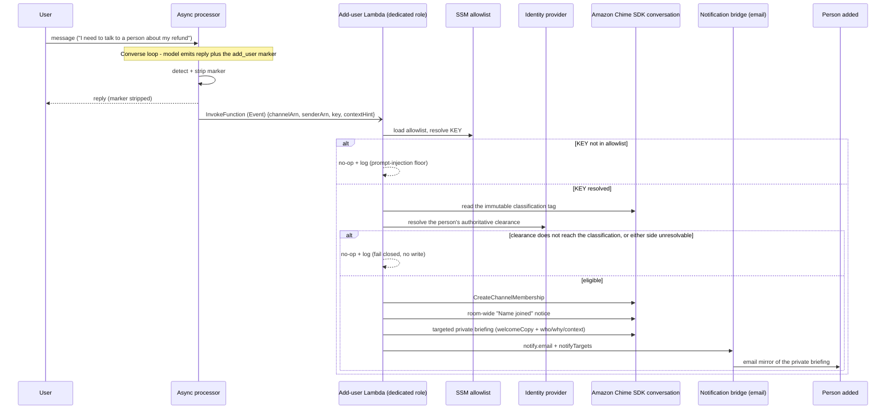

# SPEC: Add a user to a conversation (eligible-member invite and assistant escalation)

**Status:** DESIGN (not yet built).

**Coverage:** none - design only; the escalation path is not built.

**Related:** [SPEC-WELCOME-AND-CONTEXT.md](../assistants/SPEC-WELCOME-AND-CONTEXT.md) - the welcome composition pattern this reuses. [SPEC-NOTIFICATION-BRIDGE.md](../../communication/SPEC-NOTIFICATION-BRIDGE.md) - the email mirror of a targeted welcome. [SPEC-CONVERSATION-SECURITY.md](./SPEC-CONVERSATION-SECURITY.md) - Layer 6, the membership audit whose checks this runs pre-add rather than post-hoc.

**Site section:** Interaction layer, governance.

---

## Overview

**One eligibility gate serves both ways of adding a person, and neither of them accepts a typed email address.** A human picks from a list of already-registered users whose clearance reaches this conversation; an assistant emits a key that selects one entry from a deployment allowlist. The two differ only in who initiates. Both then run the same check before any write and the same email-with-deep-link delivery, so there is one place where "may this person be here" is decided rather than two that will disagree.

**The model selects a key, never an identity.** A key is a short, charset-safe token drawn from an enumerated set the assistant was shown in its system prompt. It is never an ARN, a subject, an email or a name. The blast radius of any model output, including an injected one, is therefore "add one of the N people this deployment pre-approved", and an invented key resolves to nothing. This generalizes the narrowest possible version of the control - a single hardcoded target - to a small set, and keeps the property that made it safe.

**Eligibility is set membership against an immutable tag, not a comparison of levels.** A classification is a declared set of grants rather than a ladder ([ADR-046](../../../design/decisions/046-classifications-are-a-set-not-a-ladder.md)): the add is allowed when the person's authoritative clearance reaches the conversation's classification, and refused otherwise. The conversation's classification is read from the immutable `classification` tag, because the mutable metadata mirror is writable by members.

**Where the reactive audit guesses, this refuses.** The membership audit is a detective control on the delivered-membership stream and errs toward over-reporting: a member who reaches nothing is flagged as a violation, and a member whose clearance cannot be established, or a conversation whose tag cannot be read, is recorded as an unaudited membership rather than compared against a value nobody read. A pre-add gate is a preventive control, and uncertainty has to send it the other way: an unresolvable classification on either side refuses the add. Both directions are fail-safe for what they are - refusing access is safe, refusing to look is not - which is why the two paths cannot share one helper without the pre-add copy stating its own answer to the unknown case.

**This is the vehicle for handing a conversation to a human.** When an assistant hands a person to someone else - a visitor to a sales rep, a customer to a specialist - the hand-off is this add, and it offers two choices: **add here**, which brings the person into the current conversation, or **start a new conversation**, which opens one through the canonical creator with both people in it. Which choice is available follows from one rule. A conversation's classification is immutable and fixes its audience, so add here is offered only when the person's clearance reaches the current conversation's classification. A hand-off that needs a different classification always starts a new conversation at that classification, linked to the current one by a resource tag on the new channel naming it, and seeded only with content the new conversation's audience may read. Nothing is carried across by reclassifying, and the current conversation's history is never copied whole into a wider audience.

**The person can come from any declared issuer.** An allowlist entry names a person by issuer and subject, and the add resolves that pair through the `Identities` index to the person's AppInstanceUser, which is the only identity the add uses. Clearance then resolves through `ClearanceSource` and the email address through `Directory`, each keyed by that AppInstanceUser, so a person from a second pool or an OIDC issuer is handled by the same path as a person from the deployment's own pool. A subject with no `Identities` row, a person who has never signed in, resolves to nothing and the add refuses.

**The membership write does not live on the turn path.** It runs in a dedicated Lambda with a scoped role, reached by fire-and-forget invoke, so the async-processor role gains one `lambda:InvokeFunction` statement and no Amazon Chime SDK membership permission at all.

## Business Problem

A team wants to bring the right person into a conversation - an eligible colleague, an approver, a routed support or sales specialist - and wants the assistant to be able to do it when a request has run past what it can resolve alone. What they will not accept is that becoming a way to leak the conversation to someone who should not see it, which is exactly what a free-text email field is: any address, no entitlement check, an invite sent. The alternatives are an invite flow that emails a link to any typed address with no entitlement check, or building the eligibility gate and the prompt-injection defenses around member-adds in-house. A customer needs the person added to be entitled to this conversation before the invite exists, and needs that to hold whether a human or a model asked for it.

## Personas

Personas are defined in [PERSONAS.md](../../../overview/PERSONAS.md) and are not redefined here. Four of them meet this capability, and the assistant meets it as a system actor rather than as a user of any surface.

### End user

**How this relates to them:** this is the everyday "bring a colleague in" action, and the change they notice is that they choose from a list instead of typing an address. They also receive the outcome when the assistant escalates on their behalf, which is a person arriving rather than being told to go find one.

| What they need | Requirement |
|---|---|
| Add a colleague by picking them, with only eligible people offered and the reason stated inline | FR1 |
| Never be able to invite someone who could not open the conversation | FR7, FR8 |
| A person brought in rather than a referral out of band when the assistant runs out of room | FR3 |
| The person who arrives already knowing who is asking and why | FR12 |
| A hand-off that either adds the person here or starts a new conversation, never one that widens who can read this one | FR18, FR19 |

### Admin / operator

**How this relates to them:** they answer for who is in which conversation, and an assistant that can add people is a membership mutation they did not perform. So the record of every completed add matters more to them than the refusals do, and the capability has to be off until they turn it on.

| What they need | Requirement |
|---|---|
| Every completed add on the same review surface as a reactive membership finding, not only in logs | FR14 |
| The capability inert and invisible to the model until a deployment configures it | FR15 |
| Confidence that a repeated marker cannot page a human by email once per turn | FR13 |
| A refusal that creates nothing at all, rather than a half-add to clean up | FR7 |

### AI developer

**How this relates to them:** they own the allowlist and the guidance that tells an assistant when each entry applies, so the behavior is configuration they author rather than code. What they must not be able to do is widen the blast radius by writing a better prompt.

| What they need | Requirement |
|---|---|
| Declare which people an assistant may bring in, and when, as configuration, from any declared issuer | FR15, FR16, FR20 |
| Copy that tells the added person why they were brought in | FR12 |
| An assurance that the guidance they author cannot introduce a new identity | FR3, FR6 |
| A declared floor in the allowlist that can never raise a person above their real clearance | FR10 |

### Platform developer

**How this relates to them:** most of this capability is reuse, and the value of the document to them is the honest delta - which primitive is already exported and shared, which is module-private, and which one inverts its answer to an unknown value when it crosses from a detective control to a preventive one.

| What they need | Requirement |
|---|---|
| The membership write isolated in its own role rather than added to the turn path | FR5 |
| One source of truth for "what classification is this conversation, and what does this person reach" | FR8 |
| A chain test that proves the refusal paths, not only the success path | FR17 |

### The assistant (system actor)

**How this relates to it:** bringing in a pre-approved human is one of the behaviors the assistant performs as itself ([PERSONAS.md](../../../overview/PERSONAS.md), system actors). It signals intent and nothing more: it does not perform the write, does not choose the identity, and cannot learn who the keys resolve to.

| What it needs | Requirement |
|---|---|
| A way to signal an escalation from inside its reply, stripped before a person sees it | FR3, FR4 |
| Guidance describing when each key applies, injected at prompt assembly | FR16 |
| To pass context forward without that context being trusted as instruction | FR11 |

## Functional Requirements and Acceptance Criteria

**Priority is a keep-or-cut decision set against what the field expects, not against how interesting the work is.** `Table stakes` means a deployment without it is behind. `Differentiator` is worth the cost because few platforms do it. `Gap - prioritize` marks a requirement whose absence puts this below comparable systems. `Above bar - optional` is more than the field asks and can wait. `Optional - attach instead` should be bought rather than built. `Enabler` is not user-visible and is what makes another row affordable.

| # | Requirement | Priority | Delivered | Validated by |
|---|---|---|---|---|
| FR1 | The human-initiated add is a list of eligible, already-registered users rather than a free-text email field, with an inline note that only eligible users appear | Table stakes | No | none |
| FR2 | The eligible-user list is computed where the request is served and returns only the eligible set, so the full directory never reaches the client, and the server re-verifies eligibility before any write rather than trusting the list it sent | Table stakes | No | none |
| FR3 | The assistant signals an escalation with a marker naming an allowlist key, never an ARN, subject, email or name, and the key is validated against the allowlist inside the dedicated Lambda rather than trusted from the marker | Differentiator | No | none |
| FR4 | At most one add-user marker is honored per turn; extras are ignored | Enabler | No | none |
| FR5 | The membership write runs in a dedicated Lambda with a scoped role, and the async-processor role gains one `lambda:InvokeFunction` statement and no Amazon Chime SDK membership permission | Enabler | No | none |
| FR6 | The marker is removed from the reply text before the message is sent, so it never persists in stored content | Table stakes | No | none |
| FR7 | Eligibility is verified before any write, and an ineligible result creates nothing at all - no membership, no notice, no email | Table stakes | No | none |
| FR8 | Eligibility is set membership: the add is allowed only where the person's authoritative clearance reaches the conversation's classification, read from the immutable `classification` tag and never from mutable metadata | Table stakes | No | none |
| FR9 | An unresolvable value on either side of the check refuses the add rather than defaulting: an unreadable conversation tag and an unresolvable person both block | Table stakes | No | none |
| FR10 | The allowlist's declared `role` is a floor the deployer asserts, never a grant: a person whose authoritative clearance does not reach the declared role is refused, one whose clearance reaches it but differs from it is allowed and the difference is logged as configuration drift, and the declared value never gives anyone a classification their real clearance does not reach | Differentiator | No | none |
| FR11 | The model-influenced context passed with the marker is untrusted: length-capped on ingest, markup-stripped, and rendered as quoted context only, never as identity and never as an instruction | Table stakes | No | none |
| FR12 | The added person gets a room-wide join notice and a targeted private briefing naming who is asking, why, and the running context, mirrored to email, and every messaging step past the membership write is best-effort so a greeting failure never leaves a half-add | Table stakes | No | none |
| FR13 | A person who is already a member is handled idempotently, and a marker repeated across turns is bounded by a per-conversation, per-key cooldown so a re-escalation cannot re-page them by email every turn | Table stakes | No | none |
| FR14 | Every completed add emits an audit record naming who initiated, who was added, the key, the conversation and the resolved classification, reaching the same review surface as a reactive membership finding | Table stakes | No | none |
| FR15 | Absent or malformed configuration disables the capability: no guidance is injected, the model never learns the keys exist, and a marker cannot produce an add | Table stakes | No | none |
| FR16 | The keys and the conditions each applies under reach the model through system-prompt assembly and nowhere else, and the rule that at most one key may be emitted and never a raw identity is fixed persona text rather than configuration | Enabler | No | none |
| FR17 | A chain test proves marker to eligibility to add to welcome, and proves each refusal separately: the ineligible person, the unresolvable classification on either side, the already-member cooldown, and the audit record on success | Enabler | No | none |
| FR18 | A hand-off offers two choices, add here or start a new conversation, and starting a new conversation goes through the canonical creator with the requester and the added person as members | Table stakes | No | none |
| FR19 | Add here is offered only when the person's clearance reaches the current conversation's classification. A hand-off to a different classification starts a new conversation at that classification, tagged with the current channel's ARN as its link and seeded only with content its own audience may read | Table stakes | No | none |
| FR20 | An allowlist entry may name a person from any declared issuer; the add resolves `(issuer, subject)` through the `Identities` index to an AppInstanceUser, resolves clearance through `ClearanceSource` and the address through `Directory`, and refuses a subject with no row | Table stakes | No - the add path is not built. The pieces it resolves through exist: the `Identities` index (`backend/lambda/src/lib/person-identity.ts`) and per-issuer clearance through `Directory.clearanceOf`, which the membership audit reads (`memberClearanceOf`, `backend/lambda/src/membership-audit.ts`) | none |

**Reading the "Validated by" column.** Backend unit tests live in `backend/test/`, with the shared-library ones under `backend/test/lib/`; end-to-end specs live in `tests/e2e/` and are listed against their phase in [e2e-coverage-matrix.md](../../../reference/e2e-coverage-matrix.md); the admin console's Vitest suite lives under `frontend/packages/admin/src/`. The status in brackets is what a test does, which matters more than that it is green: **behavior** executes the code path and asserts on the result, **source text** asserts that a convention still appears in the source, and **none** means no test exists. Every row here reads `none`, which is the expected answer for a document nothing implements, and FR17 exists so that stops being true in one step rather than gradually.

**Where the deny-tests have to land.** Tenet P4 asks for isolation proven by deny-test rather than by review, and this design has four boundaries that only a refusal can demonstrate: an unknown key producing no write (FR3), an ineligible person producing no write (FR7), an unreadable classification producing no write (FR9), and the async-processor role being unable to write a membership at all (FR5). A chain test that only proves the success path would leave every one of those unproven while reading as coverage.

**OPEN:** whether the eligible-user list fully replaces free-text email entry or coexists with it. An address may find a record inside one issuer's directory, and the match still resolves through `Identities` to an AppInstanceUser before any write; it never binds or creates an identity. A person not yet known to the deployment is reached by an invitation, which is a different path with a different gate.

**OPEN:** directory privacy on the eligible-user list - who may see whom, whether existing members and unapproved accounts are excluded, and how the listing pages for a large pool.

**OPEN:** which bearer authorizes the membership write on an ordinary conversation. The design assumes the assistant that owns the conversation is a moderator of it, which holds for conversations that assistant created and is unverified for a pre-existing one it was merely added to. If it does not hold, the write needs an admin `AppInstanceUser` bearer instead, and that choice has to be made and recorded before build rather than discovered as an authorization error.

**Any declared issuer is eligible (FR20).** An entry naming another issuer resolves through `Identities` and that issuer's `ClearanceSource` like any other. The clearance lookup this design reuses already does so: `resolveMemberClearance` in `backend/lambda/src/membership-audit.ts` asks `Directory.clearanceOf`, which finds the person's subjects through `Identities` and asks each issuer's clearance source. **NOT BUILT:** the add path that would call it.

**OPEN:** whether an approval step belongs in front of an assistant-initiated add. The design has none: the deployer's act of configuring the allowlist is the approval, and every completed add is reviewable after the fact.

## Non-Goals - Out of Scope

| Out of scope | Why | Where it is covered instead |
|---|---|---|
| Bringing in an external person who holds no account in this deployment | A different identity path with a different boundary: an external token is verified and bounded by its issuer rather than a registered clearance being read | [SPEC-FEDERATED-PARTICIPANTS.md](./SPEC-FEDERATED-PARTICIPANTS.md) - the external-identity seam and the classifications applied to it |
| Removing a member | This capability only adds. The dedicated role carries no `chime:DeleteChannelMembership`, so removal is not an omission that a wider grant would fix | [SPEC-CONVERSATION-ARCHIVE-AND-MEMBERSHIP.md](../conversation/SPEC-CONVERSATION-ARCHIVE-AND-MEMBERSHIP.md) - leaving and removal, and the moderator gate on each |
| Creating a conversation inside the add-user Lambda | An add here lands in the conversation the turn is already in, and the role carries no `chime:CreateChannel`. The start-a-new-conversation choice (FR18) calls the canonical creator, which owns creation and its classification checks | [SPEC-CONVERSATION-TYPES.md](../conversation/SPEC-CONVERSATION-TYPES.md) - how a conversation comes into being and what sets its classification |
| Reclassifying a conversation so someone becomes eligible | The classification is set once at creation and is immutable, because every live decision reads that tag. The classification is not negotiable by the thing it bounds | FR19 starts a new conversation at the classification the hand-off needs; [SPEC-CONVERSATION-SECURITY.md](./SPEC-CONVERSATION-SECURITY.md) - the immutable tag, the audience rule and the layered model built on them |
| Revocation after the fact as the control | The reactive membership audit already revokes an over-clearance member, and an add that should never have happened has by then delivered an email with a deep link. A pre-add check is the point of this document | FR7 and FR8 run the check before the write; Layer 6 remains the backstop behind it |
| Any identity that comes from the model | The single property that bounds this capability. A resolved identity always comes from configuration, and the model's only contribution is a key from an enumerated set | FR3, and the guardrail appendix |
| A free-text reason or instruction from the model shaping the add | Context passed forward is quoted, capped and stripped; it decides nothing | FR11 |
| Resolving a person from a system of record at add time | A later extension, and it does not change the gate: whatever a connector resolves still has to clear eligibility before any write | Appendix F - the forward-looking cases |

## User Experience Description and Mocks

Four people experience this, in this order.

### The end user adding a colleague

1. **Open the add-a-user control** and find a list rather than a text field, with a note saying only users eligible for this conversation appear (FR1).
2. **Pick a person.** There is no way to reach someone who is not on the list, which is the same thing as saying there is no way to invite someone who could not open the conversation (FR2).
3. **They arrive by email.** The existing invite with its deep link is unchanged; the targeted briefing is waiting when they open the conversation from it (FR12).

### The end user who asked for a person

1. **Ask for help.** "I need to talk to a person about my refund."
2. **Read an ordinary reply.** Nothing in it reveals that an escalation was signaled: the marker is gone before the message is sent (FR6).
3. **See someone join.** A room-wide notice names them. What the user does not have to do is repeat the problem, because the briefing the new arrival gets carries who asked, why, and the running context (FR12).

### The person brought in

1. **Receive an email** mirroring the private briefing, with a deep link into the conversation (FR12).
2. **Open it and read one message only they can see**: the deployment's copy for why this kind of escalation happens, then who is asking, the quoted context, and what the conversation has been about.
3. **Be briefed once.** A repeated escalation does not re-page them, because the cooldown suppresses the duplicate welcome and its email (FR13).

### The operator reviewing it later

1. **Open the membership review surface** and find assistant-initiated adds beside reactive findings, each naming who initiated, who was added, the key, the conversation and the resolved classification (FR14).
2. **See successes, not only violations.** The reactive audit records what went wrong; this records what happened, because an assistant that brings people into conversations has to be reviewable rather than silent.

**OPEN:** this document carries no mocks. The candidate is the eligible-user list in the chat client's add-a-user control, which is where the human-initiated half becomes visible and is the part a reviewer would most want to see before it is built.

## Related Documents

- [SPEC-WELCOME-AND-CONTEXT.md](../assistants/SPEC-WELCOME-AND-CONTEXT.md) - the welcome composition pattern: static, targeted, "only you can see this message"
- [GUIDE-ASSISTANT-CONTEXT.md](../../../guides/developer/GUIDE-ASSISTANT-CONTEXT.md) - where system-prompt guidance and welcome copy live
- [SPEC-NOTIFICATION-BRIDGE.md](../../communication/SPEC-NOTIFICATION-BRIDGE.md) - the email mirror of a private welcome, and how an address is resolved at send time rather than stored
- [SPEC-CONVERSATION-SECURITY.md](./SPEC-CONVERSATION-SECURITY.md) - Layer 6, the membership audit whose checks this runs pre-add
- [SPEC-FEDERATED-PARTICIPANTS.md](./SPEC-FEDERATED-PARTICIPANTS.md) - the path for a person with no account in this deployment
- [ADR-046](../../../design/decisions/046-classifications-are-a-set-not-a-ladder.md) - why eligibility is set membership rather than a comparison of levels
- [PERSONAS.md](../../../overview/PERSONAS.md) - the canonical definitions of the personas above, and the assistant as a system actor
- [TENETS.md](../../../overview/TENETS.md) - tenet P4 for the layered, deny-tested gate, tenet D8 for why almost all of this is reuse, and tenet D11 for why the key is a token the platform wrote rather than a phrase a model said

## Appendix A - Shape at a glance

```
model turn (async processor)
  emits  <!--add_user:KEY-->  in its reply text
        │
        ├─ processor detects + strips the marker and fire-and-forget invokes a
        │  DEDICATED add-user Lambda (Event), exactly as it invokes the battle
        │  orchestrator today
        ▼
add-user Lambda (dedicated role: membership-write scoped)
  1. resolve KEY → allowlist entry { issuer, subject, role, welcomeCopy, whenToAdd }
     and (issuer, subject) → Identities → AppInstanceUser ARN  ── no row: refuse
  2. verify ELIGIBILITY BEFORE any write  ── fail closed
  3. CreateChannelMembership into the CURRENT conversation
     (or, for a new conversation, the canonical creator)
  4. room-wide "**Name** joined" notice
  5. member-TARGETED private welcome (welcomeCopy + who/why/context briefing)
  6. email mirror via notify metadata naming the AppInstanceUser ARN
```

## Appendix B - The marker and its lifecycle

The assistant signals an escalation by emitting a marker in its reply text:

```
<!--add_user:KEY-->
```

`KEY` matches `[A-Za-z0-9_-]{1,64}` and selects one entry from the deployment allowlist. The model picks one the same way it picks a work-item id: from a fixed, enumerated set it was shown in its system prompt. Unlike `<!--proposal:-->`, which carries a base64 JSON payload, `add_user` carries only an opaque key, so no encoding is needed.

Precedent markers in `backend/lambda/src/lib/async-processor-core.ts` are `<!--proposal:-->` (work-item confirm cards), `<!--corr:-->` (the turn correlation id), `<!--suggestions:-->`, `<!--battlestats:-->` and `<!--battlewaiting-->`.

1. **Detect.** After the Converse loop returns the reply, the processor tests for `/<!--add_user:([A-Za-z0-9_-]{1,64})-->/`, the same shape as its existing test for a proposal marker.
2. **Capture.** The key is handed to the escalation dispatch. At most one is honored per turn (FR4).
3. **Strip.** The marker is removed from the reply before the message is sent (FR6). The stripping primitive itself is not new work: `stripMessageMarkers` in `backend/lambda/src/lib/message-markers.ts` is the canonical, shared declaration and removes every HTML-comment control marker, so a new marker is covered by it with no change to the stripper. It already runs on the live path where untrusted member-authored text enters a system prompt and at the guardrail boundary where a masked marker could come back, and every non-UI reader - analytics, the relevance judge, the admin conversation browser - strips through it. What is new for `add_user` is applying it to the outgoing reply on the live send path, because the other markers deliberately persist in the stored message and are stripped by the client at render.
4. **Dispatch.** The processor fire-and-forgets a `lambda:InvokeFunction` with `InvocationType.Event` to the dedicated add-user Lambda, passing `{ channelArn, senderArn, key, contextHint }`, mirroring how it invokes the battle orchestrator, so the user-facing turn never blocks on the add. `contextHint` is the only model-influenced field and is untrusted (FR11).

## Appendix C - Configuration surface

The allowlist mirrors the onboarding-intake configuration plumbing one for one.

| Concern | onboarding-intake (existing) | add-user-allowlist (proposed) |
|---|---|---|
| Inline env | `ONBOARDING_INTAKE` | `ADD_USER_ALLOWLIST` |
| SSM parameter name env | `ONBOARDING_INTAKE_PARAM` | `ADD_USER_ALLOWLIST_PARAM` |
| SSM key | `/agent-echelon/assistant/{classification}/onboarding-intake` | `/agent-echelon/assistant/{classification}/add-user-allowlist` |
| Loader | `loadIntakeConfig(ssmGet)` - cached warm, null when absent or malformed | `loadAddUserAllowlist(ssmGet)` - same contract |
| Default | absent means onboarding off | absent means escalation off |

The configuration is a JSON object keyed by key:

```jsonc
{
  "escalations": {
    "billing-lead": {
      "issuer": "staff-pool",
      "subject": "a1b2c3d4-0000-4444-8888-aaaabbbbcccc",
      "role": "standard",
      "welcomeCopy": "You've been brought in on a billing question the assistant couldn't resolve. The customer is waiting.",
      "whenToAdd": "The user has a billing dispute, a refund request over the self-serve limit, or explicitly asks to speak with a human about their invoice."
    },
    "security-oncall": {
      "issuer": "corporate-oidc",
      "subject": "d4c3b2a1-1111-4444-8888-ccccbbbbaaaa",
      "role": "premium",
      "welcomeCopy": "You've been paged into a conversation flagged as a possible security concern. Review the context before replying.",
      "whenToAdd": "The user reports a suspected account compromise, a data-exposure concern, or anything that reads as a security incident."
    }
  }
}
```

- **`issuer` and `subject`** name the person as one declared issuer knows them: `issuer` is the issuer's id in the deployment's issuer declaration, and `subject` is the subject claim that issuer declares. They come from configuration and resolve through the `Identities` index to the person's AppInstanceUser, which is the only identity the add uses. A pair with no row refuses the add. The issuer declaration (the trusted-issuer registry, `backend/lib/config/issuers.ts`) and `Identities` (`backend/lambda/src/lib/person-identity.ts`) exist; **NOT BUILT:** the allowlist that names a person by them.
- **`role`** is the declared floor the deployer asserts about the entry (FR10). It is not what decides eligibility.
- **`welcomeCopy`** is deployment-authored copy prepended to the targeted briefing.
- **`whenToAdd`** is the natural-language condition under which this key applies, rendered into the system prompt.

At system-prompt assembly the loader renders one line per entry:

```
- To bring in help for <role>: emit <!--add_user:KEY--> when <whenToAdd>.
```

This is the only place the keys are surfaced to the model. That at most one marker may be emitted, only a key from this list, and never a raw identity, is fixed persona text rather than configuration. Absent an allowlist nothing is injected and the capability is invisible to the model (FR15, FR16).

## Appendix D - The add flow

The add, email and welcome mechanics are the existing federated add-member sequence unchanged: verify the person is eligible, add them with `CreateChannelMembership` (which triggers the email deep-link invite), and deliver the targeted welcome as a persistent `Target`-scoped message they see when they open the conversation from the link. This capability adds two things on top: the trigger, and the pre-add eligibility filter. The ordered steps are that reused flow, stated in full for the assistant path.

1. **Resolve the key.** Load the allowlist, warm-cached. An absent key is a no-op with a log entry: an invented key resolves to nothing, which is the prompt-injection floor.
2. **Verify eligibility before any write.** Ineligible is a no-op; nothing is created. An unresolvable classification on either side is a refusal, not a default.
3. **`CreateChannelMembership`** for the resolved person into the conversation named in the event. `ConflictException` is treated as already a member and is idempotent.
4. **Associate the channel flow** if it is not already associated, best-effort, so the new member's messages route like anyone else's.
5. **Room-wide join notice:** a message visible to everyone, `**Name** joined this conversation`.
6. **Targeted private briefing:** a message with `Target` set to the new member and "only you can see this message" framing, composed from `welcomeCopy` plus **who** (the requesting user's display name, best-effort, degrading to "A user"), **why** (the quoted `contextHint`, capped and stripped, rendered as context and never as an instruction) and **context** (the running conversation summary, best-effort). Every section is guarded, so missing data omits a line rather than blocking.
7. **Email mirror:** the briefing carries notify metadata naming the added person's AppInstanceUser ARN, and the notification bridge resolves the address through `Directory` at send time rather than storing it.
8. **Audit the successful add** with a structured record naming who initiated, who was added, the key, the conversation and the resolved classification, on the same review surface as a reactive membership finding.

Every messaging step past the membership write is best-effort and non-fatal: a greeting failure must not leave the person half-added with no notice recorded.

## Appendix E - Guardrails

These are the load-bearing controls. The capability is only safe because of them.

### The model picks a key, never an identity

The assistant selects a key from an enumerated allowlist. It never emits an ARN, subject, email or name that becomes an identity. The blast radius of any model output, injected or not, is bounded to "add one of the N people this deployment pre-approved", and an invented key resolves to nothing.

### Eligibility is verified before the add, and fails closed

The add is refused unless the person's authoritative clearance reaches the conversation's classification. The conversation's classification is the immutable `classification` tag; the metadata mirror is non-authoritative because a member can write it. The person's clearance is resolved through `ClearanceSource` for their AppInstanceUser, which reads their groups from whichever issuer signed them in.

The predicate is the one the membership audit already uses, `isClassificationViolation` in `backend/lambda/src/membership-audit.ts`, which asks whether the clearance *reaches* the classification rather than whether it outranks it. That matters beyond tidiness: two peer classifications that grant only themselves are not ordered, so a person cleared for one is not "below" the other, and a comparison of levels would report no violation while the leak stood.

**Directionality is a property of what the shipped classifications declare, not of the axis.** The three this repo ships nest, so a `standard` person reaches a `basic` or `standard` conversation and not a `premium` one. A deployment is free to declare classifications that do not nest, and the same set-membership check is still the right question.

**Two readings of a person's clearance exist and their roles are distinct.** The identity provider's groups are authoritative and alone decide eligibility. The allowlist's `role` is a floor the deployer asserts about the entry. Configuration drift resolves definitely rather than ambiguously: a clearance that does not reach the declared role means the floor is unmet and the add is refused; one that reaches it but differs is allowed, the person simply holds more than declared, and it is logged as drift. The declared value never gives anyone a classification their real clearance does not reach.

**Unresolved is a hard refuse.** An unreadable conversation tag and an unresolvable person both block. This is the opposite of what the reactive audit does with the same uncertainty, deliberately: the audit records a member whose clearance it cannot establish, and a conversation it could not read, as an unaudited membership rather than acting on either, because over-reporting is safe for a detector and guessing is not. As a pre-add check, the audit's answers would be fail-open in one direction and fail-closed in another, so the pre-add path states its own: unknown blocks.

### No cross-classification escalation

Implied by the above: an add can never place a person in a conversation their clearance does not reach. The conversation's classification is the boundary, and it cannot be changed to accommodate the add.

### Every completed add is audited, not only the refusals

The reactive audit records violations. This records successes, because a membership mutation is exactly what that audit exists to track and an assistant-initiated add is a mutation nobody performed by hand.

### Failure modes

| Situation | Behavior |
|---|---|
| Marker emitted, key not in the allowlist | No-op and log. No add, no message. |
| Marker emitted, allowlist absent or malformed | The loader returns null, the capability is disabled, no-op and log. |
| Configuration present but an IAM grant missing | The Amazon Chime SDK, SSM or identity-provider call throws, and the path fails closed with no partial add; the error is logged. |
| Person is already a member | `CreateChannelMembership` raises `ConflictException`, the add is skipped, and the targeted briefing is optionally re-posted under a deployment toggle so a re-escalation still briefs them; never a duplicate join notice. The re-post carries the email mirror, so it is gated behind a per-conversation, per-key cooldown - one add per turn does not bound a marker repeated across many turns, which would otherwise re-page by email every turn. |
| Eligibility check fails, or the person cannot be resolved | No-op and log. An unresolvable person is ineligible, never "allow". |
| Briefing or summary lookup fails | Degrade to a simpler welcome; never block the add. |

### Configured-and-live checklist

For a given classification, escalation is live only when all four line up. If any is missing the capability is inert, which is the intended default.

1. **The SSM allowlist exists** and holds valid JSON with at least one entry.
2. **The system prompt renders the guidance** for each key, or the model never emits the marker.
3. **The dedicated Lambda's role carries** the scoped membership-write, SSM and identity-provider grants, and the async-processor role carries `lambda:InvokeFunction` on the add-user Lambda and nothing more.
4. **A test proves the chain**, including every refusal path (FR17).

## Appendix F - Dedicated Lambda and IAM

The add path runs in a dedicated Lambda so the async-processor role is never granted membership-write, the same isolation a host's membership function uses. The role is modeled on `ConversationMembershipRole` in `backend/lib/stacks/conversations-stack.ts`, which holds no message send of its own: its join notice and welcome are named to the router (`sayThroughRouter`).

- **Amazon Chime SDK, scoped to `${appInstanceArn}/*`:** `chime:CreateChannelMembership`, `chime:AssociateChannelFlow`, `chime:SendChannelMessage`, `chime:DescribeChannel` and `chime:ListTagsForResource` (read the conversation's immutable classification tag), and `chime:DescribeChannelMembership` (the already-a-member probe). No `chime:DeleteChannelMembership`: this path only adds. No `chime:CreateChannel`: it adds into an existing conversation.
- **SSM `ssm:GetParameter`:** the per-classification assistant ARN that bears the membership write, and the allowlist parameter.
- **The `Identities` read, `ClearanceSource` and `Directory`:** resolve the entry to an AppInstanceUser, the added person's authoritative clearance, and the requester's display name for the briefing. With the shipped Cognito adapter these are `cognito-idp:AdminListGroupsForUser` and `AdminGetUser`, scoped to the declared pools.
- **Bearer identity:** the per-classification assistant's `AppInstanceBot`, matching how the classification processors already scope their Amazon Chime SDK grants. Whether that assistant is a moderator of an arbitrary pre-existing conversation is the third **OPEN** above.

The async-processor role gains exactly one new grant: `lambda:InvokeFunction` on the add-user Lambda, the same shape as its existing battle-orchestrator invoke, plus the environment variable carrying the ARN. It gains no Amazon Chime SDK membership permission.

## Appendix G - Sequence



## Appendix H - Build delta

These primitives exist and are reused as-is or as close templates:

- The marker embed, detect and strip lifecycle in `backend/lambda/src/lib/async-processor-core.ts`, and the canonical stripper `stripMessageMarkers` in `backend/lambda/src/lib/message-markers.ts`, which already covers any new HTML-comment marker without a change.
- Fire-and-forget dedicated-Lambda invoke from the processor, as it invokes the battle orchestrator.
- The add-member sequence in a host's add (`membershipHandler`, `backend/lambda/src/conversation-management.ts`): `CreateChannelMembership` and `AssociateChannelFlow`, with the join notice and the welcome named to the router (`sayThroughRouter`) rather than sent by the handler's own role.
- The per-classification SSM configuration loader and stack wiring pattern in `backend/lambda/src/lib/onboarding-intake.ts` and `backend/lib/stacks/assistant-profile-stack.ts`.
- A scoped dedicated-Lambda membership-write role, `ConversationMembershipRole` in `backend/lib/stacks/conversations-stack.ts`.
- The conversation-classification read: `readChannelClassificationTag` in `backend/lambda/src/lib/channel-classification.ts` is already extracted and exported, and already returns `undefined` rather than a floor when the tag cannot be read.
- The eligibility predicate: `isClassificationViolation` and `classifyMember` are exported from `backend/lambda/src/membership-audit.ts`, and the grant-set question they delegate to lives on the profile registry.

These do not exist and are net-new work:

1. **The marker itself:** the persona instruction that emits it, the detect, capture and strip in the processor, and the one-per-turn guard.
2. **The add-user Lambda.** A host's add-member (`membershipHandler` in `conversation-management.ts`) is keyed to a host's context conversation - it adds into the deterministic conversation the context names, creating it when absent. This path adds a person from any declared issuer, by AppInstanceUser, into the conversation passed to it or into a new one from the canonical creator. So that handler is a template to fork, not a function to call.
3. **The allowlist loader, SSM parameter and stack wiring**, a direct copy of the onboarding-intake plumbing.
4. **Pre-add resolution of a person's clearance.** `resolveMemberClearance` is exported from `membership-audit.ts` and already resolves through `Directory.clearanceOf` for any declared issuer (FR20), so the add path reuses it and keeps one source of truth for "what does this person reach". What the add path must state for itself is the answer to an unresolvable value: the audit records an unresolvable person as an unaudited membership, and a pre-add gate refuses.
5. **System-prompt injection of the per-key conditions**, one line per entry, mirroring how the intent-pack and onboarding configurations already shape prompt behavior.
6. **The async-processor role's `lambda:InvokeFunction`** on the new Lambda, and the environment variable carrying its ARN.
7. **The chain test** (FR17), including each refusal path.
8. **The bearer decision for an ordinary conversation** (the third **OPEN** above), recorded before build rather than discovered as an authorization error.

## Appendix I - Forward-looking cases

The base case matches the eligibility rule stated above. The rest are extensions, and all of them ride the same primitive: the model selects a pre-approved key, and the dedicated Lambda enforces eligibility before any write.

- **Invite a registered person whose clearance reaches the conversation.** The base case.
- **Bring in a named human on a live request** - an account manager or sales engineer the deployment allowlists, so the assistant can pull them in when a request warrants human engagement. The identity still comes from configuration by key.
- **Add a support agent who needs case context at add time.** On add, the agent needs a briefing about the customer, a case number where one exists, and possibly pre-drafted copy to send. This implies the allowlist entry and the briefing payload grow optional fields beyond `{ issuer, subject, role, welcomeCopy, whenToAdd }`. Those are a forward-compatible extension: absent them the flow behaves exactly as it does now, and the loader treats unknown fields as optional so existing configuration keeps validating.
- **Resolve the person from a system of record.** A connector in the workflow resolves the assigned or routed specialist, and that resolution maps to an allowlist key or a dynamically resolved identity. The eligibility gate is unchanged: whatever is resolved still has to clear the check before any membership write.
