# DESIGN: Battle Mode (`/battle`) - Technical Design

**Status:** Partial. The two-version battle (section 1a), the alt as a classification-stack assistant and the router-owned round 2 are built and deployed. The battle e2e ran against a deployment with both sides pinned on 2026-10-27, 20 of 21 passed: two-sided battles, round 2, server-recorded picks, and the alt answering as the alt (B-E10). B-E7, FR10's answer-then-resume round trip, failed that run, and not on routing: the owner's `Target`-ed reply reached the waiting side through Amazon Lex (ADR-041 Appendix A) and `resumeDuelSideIfWaiting` resumed it for the battle's initiator only (dev logs, 2026-10-28 UTC, battle `8c9ef799c8503d0f`). The input guardrail blocked that reply's text, so the side parked again within three seconds, and the test's 5 s state sample missed the resume. B-E7 now sends both members the same text and reads the side's `enteredStateAt`; it has not been rerun. A battle side's per-turn pinned version is unit-tested only. Gated by TWO facts, not one (ADR-049): the classification's `battleCapable` capability (standard and premium out of the box; basic is not capable), and a per-classification runtime setting that is off until an operator turns it on from the Experiments surface. `canRunBattle` asks capability first, so a classification the deployment did not wire can never be switched on. Delivery status per requirement is [SPEC-BATTLE](./SPEC-BATTLE.md)'s, Functional Requirements.

**Coverage:** `tests/e2e/battle.spec.ts`

**Verified by:** `backend/test/lib/battle-turn.test.ts`, `backend/test/lib/battle-outcome.test.ts`, `backend/test/battle-orchestrator.test.ts` - the per-side turn, the outcome binding and the exactly-once round 2, which are the three mechanisms this document exists to describe; `backend/test/lib/a-duel-side-serves-its-pinned-version.test.ts` and `backend/test/lib/an-experiment-turn-serves-its-version.test.ts` - a side serves its pinned version through its routes, with no model forced beside it; `backend/test/a-shared-service-only-speaks.test.ts` - the router re-resolves a round-2 side and drops a forged payload version. The full inventory is in section 7.

**Related:** [SPEC-BATTLE.md](./SPEC-BATTLE.md) - what Battle Mode is for, its requirements, its personas and what it refuses to be. This document is the mechanics only. [DESIGN-EXPERIMENTS-BATTLE-DECISION-LOOP.md](./DESIGN-EXPERIMENTS-BATTLE-DECISION-LOOP.md) owns the experiment's objective, briefing, lifecycle and statistics. [DESIGN-SEPARATE-ASSISTANTS-AND-DELEGATION.md](../assistants/DESIGN-SEPARATE-ASSISTANTS-AND-DELEGATION.md) owns the role-and-assistant model the alt belongs to.

**Site section:** Interaction layer, quality.

> Section numbers in this document are cited from source comments (`DESIGN-BATTLE §2a`, `§2b`, `§5`, `§5a`, `§8`). Renumbering a section breaks those citations.

---

## 1. Overview

**Design anchor 1, the turn. A battle turn is a NORMAL turn.**

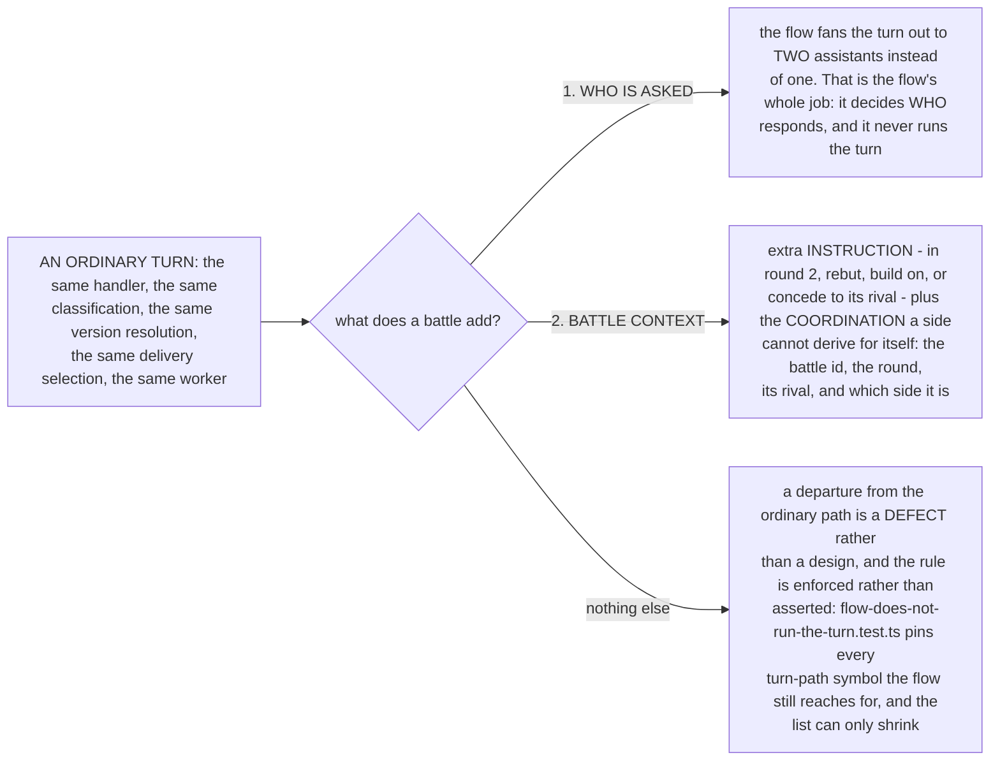

When there is one resolution path there is nothing to diverge, and every battle defect worth the name has been a divergence: an image battle dispatched as text, or a keyword-classified profile still paying for a model call. **Design anchor 2, the variant:** a battle introduces no parallel persona infrastructure, because the alternative assistant is the **treatment variant of an existing A/B experiment**, surfaced as a real Amazon Chime SDK channel member. Routing that picks one variant stochastically instead fans out to both, reusing the machinery that powers A/B testing.

### 1a. The alt is an ordinary assistant

A battle compares the two versions every experiment compares ([DESIGN-EXPERIMENTS-BATTLE-DECISION-LOOP](./DESIGN-EXPERIMENTS-BATTLE-DECISION-LOOP.md) §3.5, [SPEC-BATTLE](./SPEC-BATTLE.md) FR11): the control is the live assistant's active version, pinned by number when the experiment is armed, and the treatment a candidate derived into the alt's history. Each side serves its version as any turn does, per-intent routes included, under its own identity. A battle side is named from its profile, never by an alias on the experiment (`battleSideNames` in `experiment-manager.ts`): the control by its pinned version's `displayName`, else the live assistant's configured name (`ProfileRegistry.displayNameFor`), and the treatment by its version's `displayName`, else the control's. When the two names match, case aside, the treatment's carries the `battleAltName` line from its own version's copy (by default `{name} (alt)`), so the two sides read differently. The alt identity wears the treatment's name while the experiment holds it, the live identity's name never changes for a battle, and the battle's own lines (the placeholder `name=`, the rival's name in a rebuttal, the scorecard) read both sides' names. Built and deployed.

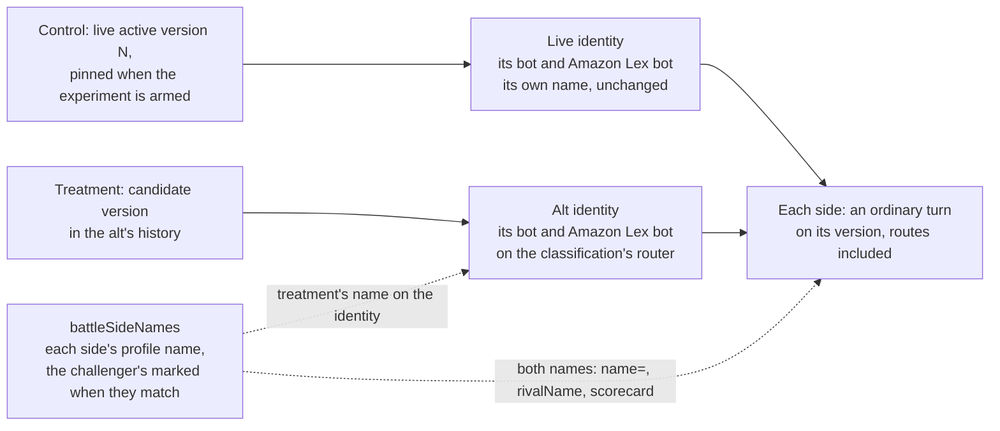

The alt is an ordinary assistant, `alt-{role}-{classification}` ([ADR-050](../../../design/decisions/050-the-alt-is-an-assistant-and-a-conversation-is-enrolled-once.md)). **Arming pins both versions** ([DESIGN-SEPARATE-ASSISTANTS-AND-DELEGATION](../assistants/DESIGN-SEPARATE-ASSISTANTS-AND-DELEGATION.md) §3.7): `controlPin` names the live assistant's active version by number, a reference with nothing published under the live name, and `altPin` names the candidate published in the alt's history, its role's live active body plus the experiment type's recipe. Each pin carries its version's `configId`. In a battle each side serves its version and its turns are archived under its own assistant.

**Ordinary turns serve a version too.** A battle experiment enrolls a conversation like every experiment armed with two versions (`servesVersions`): a conversation created while it runs is assigned an arm once, by a hash of the conversation and the experiment, and every turn of it is served that arm's version whole under the live identity (`enrollmentOf`, `resolveEnrollment`, `pinFor`). No turn is served the alt's version per turn by hash. A turn the alt identity answers outside a battle (a reply targeted at it, a mention) serves the alt's armed candidate.

Each battle-wired classification provisions its own alt as it provisions its live assistants, through its own two provisioners (`attachBattle` in `classification-capabilities.ts`, called by its `Assistants-<classification>` stack on its `attachPoints`): an `AppInstanceBot` named `Alt-{classification}-{role}` and tagged with its classification, its own Amazon Lex bot built by the classification's Lex provisioner and fulfilled by that classification's router, and the `(classification, role, alt)` assignment record naming the bot and its Lex bot id. Each alt has a name applier of its own (`apply-assistant-name.ts`, serving the alt alone), whose ARN is published under the alt's name, so the profile writer can put the treatment's name on the alt identity when an experiment takes the alt (`aeApplyAltAlias`, asked by `admin-experiments.ts` with the alt assignment) and the provisioned name back when it releases it. The alt exists only where the deployment declares `battle`, and declaring it adds the alt and its grants to each battle-capable classification's stack and changes nothing that stack had. The alt joins a conversation without a welcome, because Battle Mode's announcement is the room primary's. A reply a person targets at the alt arrives on its own Lex bot, and the router resolves it from `event.bot.id` against the record, exactly as it resolves any addressed assistant. The Battle stack provisions no assistant.

**A side's turn reads one version.** Each pinned version carries the side's models (base, classifier, per-intent routes, image routes included) and persona addendum (`systemPromptAddendum`), so nothing about the variant rides the turn beside it. The router reads the side's version where any turn reads the version it serves: it classifies with the version's classifier and intent pack, gates task creation by the version's workflow selection, and hands the version to the processor as `variantProfile` with no model forced beside it. The processor answers through the version's own routes and base model (`experimentModelOverride` returns nothing beside a version), so a routed intent answers through its route. The battle context names the battle and both sides' names as `battleSideNames` settles them (`rivalName` for the rival, `selfName` for the side itself), and carries no variant field. The processor titles the side's scorecard column from `selfName` alone (the `name=` of its `<!--battlestats:-->` marker, which the client prefers over the bot's name), never from the served version's own `displayName`: both pinned versions are usually versions of the live assistant, so the unsettled names would title both columns alike, and the settled ones mark the challenger's.

**An image battle runs the whole chain, and its cost is its steps summed** ([ADR-064](../../../design/decisions/064-a-turn-takes-its-model-from-the-intent-and-the-step-it-runs.md) decision 7). `image_generation` is a workflow (gather, confirm, generate, revise), so round 1 of each side runs its chain on its own version's text and image models and ends with an image. Arming refuses a battle whose intent draws an image unless both pinned versions name an image model for it (`battleImageRefusal`, `manage-profiles.ts`, code `BATTLE_SIDE_HAS_NO_IMAGE_MODEL`); A side's scorecard cost is its turn's `steps[]` summed, text and image alike (`summedStepCostUsd`, `analytics-metadata.ts`), shown beside the pick and never blended into it. A battle compares whole chains; comparing one step on a shared brief is not built (ADR-064 decision K).

What each experiment type's recipe puts on the treatment's candidate (the control is the live version as it is):

| Type | The treatment's `modelKey` lands on | Also set when the variant names it |
|---|---|---|
| `intent` | The one model the experiment's `target` names (ADR-064 decision 6): the route's text model by default, its image part (`target.kind: 'image'`) or one step's override (`target.step`); the route's fallbacks, every other route and the base model are the control's | persona addendum, the route's image part |
| `base_model` | `modelKey` and `models.default` | the same |
| `classification` | `models.classifier`; both sides answer on the live base model, so the battle compares the classifier | the same |
| `profile` | the variant's `profileRef` version is the body, intents excepted | the same, laid over it |

**Arming pins both versions in the same request.** When an experiment, battle or not, is created `active` or activated later, the experiments handler asks the profile writer for both pins (`deriveExperimentVersions` in `manage-profiles.ts`, invoked directly), stores them on the variants with `servesVersions`, and only then arms, refusing with the derivation's own reason when it fails. A control variant may leave its model unnamed; one that names a model, an addendum or an image model the live version does not serve is refused (`CONTROL_DIFFERS_FROM_LIVE`). The profile writer stays the only writer of a definition; the derivation takes no patch, so it can publish only what the experiment's variants say. A re-arm reuses a candidate whose version still says the same thing, and an edit of an armed experiment, paused included, keeps its pins. The active cap and the classification conflict are checked before the derivation, so a refused arm publishes no candidate. A battle armed before experiments pinned two versions keeps reading the version its `controlPin` names, a derived version under the live name, until it is paused and resumed, which re-arms it.

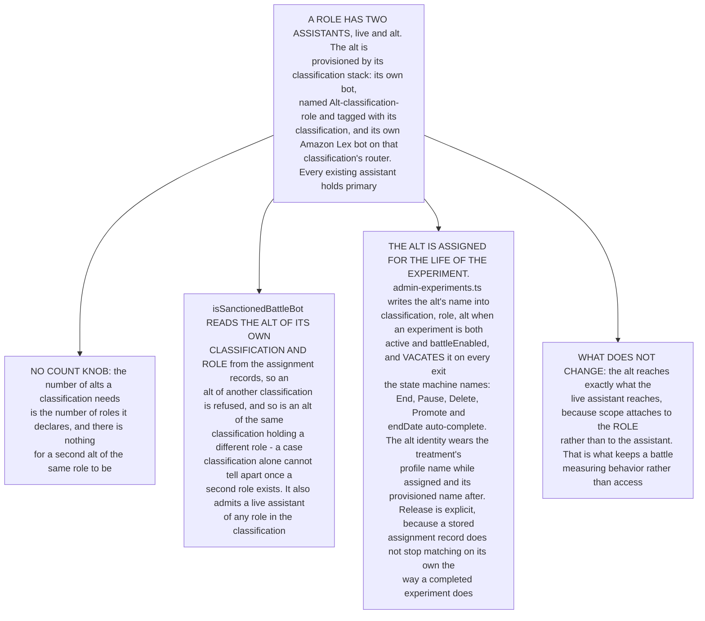

## 2. Architecture

Battle Mode is self-contained within AgentEchelon.

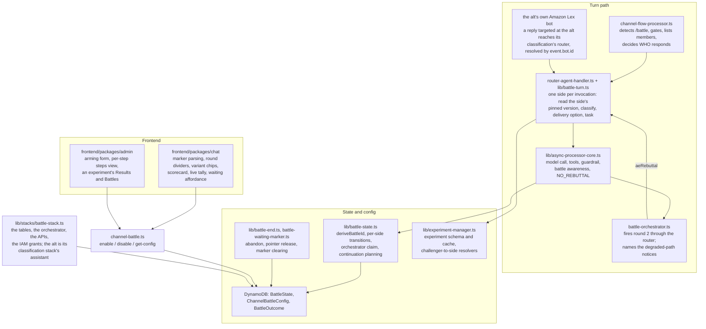

The alt's bot is published in its assignment record, `/agent-echelon/assistant-assignments/{classification}/{role}/alt`, with its Lex bot id; one alt per `(classification, role)` is the record's key. An experiment row names its challenger by assistant id (`challengerAssistant`, `alt-{role}-{classification}`), which must be its classification's alt, and stores no bot ARN: a reader takes the bot from the alt's record. The admin console lists the challengers from those records (`GET /admin/experiments/challengers`). A row of the earlier shape carries `altBotSlotId` and `altBotSlotArn` instead; the readers accept both (`challengerOf`, `challengerBotArnOf`), and every write stores `challengerAssistant` only. The Battle stack creates no alt identity, Amazon Lex bot or roster of its own.

## 2a. Battle and task state

**A battle is not a task.** Certain *intents* are tasks; a battle is a state that lives outside the task concept, and a battle turn completes outside it too. What a battle adds to a turn is additional instruction - rebut, build, concede - rather than a work item to be tracked.

| Concern | Owns | Does not own |
|---|---|---|
| Battle state | which battle, which round, which side, whether that side has produced its round-N response | anything about tasks |
| Task state | whether a work item is open, its state machine, its terminality | anything about battles |

A side's round is complete when **it has produced its response for that round**. If the intent also opened a task, that task proceeds on its own. So the battle row carries no `taskId`, the round-completion gate asks no task question, no predicate defines battle completion in terms of task terminality, and `battle-round1-complete.test.ts` keeps it that way.

**The separation does not let round 2 fire mid-chain** ([ADR-026](../../../design/decisions/026-task-shaped-battle-rounds.md)). A rebuttal of a half-collected report is not a rebuttal, and no prompt can recover what the other side has not produced yet. Waiting for the chain needs no battle-specific predicate, because the state machine already has the word for it: `WAITING_FOR_USER` is non-terminal and `allBotsTerminal` counts only `COMPLETED` and `FAILED`, so the machinery that suspends round 2 for a clarifying question suspends it for a task leg too. **A side mid-chain is busy, not incomplete**, reaching `COMPLETED` when its task reaches a terminal state under the ordinary `shouldMarkTaskCompleted` rule. The handler may still *see* task state; what the separation forbids is battle completion being defined by it.

Finding the task that belongs to a side needs no `taskId` either. The lookup is by OWNER - "the active task owned by this actor in this channel" (`getActiveTaskForOwner` in `task-tracking.ts`, called from `router-agent-handler.ts`) - which is the same question for an assistant in a battle and for a person holding a work item, so one owner field and one index serve both ([ADR-024](../../../design/decisions/024-task-ownership.md)).

**What fires the next round is an out-of-band call, and it cannot be a peer nudge.** Amazon Chime SDK does not deliver a message authored by an `AppInstanceBot` to another `AppInstanceBot`'s Amazon Lex, so a message from one side to the other triggers nothing. This is measured against a control - the identical targeted message from a human invokes the assistant, from a bot it does not - and it is undocumented, since `TargetedMessages: ALL` reads as though any targeted message would be processed. Every candidate trigger is therefore an async Lambda invoke, a stream, or a scheduled re-check, which is what the orchestrator does and what [DESIGN-MULTI-AGENT-ORCHESTRATION](../assistants/DESIGN-MULTI-AGENT-ORCHESTRATION.md) independently chose for sub-agent fan-out. Two constraints belong to whatever carries it: the round-2 claim keys on `(battleId, botArn, round)`, because a redelivered async invocation can fire a side twice; and **a rebuttal degraded by a timeout is recorded as such and stays separable from a genuine no-response**, or a slower variant silently loses its rebuttals and the comparison is biased against the arm being evaluated. Full evidence, and the deferred design that would restore in-channel coordination through a proxy `AppInstanceUser` per assistant, are in [ADR-023](../../../design/decisions/023-battle-round-coordination.md).

## 2a-i. Leaving a battle

Section 2a separates the two concepts by **definition**. This section is about **lifetime**, which is a different question, and a task sits inside a battle: a task-shaped battle is one task per side, running within the battle that compares them.

> Break out of the task and you break out of the battle. Break out of the battle and you break out of the task. There is no state where one continues without the other.

The completion rule looks INWARD and must not read task state to decide whether a round is done. The lifecycle looks OUTWARD: the battle is the container, so it is the thing a person leaves, and its task leaves with it. The code is `lib/battle-end.ts` (`endBattle`), `battle-state.ts` (`ABANDONED`, `duelInFlight`, `isPastDeadline`, `clearActiveBattle`), `battle-waiting-marker.ts`, `channel-moderator.ts`, `channel-flow-processor.ts` (`/battle end` and both ownership-branched refusals), `live-drift-flow.ts`, `channel-battle.ts` (turning Battle Mode off ends the running battle) and `battle-outcome-api.ts` (a pick on an abandoned battle is refused).

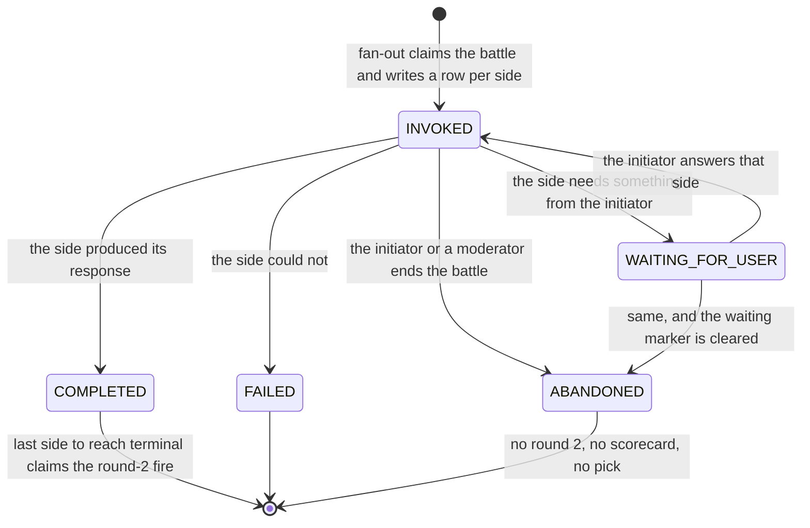

`allBotsTerminal` counts only `COMPLETED` and `FAILED`, so an abandoned row can never satisfy the round-2 trigger. **Round 2 is suppressed structurally rather than by a check a future call site can forget.**

### One owner

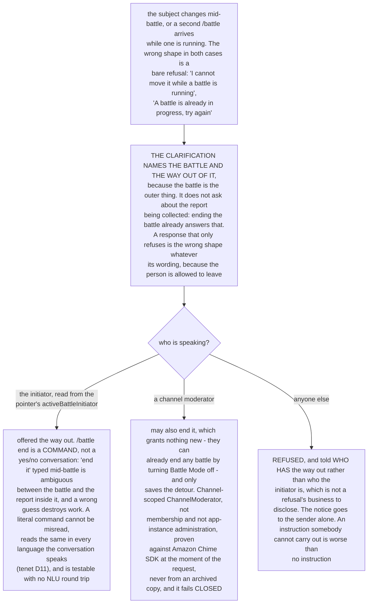

**The refusal is the design rather than a gap to widen later.** A battle any member could end, or restart by launching their own, would leave the assistants taking competing instructions from several people mid-comparison. A head-to-head result is only worth something while both sides answer the same person's question, so the container has one owner for the same reason the comparison has one prompt. Who ended a battle, and when, is retained on the release.

**The initiator is required rather than best-effort.** It is who a waiting side is waiting on, the only person whose reply resumes it, and the only person who may end it, so where it is absent each of those rules degrades to "anyone" and the continuation's owner check skips entirely. **The fan-out refuses to start a battle it cannot attribute**: refusing costs the sender one message, while starting costs the conversation a battle anybody can steer.

### Recorded leaving

A battle a person walks out of ends **abandoned**, and that is written down. With a word for "left unfinished", the TTL is garbage collection again and nothing reads expiry as intent. **Abandoning cleans up more than state:** a side stopped at `WAITING_FOR_USER` holds a question the person can still answer, and its message carries the `<!--battlewaiting-->` marker the chat app renders as the side's live "Reply to this side" control. The abandon path clears that marker the same way a resume does: `endBattle` keeps its DynamoDB steps inline and names each waiting side's marker to the router of the conversation's classification, which checks it against the battle's rows and clears it as that side's assistant (`aeClearMarkers`, `lib/battle-marker-clear.ts`, `clearDuelMarkers` in `router-agent-handler.ts`); when the router itself ends the battle (`endDuelHere`, for an experiment that ended under a battle turn or a rebuttal round) it runs the same checks and clear in place rather than invoking a router, and turning Battle Mode off waits for that before it removes the alt, because a battle that ends removes every affordance that invited the next input, or the transcript keeps asking.

**The one race, and what happens when it is lost.** Round 2 fires from `allBotsTerminal`, so an abandonment arriving after the last side completed can collide with a fire already in progress. The abandon path attempts the orchestrator's exactly-once claim (`tryClaimOrchestratorFire`) to poison a fire that has not started. If that claim is LOST the rebuttal is already dispatched and cannot be recalled; the battle is still recorded abandoned and the pick is still refused, so the comparison contributes nothing even though a round-2 message was produced. This is stated rather than designed away, because the alternative is pretending a distributed claim cannot be lost. **What is excluded from an abandoned battle is the COMPARISON**: round 2, the scorecard, the pick. The pick API refuses an abandoned battle, and that refusal is ordered AFTER the channel-membership check so it cannot be used to probe which battle ids exist. The round-1 turns themselves remain in ordinary exchange telemetry with their ordinary variant attribution: those turns happened, reached the user and cost money, and dropping them would misstate spend, which is a different falsehood from the one being prevented. The reason is measurement rather than tidiness - section 5b sets out what a battle result may claim, and a battle scored as though it finished when it did not is worse than absent data, because absent data is visibly absent while a fabricated round points a recommendation the wrong way.

## 2b. End to end

A battle is the visible end of a chain that starts in an experiment. Reading the fan-out alone hides where its decisions come from, which is how a classification-blind dispatch survived in round 2 while round 1 was fixed: the two ends of this chain were reviewed separately.

```mermaid
flowchart TB
  CFG["ADMIN CONFIGURES AN EXPERIMENT (experiment-manager.ts)<br/>experimentType: intent, base_model, classification or profile<br/>intent, one classification, objective.statement<br/>variants[2]: the control is the live version and may name<br/>no model; the treatment modelKey XOR profileRef;<br/>no name: each side is named from its profile;<br/>systemPromptAddendum?, imageGenModelKey? both or neither<br/>battleEnabled needs a challengerAssistant<br/>longFormMode: one-shot or outline-first<br/>ARMING pins controlPin and altPin"]
  ENABLE["BATTLE IS ENABLED HERE (channel-battle.ts)<br/>ChannelBattleConfig: enabled, experimentId,<br/>challengerAssistant, challengerBotArn, enabledBy<br/>+ briefingStatement, briefingIntent, snapshotted<br/>the alt JOINS as a real member"]
  BRIEF["THE BRIEFING, before any battle runs<br/>'Two assistants will answer the same prompt'<br/>'We are deciding: objective.statement'<br/>'Most useful prompts: coaching line + examples'"]
  FLOW["THE CHANNEL FLOW decides WHO answers, and nothing else<br/>eligibility via canRunBattle, single-active guard,<br/>abuse gate ONCE for the battle as a whole, round-1 claim,<br/>resolves the ROUTER for the channel's classification"]
  H1["side = CONTROL, the live identity<br/>read this side's pinned version<br/>classify with its classifier and pack<br/>delivery option, task if any<br/>NOT metered again"]
  H2["side = TREATMENT, the alt identity<br/>read this side's pinned version<br/>classify with its classifier and pack<br/>delivery option, task if any<br/>NOT metered again"]
  PH["each side POSTS ITS OWN placeholder as its own bot<br/>from the handler entry (ADR-025): 'One moment...'<br/>carrying the correlation and battle markers<br/>and this side's profile name, then returns an<br/>empty messages array; the flow never posts for a side:<br/>a handed-back text is logged, and that side's<br/>processor posts the answer as a new message"]
  PR["THE PROCESSOR, async, per side<br/>model call, tools, RAG, guardrail<br/>resolves its target by the correlation-id<br/>control-table mapping, or a marker scan<br/>UPDATES that same message in place<br/>writes its BattleState row: COMPLETED or FAILED"]
  CLAIM["the LAST side to reach terminal<br/>claims the fire, then dispatches round 2<br/>NOT by messaging the rival"]
  R2["ROUND 2 (battle-orchestrator.ts)<br/>hands each side to the BATTLE'S classification router<br/>(aeRebuttal), which validates the round, re-resolves<br/>the side's pinned version, posts the side's placeholder<br/>and invokes the PROCESSOR with round=2 and the rival's<br/>reply; inherits round 1's recorded intent and carries<br/>a fixed delivery option"]
  PICK["THE HUMAN PICKS<br/>BattleOutcome, experiment_results,<br/>the advisory recommendation"]
  CFG -->|"admin arms it on a conversation"| ENABLE
  ENABLE -->|"broadcast to everyone"| BRIEF
  BRIEF -->|"a member types /battle prompt"| FLOW
  FLOW -->|"one turn per side, through the handler"| H1
  FLOW --> H2
  H1 -->|"posts, then returns"| PH
  H2 --> PH
  H1 -->|"dispatches ASYNC, does not wait"| PR
  H2 --> PR
  PH -.->|"the dispatch precedes the post, so no id is<br/>handed over and the mapping stays load-bearing"| PR
  PR --> CLAIM
  CLAIM --> R2
  R2 --> PICK
```

**Why the handler and the processor are two Lambdas**, since the split is the part most often misread. The handler is synchronous and must answer fast: it decides what this turn IS and returns the placeholder text. The processor is asynchronous and slow: it makes the model call and then **updates the message the placeholder already occupies**, which is why a battle shows one bubble per side that fills in rather than a bubble followed by an answer. The handler dispatches the processor BEFORE the placeholder exists, so it cannot hand over the message id; the processor resolves its own target from the correlation-id control-table mapping, falling back to a marker scan when the mapping has not landed. That is one resolution path instead of two, and it is the same on `@all`.

**Round 2 goes through the router** ([ADR-023](../../../design/decisions/023-battle-round-coordination.md) A-prime). The orchestrator hands each side to the battle classification's router (`aeRebuttal`, `dispatchRebuttalRound` in `router-agent-handler.ts`), which checks the round against the battle state (the fan-out was claimed, the side finished round 1, the battle ran in that conversation, the rival is a side of it), re-resolves the side's pinned version and the rival's name itself (`resolveDuelSides`), posts the side's placeholder on a speak route of its own, records the round and dispatches the processor. Any version, definition, attribution or rival name the payload carries is dropped, so a forged payload is neither served nor granted. The orchestrator is a DISPATCHER and is kept rather than removed, because it still decides the "did not finish in time" notice and the nobody-finished close; it speaks as no assistant, and the router says those two lines as notices the orchestrator names (`battleSideDidNotFinish`, `battleSideDidNotFinishUnnamed`, `battleNoneFinished`). **What A-prime still owes is classification on the turn entry:** a rebuttal runs no classifier, inherits round 1's recorded intent and carries a fixed delivery option, and a non-triggering marker message alongside the dispatch, which would put the coordination in the system of record, is not posted.

### Each side posts its own placeholder

Settled by [ADR-025](../../../design/decisions/025-who-posts-the-placeholder.md). On a bypass entry the turn posts its own acknowledgment as its own bot from the handler entry and returns an empty `messages` array; the Lex path is unchanged and still materializes from the fulfillment return. A side that returns a non-empty `messages` array, because its post failed, is logged by the channel flow (`noteHandedBackMessage`) and nothing is posted for it there; that side's processor finds no placeholder and posts the answer as a new message, and records `reply_undeliverable` only when that send fails too (MESSAGE-FLOW §8.1). The acknowledgment is profile behavior end to end, which is the reason for the decision: the component that decided what the turn is speaks it, and an assistant's author controls it by editing a profile.

What that costs is one grant, and the grant carries its own Deny. `AgentHandlerRole` holds classification-scoped `chime:SendChannelMessage` and `chime:UpdateChannelMessage` through `classificationChannelScopedAllow`, the same helper the processor role uses, which layers the archived-channel read-only Deny automatically because both actions are in `ARCHIVE_DENIED_ACTIONS`; `handler-send-grant-carries-archive-deny.test.ts` pins that the grant only ever goes through that helper, because protection that arrives as a side effect is what disappears quietly when the helper is bypassed. The dispatch is deliberately NOT reordered: the handler still dispatches before it posts, so no `placeholderMessageId` is handed over on `@all` or round 1, and the `corr#` mapping and the marker scan stay load-bearing on every path. Posting first would buy one skipped `GetItem` at the price of reordering every return path, and was priced and declined.

Reply visibility is still derived downstream from the placeholder's own `Target`, because the handler cannot see the inbound message's `Target`.

**The flow does not decide targeting, and on `@all` it sets no `Target` at all.** Both call sites of the mention path pass `broadcast: true`, so the placeholder is untargeted and the reply's tail stays public, which is the intended behavior. The flow's only targeted sends are its own notices - the single-active-battle message and the unwired-router error - addressed to the sender. Visibility is carried by the placeholder and read back downstream rather than decided by whoever posts, and any move of the posting has to preserve that rather than replace it with a caller-passed target.

### What each configuration axis varies

| Axis | Values | What differs between the two sides |
|---|---|---|
| `experimentType` | `intent`, `base_model`, `classification`, `profile` | which population the experiment scopes to; only `intent` has a single target intent, which is why the others brief with a generic prompt line |
| `intent` | one of the shipped intents | the traffic the experiment measures, and the prompt-steering examples users are shown |
| `tiers[]` | exactly one of basic / standard / premium | the classification the experiment runs in; arming refuses any other number (`EXPERIMENT_ONE_CLASSIFICATION`), since an experiment compares two versions of one assistant. Distinct from `battleCapable`, the per-CLASSIFICATION capability deciding whether a deployment wires battles there at all; arming refuses a classification that is not capable |
| variant shape | `modelKey` XOR `profileRef` | the treatment's recipe: one model selection against the live version, or an entire PROFILE VERSION, prompt, tools and guardrail included, intents excepted. Mutually exclusive by validation; the control of a model experiment may name no model, because it is the live version |
| `systemPromptAddendum` | free text, sanitized | a persona difference on the same model, carried on the treatment's candidate; a control's must be the live version's |
| `imageGenModelKey` | set on BOTH variants or neither | the battle produces images rather than text; the treatment's becomes its candidate route's image part (`models.byIntent[<intent>].image.primary`, `image_generation` or the experiment's image intent), and the control's must be the live version's. `target: { kind: 'image' }` with image `modelKey`s writes the same field and is the form ADR-064 names; retiring `imageGenModelKey` is **NOT BUILT** (it is read by battle arming, the router's per-turn grant and the orchestrator) |
| `longFormMode` | `one-shot`, `outline-first` | whether round 1 is the whole deliverable or an approach the person steers between |

**The briefing is semi-blind, and that is a measurement property rather than a courtesy.** It names the decision and never which side is which model, so a picker cannot favor a name they already trust. The side names keep it that way through the battle, because a profile name names no model: the alt identity wears the treatment's name while the experiment holds it, both placeholders carry their side's name as `name=`, and the live identity keeps its own name, which the room already shows for its ordinary turns, so the control side remains identifiable by the identity that posts it; the blindness is in what the names say about the models, not in the members panel. A variant carries no name, and a request that still sends one has it dropped on write. It is snapshotted onto the channel config at arm time (`briefingStatement`, `briefingIntent`), so every member sees the same briefing, including people who join later and non-moderators, who cannot read the experiment itself. Its copy and the prompt-steering table are [DESIGN-EXPERIMENTS-BATTLE-DECISION-LOOP](./DESIGN-EXPERIMENTS-BATTLE-DECISION-LOOP.md) §2.2. Without an `objective.statement` there is no briefing and the announcement stays as it was, so an unbriefed battle degrades to the plain announcement instead of announcing an empty decision.

## 2c. Divergence ledger

A battle is worth what it predicts about production, so every divergence is either paid for or is a defect. This is the ledger, and it is short by design.

| Divergence | Status | What it costs |
|---|---|---|
| The flow decides the turn happens, not Amazon Chime SDK routing | Unavoidable | Nothing. `/battle` is not an Amazon Chime SDK mention value, so nothing else can route it |
| The handler is TOLD which bot identity to answer as | Unavoidable | A battle needs two authors. Priced by validating the identity against the assignment records instead of trusting the caller |
| Round 2 has no user message behind it | Unavoidable | Time to first feedback is undefined and must be null; those rows stay out of its averages (section 5b) |
| One rate-limit and spend charge for the battle rather than one per side | Deliberate | Fidelity, traded knowingly - see "How a battle is metered" in section 5a. Scoped to the flow-DECLARED battle only; a resumed side's turn synthesizes its battle context after the router's metered-upstream check and is metered like an ordinary turn |
| Round 2 runs no classifier | Not aligned | The router takes the round (`aeRebuttal`), but a rebuttal never classifies, so it cannot honor a profile's `classifierMode`, cannot join a classifier experiment, and carries a fixed delivery option. Classification on the turn entry is what ADR-023 A-prime still owes (section 2b) |
| Battle correlation ids are minted rather than derived | Not aligned | The flow's duplicate-placeholder guard keys on the id, so it cannot collapse a duplicated battle delivery; the battle-state claims carry that alone ([ADR-022](../../../design/decisions/022-message-identity-is-established-at-the-channel-flow.md)) |
| A side serves its pinned version | Aligned | Each side answers through its version's routes and base model like any version, with no model forced beside it (section 1a) |
| A battle-only way to ask the user something | Retiring | Into task assignment rather than repair ([ADR-029](../../../design/decisions/029-clarification-is-public-and-answers-get-their-own-placeholder.md)) |

**Two things belong to the intent rather than to the battle side, and do not come back.** The round-1 prompt does not shape the answer: length, structure and how many questions to ask are the intent's, resolved on the ordinary path. And a battle turn opens an ordinary task when its intent is task-shaped, owned by the assistant, rather than a battle-specific category. **The one gap with no home** is the promise that a side will not deflect an explicit request by proposing a new conversation (SPEC-BATTLE FR3). Deflecting an explicit request is wrong on any path, so restoring it as a battle rule would re-create the pattern this section exists to shrink. It belongs wherever "the person asked for this deliberately" is decided, which today is nowhere.

## 2d. User-assigned tasks are the mechanism

[ADR-029](../../../design/decisions/029-clarification-is-public-and-answers-get-their-own-placeholder.md) sets the direction: a side that needs something from a person opens a **task assigned to that person**, and the composer renders the current person's assigned tasks, so a battle question and a report chain waiting on the same person queue together. The substrate that a requester and an owner can differ - which is exactly what an assistant assigning work TO a person is - closes four hazards ADR-024 recorded:

1. **One owner field, one writer.** `assigneeId` and `assigneeType` through `setTaskAssignee`, with `resolveTaskAssignee` reading legacy rows, so "owned by one at a time" is representable and enforced.
2. **The mirror is partitioned by the OWNER at every writer.** `putMirrorRow` is the single creator, and `mirrorTaskStatus` upserts a WHOLE row with `if_not_exists` guards, so a partial row with no `ttl` cannot be created even if a mirror write is lost.
3. **`reassignTask` moves the mirror partition**, deleting the old after putting the new, so a mid-way failure leaves the task findable under both owners rather than neither. It is deliberately unwired, documented as such, and covered, waiting for exactly this caller.
4. **A battle turn calls `createTask` like any other turn**, owned by the assistant, so it is in the same index as everything else.

`getActiveTasksForUser(personId)` is the cross-channel query a queue needs: one constant-cost partition read of the tasks a person currently owns, whichever assistant or workflow handed them over. What the direction still needs is the two ends rather than the middle: a caller that hands a task to the person when an assistant needs something, and a surface that renders what a person owns.

## 2e. Deploy

The two-version battle, the alt provisioned through its classification's provisioners and the router-owned round 2 deploy in one pass, with Battle Mode off for the window. The Battle stack deploys after the classification stacks and the channel flow, which it attaches to, and owns `/assistant-assignments/{classification}/primary/alt`; the routers carry `aeRebuttal`, `aeClearMarkers` and the new notice kinds before a battle runs. Each classification deploy is basic, then standard, then premium, `--diff-only` first.

0. Pre-deploy live checks: `deny-test-assistant-membership.mjs`, `deny-test-tag-key-case.mjs`, and the premium image-version check.
1. Turn Battle Mode off in every conversation and pause armed battle experiments.
2. The classification stacks at the commit that adds the processor role's grants.
3. The classification stacks at the commit that moves the processor to ambient clients.
4. Battle at HEAD: releases the alt assignment names, router-owned round 2, no vend.
5. The classification stacks at HEAD: the processor grant removal, the alt as a classification-stack assistant with the name applier serving it, the notices, the model rule, and two-version serving with routes served as written.
6. ChannelFlow, Conversations, Notifications, Identity, AdminServices, PostProcessing, Experiments and Archive (Aurora mode) at HEAD; the chat and admin frontends through `deploy-frontend.mjs`.
7. Publish premium versions that route `image_generation` to an image model where image generation is used.
8. Resume battle experiments (a pause and resume pins both versions) and turn Battle Mode back on.
9. One e2e pass.

**Step 5 ships a resolver that serves every route as written**, without the floor that raised a route cheaper than the version's base model to that base model. Seeds write each route the floor raised as the model it served, and a standalone greeting and acknowledgment get the route they were answered on, so a freshly deployed version serves what it says. Stored versions are not rewritten; a deployment that holds older versions is torn down and deployed fresh ([ADR-064](../../../design/decisions/064-a-turn-takes-its-model-from-the-intent-and-the-step-it-runs.md) decision 1).

## 3. Data model

**`ChannelBattleConfig`** (DynamoDB) - per-channel enablement. PK `channelArn`; attributes `enabled`, `experimentId`, `challengerAssistant`, `challengerBotArn` (the member its enable added, so disable removes exactly that member), `enabledBy`, `enabledAt`, plus the snapshotted `briefingStatement` and `briefingIntent`. Read at `/battle` time through `isBattleEnabled(channelArn)`, cached, so it is load-bearing at runtime rather than admin-only.

**`BattleState`** (DynamoDB; the table name is generated and published to SSM rather than fixed) - per-side round state. PK `battleId`, SK `botArn`. Attributes: `state` in `{INVOKED, WAITING_FOR_USER, COMPLETED, FAILED, ABANDONED}`, `round1Reply`, `round1MessageId`, `correlationId`, `initiatorUserSub`, `enteredStateAt`, `deadlineAt`, `waitingSince`, `waitedMs`, `clarificationCount`, `waitingMessageId`, and a `ttl`. A sentinel SK (`__orchestrator__`) provides exactly-once round-2 firing.

**The deadline and the TTL are different clocks.** A generating side is due on the machine deadline (`BATTLE_ROUND1_DEADLINE_MS`, 180s) and a side blocked on a person on the user-wait deadline (`BATTLE_USER_WAIT_MS`, 1h), an order of magnitude apart, and the orchestrator reads `deadlineAt` to know which applies. Every row's TTL is the whole-battle bound (`BATTLE_MAX_LIFETIME_MS`, 4 hours by default) plus a grace period, anchored at the write, and no transition shortens it: the rows are read as a set, so a row reaped while a sibling is still legitimately waiting on a person changes the answer to a question about the whole battle rather than losing one leg's evidence. The same whole-battle bound is what the single-active-battle pointer ages out against.

`battleId` derivation is the single source of truth, computed the same way by the channel-flow processor and the async processor (`deriveBattleId` in `battle-state.ts`), where `userMessageId` is the stable Amazon Chime SDK message id of the `/battle` message, so the id is retry-stable:

```
sha256(`${channelArn}:${userMessageId}`).hex.slice(0, 16)
```

**Experiment schema extension** (`experiment-manager.ts`) - the alt to variant binding lives on the experiment row itself; there is no separate binding table, because the existing 60-second experiment cache makes the lookup free. `variants[0]` is control, served by the room's primary; `variants[1]` is treatment, served by the alt.

```typescript
interface ExperimentVariant {
  variantId: string;
  modelKey?: BackendModelKey;    // the recipe's model; mutually exclusive with profileRef (validated); a model experiment's control may omit it
  profileRef?: { profileName: string; version?: number }; // an entire profile version instead
  weight: number;
  systemPromptAddendum?: string; // sanitized; see section 4
  imageGenModelKey?: ImageGenModelKey; // generation-out; set on both variants or neither
  controlPin?: { profileName: string; version: number; configId?: string }; // variants[0]: the live active version, pinned at arm
  altPin?: { profileName: string; version: number; configId?: string };     // variants[1]: the candidate in the alt's history
}
interface Experiment {
  // ...existing...
  servesVersions?: boolean;      // set at arm: both pins written; the experiment enrolls conversations
  promotion?: { profileName: string; version: number; configId: string; at: string; by: string }; // set by Promote
  battleEnabled?: boolean;
  challengerAssistant?: string;  // the challenger's assistant id, alt-{role}-{classification}; its bot is read from the alt's record
  // rows written before the re-key carry altBotSlotId and altBotSlotArn instead (persisted names)
  boundBy?: string; boundAt?: string;
}
```

**`analyticsMetadata`** carries a top-level `assignmentMode: 'probabilistic' | 'battle'` and, when battle, a `battleContext` with `battleId`, `round`, `selfBotArn`, `rivalBotArn`, `optedOutOfRound2?` and a `steps[]` array. Each step is `{ stepLabel, modelId, startedAt, endedAt, tokensIn?, tokensOut?, imageCount?, estCostUsd? }`. `assignmentMode` is deliberately top-level so variant-comparison rollups can filter battle traffic out *before* per-variant aggregation. Large `steps[]` arrays persist out of band in the message-analytics record keyed by message id, rather than on the 1KB-capped Amazon Chime SDK `Metadata`, and archival merges them into Aurora's `messages.metadata` JSONB, queryable with no cap.

**`battleOutcome`** (one record per battle) - `battleId` plus a `votes` map keyed by the voter's AppInstanceUser id (`callerPersonId`, `battle-outcome-api.ts`), each vote carrying `winner: 'A'|'B'|'tie'`, `chosenAt`, the `experimentId`, `variantId` and `intent` that let the pick aggregate per variant, and the `controlConfigId` and `treatmentConfigId` of the two versions that fought, read from the experiment's pins at pick time (`pinnedConfigIds` in `battle-outcome-api.ts`). Descriptive only; selection never reads it back. **Kept on offboarding.** Offboarding a person (`POST /users/delete`, `backend/lambda/src/lib/offboarding.ts`) keeps every pick they cast, still keyed by their AppInstanceUser id, so no tally (the battle majority, `battle_wins`, the human axis) moves when a person leaves, and no index of picks by voter exists ([SPEC-CREDENTIAL-EXCHANGE](../governance/SPEC-CREDENTIAL-EXCHANGE.md) §6a). *Deployed to dev on 2026-10-27; NOT VERIFIED on a deployment.*

## 4. APIs, interfaces and markers

**Endpoints** (the existing admin and user-management API Gateway, Cognito-scoped, handled by `channel-battle.ts`):

- `POST /channels/battle/enable` - body `{ channelArn, experimentId }`. Validates that battle is capable and turned on for the classification (`canRunBattle`), that the experiment runs in the channel's classification (400 `CHALLENGER_CLASSIFICATION_MISMATCH` otherwise), and that the challenger the experiment names is that classification's alt with a record (400 `EXPERIMENT_NO_CHALLENGER` otherwise, re-save to name it again), refuses a challenger another active battle experiment already names (409 `CHALLENGER_BOUND` with `conflictingExperimentIds`), calls `CreateChannelMembership` with the bot the alt's record names, writes `ChannelBattleConfig`, and posts the announcement. Channel-moderator only.
- `POST /channels/battle/disable` - body `{ channelArn }`. Removes the membership, deletes the config row, ends any running battle, and posts a leave message.
- `GET /channels/battle?channelArn=...` - returns the config when one exists, and otherwise 200 with `{ enabled: false, battleEligible, ... }` so the client can tell "not enabled here" from "cannot be enabled here" without a second call.

**Experiment write validation** (`POST /admin/experiments` and `POST /admin/experiments/{id}/status`, `admin-experiments.ts`, 4xx on violation): `battleEnabled` requires exactly 2 variants (`BATTLE_VARIANT_COUNT`), a challenger that is its classification's alt (400 `BATTLE_CHALLENGER_REQUIRED`, `BATTLE_CHALLENGER_MISMATCH`), the arming admin (`BATTLE_BOUND_BY`, set from the caller), and an alt provisioned in its classification (400 `ALT_NOT_PROVISIONED`); a variant carries no name (a `displayName` sent is dropped, and each side is named from its profile by `battleSideNames`); a variant sets `modelKey` or `profileRef` and never both (a model experiment's control may set neither), and `imageGenModelKey` is set on both variants or neither (`BATTLE_IMAGE_GEN_PAIR`). Arming, battle or not, pins both versions and refuses with the derivation's reason: `EXPERIMENT_TWO_VERSIONS`, `EXPERIMENT_ONE_CLASSIFICATION`, `CONTROL_HAS_NO_ACTIVE_VERSION`, `CONTROL_DIFFERS_FROM_LIVE`, `PATCH_OUTSIDE_EXPERIMENT_TYPE`, `FROM_PROFILE_REF_NOT_FOUND`, `NO_ALT_FOR_ROLE`, `DERIVATION_FAILED` and `DERIVATION_UNAVAILABLE`; a row whose pins do not check is refused `BATTLE_TREATMENT_MUST_PIN_ALT_VERSION` or `BATTLE_CONTROL_MUST_PIN_LIVE_VERSION` for a battle, `TREATMENT_MUST_PIN_CANDIDATE_VERSION` or `CONTROL_MUST_PIN_LIVE_VERSION` otherwise. The challenger-conflict refusal lives on the enable path above rather than on the experiment write. **OPEN:** disabling battle on an experiment while a `ChannelBattleConfig` still references it is not checked on the write path, so a channel can hold a config that names an experiment no longer armed, and `battleIsRunnable` is what stops a battle from starting there.

**System-prompt addendum sanitization** (server-side, before storage): cap 500 characters after whitespace normalization, strip ASCII control characters, reject the literal `</persona_addendum>` assembly delimiter case-insensitively, and collapse whitespace runs.

**Markers** in raw message content, stripped before display by the frontend parser and by the Amazon Bedrock Guardrail metadata filter:

- `<!--corr:{id}-->` - the existing correlation marker, unchanged.
- `<!--battle:battleId={id},round={n},total={total},rivalArn={arn}[,rivalReplyMsgId={msgId}][,name={displayName}]-->` - parsed into a `battle` field `{ battleId, round, rivalBotArn, rivalReplyMsgId?, name? }` used for round dividers, variant chips and rebuttal linking; `battleId` is what the per-battle review joins on and `name` is the side's profile name as `battleSideNames` settles it, URL-encoded, on the round-1 placeholder the side posts and on the round-2 placeholder the router posts for it.
- `<!--battlewaiting:battleId=...,botArn=...,owner=...-->` - on the message a side parks on while it waits on a person (a task step or a clarifying question), naming the battle owner it waits on. The chat app draws the side's "Reply to this side" control from it ("A side parked on the person", section 5).
- Generation-out carries NO image marker: the image is delivered as a message **attachment** and rendered by `AttachmentDisplay`, which fetches a fresh presigned URL on demand. An inline marker would embed a presigned URL in the content, so it would expire with the STS token.

**Side resolution** (`experiment-manager.ts`): `resolveBattleSides` reads the battle's experiment row once and derives from it whether the experiment is still active, the treatment's `altPin` version and the control's `controlPin` version, keyed by the challenger's assistant id. A battle turn reads that row by the id the conversation's battle config bound at enable (one consistent GetItem); a config without an id falls back to one scan of the active rows, and a bound row that is no longer live is confirmed by that scan before the battle is read as ended, because the config is read through its cache. `battleSidesOf` resolves and names both sides from an experiment row the caller already holds, with no read of the table and no check that the battle is live: enabling Battle Mode names the challenger in its announcement from the experiment it validated (a name that does not resolve is said as the `battleChallengerUnnamed` line, never the assistant id), arming names the alt's identity from the experiment it armed, a start date still ahead included, and the console's experiment list carries each battle side's name as a derived, never-stored `sideNames`. `resolveBattleTreatment` reads the treatment alone, for a turn the alt answers outside a battle; the turn finds which side it answers by comparing its bot with the one the alt's record names (`duelChallengerOf`), so no caller's payload says which side is which; every field a side returns is read from its version, `displayName` included, which `battleSideNames` settles against the other side's. A side with no pin, or a pin that does not resolve, resolves nothing. These read fresh rather than through the 60s experiment cache: they decide what the battle IS, and they run once per battle turn rather than per ordinary turn, so the cache buys nothing and costs correctness. The round-2 orchestrator reads the sides the same way, once, for the names in its notices. They resolve on the turn path (`resolveDuelSides` in `battle-turn.ts`) rather than ahead of it in the fan-out.

## 5. Key flows and algorithms

**Detection is the flow's only decision.** `channel-flow-processor.ts` tests `/@all\b/i` and `/\/battle\b/i`; they are mutually exclusive, `/battle` wins, and `/battle` is parsed only at message start because it is a command rather than an inline mention. Both are Amazon Lex bypasses rather than native Amazon Chime SDK mentions, and bypassing Lex is the sole sanctioned difference between a battle turn and an ordinary one ([MESSAGE-FLOW](../../../guides/developer/MESSAGE-FLOW.md)). A decision duplicated on this path is one that can diverge from the ordinary path, and it diverges silently because the battle still answers, which is why the battle resolves nothing for itself.

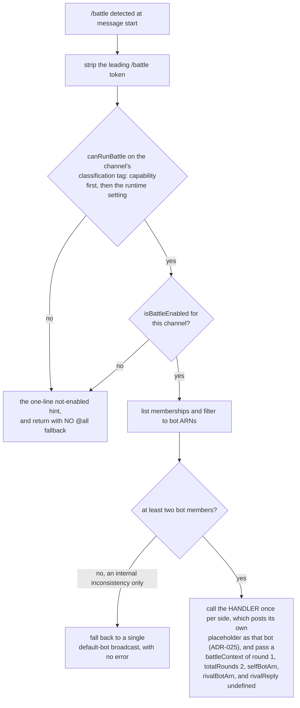

#### Per-bot generation

Each side runs an ordinary turn, and what the fan-out passes is only the coordination context a side cannot derive for itself, including **which side it is** - the room's primary is the control side, the alt the treatment side. What a side serves is its pinned version, read by the handler where any turn reads the version it serves, so a battle resolves nothing on a path of its own. That is what keeps one side from resolving successfully while the other falls through, which would degrade a battle to a text turn with nothing in any log to say why. Prompt assembly order is the classification base prompt, then `<persona_addendum>{sanitized addendum}</persona_addendum>`, then the battle awareness note last, so it overrides any contradictory addendum.

**The battle prompt adds AWARENESS and nothing else** (`buildBattleAwareness`): a rival is answering the same prompt right now, and a turn to respond to theirs is coming. It does not shape the answer, and that is the point. Response length and structure come from the intent pack's per-intent `verbosity` and `maxTokens`, resolved on the ordinary turn path and threaded as `responseSettings`; deliverable shaping comes from `isDocumentRequest`; and asking the person a question is what an intent's task machine does when its flow calls for it, which is why `report_generation` and `data_extraction` legitimately ask several. Any battle-side copy of those rules would re-create the divergence the handoff exists to remove: a battle measuring an engine no user meets.

**Round 2 waits until each side has finished, and "finished" is a BATTLE state rather than an intent rule.**

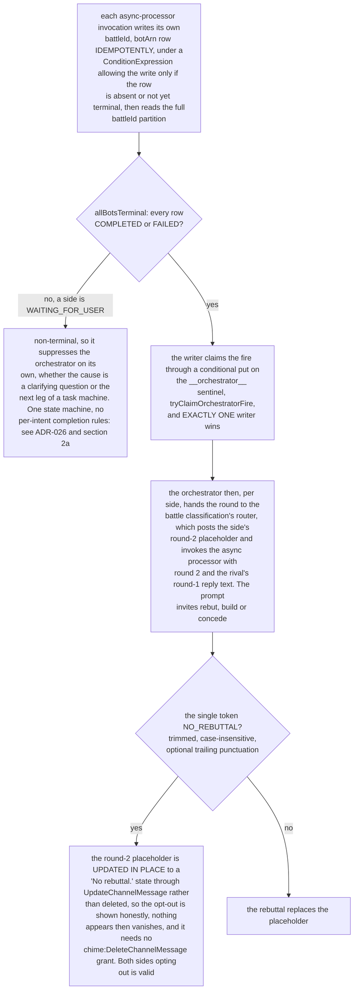

**A wait is not a stall, which is why the state layer writes `deadlineAt` on every transition and the orchestrator reads it:** only the writer knows which of the two clocks in section 3 applies, and without that split a waiting row falls back to `enteredStateAt + 180s` and a person who thought for four minutes reads as an assistant that failed to finish. Waited time is banked into `waitedMs` so `computeActiveResponseMs` never charges a slow human to the assistant.

**Clarification routing.** Clarification is a measured dimension rather than a forbidden one, and how many questions a side asks is its INTENT's business rather than a battle rule.

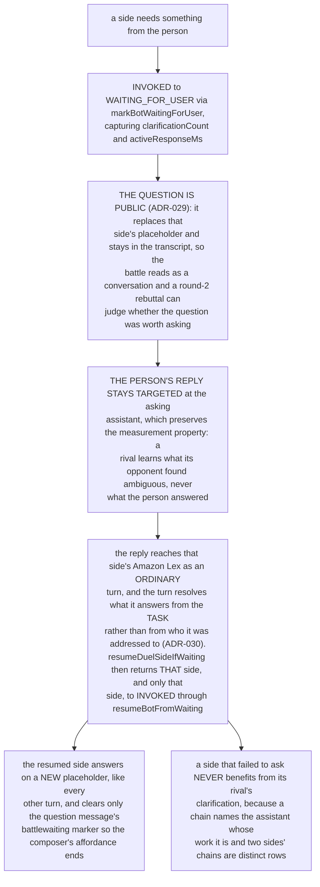

**The `NEED_CLARIFICATION` sentinel retires into task assignment** rather than being repaired. The round-1 prompt is `buildBattleAwareness` alone and never mentions it, and the state layer treats "blocked on a person" identically whether the cause is a question or a task leg (`reason: 'clarification' | 'task-step'`). The destination is section 2d. `WAITING_FOR_USER` stays, narrowed to suppressing round 2, which is a battle concern. `<!--battlewaiting-->` and `clearBattleWaitingMarker` stay with it: they are how the chat app learns that a side is waiting and on whom, whatever the cause (next section).

### A side parked on the person

A task-shaped side parks when its own chain needs input: an image brief's `confirm` step, a report's requirements, or any `awaits` state ([ADR-026](../../../design/decisions/026-task-shaped-battle-rounds.md)). It resumes only on a reply `Target`-ed at it from the battle's owner. The chat app offers that reply on the side's own message.

- **The step carries the marker.** When a round-1 leg leaves its task running, the processor appends `<!--battlewaiting:battleId=...,botArn=...,owner=...-->` (`battleWaitingMarker`, `lib/async-processor-core.ts`) to the same update that delivers the step, and records that message as the side's `waitingMessageId` with `markBotWaitingForUser({ reason: 'task-step' })`. A clarifying question carries the same marker. `owner` is the AppInstanceUser id of the person who ran `/battle`, read from the side's row (`initiatorUserSub`), with the round-1 sender standing in when the row has none. The marker is a display hint; the router decides whose answer counts from the battle's own record.
- **The control lives as long as the wait.** The chat app parses the marker into `battleWaiting` (`parseMessageContent`, `@ae/shared`) and draws `BattleSideReply` under the side's latest waiting message (`waitingSides`, `chat/src/utils/battleSideReply.ts`). The owner reads "Reply to this side", and "Answer both sides" when both sides wait on them. Everyone else reads whom the side is waiting on. The copy is `conversation.battleSide.*` in the locale, the buttons are the shared `btn` classes, and each control is a keyboard-reachable button with an `aria-label` naming the side. The control is derived from the message stream, so nothing polls.
- **The composer replies to the chosen side.** Choosing a side puts the composer into a reply-to-side mode (`replyingToSides`, `ConversationProvider.chime.tsx`) labeled "Replying to @<side>" with a cancel control. The send is the raw text with `targetArn` set to the side, the shape `resumeDuelSideIfWaiting` resumes on; "Answer both sides" sends the same words to each side as its own targeted message, because a `Target` holds one member. The mode ends with the send, on cancel, when the conversation changes, or when the side stops waiting. The composer never enters it on its own, so an owner who writes to the room sends an ordinary message.
- **The resume and the end take it down.** `resumeDuelSideIfWaiting` returns the row's `waitingMessageId` as `clearWaitingMarkerMessageId`, and the resumed turn clears that message's marker before it generates, leaving the step in the transcript. Ending a battle clears every waiting side's marker the same way (section 2a-i). A later round message from the same side also ends its control in the client, which covers the moment between the resume and the clear.

**How the owner check is enforced on the path a battle actually takes: structurally, rather than by a comparison.**

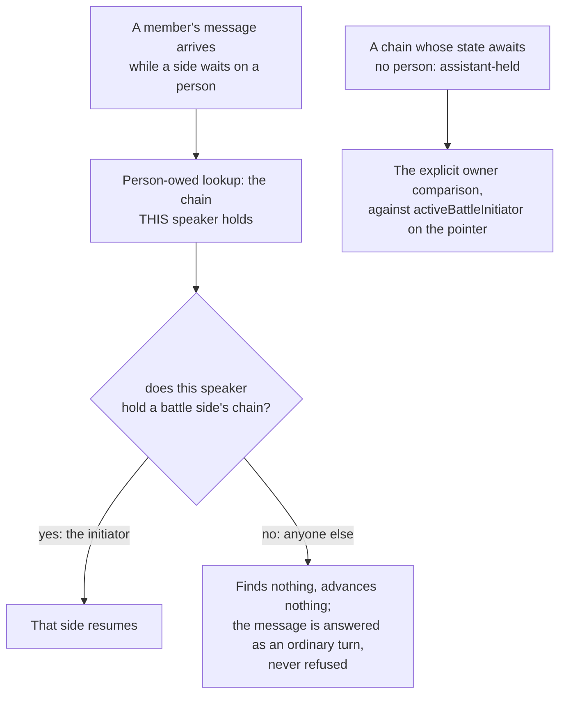

The person-owed branch needs no comparison because a battle side's chain is held by the person it awaits, so the lookup can only ever return a chain this speaker holds. The owner is recorded by `setActiveBattle` on the channel's battle pointer (`activeBattleInitiator`), which the continuation path already reads, rather than on the per-side `BattleState` rows: those are written by several callers across two Lambdas as the battle progresses, and an owner recorded on them is only as durable as the next transition. The rows carry `initiatorUserSub` as corroboration and as the fallback for a battle whose pointer predates the field; a battle with no owner in either place resumes for anyone, because an unanswerable battle is worse than an over-answerable one. A channel's pointer is one row reused by every battle in it, so a fan-out with no known initiator clears the field rather than leaving the previous battle's owner in place.

**Task isolation.** Two sides can each run a task chain for the same prompt, so a battle's task is created per side - through `createTask` with an assistant `owner` and the `battleId` attached - and continuation messages route per side. What keeps two sides' chains apart is the owner being that side, and the battle id is descriptive only (ADR-024). There is one creation door rather than a battle-specific one, and the owner-scoped `channelArn-updatedAt-index` on the agent-tasks table answers "the active task owned by this actor in this channel" without a per-side index. **A battle side may only open a workflow its serving version selected** (ADR-047), and the selection is applied in `resolveBattleSide`, where the delivery option and the task type are decided together: a side that may not open the type plans a `PLACEHOLDER_UPDATE`, which is a real generated reply and never `DIRECT`, and carries no task type, so the creation branch is never reached. Applying it at the creation site instead would leave the side holding a `TASK_MULTI_STEP` delivery with no task behind it.

**Drift interaction.** Drift detection runs on a battle turn exactly as it does on any other; what a battle changes is the action. While a battle is live the flow posts no suggestion and records no offer, because two competing "compare these" and "start a new conversation" flows would confuse the person and splitting mid-battle would strand it; the gate reads whether a battle is running, not whether Battle Mode is switched on, so between battles drift acts normally. What the person is told depends on who they are: the initiator is offered `/battle end`, anyone else is told who has that way out (section 2a-i). A system-prompt clause is defense in depth against a side emitting drift-flavored text itself. **Fail modes:** a crashed async processor leaves a state row the TTL reaps. `allBotsTerminal` keeps no expected-side count and asks only the rows that exist, so a missing row is invisible to it rather than read as `FAILED`; what stops a set with a hole in it from reading as a finished battle is the row TTL outliving the whole battle (section 3), and a side that never finished is named by the orchestrator's did-not-finish path rather than rebutted against as an implicit empty rival (section 8). A single-active-battle lock per channel, for which the state table doubles as the lock, answers a second concurrent `/battle` with an explained refusal to the sender.

**Marker survival.** The round-1 placeholder CREATE carries the `battle` marker, and the async-processor UPDATE overwrites content with no marker. The frontend `ConversationProvider` update handler does a selective field merge that deliberately excludes `battle` from the override list, so chips, the round-2 divider and the scorecard keep rendering after the reply lands. The scorecard summary fields (`responseMs`, `estCostUsd`, `steps`) merge into the existing battle object from the UPDATE.

### 5a. The per-side handoff

**Why this matters more for a battle than for `@all`.** A battle is an interactive A/B test, and its result is only worth something if a battle turn is what a production turn would have been. A battle that resolves its own models on its own path measures an engine no user meets. **A side classifying differently from its rival is a RESULT**, because classification is part of the flow under test, but it has to be the real classifier producing that difference rather than a second implementation that structurally cannot honor profile config.

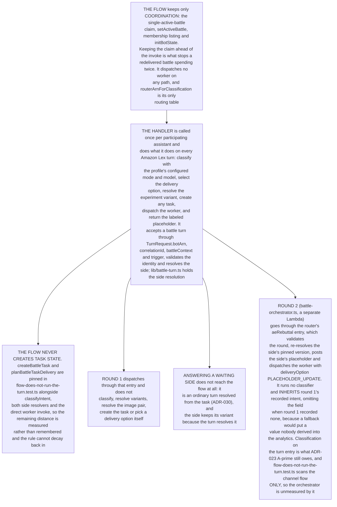

**What the caller supplies**, all of it coordination context a side cannot derive:

| Field | Why the handler cannot derive it |
|---|---|
| `botArn` | The handler resolves one identity from a per-classification SSM parameter; a battle has two sides |
| `correlationId` | The battle state row keys on it, and it must exist before dispatch so the orchestrator can see the side in flight |
| `battleContext` | Battle id, round, rival, which side, and for round 2 the rival's reply. Already a first-class field on the worker event |

As with `@all`, a side hands the worker no `placeholderMessageId`, because the handler dispatches before the placeholder exists, so the worker resolves through the control-table mapping or the marker scan like any other turn.

#### How a battle is metered: one user action, one gate

The flow gates the battle **once**, before fanning out (`enforceAbuseGate`), and the handler gates every ordinary turn (`evaluateAbuseGate` in `router-agent-handler.ts`). A battle turn arriving at the handler must therefore either skip that gate or add a second and third charge to a single user action. Two coherent answers exist, and they differ on what a battle *is*:

| | One user action, one gate | Two turns, two gates |
|---|---|---|
| Mechanism | The flow gates the battle as a whole and the handler skips its gate when a battle context is present | The flow's gate goes, as it did for `@all`, and each side meters itself |
| Gains | A battle costs one unit and can never half-fail | Truer to what a battle spends, and it removes the exception |
| Costs | A battle-shaped exception inside the handler | **A rejection between sides produces a half-battle**: one side answers, the other posts a rate-limit notice, and the comparison the feature exists for is gone |

**One user action, one gate is the decision**, and the half-battle is the deciding argument: a rejection landing between the sides leaves one answer with nothing to compare against, and a rejected arm is indistinguishable in the results from an arm that answered badly, which is measurement bias in an experiment rather than a UX wrinkle. The handler skips its gate only for a **declared** battle context, one that ARRIVED with the turn, meaning the flow already metered the battle upstream (`meteredUpstream` in `router-agent-handler.ts`), so a two-side battle consumes **one** rate and spend charge rather than one per side. A context SYNTHESIZED by a resumed side is created after that check, so the resumed turn is an ordinary Amazon Lex turn no upstream ever gated and is metered here like any other. The accepted cost is one battle-shaped branch in the handler, and the handler states that at the branch. The `@all` precedent does not settle this on its own: there, one user action is one turn, so moving the gate changes nothing about what gets charged, while here one user action is two turns.

#### Decisions taken

1. **Bot identity is caller-supplied, so it is validated, and validated FOR THIS ROLE.** `isSanctionedBattleBot` allows this handler's own bot, the alt its classification's assignment record names for the same **(classification, role)** - the alt of the very role this handler serves - or a live assistant of the same classification, and nothing else. It **fails closed** three ways: an unreadable record set rejects every caller-supplied identity; a turn that names no classification admits no alt; and a turn that names no role admits no alt. An unsanctioned ARN logs a security event and falls back to the handler's own bot, so the battle shows the wrong author, which is visible, rather than going silent. The records are read for the handler's own classification only, so an alt belonging to another classification - a premium alt answering in a basic room, reaching what premium reaches - is refused here as well as at the callee's own boundary, the second layer tenet D3 asks for; scoping on the role keeps it closed once a classification declares a second role. `battle-turn.test.ts` asserts both directions, so neither case can pass by a filter being stuck on one value.
2. **Per-side gate charging: no.** See "How a battle is metered" above, and MESSAGE-FLOW for the same consequence stated on the flow side.
3. **Round 2 carries an explicit `trigger: 'rebuttal'`.** It is fired with no user message, so its time to first feedback is undefined and must be null rather than zero, and its rows stay out of that average (section 5b).
4. **What fires round 2 cannot be a message from one assistant's bot to another's** ([ADR-023](../../../design/decisions/023-battle-round-coordination.md), section 2a). Round 2 dispatches THROUGH the router (`aeRebuttal`) rather than re-implementing a turn, so `battle-orchestrator` is a dispatcher rather than a turn-runner. It can be removed **only once its degraded-path duties have a home**: it names the "did not finish in time" notice for every stalled side (`postDidNotFinish`) and closes a battle where nobody finished (the `closed:no-completion` path); the router says both lines.

### 5b. What a battle result may and may not claim

Two limits are structural rather than defects, and stating them keeps a battle result from being read as an online-experiment result:

- **Round 2 has no production analogue.** No ordinary turn is "reply to a rival's answer." A rebuttal can be a faithful engine turn, but it is not a sample of production behavior, so round-2 rows must not be pooled with round-1 rows as though they were. It also has no user message to measure from, so its time to first feedback is undefined and must be null rather than zero.
- **A battle cannot be blind.** Both answers are shown side by side and the person picks, which measures preference under direct comparison, a different quantity from performance in production where a person sees one answer. A battle is a real test of the engine and the variants, and a real preference signal; it is not a substitute for an online A/B's outcome metrics.

### 5c. Battle measurement: what a battle turn is tied to, and where its numbers live

A battle turn is its own type of response and is measured as one. A separation that exists only in prose is read as one that holds, so this section states which separations are enforced in the data.

#### The identity chain: five facts, three carriers

| Fact | Where it is recorded | Read from |
|---|---|---|
| **The battle** | `battleId`, in the `<!--battle:battleId=...-->` marker on the placeholder (`lib/battle-turn.ts`, the one builder for both rounds) in `analyticsMetadata.battleContext.battleId`, and as the scalar `battleId` on the reply's own Metadata (`FRONTEND_METADATA_KEYS`) | Aurora `messages.battle_id` and `exchanges.battle_id` (migration 057), written by archival from whichever carrier the reply has (`battleIdOf`, `kinesis-archival.ts`), backfilled from every carrier (migrations 057 and 073) and indexed. The JSONB path is what decides whether a turn ENTERS a rollup (`assignmentMode`); the column is what a per-battle review joins on |
| **The answering assistant** | The message sender. A battle's two sides post as two different bot identities, which is what lets one user message legitimately have two replies | `messages.sender_arn`, and `turn_events.actor` |
| **The turn** | The correlation id, minted per side per round as `battle-r1-...` and `battle-r2-...` (`lib/correlation.ts`, `battleCorrelationId`) and carried in `<!--corr:-->` | `turn_events.turn_id`, with `turn_id_source = 'declared'` |
| **The originating user message** | Round 1 declares it on the placeholder itself as `<!--turn:answers=...-->` (`battlePlaceholderContent`, from the id the fan-out hands the turn). Round 2 declares no target, deliberately | `messages.answers_message_id` (migration 042) |
| **The round** | The `round=N` field of that same `<!--battle:-->` marker, resolved onto the archived record by `analytics-aurora/kinesis-archival.ts` and written on the battle side's `placeholder_posted` row | `turn_events.battle_round`, and `v_turn_latency.battle_round` with it |

**The round-1 declaration is what puts a battle side in the declared-pairing population rather than the swept one.**

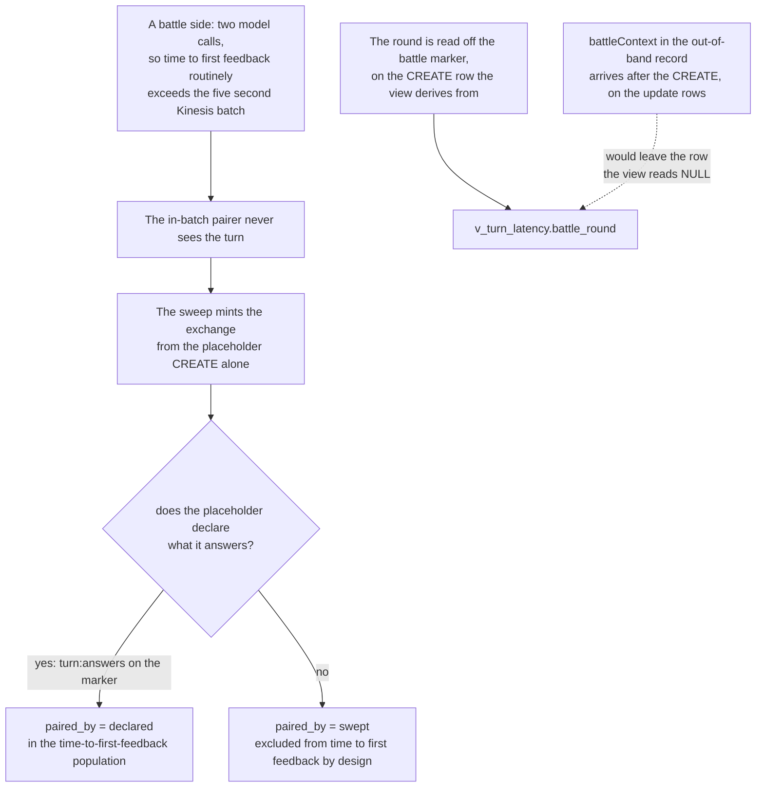

Covered by `a-duel-side-names-what-it-answers.test.ts` and ratcheted for both battle branches of the router by `task-shaped-battle-parity.test.ts`. **The round is read off the MARKER rather than off `analytics.battleContext.round`, and that is a constraint rather than a preference.** `v_turn_latency` takes the value as `MIN(battle_round) FILTER (WHERE kind = 'placeholder_posted')`, so it has to be on the row derived from the placeholder's CREATE. A battle placeholder carries no message metadata on either round: round 1 is materialized by Amazon Chime SDK from the Amazon Lex fulfillment return, which carries messages and session attributes and no metadata at all, and the round-2 placeholder the router posts for each side is a bare `SendChannelMessage` with none either. `battleContext` reaches archival only through the out-of-band analytics record the worker writes when it finishes, which is after the CREATE it would have to ride, so sourcing the round there would stamp it on the update rows and leave the row the view reads NULL. The marker is in the content the instant the placeholder is posted, written by the one builder both rounds share. `battle_round` is declared in `analytics-aurora/schema/019-turn-audit.sql`, selected by every revision of `v_turn_latency` and returned by the `turn_latency_audit` query; `kinesis-archival.ts` resolves it onto the archived record and `turn-events-live.ts` writes it, with the matching expression in the placeholder and final passes of `turn-events-backfill.ts` for history. An ordinary turn writes NULL, which is what the column already means everywhere that reads it, and there is no sentinel for "not a battle".

#### The follow-up chain, and how much of it is recorded

```mermaid
flowchart TB
  Q["THE ASSISTANT'S QUESTION: a public message replacing that<br/>side's placeholder and staying in the transcript (ADR-029),<br/>carrying a battlewaiting marker. The side transitions to<br/>WAITING_FOR_USER on its BattleState row, which is what<br/>suppresses round 2, and clarificationCount counts how many<br/>a side asked. Recorded as a message AND as a state"] --> R["THE PERSON'S RESPONSE: targeted at the asking assistant, so<br/>a rival learns what its opponent found ambiguous and never<br/>what the person answered. It reaches that side's Amazon Lex<br/>as an ordinary turn, resolved from the TASK rather than from<br/>who it was addressed to (ADR-030)"]
  R --> F["THE ASSISTANT'S FOLLOW-UP: a fresh placeholder like any<br/>other turn, posted by the battle branch of<br/>router-agent-handler.ts after resumeDuelSideIfWaiting<br/>returns the side to INVOKED. Its battle binding is<br/>RECONSTRUCTED rather than carried: the battle id, the round,<br/>and the rival are recovered from the<br/>channel's active-battle pointer plus the battle's own rows<br/>(the challenger from the alt's record),<br/>and the originating /battle message id is NOT among them"]
  F --> D["so a resumed side declares the message it is answering,<br/>which is the person's REPLY rather than the /battle command<br/>that opened the battle. That is the honest declaration for<br/>that turn, and it means the battle-to-originating-message<br/>link for a resumed side exists only through battleId"]
  D --> T["ROUND TWO: handed by battle-orchestrator.ts to the battle<br/>classification's router (aeRebuttal), which validates it,<br/>posts the side's placeholder and dispatches the worker,<br/>carrying trigger 'rebuttal' and a triggerAtMs stamped with<br/>the instant round two was triggered: the battle's last<br/>round-1 terminal transition"]
```

#### Which metrics apply to a battle turn, and which do not

- **Round 1 is a real user-caused turn** and is measured as one. A person typed `/battle` and is waiting, so time to first feedback, end to end, model time and tool time all apply and mean what they mean elsewhere.
- **Round 2 has no time to first feedback, and NULL is the answer.** A rebuttal answers the rival rather than a person, so nobody is waiting on it. `v_turn_latency` gates `ttff_ms` on the declared interaction kind being one of the human-waiting set (`lib/interaction-kinds.ts`, `HUMAN_IS_WAITING`), and `rebuttal` is the kind that is not in it. This is settled in [LATENCY-TARGETS](../../../guides/developer/LATENCY-TARGETS.md), and nothing in a battle should reintroduce it.
- **Round 2 IS measured, from the instant it was triggered.** Round two is triggered by the battle's last round-1 terminal transition, the write that fires the orchestrator, so the orchestrator declares the latest `enteredStateAt` across the battle's rows as each rebuttal's `triggerAtMs` (`roundTwoTriggeredAtMs` in `battle-orchestrator.ts`), the same instant for every side. Two figures start there: acknowledgment latency (`ack_ms`, to the placeholder) and the round's own end to end (`e2e_ms`, to the rebuttal's final answer, migration 071). Anchoring on the person's message would fold the whole of round 1 into round 2, and anchoring on the rival's completion would fold the second-finishing side's own round-1 generation into its round 2. Where any row lacks a readable stamp no instant is declared and both figures are NULL.
- **Round 2 is not in the headline end to end.** The E2E card describes a person's wait and filters `battle_round > 1` out of `avg_e2e_ms` and `p95_e2e_ms` (`getLatencyMetrics`), so a rebuttal's end to end is read only as its own row of the interaction-latency panel. *Verified by:* `backend/test/analytics-aurora/round-two-is-measured-from-its-own-trigger.test.ts` and the round-two trigger cases in `backend/test/battle-orchestrator.test.ts`.
- **Round 2 mints its own exchange row, and the row is deliberately not a reply anchor.** The pairing key carries the round (`analytics-aurora/schema/064-a-rebuttal-is-not-an-answer-to-the-person.sql`), so a side's rebuttal does not collide with its own round-1 reply from the same bot and is recorded rather than dropped. What the row must NOT do is anchor a figure on the person's message: `exchanges.user_message_at` is `NOT NULL`, so a round-2 row carries the ORIGINAL user message's instant, and a reader falling back to it would report the rebuttal at a latency spanning both rounds. The round-2 row's reply time and inbound hop are NULL, its `e2e_ms` runs from the declared trigger through the one expression every archival writer shares (`exchangeE2eSql` in `kinesis-archival.ts`), `v_turn_latency` refuses the person anchor for a rebuttal, and the round-2 placeholder declares no answered message, because a declared target would put the wrong fact back.
- **Round 2 runs no classifier.** Its intent is inherited from round 1 rather than re-derived, so it contributes nothing to classifier-latency figures and must not be read as a turn that classified for free.

#### Where a reader looks for battle numbers

- **Battles are read on their experiment's page**, in its **Battles** section (`frontend/packages/admin/src/components/admin/ExperimentBattles.tsx`), between the experiment's Results and its Settings; there is no separate battles view, and `?admin=battles` and `?admin=duels` land on the Experiments list. The section opens with one help line and a summary sentence ("Challenger won 6 of 9 battles; 3 not picked yet"). **How each version did in battles** is fed by `battleEffectiveness` (`frontend/packages/shared/src/types/analytics.ts`), scoped to battle turns only and kept out of the probabilistic A/B rollup, which filters on `assignmentMode`: each version as control (live now) or challenger (being tested) with the name the battle gave it (`sideNames`, from `battleSidesOf`) and its version, battles won with the share of picks, and quality and estimated cost per reply in battles, every column with a tooltip. The A/B numbers stay in Results and are not repeated. **Each battle** reads `battle_results` for the experiment, one row per battle: when it started, the room, the outcome (a version won, "Tie", or "Not picked yet"), how many people picked, and the conversation. Clicking a battle opens the conversation it ran in, through the console's conversation view (`onOpenConversation`), because the conversation is where both answers and the pick are. It opens at the `/battle` message that started the battle: `battle_results` returns that message's Amazon Chime SDK MessageId (`start_message_id`, from `messages.message_id`) and its own time (`started_at`, from `messages.created_at`), both read through a round-one exchange's `user_message_id`, with `fought_at` standing in for the time when that message is not found. The row hands both to the viewer as `&msg=` and `&at=`, and the viewer highlights the message, or, when its record lacks it, opens at the message nearest `started_at` and says the battle's starting message is not available (SPEC-ADMIN-CONSOLE 3.1). `battle_results` is served by the Aurora analytics query only; the Athena analytics query has no such query type. A battle nobody picked reads "Not picked yet" and never "Tie", because one is an absent decision and the other is a made one.
- **Per-experiment drill-down**, including the per-user picks, is the `picks` axis of `frontend/packages/admin/src/components/admin/ExperimentDrillDown.tsx`, opened from the Battle wins row of the experiment's Results.
- **Rebuttal latency** is the `rebuttal` row of the interaction-latency panel, labeled "Battle round 2 (rebuttal)", with its own acknowledgment and end to end (`frontend/packages/admin/src/components/admin/InteractionLatency.tsx`), and the Turn Latency Audit carries the round itself as a `Battle` column rendered from `battle_round` (`frontend/packages/admin/src/components/admin/TurnLatencyAudit.tsx`), so an operator reading a turn can tell a battle turn from an ordinary one. NULL renders as a dash, because an ordinary turn is not an unmeasured battle.
- **Picks** are the `BattleOutcome` table (section 3), read by scan rather than by SQL and joined into the Aurora `experiment_results` rollup as the `battle_wins` column, the one figure on that surface sourced from two stores.

**A win is credited to the row that earned it.** A pick records only which side won, carrying no classification, role or version, so once the rollup groups by those, attaching a variant's whole tally to each of its rows would report the same wins two or three times and make the column sum past the number of battles fought. Each pick is traced through its own battle (`battleId`, `variantId`) to the dimensions that side ran under, and a pick whose battle cannot be resolved is counted and logged rather than dropped silently.

#### What is separable, what is still pooled, and what separating the rest would cost

**The round is a column, so a battle turn is separable in the ledger.** `turn_events.battle_round` has a producer and `v_turn_latency.battle_round` carries it through, so anything reading the ledger can partition by round and by battle-versus-not on one field. This cost a value on the archived record, an entry in the live ledger's insert columns and the equivalent in two of the backfill's passes; it needed no migration, no new table, no new metric and no new admin surface, which is what made it the reuse-first answer (tenet D8) rather than a battle analytics surface built beside the one the platform has. What remains pooled or unjoined is listed here rather than discovered from a figure that disagrees with itself.

**Round-1 battle turns are still pooled with production turns in the headline figures.** Assistant turn counts, average and p95 time to first feedback, end to end, model, tool and router averages all include battle turns. The latency grid projects and groups on `battle_round` and surfaces it as a `Duel` dimension, so the population is selectable; section 5b says round-2 rows must not be pooled with round-1 rows, and nothing says round-1 rows may be pooled with production rows. Separating them is a predicate in a query that already selects the column, and it is a decision about which population each figure should describe rather than a piece of plumbing. Because a declared battle side votes in time to first feedback rather than being censored as swept, the pooling weighs more than a reader who assumes battle turns are excluded would expect; the effect is recorded in [LATENCY-TARGETS](../../../guides/developer/LATENCY-TARGETS.md) so a rise is not read as a regression.

**"Battle" still has two definitions that never join.** The Experiments surface asks `assignmentMode = 'battle'`, which is round-agnostic and lives in JSON. The Latency surface asks the interaction kind, which names only round 2 and lives in a column. So "how many battle turns" has two answers depending on which tab is asking, and tenet D7 says one source per question. The fact able to reconcile them exists as a column with a reader - `battle_id` and `battle_round` on `messages` and `exchanges` (migration 057), reported per battle in the Battles section of an experiment's page - and **migration 057 deliberately does not pick between the other two**, because whether a rebuttal counts as a battle turn for a latency average is the same argument as section 5b's "round 2 has no production analogue", and a schema change is the wrong place to settle a product decision. Both columns are backfilled from the JSONB already recorded, so battles fought before the column are reviewable too, while the JSON path remains the discriminator for what enters a rollup, because a column is only as complete as its backfill.

**A battle's dimensions are recorded on the exchange by both pairing paths.** `conversation_classification`, `assistant`, `assistant_role` and `profile_version` are real indexed columns, and the cross-batch sweep carries all four, with `profile_config_id` and `profile_name` (migration 091) beside them. `assistant` is the identity that answered and `profile_name` the definition that served; they differ on a treatment served from the alt's history. The sweep carrying them matters for a battle in particular: a battle runs two model calls per round, so its time to first feedback routinely exceeds the Kinesis batching window and its exchanges are usually minted by the sweep. A sweep that wrote only the first of those columns would make filtering battle turns by role or version return nothing on columns populated everywhere else, and migration 057 backfills the rows written before the sweep carried them.

**A battle that ends abandoned is not shown as having ended.** No comparison is presented for an abandoned battle, but only because none is produced: no round 2 means no scorecard payload, so `BattleScorecard` and `BattleTallyBar` render nothing, and no frontend code reads the `ABANDONED` state. That is absence rather than explanation, and a person who walks away from a battle and comes back sees a gap where a result would have been, which invites them to assume a result they never got.

## 6. Security and IAM

- **Bounded bot growth.** Each battle-wired classification provisions its alt at deploy time rather than per experiment, so runtime `chime:CreateAppInstanceBot` is avoided: one alt per `(classification, role)` a battle fields, each with its own Amazon Lex bot on that classification's router. Adding a role is a CDK deploy with no schema change.
- **An alt acts in one classification, like every other assistant** (ADR-042). The alt's bot is tagged with its classification at creation, its assignment record lives under that classification, and the turn-path identity check reads only that classification's records (section 5a, decision 1). Removing it deletes its identity with it rather than leaving a bot nothing owns that every assistant role can still bear.
- **A session acts only as its own identity.** The vended session's bearer is pinned to `/bot/${aws:PrincipalTag/bot}` (`ActOnlyAsTheSessionsOwnBot`, `lib/assistant-acting-policy.ts`), so a turn served as the alt can send only as the alt, and the `AssistantBoundary` managed policy is the boundary every acting session sits under (`an-assistant-acts-through-one-tagged-role.test.ts`). **OPEN:** no live deny-test names the alt's bot; the pinning is proven by synthesis and unit tests, not against a deployment.
- **The orchestrator reaches the routers, and nothing else in a classification stack.** It invokes the routers, each found by name at call time (`sayThroughRouterWiring`, statement `NameANoticeToTheRouter`, `resolveRouterArn`), reads the experiments table, reads the definitions of exactly the assistants a battle can field (each role's live assistant and its alt), and reads the room's tags and assignment records so the room's primary says a battle's closing line (`battle-stack.ts`). It speaks as no assistant: no vend, no routing-table write, no Amazon Chime SDK send. The battle classification's router posts each side's round-2 placeholder when it takes the round, after checking the round against the battle state (the fan-out was claimed, the side finished round 1, the battle ran in that conversation), and says the orchestrator's closing lines as notices. It can invoke no processor. `only-declared-speakers-can-speak.test.ts` refuses any Battle-stack role that can invoke a vend, write a routing record or send bearing a bot.
- **Round 2 trusts nothing in its payload about what the side serves.** The router re-resolves the side's pinned version and the rival's name (`resolveDuelSides` in `dispatchRebuttalRound`), narrows the round's session from that version, and drops any version, definition, attribution or rival name the orchestrator's payload carries, so a forged payload is neither served nor granted (`a-shared-service-only-speaks.test.ts`).
- **Cost gate.** A battle is up to four model invocations, two variants across two rounds. `/battle` requires a classification that is battle-capable AND has battle turned on, resolved from the immutable `classification` tag, plus the single-active-battle lock. Off by default, so a deployment that has not asked for battles does not pay for them. The existing `bedrock-resilience.ts` retry and circuit-breaking apply unchanged.
- **Authorization.** Enable and disable are channel-moderator only, and only for a classification that is battle-capable with battle turned on. Addendum text is sanitized server-side and wrapped in a delimiter so the model treats it as a distinct authorial layer, with the battle awareness note appended last.
- **Image-output moderation** ships as a basic default guardrail; production-grade tuning is the deployer's documented responsibility under the open-source posture rather than an internal sign-off gate.

## 7. Testing

| What is pinned | Tests in `backend/test/` and `backend/test/lib/` |
|---|---|
| State, ids, clocks and the round-2 claim | `battle-state.test.ts` (id derivation, transitions, `allBotsTerminal`, the orchestrator claim), `battle-two-clocks.test.ts` (the machine deadline against the user-wait deadline, and the banked wait), `battle-orchestrator.test.ts` (both completions paired, round 2 fired once) |
| The absence of task coupling (section 2a) | `battle-round1-complete.test.ts` - the task-terminality gate is gone and recording a side terminal consults no task |
| Leaving, and who may (section 2a-i) | `a-duel-ends-by-a-recorded-state.test.ts` (`ABANDONED` never satisfying the round-2 trigger, the conditional pointer release, the waiting affordance coming down, an already-claimed fire reported rather than hidden), `live-drift-flow.test.ts` (drift detection runs on a battle turn, the action is withheld for the initiator and a non-initiator alike while a battle is live, and no battle claim is made when Battle Mode is on with no battle in flight; the way-out copy itself is not asserted) |
| The handoff ratchet (section 5a) | `flow-does-not-run-the-turn.test.ts` over the channel flow's turn-path symbols, `battle-classification-routing.test.ts` (both rounds resolve their worker from the battle's own classification) |
| Round 2 opens no work and declares no intent | `a-rebuttal-opens-no-work.test.ts` (resolving a delivery option for round 2, or calling `createTask` from the orchestrator, fails the suite), `a-rebuttal-inherits-the-duels-intent.test.ts` |
| Side resolution and the identity guard | `battle-turn.test.ts` - the side resolution, the arm assignment, and the guard rejecting an alt of another classification and an alt of the same classification in a different role, each asserted in both directions; `lib/a-duel-side-serves-its-pinned-version.test.ts` (each side hands the worker its pinned version and no model beside it); `lib/an-experiment-turn-serves-its-version.test.ts` (a routed intent answers through its route); `lib/experiment-manager.battle.test.ts` (each side is named from its version, and `battleSideNames` marks the challenger when the names match); `manage-profiles.test.ts` (arming pins the live version and derives the candidate for each type) |
| The router owns round 2 and the markers | `a-shared-service-only-speaks.test.ts` (the round is validated against the battle's state, its placeholder carries the side's name, and a forged payload version is dropped), `only-declared-speakers-can-speak.test.ts` |
| Eligibility and arming | `battle-enablement.test.ts` (the wired capability and the runtime setting), `battle-runnable.test.ts` (the bound experiment's state: active runs, paused, completed and deleted stop, a legacy config with no bound id runs), `experiment-manager.battle.test.ts` (challenger and side resolution, addendum sanitization, arming validation), `channel-battle.test.ts` (the enable refuses a challenger that is not the room's alt, and records the member it added), `admin-experiments.test.ts` (arming binds the alt of the experiment's classification from its record), `cdk-synth.test.ts` (the classification stack provisions the alt with its own Lex bot and record; the Battle stack owns no assistant) |
| Prompt assembly and the waiting affordance | `async-processor-battle.test.ts` (`NO_REBUTTAL`, long-form), `battle-clarification.test.ts` (the marker names the owner), `battle-waiting-marker.test.ts`, `a-parked-duel-side-offers-its-answer.test.ts` (a round-1 leg that leaves its task running delivers the step with the marker and records it as `waitingMessageId`; a completing leg and a rebuttal carry none), `task-shaped-battle-parity.test.ts` (the resume names the parked message to clear) |
| Task-shaped battles and the image modes | `battle-task.test.ts`, `battle-task-delivery.test.ts`, `a-battle-turn-resolves-its-task-by-the-answering-assistant.test.ts`, `battle-vision-plan.test.ts`, `vision-battle-action.test.ts`, `battle-generation-out-plan.test.ts`, `battle-attachment.test.ts` |
| Picks, analytics and the ledger | `battle-outcome.test.ts`, `battle-outcome-api.test.ts`, `battle-outcome-is-bound-to-its-channel.test.ts`, `analytics-metadata.battle.test.ts`, `a-duel-side-names-what-it-answers.test.ts`, `task-shaped-battle-parity.test.ts`, `analytics-aurora/turn-events-battle-round.test.ts` |
| Stack wiring | `battle-stack-outcome-wiring.test.ts`, `the-experiments-gate-does-not-scan-every-duel.test.ts` |

Frontend unit tests: `chat/src/components/BattleSideReply.test.tsx` (the owner's reply and "Answer both sides", keyboard reach, and the note everyone else reads), `chat/src/components/MessageInput.battle-side-reply.test.tsx` (the chosen side's targeted send, both sides, cancel, and no reply mode without a choice), `chat/src/utils/battleSideReply.test.ts` (who is waited on, and which message holds a side's control), and `shared/src/utils/messageParser.test.ts` (the marker's owner); `chat/src/utils/battleTally.test.ts` for `computeBattleTally`; `chat/src/services/channelBattleService.test.ts` and `chat/src/services/battleOutcomeService.test.ts` for the client calls; `admin/src/components/admin/EffectivenessTab.test.tsx` for the per-step view that surfaces `execution_steps`.

End-to-end (`tests/e2e/battle.spec.ts`), run under `BATTLE_E2E=1` against a battle-enabled deploy and never in the default unit suite: round-1 chip survival with a working scorecard pick, the round-2 divider, multi-turn battles, server-side outcome persistence, the not-enabled hint, `/battle` start-of-message detection, generation-out (both variants render a decoded image, honest text otherwise), clarification (an ambiguous `/battle` is answered normally by both sides with no waiting queue on the composer, because the round-1 prompt does not ask a model to raise a question), the briefing and its steering chips, the single-active guard, the human pick reaching the recommendation as its own axis, per-user picks, the answer-then-resume round trip (B-E7), the capability refusal (B-E8), ending a battle (B-E9) and addressing the alt directly (B-E10). Against a deployment with both sides pinned (2026-10-27) it passes 20 of 21; B-E7 failed: the owner's reply resumed the side, but the input guardrail blocked its text and the side parked again before the test's state sample saw it move (SPEC-BATTLE FR10). B-E7 is asserted as a pair against a task-shaped battle: a side parked on the person is answered with the same text by a non-owner, through a raw targeted send because the app offers a non-owner no reply, and then by the owner through the side's "Reply to this side" control, and both halves are asserted together, because a negative assertion is worth nothing without the positive control beside it - a continuation broken for everyone satisfies the negative half perfectly. `tests/e2e/experiment-battles.spec.ts` covers reading battles on their experiment's page and opening a battle's conversation from its row.

## 8. Open technical questions

- **The alt's own profile version is built** (ADR-050). The record names the assistant `alt-{role}-{classification}`, the battle cannot arm until its treatment pins a version of that alt derived for this experiment (`BATTLE_TREATMENT_MUST_PIN_ALT_VERSION`), and the battle serves the pinned version, so the challenger has a `configId` and a version history of its own.
- **Extending `flow-does-not-run-the-turn.test.ts` to `battle-orchestrator.ts`.** The ratchet measures the channel flow only, so the orchestrator's duplicate turn logic is unmeasured. Extending it ahead of the round-2 handoff would make the suite red by design; extending it as part of that handoff keeps the ratchet honest.
- **Showing that a battle was left.** Making the `ABANDONED` end state visible in the conversation, rather than leaving a gap where a result would have been (section 5c).
- **Post-hoc drift exclusion.** There is no `battle_id` column on `drift_events` (`analytics-aurora/schema/006-drift-events-hardened.sql`), nothing writes one, and `analytics-aurora/drift-detection.ts` reads nothing battle-shaped, so post-hoc drift rollups include battle exchanges. That is the same shape as the round-1 pooling in section 5c: a separation stated in prose and not enforced in the data.
- Smaller open items: `steps[].tokensIn` accounting for vision-in image tokens; binding a specific attachment to a `/battle` turn when a channel holds several; the exact `MODEL_RATE_TABLE` values and image-generation cost granularity, which are approximate and deployer-tunable by design; the generation-out model choice (Amazon Titan Image Generator against Amazon Nova Canvas) and the precise default image-output guardrail config to ship; and whether Aurora should add a generated column or index for `assignmentMode` if rollup performance degrades, since it rides the JSON metadata column with no migration.

**A battle where both sides die** has an owner in every case an observer exists, and the residual case is exact.

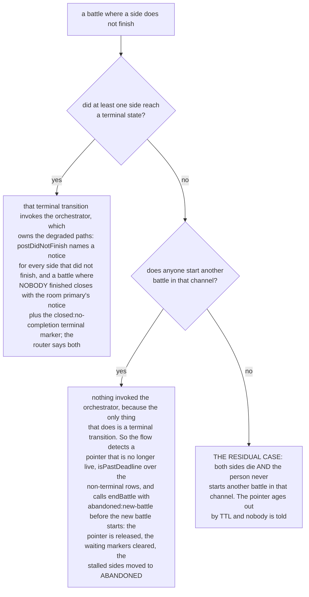

**OPEN: closing the residual case needs a new observer, and the choice has a cost that belongs to the owner.** A timer is refused (tenet D6), so the two event-driven candidates are a battle-pointer check on EVERY flow pass in a battle-enabled channel, which buys the guarantee for one extra read per message, or accepting the limit on the grounds that a person who abandoned the conversation has nobody waiting to be told.

**Reusing `endBattle` for the no-completion case would be wrong**, which is why the orchestrator keeps the job: its reasons are all `abandoned:*`, which name a decision the PERSON made, and a battle whose sides crashed is a failure of the system. Announcing it as abandonment blames the person for it, the same distinction `battle-orchestrator.ts` already draws when it excludes `ABANDONED` rows from "did not finish in time".
