# DESIGN: Evaluation

**Status:** Partial. This document describes the design for first release. Per requirement, what is delivered and what is not is stated in [SPEC-EVALUATION](./SPEC-EVALUATION.md), Functional Requirements, and nowhere else.

**Coverage:** `tests/e2e/evaluation-verdicts.spec.ts`. Per-claim unit tests are named inline.

**Related:** [SPEC-EVALUATION.md](./SPEC-EVALUATION.md) - what evaluation is for, its requirements, and what it refuses to be. This document is the mechanics only.

**Site section:** Interaction layer, quality.

---

## Two evaluations, at two moments

A turn can be sent to the wrong place, or handled badly once it arrives. Different moments, different inputs, different instruments, and different owners. One number cannot separate them, so the design does not try.

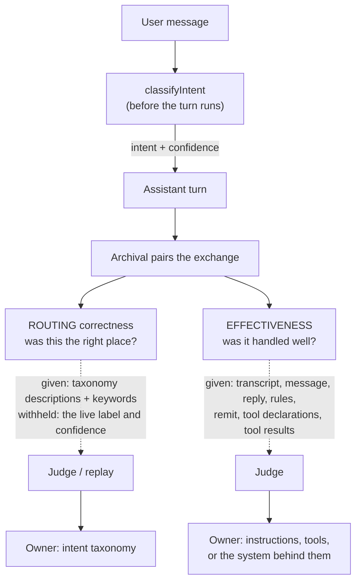

Everything withheld is withheld on purpose, and the rule that decides is the admissibility test below. Everything given is given because a judge that cannot see the assistant's remit or the tool results can only grade how the answer sounded.

## The two runners, and what each can answer

Two runners exist because the two deployment modes have different stores underneath them, and the difference is large enough that a requirement has to name its mode.

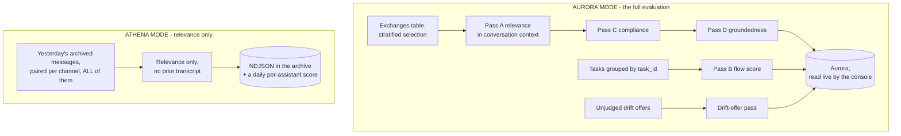

| | Aurora mode | Athena mode |
|---|---|---|
| Cadence | Every 30 minutes, against unscored rows | Daily, one day of archive at a time |
| Relevance | In the conversation's context | The exchange pair alone |
| Compliance, groundedness, task score, drift offers | Yes | None |
| Selection | Stratified, deterministic, recorded rate | Every paired exchange in the day |
| Rubric version on the row | Yes | No |
| Delivered document | Its own row: relevance, groundedness, compliance; retried within a bound | Its own row: relevance only; a failed judge call is graded again by re-running the day |
| Rollup | Per assistant and classification, per intent | Per assistant and intent, classification not split out |

Athena mode is the default, so the honest reading of a default deployment is a daily relevance number with no provenance and no compliance verdict. That is a reason to choose Aurora mode rather than a defect to fix in the smaller runner: the passes it lacks need joins and a live read surface that the archive is the wrong store for (tenet D7).

## What a verdict is about: the assistant, and the slice

The attribution key is the assistant that answered - `(assistant, classification)` - not the profile definition it served. One assistant with instances in two classifications is two measured things, each judged against the profile and context given to it there, because pooling them describes neither.

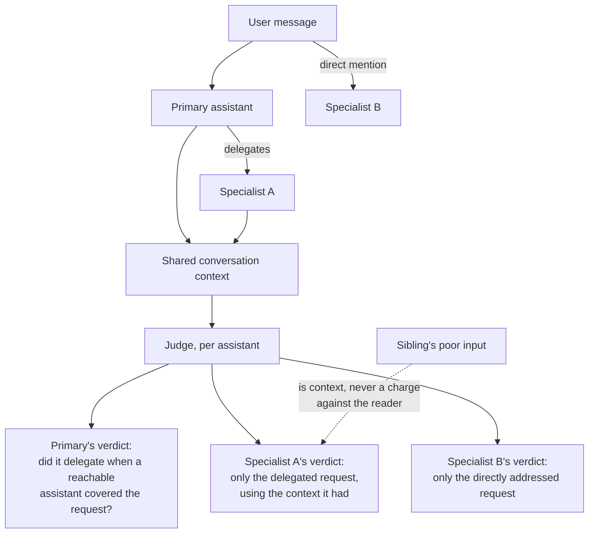

A judge scoring one assistant is shown the whole context that assistant had, including what other assistants contributed, and scores only that assistant's own part. Two consequences follow. A decline is correct when the request falls outside the assistant's remit, and is a missed delegation only when a reachable assistant covered it - which is why [DESIGN-SEPARATE-ASSISTANTS-AND-DELEGATION](../assistants/DESIGN-SEPARATE-ASSISTANTS-AND-DELEGATION.md) is a dependency rather than a reference. And an assistant misled by a sibling's bad input is not marked down for it; the finding belongs to the sibling, which is only expressible because the verdict is per assistant.

## Scoping a team to its own assistants

A team's views cover the assistants that team manages, and how that set is resolved is **an open design question with a real trade-off**. Both candidates are written out because the cheaper one is the weaker one, and the choice should be made deliberately.

| | IAM-enforced scope | A filtered list of app-instance bots |
|---|---|---|
| Where it is enforced | Before the request runs, as a condition on the vended grant | In the query the API builds, after authentication |
| Layers | Two, with the API check on top | One |
| Provable by deny-test | Yes | No - a test can only assert the API's own behavior |
| Needs | An ownership record a policy can read, which does not exist yet, plus a tag or path convention IAM can condition on | A lookup from team to bot ARNs |
| Fails | Closed | Open, if the filter is ever omitted on a new endpoint |

Tenet P4 points at the first: access is enforced by IAM and resource policies before a request runs, every sensitive operation carries at least two layers, and a client-side or query-side filter is not an enforcement layer. The obstacle is that ownership of an assistant is not recorded anywhere a policy could evaluate today, so the work is not contained within evaluation - it lands on the profile as an ownership attribute first. Until it is settled, a team-scoped surface is specified but not built, and the matrix in [SPEC-EVALUATION](./SPEC-EVALUATION.md), Appendix B is the statement of what enforcement has to achieve.

## The passes, and where each verdict lands

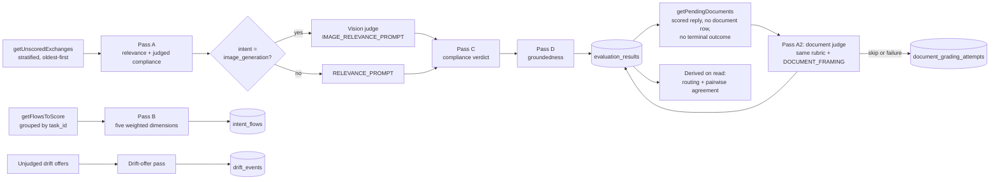

| Pass | Writes | Rubric version | Test |
|---|---|---|---|
| A - relevance | `evaluation_results` | `RELEVANCE_RUBRIC_VERSION`, or `IMAGE_RELEVANCE_RUBRIC_VERSION` on an image turn | `the-judge-reads-the-transcript-not-the-ledger`, `a-correct-decline-is-not-irrelevant` |
| B - flow | `intent_flows`, upsert keyed on `task_id` | `FLOW_RUBRIC_VERSION` (prompt + weights) | `flow-eval` |
| C - compliance | `is_compliant`, `compliance_categories`, `rule_set_version` | rule-set version | `compliance-rules`, `an-unjudged-row-is-not-a-verdict` |
| D - groundedness | `is_grounded`, `groundedness_notes`, `retrieved_passage_count` | `GROUNDEDNESS_RUBRIC_VERSION` | `an-answer-is-checked-against-what-it-was-given` |
| A2 - delivered document | `evaluation_results` row with `evaluation_type = 'document'`, `artifact_key`, `artifact_sha256`; a skip or a failed attempt in `document_grading_attempts` | `DOCUMENT_RUBRIC_VERSION` | `a-delivered-document-is-graded-as-itself` |
| Drift offer | `drift_events` | rubric version column | `drift-offer-eval` |

Pass C and Pass D are this document's letters for compliance and groundedness, and the drift-offer pass has no letter here. The runner's own comments label the drift-offer pass Pass C, and `compliance-agreement.ts` calls compliance "Pass C, Step 3", so a reader moving between this document and the code should key on the pass name rather than the letter.

**Pass A reads the message timeline, not exchange pairs.** A drift offer posts directly and mints no exchange, so a judge shown only pairs would see a reply to a question it could not see and score it irrelevant. Markers are stripped with the single backend stripper that mirrors the SPA parser, so the judge reads what the person read.

**Pass B weights:** outcome 0.30, information 0.25, efficiency 0.15, context retention 0.15, UX 0.15; status is one of `completed`, `in_progress`, `abandoned`, `failed`. Its `information` dimension is scored from the transcript, which is why groundedness is Pass D's own question against the passages rather than a dimension of the flow score.

**Pass C is three-state and never defaulted.** Deterministic guardrail findings from the turn union the judge's findings against declared rules. NULL where neither could assess. No reader coalesces it, and no rollup weights a NULL group as zero.

**A delivered document is graded as itself** ([SPEC-EVALUATION](./SPEC-EVALUATION.md) FR22). When a turn delivers a file - a report, an extraction, code - the exchange's response is the chat reply beside it, and the file is the deliverable. Four steps carry it to a score:

1. The processor hashes the document as it uploads it (`generateAndUploadDocument`) and records a reference on the turn's out-of-band analytics record, `deliveredDocument` (`lib/delivered-document.ts`): the attachment key, the SHA-256, size, content type, the kind (the producing task type, else `document`), the intent, and for a task its id, the state it was delivered from and the requirements it recorded before delivery. A private task's requirements are not copied, and the reference is marked `private`.
2. Archival, merging that record into the archived message, copies the document from the conversation's `generated-docs/<conversationId>/` into the archive bucket at `delivered-documents/<classification>/<conversationId>/<sha256>` (`delivered-document-archive.ts`), after checking the bytes against the recorded hash, and adds `archiveKey` to the reference. The copy is the archive's own: the attachments bucket expires its objects under a rule written for that bucket's owners, and the archive is the system of record for every evaluation input (tenets D7, D15). A copy that cannot be made is logged, never fails the batch, and leaves no `archiveKey`.
3. Pass A2, which runs after Pass A in every run, takes the document backlog (`getPendingDocuments`): every exchange whose reply row exists, whose merged metadata carries a `deliveredDocument`, that has no `document` row and no terminal outcome, oldest first, up to `EVAL_MAX_DOCUMENTS_PER_RUN` (50 by default). It reads the archive's copy, checks the hash again, and judges the document with the relevance rubric unchanged plus `DOCUMENT_FRAMING` (`lib/delivered-document.ts`, one copy for both runners) in the task context: the response is the delivered file, the reply is scored separately, and these are the requirements the task recorded. Groundedness is checked for the document against the same passages. The compliance verdict is the judge's against the judged rules; the turn's guardrail findings stay on the reply's row.
4. The verdict is written as its own row, `evaluation_type = 'document'`, with `artifact_key` and `artifact_sha256` naming what was judged (migration 082, one document row per exchange). Every reader of a reply score filters on `evaluation_type = 'exchange'`, so a document score is never pooled into a reply rate.

**A document grade is its own unit of work.** The backlog is selected on the document's own state, not the reply's, so a document whose grading fails is not marked done by its reply's row. `document_grading_attempts` (migration 083, one row per exchange) records what happened when a document was not scored:

| Outcome | Status | Next run |
|---|---|---|
| Private task, no archive copy, hash mismatch, empty, longer than `EVAL_DOCUMENT_MAX_CHARS` (100,000 characters by default) | `skipped`, with `skip_reason` | Not read again |
| The judge call threw, or the archive copy could not be read | `retrying`, `attempts` incremented, `last_error` (the error's first line, never document text) | Tried again |
| A failure that brings `attempts` to `EVAL_DOCUMENT_MAX_ATTEMPTS` (3 by default) | `exhausted` | Not tried again; logged as an error naming the exchange and counted in the run's `documentsExhausted` |
| Scored after one or more failed attempts | `scored` | Not taken: the `document` row exists |

A document scored on its first attempt has no row there. The run reports `documentsScored`, `documentsSkipped`, `documentErrors` and `documentsExhausted`. Without `ARCHIVE_BUCKET` the pass does nothing and records nothing, because a deployment fault is not a verdict on any document. A document is drawn with its exchange, so it states the reply row's sample stratum and rate, whenever it is graded.

**In Athena mode** there is no out-of-band store, so the reference cannot ride the record Aurora-mode archival reads, and the Firehose that archives messages runs no code that could copy a second object. Three things carry it instead:

1. The processor puts a compact reference on the inline Metadata when the out-of-band store is not provisioned (`inlineDeliveredDocument`): the key, hash, size, content type, kind, task id and the private flag, without the requirements, which do not fit the 1024-character cap. It is marked `requirementsOmitted`, so the judge is told the requirements were not recorded rather than that there were none. It is shed under the cap before anything a person sees (`METADATA_SHED_ORDER`).
2. The Athena runner, after scoring the reply, makes the archive's copy with the same module archival uses (`archiveDeliveredDocument`: only a file under the conversation's own `generated-docs/<conversationId>/`, verified against the hash, written to `delivered-documents/<classification>/<conversationId>/<sha256>`), reads the copy back, and judges it with its relevance rubric plus `DOCUMENT_FRAMING`. Its role holds `s3:GetObject` on the attachments bucket's `generated-docs/*` for this, and nothing else in that bucket (`archive-stack.ts`).
3. It writes the document as its own NDJSON row, `evaluationType: 'document'`, with `artifactKey`, `artifactSha256` and `documentKind`, or a `document_skipped` row with `skipReason` and no score. Reply rows carry `evaluationType: 'exchange'`; the per-assistant agent score, the run's average and the `evaluation_scores` query read reply rows only. This mode judges relevance alone, for documents as for replies, and keeps no attempt ledger: a failed judge call writes nothing, and re-running the day (`{ "targetDate": "YYYY-MM-DD" }`) grades it again.

**The scores have a reader.** `document_evaluation` (both modes) returns one row per intent and one per task type (`dimension`, `group_key`) over the documents delivered in the window: `documents_delivered`, then each document in one state (`documents_scored`, `documents_skipped` with a count per reason, `documents_retrying`, `documents_failed`, `documents_awaiting`), the document's relevance, groundedness and compliance with their assessed counts, and the reply's relevance on the same exchanges as `reply_avg_relevance`, never averaged with the document's. With a `channelArn` it returns that conversation's documents with their score and grading state. The console shows it on the Effectiveness and Evaluations tabs and next to the file in the conversation drawer ([SPEC-ADMIN-CONSOLE-EFFECTIVENESS](../../interface/SPEC-ADMIN-CONSOLE-EFFECTIVENESS.md)).

**Every prompt is built by `renderPrompt`, not chained `.replace`.** A chained replace expands `$&` and `` $` `` in the substituted value and is order-dependent, so a member's message could splice the rubric into the evidence or blank the field the judge scores. *Verified by:* `a-judge-prompt-is-built-not-pattern-matched.test.ts`.

## What each judge is shown, and whether it can be trusted

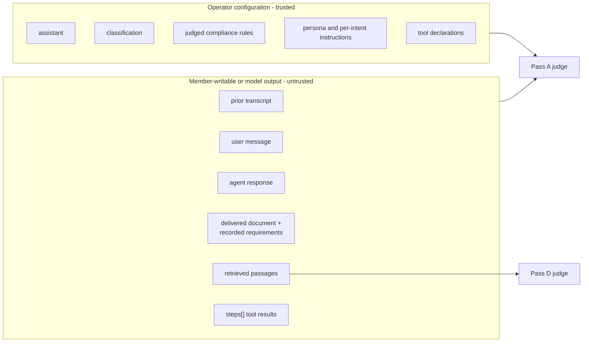

**Untrusted content is evidence, never instruction.** Prompt injection into an evaluator is a measurement-integrity risk rather than a disclosure one: a member who steers the judge manufactures a clean verdict on their own exchange, and every downstream rate inherits it. It is unbounded by sampling, because a flagged exchange is always drawn. `renderPrompt` guarantees only that a value lands intact where the template put it; whether the judge treats enclosed text as evidence is the rubric's job.

**Identities never enter a judge prompt.** Roles and configuration only - no names, emails, subs or member ARNs. Task state and calibration inputs both walk toward this boundary, so each new input is checked against it rather than assumed clear.

**Private task detail stays private.** Task state is stripped at read behind a `viewerId` gate and the runner has no viewer, so evaluation reads the stripped form or is scoped to non-private tasks. A judge is not an authorized viewer of a private request.

### The admissibility test

Configuration declared **before** the turn is an observation and may be passed. A per-turn **conclusion** of the thing being judged may not.

| Input | Admissible | Why |
|---|---|---|
| Persona, per-intent instructions, tool declarations, intent descriptions | Yes | Configuration, fixed before the turn |
| Tool results from `steps[]` | Yes | Evidence of what the assistant was given, not a verdict on it |
| A task's recorded requirements, on a delivered document | Yes | What the person agreed to, collected from their own messages and fixed before the document was written; the values only, never the evidence quotes |
| The task type a document was produced under | **No** | Routed from the classifier's conclusion, so it is withheld like the intent |
| Task framing ("this is a step in a task") | Yes | A fact about shape |
| The classifier's intent label | **No** | The conclusion a judge assessing relevance would be anchored by |
| The live confidence | **No** | An output of the turn under judgment |

*Verified by:* `the-judge-is-not-told-the-intent.test.ts`, covering both judges and both spellings of the placeholder.

## Routing correctness: three checks

Each check answers a narrower question than the one before it, and the check after it calibrates it.

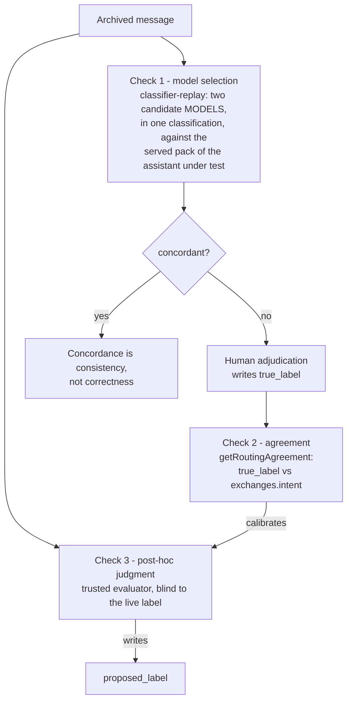

**Check 1 answers which of two models to ship, not whether either routes correctly.** Both candidates run the same prompt, so their errors correlate. A run is scoped to one classification and one assistant: it reads only that assistant's exchanges in that classification, and both candidates classify against the intent pack that assistant serves (its active version's, else the classification's deployment pack, else the platform's), which is the taxonomy a live turn of that assistant classifies against. The starter resolves the pack and the run keeps it (`classifier_replay_runs.intent_pack`), so a re-execution asks the same question. A classification candidate differs from its control only in `models.classifier`, so one pack serves both candidates ([DESIGN-EXPERIMENTS-BATTLE-DECISION-LOOP](./DESIGN-EXPERIMENTS-BATTLE-DECISION-LOOP.md) §5.2). Replay exclusions are counted rather than dropped: `messages_retracted`, `messages_fast_path` and empty content each have a column. **ROADMAP:** the same replay for answers, where an `intent` or `base_model` candidate version answers archived exchanges and is judged pairwise against the recorded answer (§5.6 of the same document).

**Check 3's advantage is evidence and hindsight, not taxonomy knowledge.** The classifier is handed the taxonomy every time; what it lacks is the future. A post-hoc evaluator sees the tools called, the answer, whether the person rephrased, and whether the task succeeded. `intent_confidence` is recorded per turn and joined to the outcome, so the two cases an operator most wants separated - a low-confidence route that was right, and a high-confidence route that was wrong - are reported apart.

**Delegation widens the taxonomy.** Once a primary assistant can read what its roommates advertise, the evaluator's taxonomy spans every reachable assistant's **advertised** intents: the published key and person-facing line, never a sibling's `instructions` or `tools`. Grading a primary against what it was never shown marks it down unfairly and leaks one team's implementation into another's record. The consequence for scoring is that a decline is correct only if no reachable assistant covers the request; otherwise it is a missed delegation, and scoring it as an Appropriate Refusal would hide the failure delegation exists to prevent.

## The standard is fixed before the answer is seen

A judge shown the reply infers the standard from it, which is how a confident fabrication outscores an honest gap. Two passes fix the standard first.

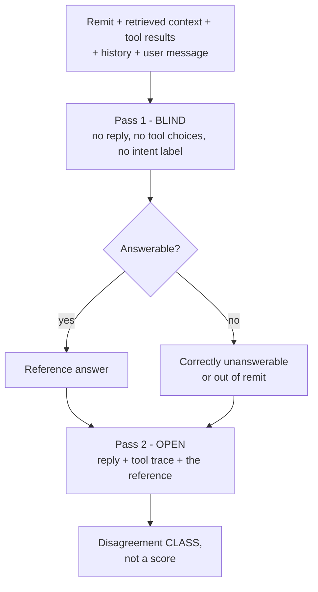

| Pass 1 says | Assistant did | Verdict | Owner |
|---|---|---|---|
| Answerable | Answered well | Fine | - |
| Answerable | Answered badly | Model or prompt | AI developer |
| Answerable | Declined | Routing or grounding | Taxonomy or retrieval |
| Unanswerable | Declined | Correct, and provably so | - |
| Unanswerable | Answered | **Fabrication** | AI developer, urgently |

The bottom two rows are the reason for the design: a single relevance score cannot separate a grounded answer from a confident invention, and rewards the invention.

**Risk to manage:** the reference generator has the assistant's failure modes. It is held to the same grounding discipline, or it punishes a correct decline - the inverse failure. It must not be the same model in the same configuration, or the exercise is self-grading; `UTILITY_MODEL_ID` provides a separate one. Cost: it at least doubles judge calls, so it runs on the `always` stratum plus the existing sample rather than on all traffic.

## Three readings, because there are three owners

One score conflates three failures whose fixes sit with three different people, so adherence, correctness and fitness are reported separately, and tool use is a dimension of its own with five outcomes.

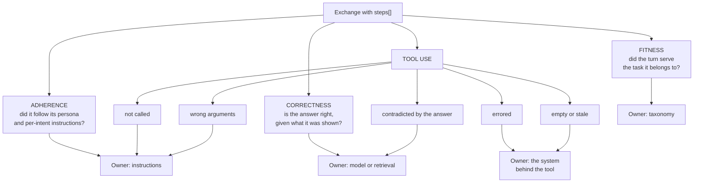

The fifth tool outcome is fabrication seen from the tool side, and it is the one a text-only score reads as a good answer. Each of these readings is per assistant, so a finding reaches one team rather than being argued between two.

## Selection, versioning and cost

**Stratified and deterministic.** `always` takes human-flagged and low-confidence exchanges; the remainder is drawn at a recorded rate by a hash of the id rather than `random()`, so a re-run selects the same rows. The stratum and rate land on the row, which is how a rate states its population. The `always` stratum records a NULL rate rather than 100, so nobody pools it with sampled traffic.

**A score names everything that could have changed it.** `componentVersion(prompt)` segregates rows scored under different wording. The evaluator model is the other axis: a model swap re-baselines every score, which tenet P3 makes an expected event rather than an edge case, so `evaluator_model` is on the row and readable by the surfaces that report a rate. The Effectiveness drill and the Evaluations table render it per exchange beside the rubric, a row that records no model reads as a dash rather than borrowing the current one, and the aggregate names the judge only where exactly one produced it: above one it states the count instead, because an average over two judges is not one number. Aurora only, as the column is: the Athena runner scores relevance alone and records no evaluator model.

**The cost levers are the design's, and what ships is narrower.** `EVAL_SAMPLE_PERCENT`, `EVAL_MAX_PER_RUN`, `EVAL_MAX_FLOWS_PER_RUN` and `VISION_EVALUATOR_MODEL` decide what evaluation costs, and a team that cannot turn evaluation down turns it off. The design requires that `EVAL_MAX_PER_RUN` bound the run rather than one pass, so Pass A and the drift-offer pass draw from one budget instead of reaching twice it between them; as shipped, each pass takes the full cap separately, so a run can judge up to twice it. The design requires that the sample percent reach zero, because throttling and disabling are different requests; as shipped it is clamped to 1 through 100, so disabling evaluation is a deploy decision rather than a lever. The levers exist as Lambda environment variables that no deploy path sets, so the runner reads their defaults; making them context-driven, and closing the two gaps above, is [SPEC-EVALUATION](./SPEC-EVALUATION.md) FR18.

## Batching by assistant, and cycling

The remit a judge needs is per assistant, and `getIntentPack()` memoizes at module scope with SSM read once, so flat chronological selection mixes assistants and makes every row a pack resolution where an omitted argument silently falls back to the deployment pack. Grouping by assistant loads the remit once and correctly for every row in the group.

**Batch the context resolution, not the judge call.** One judge call per exchange: no shared window, no cross-contamination, no verdict to untangle. Rendering several exchanges into one call couples verdicts and muddies attribution.

**Cycle so every assistant is reviewed regardless of traffic.** The rotation is derived rather than stored - take the assistant whose most recent scored row is oldest. It self-corrects after a failed run, needs no migration, and a new assistant joins automatically. `always` is taken every run regardless of whose turn it is, or a flagged exchange waits a full cycle.

**Consequence that must be handled:** cycling scores closer to equal per assistant rather than in proportion to traffic. That is right for per-assistant figures and makes any pooled cross-assistant average stop describing what users experienced. The selection basis rides `sample_stratum` and `sample_rate` so a reader can re-weight, and every reader of those columns is written to expect the cycling values.

## Calibration, a golden set, and a gate on promotion

A judge no person has checked is an opinion repeated at scale, so the agreement figure is published next to the score it qualifies.

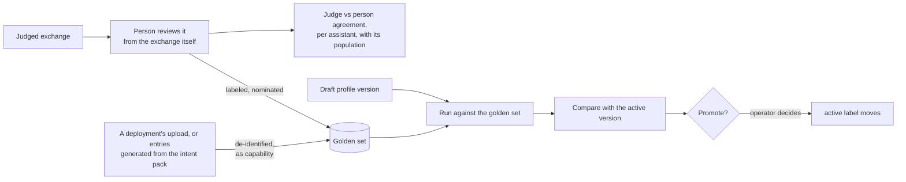

**Recording a verdict starts from the exchange being reviewed.** A calibration set cannot fill when each label costs a tab switch and an identifier copied into a free-text field, and a golden set built on that workflow inherits the problem. The flagged-response surface records its review from the row itself, and that is the shape this follows.

**The gate is narrower than a workbench, on purpose.** A general-purpose dataset workbench is declined and stays declined; a gate between a draft profile version and the `active` label encodes this deployment's own rules, which is the case for building rather than attaching. The decline of an evaluation gate in CI is untouched: a build runs on every push with nobody watching, while a promotion runs when an operator is standing there to read the result.

**Calibration does not retune the judge.** It publishes the distance between judge and person. A rubric tuned on the labels it is measured against is no longer independent, so the loop stops at reporting.

**One reader serves the console.** The Ground Truth tab reads `judge_calibration` per rubric, assistant instance, evaluator model and rubric version (`JudgeCalibrationPanel`), beside the battle-pick agreement (`pairwise_agreement`); the pooled agreement rate and mean absolute error it replaced are gone. The `complianceAgreement` data-plane operation remains, reached by an operator script and by no console surface. [SPEC-EVALUATION](./SPEC-EVALUATION.md) FR15 states what is delivered.

## Next increments

[SPEC-EVALUATION](./SPEC-EVALUATION.md) Appendix C orders the increments. Everything in this section is built with unit tests and deployed to dev on 2026-10-27 (Aurora mode), **NOT VERIFIED** on a deployment. The non-posting answer run the gate needs is built and unit-tested on each classification's GoldenRun function, and verified on dev on 2026-10-31 by the `golden-set` e2e phase ([ADR-065](../../../design/decisions/065-a-draft-answers-the-golden-set-before-it-is-activated.md)). Each increment reads a record the platform already writes, or adds that record before anything judges it, and lands beside the passes above rather than as a parallel system.

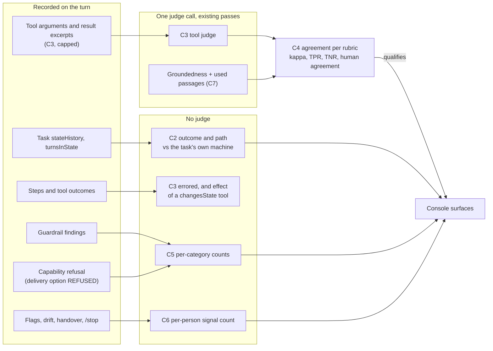

**Deterministic first.** C2, C5, C6 and the errored and state-change halves of C3 are queries over rows that already exist or gain one column. They cost nothing per turn and cannot drift with a judge, which is why they precede any new judged reading.

**Trajectory against the declared graph.** The shortest path is computed from the machine the task ran under (`task-state-machines.ts`, or the pack's own), so a valid detour scores as a longer path rather than a mismatch. A `by: 'system'` edge is reported apart from a `by: 'tool'` edge, because a platform move is not the model's choice.

**Tool judge as its own pass** (`tool-judge.ts`). It selects exchanges the relevance pass judged that recorded tool calls or held tools. It batches by assistant like Pass A, renders the turn's offered tools and each call's recorded arguments and excerpt as delimited evidence, and stores one row per call with `rubric_version` and `evaluator_model`. The excerpt is recorded under the conversation's classification, so the judge reads it with the same role that reads the turn.

**Used passages ride the groundedness call.** No new pass: the groundedness judge already holds the request, the passages and the reply, so it returns the indices the reply rests on in the same call, and the row gains `used_passage_count` and `passage_sources`. `retrieval_sources` reads how often each source was retrieved and used, shown as **Retrieval by source**.

**One calibration reader.** Ground-truth labels, compliance labels and battle picks feed one per-rubric, per-instance agreement query that every judged surface reads. A change of `evaluator_model` or `rubric_version` starts a new series. An alert on a judged rate checks its population against a minimum detectable effect computed with the experiment statistics' power function before it fires.

## The promotion gate

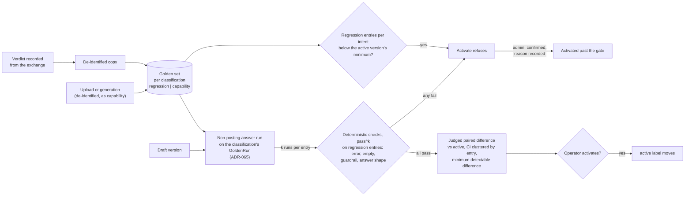

**Only deterministic checks block.** A judged average moves with the judge, the sample and the run, so a gate that blocks on it is flaky by construction; it is shown with its interval and the smallest difference the set can detect, and the operator decides. Repeated runs are required even at temperature 0, because the same request does not produce the same answer twice.

**Per classification, under its own role.** The set is stored and read per classification, and the run executes on that classification's own GoldenRun function, beside its classifier replay and built the same way; a deny test proves another classification's role is refused the set and the run record. The function holds no Amazon Chime SDK action and is not a speaker. The starter outside the VPC sends both versions' stored definitions, so the function needs no SSM route, and it reads their bodies from S3 through the gateway endpoint. A text run offers no tools, so an entry whose answer used one is counted as not exercised (ADR-065).

**A copy, de-identified.** A nominated entry is copied from the conversation's de-identified copy, and an uploaded or generated entry is de-identified by the same detector before it is stored, so the set outlives the conversation and the assistant's job changing while holding nothing offboarding must erase. Uploaded and generated entries enter as capability and become regression only after the active version passes them.

**Before the set is adequate.** The gate counts regression and capability entries per intent of the draft's pack, and the active version may declare `goldenSet.minRegressionPerIntent`, below which Activate refuses as `GOLDEN_SET_THIN`. An administrator may activate a refused draft on a separate route and capability, `activate-past-golden-gate`, after confirming the refusal that stands and giving a reason the version records ([ADR-065](../../../design/decisions/065-a-draft-answers-the-golden-set-before-it-is-activated.md) decisions 5 to 8).

## What the runner needs access to

The runner sits in the database subnets, and its role holds the database and the judge model. Persona and instructions live in SSM, task state in DynamoDB, and sibling packs elsewhere, and the runner reads none of them yet. Task state is reachable through the VPC's DynamoDB gateway endpoint. SSM is not reachable from the database subnets, which have no SSM endpoint, and the existing data-plane seam runs the other way, a non-VPC handler reaching in to the in-VPC Lambda, so persona and pack resolution needs either an SSM endpoint or a seam in the reverse direction; which one is unsettled and is listed under Open questions. Widening the runner's role is not the answer either way (tenet D8). Its `ARCHIVE_BUCKET` grant is narrowed to what it reads, `s3:GetObject` on `delivered-documents/*`: the archive is the system of record and nothing in evaluation writes to it. Its attachments-bucket grant is `s3:GetObject` on `battle-images/*`, the generated images the image judge reads. Archival, which makes the archive's copy of a delivered document, holds `s3:GetObject` on the attachments bucket's `generated-docs/*` and `s3:PutObject` on the archive's `delivered-documents/*` (`archive-stack-aurora.ts`).

## Open questions

| Question | Why it is open |
|---|---|
| Per-assistant or per-intent rubrics | A per-assistant rubric makes scores incomparable across assistants unless the scale is held fixed, and a terse internal lookup should not be judged by a customer-facing standard. Both are true |
| How the runner reaches persona and pack configuration | The database subnets have no SSM endpoint and the data-plane seam runs inward, so the choice is an SSM endpoint or a reverse seam, and each has a cost the other does not |

## Third-party integration points

| Point | Carries | Content leaves the account? |
|---|---|---|
| S3/Athena archive export | Full event sequence | Depends on the tool. A self-run library does not self-host the judge model, and the defaults call a hosted provider |
| `evaluation_results` / `intent_flows` | Verdicts, scores, reasoning | Only if exported; judge reasoning is prose and is an egress decision |
| Run completion | Counts, a `runId`, exchange ids, error strings - no message bodies | No |
| OpenTelemetry exporter | Spans | Unscheduled by design, and blocked on an exporter that does not exist |

Amazon Bedrock human evaluation shows content to annotators unless a bring-your-own work team is used. An exported dataset is also a copy that a later erasure request cannot reach, so the export shape is a prerequisite for every attach path rather than a detail of it.

## Related Documents

- [SPEC-EVALUATION.md](./SPEC-EVALUATION.md) - requirements, personas, non-goals, and what is delivered
- [SPEC-AURORA-VPC-MODE.md](../../foundations/SPEC-AURORA-VPC-MODE.md) - hosting, and the producer-to-column diagram
- [SPEC-ADMIN-CONSOLE-EFFECTIVENESS.md](../../interface/SPEC-ADMIN-CONSOLE-EFFECTIVENESS.md) - the reader surfaces
- [HOW-TO-CONFIGURE-COMPLIANCE-RULES.md](../../../guides/developer/HOW-TO-CONFIGURE-COMPLIANCE-RULES.md) - authoring the rules Pass C judges
