# DESIGN: Experiments and Battle - Objective, Briefing, Lifecycle, and Decision Loop

**Status:** Partial. §1 to §4 are implemented. The §4.3 drill-down's real-data reconciliation is verified live by `tests/e2e/experiments.spec.ts` ("the drill-down reproduces the aggregate: same count, same mean, per variant"); `tests/e2e/experiment-results-trust.spec.ts` extends that check to every experiment type through the admin console, 4 of 4 on a deployment (2026-10-27). The two-version model (§3.5) and promotion (§3.6) are deployed and verified on a deployment by the experiments, experiment-trust and promotion e2e (2026-10-27, ADR-050 What proves it); every §4 test counts conversations (§4.2), built and deployed, with the correlated case pinned by `experiment-stats-per-conversation.test.ts`. Section 5's gate is deployed, exercised end to end on test traffic only, and has not informed a decision; its precondition is enforced in the console rather than in the API. `accuracy` has no measurement of its own inside section 4; section 5 is its measurement. Answer replay (§5.6) is **ROADMAP**. Delivery status per requirement is [SPEC-BATTLE](./SPEC-BATTLE.md)'s; §3.5 and §3.6 record the code-level gap against the design.

**Coverage:** `tests/e2e/an-image-experiment-attributes-every-step-to-its-arm.spec.ts` · `tests/e2e/experiments.spec.ts` · `tests/e2e/experiment-results-trust.spec.ts` · `tests/e2e/battle.spec.ts`

**Verified by:** `backend/test/lib/experiment-stats.test.ts` (the statistics in §4), `backend/test/lib/experiment-stats-per-conversation.test.ts` (§4.2 unit of analysis: correlated conversations on which the per-exchange test is significant and the per-conversation test is not, the singleton case equal to the per-exchange test, picks per battle, the gate per conversation), `frontend/packages/admin/src/components/admin/ExperimentUnits.test.tsx` (the console states conversations beside exchanges), `backend/test/lib/experiment-types-and-lifecycle.test.ts` (the state machine in §3.2 / A.3), `backend/test/lib/experiment-outcome.test.ts` (the verdict rule in §4.4), `backend/test/lib/battle-outcome.test.ts` (per-user picks, A.4), `backend/test/analytics-aurora/analytics-query.test.ts` (the two human axes in §4.3: that each is emitted independently of the metric sample floor, that absence differs from zero, and that a small lopsided sample is not called decisive), `backend/test/lib/variant-feedback-drilldown.test.ts` (one counted vote per voter, and that each drill-down selector returns exactly the records its aggregate counts), `backend/test/analytics-aurora/analytics-query.drilldown.test.ts` (the three drill-down queries and their full-match totals), `frontend/packages/admin/src/components/admin/ExperimentDrillDown.test.tsx` (the on-screen reconciliation, including that a mismatch is announced rather than rendered quietly), `backend/test/lib/experiment-worked-examples.test.ts` (every figure quoted in the §4.6 and §5.3 worked examples, computed by the same functions the recommendation calls), `backend/test/manage-profiles.test.ts` (§3.5: each type's recipe, the control pinned as the live version, the control refusal, and §3.6 promotion: the hash-equal copy, `promotedFrom`, the refusals on a moved base and a hash mismatch), `backend/test/admin-experiments.test.ts` (arming pins both versions for every type with and without a battle, an edit keeps its pins, a resume re-arms an older row, and promotion completes the experiment, releases the alt and is refused to a caller without `activate-profiles`), `backend/test/lib/experiment-manager.battle.test.ts` (enrollment serves a pinned arm's version and nothing is served per turn; what each type counts), `backend/test/lib/an-experiment-turn-serves-its-version.test.ts` (a served version answers through its routes, the session is narrowed to the served version, an external image model is gated), `backend/test/lib/battle-turn.test.ts` and `backend/test/lib/a-duel-side-serves-its-pinned-version.test.ts` (a battle side serves its pinned version with no model forced), `backend/test/a-shared-service-only-speaks.test.ts` (round 2 re-resolves the side's version and drops a forged one), `backend/test/lib/profile-lifecycle.test.ts` (nothing is published under the live name; the rollback refusal names Promote), `frontend/packages/admin/src/components/admin/PromoteExperiment.test.tsx` (the console's Promote action).

**Related:** [SPEC-BATTLE.md](./SPEC-BATTLE.md) - the product surface, its requirements and its personas, which this document does not restate · [DESIGN-BATTLE.md](./DESIGN-BATTLE.md) - the battle's own turn path, state and measurement · [DESIGN-MULTI-ASSISTANT-TURN-ENGINE.md](../assistants/DESIGN-MULTI-ASSISTANT-TURN-ENGINE.md) · [SPEC-ADMIN-CONSOLE.md](../../interface/SPEC-ADMIN-CONSOLE.md) · [GUIDE-AB-TESTING-AND-BATTLES.md](../../../guides/admin/GUIDE-AB-TESTING-AND-BATTLES.md) · [TENETS.md](../../../overview/TENETS.md)

**Site section:** Interaction layer, quality.

> Section numbers in this document are cited from source comments (`DESIGN §1.2`, `§2.2`, `§3.2 / A.3`, `A.5`). Renumbering a section breaks those citations.

---

## 0. Summary

Experiments and battles are **one feature by design**, not two. A battle is the hands-on, human-feedback mode of an A/B experiment: `battleEnabled` is a field on the experiment record, the combatants **are** the experiment's two variants, and picks flow back as a per-variant `battle_wins` column ([SPEC-BATTLE](./SPEC-BATTLE.md), Overview and FR8). The product surface and the personas are that spec's; this document is the mechanics.

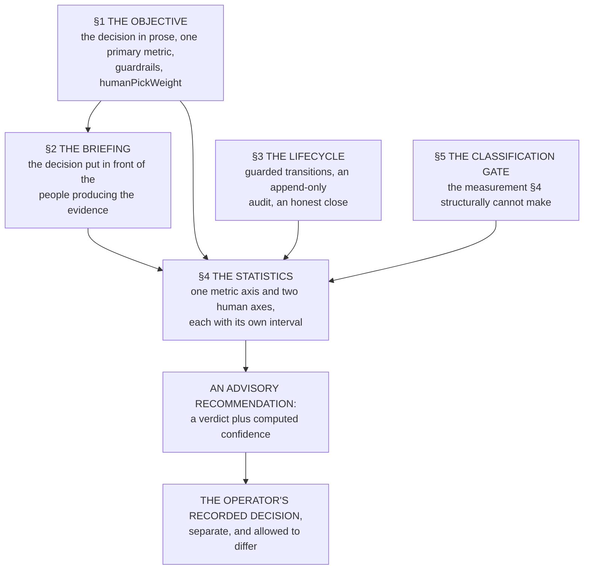

**OPEN:** no specification owns the objective, the briefing or the experiment lifecycle, so the requirements these mechanisms satisfy are asserted here and in no requirements table.

### Invariants

Load-bearing constraints from the specs and tenets. Every mechanism below holds to them.

- **INV-1 - Never auto-route.** Results recommend; promotion is always a deliberate manual operator action (SPEC-BATTLE FR8 and Non-Goals).
- **INV-2 - Additive schema.** Deployed experiments keep working; new fields are optional and absent means prior behavior (tenet P3).
- **INV-3 - Honest about confidence.** Low-sample flags, `pending` states and the advisory tags are preserved.
- **INV-4 - No algorithmic judge decides the battle.** The human pick and objective telemetry are first-class; a model-as-judge control loop is out of scope (SPEC-BATTLE Non-Goals). Statistics are computed over the picks and metrics, and the quality verdict per battle stays the human's.
- **INV-5 - Governance holds.** Battle stays gated by the classification's `battleCapable` capability plus a runtime per-classification setting that is off by default (ADR-049), and stays single-classification; no result changes a classification's declared grant set (tenet D2, ADR-046).

---

## 1. The written objective

### 1.2 Schema

An experiment records the decision it informs rather than a bare threshold. The objective is a single sub-object, extended additively so a record carrying only `{metric, target}` keeps working (INV-2), and every field decides one branch downstream.

```ts
export type ExperimentObjectiveMetric = 'cost' | 'accuracy' | 'quality' | 'latency';

export interface ObjectiveGuardrail {
  metric: ExperimentObjectiveMetric;
  // 'no_worse_than' bounds a regression; 'at_least' bounds an improvement floor.
  direction: 'no_worse_than' | 'at_least';
  bound: number; // percentage, same units as `target`
}

export interface ExperimentObjective {
  metric: ExperimentObjectiveMetric;   // PRIMARY quantitative criterion
  target: number;                      // % decrease for cost/latency; % level for quality/accuracy
  statement?: string;                  // the decision this test informs (<=500 chars, sanitized)
  guardrails?: ObjectiveGuardrail[];   // metrics that must NOT regress for a ship (<=3)
  humanPickWeight?: number;            // 0-1: how much the battle human pick counts (default 0)
}
```

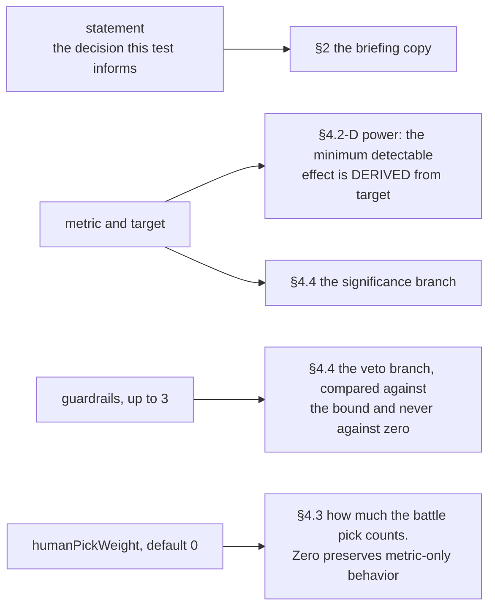

**Guardrails are pre-registered for two reasons, not one.** They state the decision rule before the result ("ship treatment if quality is at least +5% **and** cost is no worse than +20%"), and pre-registration is also what protects the statistics in §4 from multiple-comparison fishing.

### 1.3 API and validation

`validateAndSanitizeExperiment` sanitizes and length-caps `statement`, validates each guardrail's metric and that its `bound` is within 0 to 100, and validates that `humanPickWeight` is within 0 to 1. All are optional, so an absent objective passes; the create form requires `statement` while the API only warns, so programmatic callers are unaffected (INV-2). This rides the existing `POST /admin/experiments` upsert and adds no endpoint.

### 1.4 Console

Create presents an **Objective** block: a required "What decision will this test inform?", the metric and target as **Primary metric**, and an optional **Guardrails** repeater. The results view renders the statement above the metric progress and shows guardrail pass or fail chips beside the primary-metric badge.

---

## 2. Battle-start briefing and prompt steering

### 2.2 The briefing

Without a briefing, users generate the comparison data blind, so battles exercise prompts irrelevant to the decision. The briefing is the objective's `statement` put in front of the people producing the evidence.

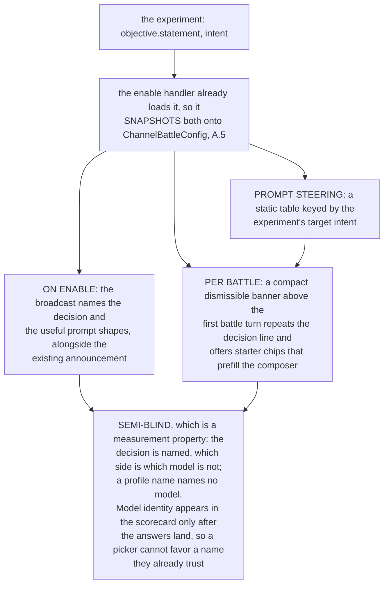

The briefing fields are readable by non-moderators, which is the point: the people running battles are the ones who need them. The frontend renders the chips and the backend supplies the copy. **INV-5** holds because the briefing shows only where battle is already enabled, so it opens no new exposure surface.

**Prompt steering** exists because a battle is only as good as what it is asked. Each entry is a coaching line plus two or three starter chips:

| Target intent | Coaching line | Starter chips |
|---|---|---|
| `general` | Ask real questions your users ask. | "Explain X to a new hire" · "What is the difference between A and B?" |
| `code_generation` | Ask a real coding task you would actually ship. | "Write a function that ..." · "Add retry/timeout to this call" |
| `code_review` | Paste real code and ask for a review. | "Review this for bugs" · "Is this concurrency-safe?" |
| `data_extraction` | Give a document and ask for specific fields. | "Extract the totals as a table" · "Pull every date and owner" |
| `report_generation` | Ask for a report you would actually send. | "Draft a one-page status report on ..." · "Summarize this for execs" |
| `image_generation` | Describe an image you actually need. | "A hero image for ..." · "An icon set for ..." |
| `strategic_analysis` | Pose a real judgment call. | "Pros and cons of migrating to ..." · "What are the risks of ...?" |
| `guided_troubleshooting` | Ask it to drive a multi-step task. | "Plan and track the steps to ..." · "Walk me through ..." |

Intent-type experiments use their own row. Base, classification and profile experiments span intents, so they seed from the objective statement plus a generic line. The table is example copy rather than policy, and a deployment may override it.

---

## 3. Lifecycle

A running test is not silently overwritten, a finished test cannot be reopened, a test that collected data cannot vanish without a trace, and every transition records who made it.

### 3.2 Experiment state machine

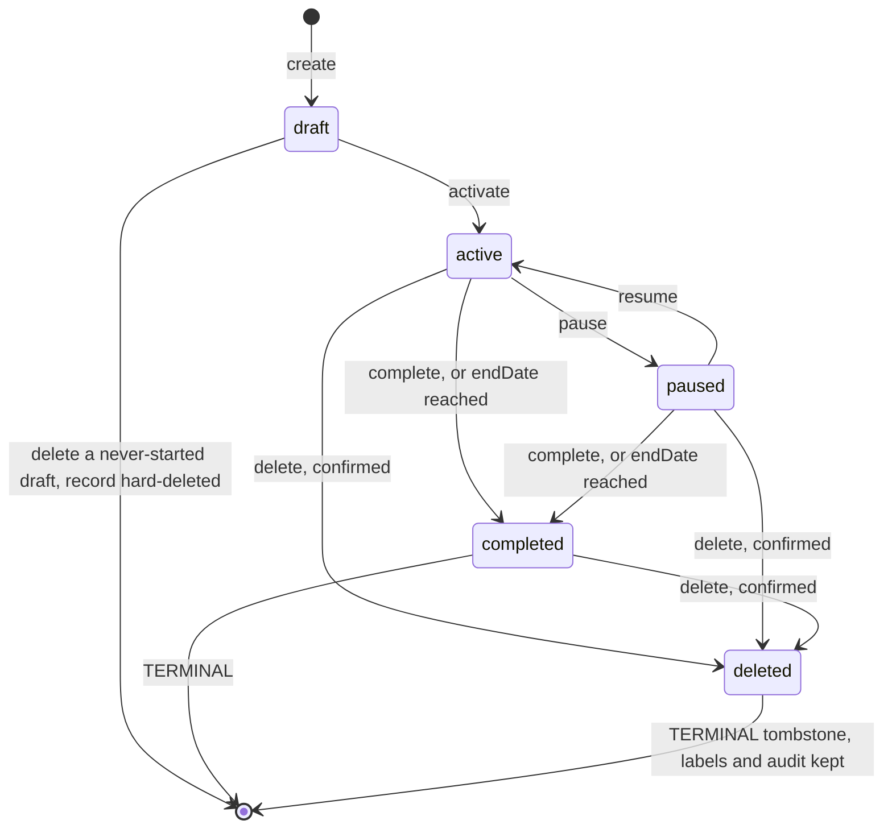

- **`draft` never resolves traffic.** An omitted status still means `active` for existing callers (INV-2); Create defaults to draft with an explicit "Create and Activate".
- **Edits to a live experiment are guarded.** Once an experiment has left `draft` the variant models and count are immutable, and only weight, `endDate` and `objective` may change; `createdAt` is preserved on update rather than clobbered. The lock keys on status rather than on a per-variant exchange count, because the count is an analytics alias never persisted on the row, and any non-draft experiment is treated as data-bearing, which is the fail-safe reading. Changing what is being compared means a new experiment with a new id, which is cheaper and cleaner than pooling data across a variant swap.
- **`completed` is terminal**, any transition out of it is refused; **weights** are each a non-negative integer summing to 100; **`startDate`** is honored at resolve time and a past `endDate` auto-completes; **a missing id** returns 404 rather than 500.
- **An append-only `transitions` audit** records every status change and guarded edit with the acting admin, per tenet P4.
- **Delete is hard where there is nothing to preserve and soft otherwise.** A never-started draft with no data is removed outright; anything that ever ran becomes a `deleted` tombstone, so historical exchanges keep their variant labels and the audit survives. The choice is made server-side from the record's state and exchange count rather than by the caller, and either way Delete frees the classification and releases the challenger it named.

### 3.2.1 Freeing a classification

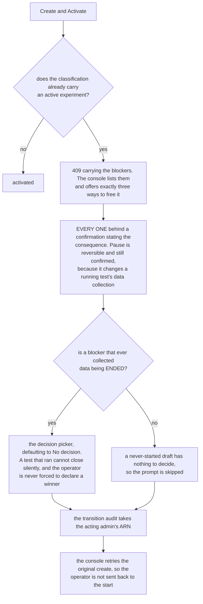

| Action | Transition | Results | Resumable? |
|---|---|---|---|
| **End** | `active\|paused → completed` (terminal) | Kept | No |
| **Pause** | `active → paused` | Kept | Yes |
| **Delete** | `any → deleted` (soft) | Historical exchanges keep their labels | No |

```ts
export interface ExperimentDecision {
  outcome: 'promoted_treatment' | 'kept_control' | 'no_decision';
  note?: string;   // optional prose, <=500 chars
  by: string;      // admin ARN from token
  at: string;      // ISO timestamp
}
```

`promoted_treatment` and `kept_control` are the operator's record of what they did after reading the advisory recommendation. **Recording the decision is not the promotion itself**, so INV-1 still holds; promotion is §3.6. Confirmation stays on the console side: End and Pause reuse `POST /admin/experiments/{id}/status`, Delete uses `DELETE /admin/experiments/{id}`, and the API executes the requested transition and returns the freed classification.

### 3.4 Battle lifecycle guarantees

Four properties bound a battle: only one runs per channel at a time, a stalled round fails loudly rather than silently, every member's pick is retained, and completion is signaled explicitly rather than inferred.

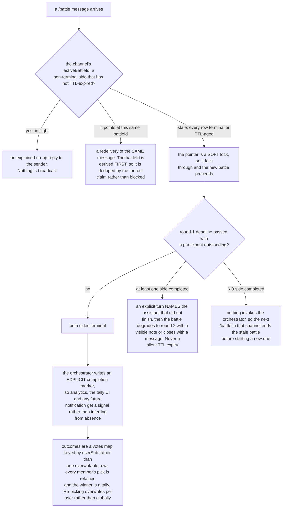

**Fail-loud has one residual gap**: both sides dying AND the person never returning, where there is no observer to tell. [DESIGN-BATTLE](./DESIGN-BATTLE.md), Open technical questions, states that limit and the cost of closing it, rather than leaving this sentence to imply it is covered. **A legacy single-row outcome is read as one pick** keyed by its `chosenByUserSub` during cutover, so the votes map needs no migration step.

### 3.5 Two versions of one assistant

Requirements: [SPEC-BATTLE](./SPEC-BATTLE.md) FR11. Every experiment, battle or not, compares two complete versions of one assistant, so a result names two `configId`s and promotion (§3.6) activates exactly what was measured.

- **Control.** The live assistant's active version, pinned by version number when the experiment is armed (`controlPin`). It is a reference: nothing new is written to the live history. A control variant may leave its model unnamed; one that names a model, a persona addendum or an image model the live version does not serve is refused (`CONTROL_DIFFERS_FROM_LIVE`), and an assistant with no active version has no control to pin (`CONTROL_HAS_NO_ACTIVE_VERSION`).
- **Treatment.** A candidate version derived from the control by the experiment type's recipe and kept in the candidate history, the alt assistant `alt-{role}-{classification}` (`altPin`, [ADR-050](../../../design/decisions/050-the-alt-is-an-assistant-and-a-conversation-is-enrolled-once.md)). A re-arm that derives the same body reuses the pin.
- **A battle has no alias.** A battle side is named from its profile, never by an alias on the experiment (`battleSideNames` in `experiment-manager.ts`): the control by its pinned version's `displayName`, else the live assistant's configured name (`ProfileRegistry.displayNameFor`), and the treatment by its version's `displayName`, else the control's. When the two names match, case aside, the treatment's carries the `battleAltName` line from its own version's copy (by default `{name} (alt)`), so the two sides read differently. A variant carries no name; a request that still sends a variant `displayName` is accepted and the field is dropped on write. The live identity's name never changes for a battle. The alt identity carries the treatment's name while an experiment holds it and its provisioned name again when the experiment releases it, and the battle's own lines (the placeholder `name=`, the rival's name in a rebuttal, the scorecard) read both sides' names. A profile name names no model, so the battle stays semi-blind.

| Type | The candidate differs from the control in |
|---|---|
| `intent` | One model of the intent, named by the experiment's `target` ([ADR-064](../../../design/decisions/064-a-turn-takes-its-model-from-the-intent-and-the-step-it-runs.md) decision 6): `models.byIntent[<intent>].primary` (the text model, the default), `.image.primary` (`target.kind: 'image'`, the variants' `modelKey` image models) or `.steps[<state>].primary` (`target.step`); fallbacks kept. Any model the classification allows and that fits the target, cheaper than the base model included. A turn bound to a task counts by the task's intent (its type, else the intent of the request that opened it). A task records the arm it was opened under and is served it while the experiment runs; once the experiment stops, its losing version is no longer served and a task in flight carries on with the live version (ADR-064 decision J as restated). **NOT BUILT:** a step target in the console's experiment form (set through the API) |
| `base_model` | the base model only; it reaches every turn whose intent has no route |
| `classification` | `models.classifier` only |
| `profile` | a referenced version, intents excepted |

The tested instruction (`systemPromptAddendum`, layered after the persona) and the image model (`models.image`) are fields a recipe may also set. The tested instruction is what the experiment tests, not the assistant's general answer style, which belongs in the persona's `How to answer:` section; after promotion, the console's **Move into the persona** moves it there on a draft. An experiment compares exactly two variants in one classification (`EXPERIMENT_TWO_VERSIONS`, `EXPERIMENT_ONE_CLASSIFICATION`).

**Two referenced versions.** A `profile` experiment's control is its referenced version, which need not be the live one: comparing two configurations neither of which is live is a `profile` experiment with two referenced versions. It has no live control, records a decision, and §3.6 does not apply to it.

**A referenced profile on an intent experiment** stays refused (`PROFILE_REF_ON_INTENT_EXPERIMENT`), on the amended ground in ADR-050: an `intent` experiment does serve a whole version to every turn of an enrolled conversation, which is safe because its candidate differs from the control in one route, while a referenced version may differ in anything.

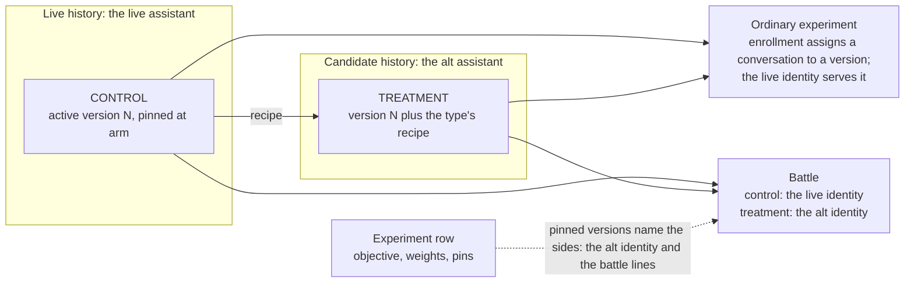

*As built and deployed; verified on a deployment for ordinary experiments, a battle side's per-turn pinned version by unit test only.*

**Every turn serves a version normally**, its per-intent routes included: no forced model and no experiment model override. An `intent`, `base_model` or `classification` experiment enrolls a conversation exactly as a `profile` experiment does: a conversation created while it runs is assigned an arm once, and every turn of it, the greeting included, is served that arm's version under the live identity. The version is resolved before the turn is classified, so its classifier, intent pack and workflow selection decide the turn, and a `classification` experiment's candidate classifies with its own classifier. A battle serves the control from the live identity and the treatment from the alt identity, an ordinary assistant with its own `AppInstanceBot` identity and its own Amazon Lex bot on its classification's router ([DESIGN-BATTLE](./DESIGN-BATTLE.md) §1a). A turn the alt identity answers outside a battle (a reply targeted at it, a mention) serves its armed candidate.

**Session narrowing.** A candidate served under the live identity narrows the turn's vended session to the served version's declared reach: the router records the served version as the turn's routed variant, and the vend narrows from it, inside the edges the classification stack created for its `(classification, role)`.

**What an experiment counts.** Every turn of an enrolled conversation is served its arm's version, and each type keeps the meaning its attribution had: an `intent` experiment counts only turns of its intent (matched as the resolver matches it), a `classification` experiment only the turns its version's classifier labeled, a `base_model` experiment every turn but the fast-path greeting and acknowledgment, and a `profile` experiment every turn. Those turns carry `experimentId`, `variantId` and the served version's `configId`. Enrollment samples only conversations created while the experiment runs, so an `intent` experiment accrues more slowly than assignment on every turn did. The analytics read relies on that stamp and adds no intent clause of its own (`experimentPopulationWhere` in `analytics-query.ts`): the uncounted turns of an enrolled conversation carry no `experimentId`, so they never reach a mean or a test, and a conversation counts toward an `intent` experiment once at least one of its turns did. Because the counted turns of one conversation are not independent, every §4 test counts conversations (§4.2, "The unit of analysis").

**Image models hosted outside AWS.** A recipe that names an image model with `hosting: 'external-http'` is refused by the derivation unless the classification selects that model, the same rule the write path applies to any version, and the processor serves such a model at runtime only in a classification that selects it.

**Only an active experiment holds a conversation.** An enrolled conversation is served its arm only while the experiment is `active`, inside its window, and has not left `active` since the conversation was created (`enrollmentHolds` in `experiment-manager.ts`, checked every turn through the per-container cache, so within one minute of the write). Completed with any decision, deleted, past its end date or paused, the conversation is served the live assistant's active version from its next turn with no attribution, so only turns served while the experiment was active count; a pause releases for good, and a resume enrolls only conversations created after it. A battle on an experiment that is no longer active ends (`endBattle`, `abandoned:experiment-ended`; `DuelSides.ended` in `battle-turn.ts`) rather than letting the treatment answer, round 2 included.

**Rows armed before.** A row carrying a pin enrolls conversations and serves the pinned version; a battle armed before keeps reading a control version derived under the live name until it is paused and resumed, which re-arms it. An `intent` or `base_model` row with no pins is evaluated on each turn while live, by a hash of the conversation and experiment, until it is paused and resumed. An edit of an armed experiment keeps its pins. Conversation-scoped means every experiment armed with two pinned versions (`servesVersions`), any with a pin, a `profile` experiment, and any with a `profileRef` variant.

**Editing an armed experiment, paused or running.** An edit keeps the row's pins whatever its status (`keepPins` in `admin-experiments.ts`), so a paused experiment that is edited (weights, end date, objective) can still be promoted or resumed against the versions it measured. What the pins were derived from cannot change on a row that has left draft: the variant models and count, the experiment type, the intent and the classification (`comparisonChanged`), refused with `EXPERIMENT_LIVE_EDIT_LOCKED` and nothing written. A draft that holds pins and changes what it compares has them removed explicitly, and arming derives new ones. An edit that sets a paused or draft row `active` pins again, as Resume does, and the profile writer reuses a candidate that still says the same thing.

**A refused arm derives nothing.** Deriving publishes the candidate into the alt's history, so the active-experiment cap and the one-experiment-per-classification check run first, on the create or edit route and on Resume alike. An arm those refuse publishes no version.

| Property | As built |
|---|---|
| Control | The live active version pinned by number at arm, with its `configId`; nothing published under the live name (`deriveExperimentVersions` and `controlMismatch` in `manage-profiles.ts`; `publishVariantVersion` refuses the live name as a target) |
| Recipes | `variantDeltaOf` in `manage-profiles.ts`; the route merge in `publishVariantVersion` keeps every other route and the route's fallback |
| Arming | Every arm pins both versions through the profile writer and marks the row `servesVersions` (`deriveVersions` and `armRefusal` in `admin-experiments.ts`) |
| Serving | `resolveEnrollment` and the served version ahead of classification in `router-agent-handler.ts`; `experimentModelOverride` in `assistant-async-processor.ts`; round 2 re-resolves the side's pinned version in the router and ignores any version in the payload (`dispatchRebuttalRound`) |
| Attribution | `countsTowardExperiment` in `experiment-manager.ts`; a battle pick records both pins' `configId`s (`pinnedConfigIds` in `battle-outcome-api.ts`); the battle rollup groups by `profile_config_id`; the experiment drill-down (`experiment_exchanges`) returns each turn's `profile_name`, `profile_version` and `profile_config_id` |
| Side names | `BattleSide.displayName` is the side's profile name, settled by `battleSideNames`; the alt identity wears the treatment's through the name applier (`applyAltAlias` in `admin-experiments.ts`) |
| Profiles tab | The listing returns `derivedFrom` and `promotedFrom` per version; the tab shows them in an Origin column, labels a candidate with its experiment and offers it no activation (`ProfileVersionProvenance.tsx`, `ProfilesTab.provenance.test.tsx`) |
| Classifier replay | A `profile` experiment's candidate keeps the live pack (the derivation strips `intentPack`); one pack per candidate for a control that references a non-live version with a different pack is **NOT BUILT** |

### 3.6 Promotion

Requirements: [SPEC-BATTLE](./SPEC-BATTLE.md) FR12. Promotion is an operator action (INV-1); no result triggers it. It is an activation of the live assistant's profile, so the route (`POST /admin/experiments/{experimentId}/promote`) is in the `activate-profiles` capability and the handler re-checks it beside the experiment-admin check (`PROMOTION_NEEDS_ACTIVATE_PROFILES`); a team route reaches only its own experiments.

*As built, deployed and verified on a deployment by `tests/e2e/a-tested-treatment-is-promoted-into-the-live-assistant.spec.ts` (2026-10-27, 2 of 2); the refusal of a caller without `activate-profiles` by unit test only.*

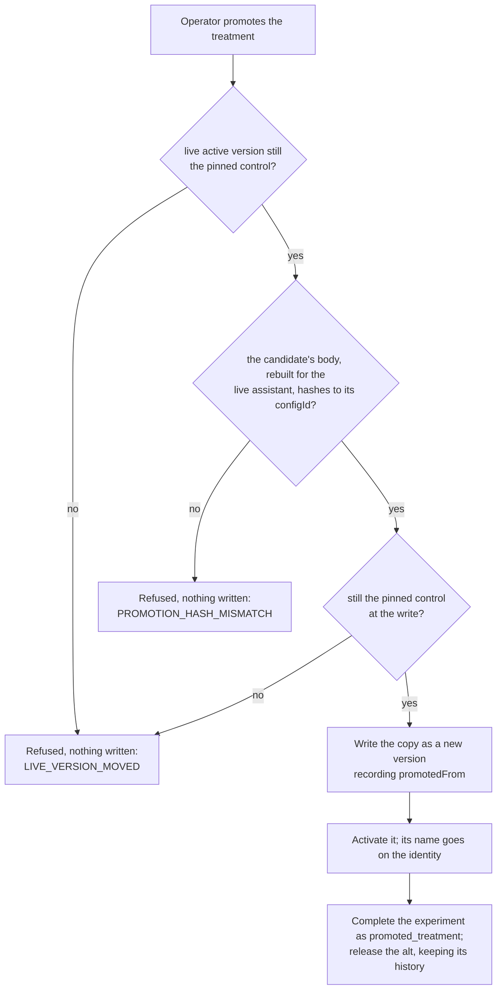

`promoteCandidate` in `profile-lifecycle.ts` checks that the live active version is still the control the experiment pinned, reads the candidate, rebuilds its body as a version of the live assistant and refuses unless it hashes to the candidate's `configId`, re-checks the live version immediately before writing, then writes the copy with `promotedFrom` (the candidate, its version and the experiment) and moves the `active` label to it. A refusal writes nothing. `promoteExperimentCandidate` in `manage-profiles.ts` applies the version's name to the identity as `/activate` does. The experiments handler then completes the experiment with the decision `promoted_treatment`, records `promotion` (the version, its `configId`, who and when) on the row, and releases the alt: its assignment record names no assistant, its identity gets its provisioned name back, and its history keeps every candidate. Conversations enrolled in the experiment return to the live version from their next turn, which after promotion is the winner (ADR-050 as amended 2026-10-15).

Refused also: an experiment armed before versions were pinned (`PROMOTION_NEEDS_TWO_VERSIONS`), one that is not running or paused (`EXPERIMENT_NOT_RUNNING`), and one whose control names no live assistant (`PROMOTION_CONTROL_NOT_LIVE`); a `profile` experiment whose control is a non-active version of the live assistant is refused as a moved base. If the experiment row changes while the version is activated, the answer says the version is active and the experiment was not completed (`PROMOTED_BUT_NOT_COMPLETED`).

The live history then holds only versions that served or were promoted. Tested-but-rejected candidates stay in the candidate history as the record of what was tried, and `activateExistingVersion` refuses a candidate as a rollback target, naming the Promote action. Because the promoted version keeps the candidate's `configId`, evidence keyed on `configId` carries across the promotion. The console offers Promote on an experiment that pinned two versions (`PromoteExperiment.tsx`). Between instances, export and import, landing as a draft, stays the path.

---

## 4. Decision logic

Confidence is a computed statistic rather than an opinion or a fixed margin, and the human signal reaches the decision. Everything here stays advisory (INV-1) and never becomes an auto-judge (INV-4).

### 4.2 The statistics

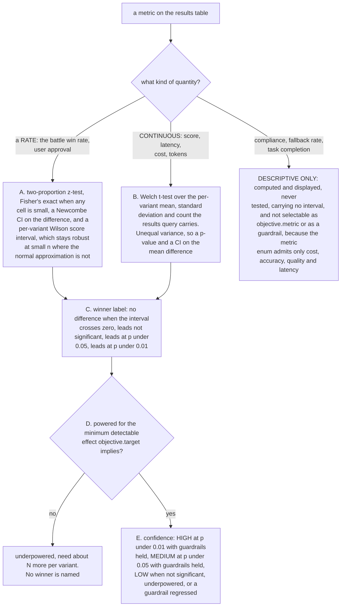

**The unit of analysis is the conversation.** An experiment holds an enrolled conversation to one arm while it is active, so its counted turns share a person, a topic and a version, and treating them as independent samples divides the variance by the number of turns when the evidence is closer to the number of conversations. Every test therefore runs per conversation, and the point estimates do not change:

| Quantity | Point estimate | Interval and test | n reported |
|---|---|---|---|
| Score, latency, cost, tokens (Welch, guardrails, power) | the per-exchange mean; the score over scored exchanges | cluster-robust variance with the conversation as the cluster, as a design effect (`clusterDesignEffect`, `clusterAdjust`); Welch runs on conversations | conversations and exchanges per variant; scored conversations for a score-backed objective |
| User approval | the per-vote rate | votes grouped by the conversation they were cast in, Rao-Scott effective counts into Wilson, Newcombe, z or Fisher (`clusteredTwoProportionTest`) | votes and conversations |
| Battle pick | the per-pick win rate over decisive picks | picks grouped by the battle they judged (`clusteredHumanPickTest`); a pick is per battle, never per exchange | picks and battles |
| Classifier gate (§5.3) | McNemar over informative discordant pairs | pairs grouped by the conversation the message came from (`clusteredMcnemarTest`) | informative pairs and conversations |
| Sample floor (`minSamplePerVariant`) | - | the smallest variant's conversations | conversations |

The design effect is the cluster-robust variance over the independent-exchange variance, floored at 1, so a clustered test never claims more confidence than the per-exchange one; with one exchange per conversation it is exactly 1 and the clustered test is the per-exchange test. The per-conversation moments come from one SQL pass over the same population as the rollup (`fetchExperimentUnits` in `analytics-query.ts`), so the conversations shown and the exchanges shown are the same turns. Cost has no per-exchange column (it is priced from tokens per model), so it takes the tokens' design effect. Experiments armed before versions were pinned, which assign an `intent` or `base_model` turn by a hash of the conversation and experiment, are counted the same way: the hash keeps a conversation in one arm, so the conversation is still the cluster. A conversation whose turns reached both arms would be a cluster in each, which treats the two arms as independent and is conservative. Battles in one conversation are treated as independent battles.

*As built and deployed (`clusterDesignEffect` in `experiment-stats.ts`, applied in `analytics-query.ts`).*

A one-point lead on thin data reads as not significant rather than as a winner. Wiring a descriptive column into the rule is a change to `ExperimentObjectiveMetric` and to the outcome evaluator rather than a display change. Generated prose narrates the computed numbers and never sources the confidence. **A hard floor applies below which nothing is claimed**, and it ships deliberately low as a demonstration floor rather than a decision floor; the operator guide recommends raising it before anyone routes traffic on a verdict.

**Power counts the measurement, not the traffic.** For a `quality` or `accuracy` objective the metric is the evaluator score, and scoring is a sample and a backlog, so most exchanges carry no score. Abundant traffic and scarce evidence are different quantities: a floor counting exchanges is satisfied by the first and says nothing about the second, which is how a rule could reach `equivalent` on a comparison nobody had judged.

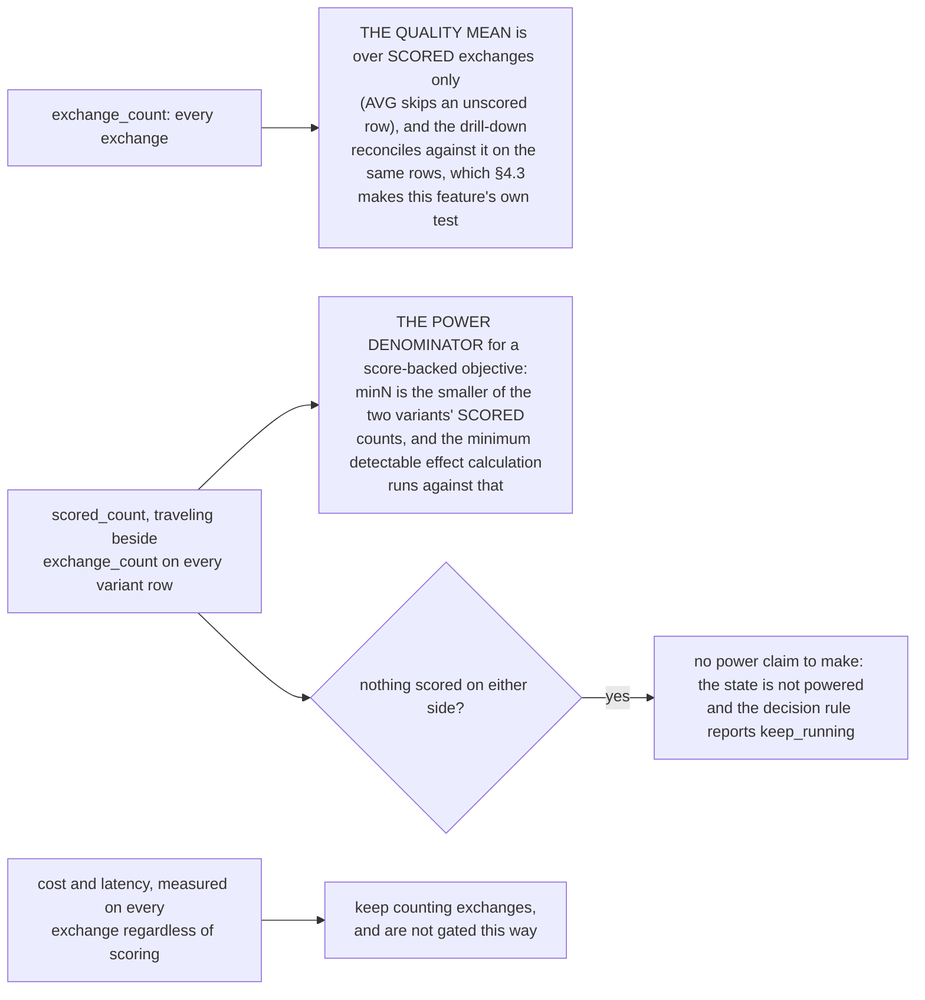

An unscored exchange is traffic rather than evidence, which is why the two denominators differ deliberately, and why the drill-down states how many rows carry no evaluator score rather than leaving the gap between the two counts to be inferred. In conversation units the power denominator is the smaller variant's scored conversations, and `requiredN` is in conversations.

### 4.3 The human axes

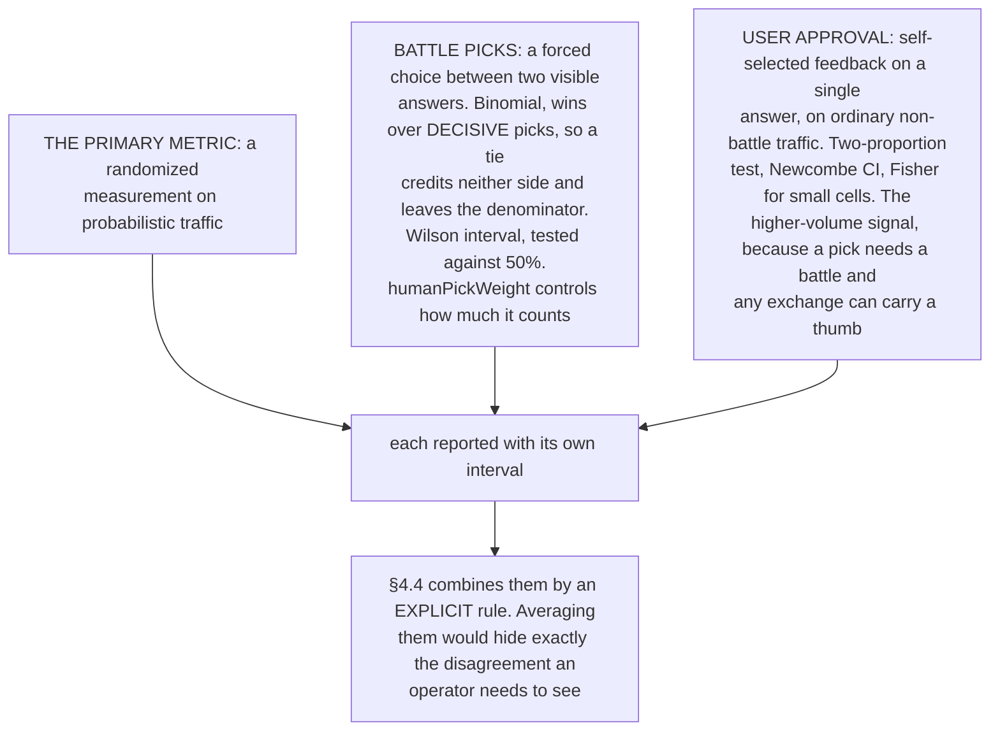

**Neither human axis is gated by the metric sample floor.** They are measured on different populations: the floor counts probabilistic traffic, which deliberately EXCLUDES battle turns through the `assignmentMode` filter, while every pick comes from a battle. Gating the picks behind that floor withheld the human signal precisely when battles were the evidence being gathered, so a battle-led evaluation could accrue any number of picks and report no human axis at all. An underpowered metric read says so while still reporting them.

**Absence and zero are different.** An axis is omitted entirely when nobody has voted or picked, because a zero-filled axis would render as a real 0% result and read as evidence. **Attribution is per experiment:** both axes key on the experiment id rather than on the variant id alone, because `control` and `treatment` collide across experiments, so a variant-only key mixes one experiment's votes into another's row whenever they share a variant id and intent.

**One counted vote per voter.** The feedback table is append-only and the whole trail is retained for audit, including after the voter is offboarded (offboarding keeps feedback, `lib/offboarding.ts`), so the approval rate counts only the latest record per (voter, message): a revised vote counts once on the side the voter ended on and a withdrawn vote counts not at all. The collapse runs **before** the date window, because a vote revised today supersedes its original however old that original is.

**The bar is reproducibility, not navigation.** The feature is done when an operator can recompute the result themselves and read the actual transcripts behind it, subject to permission. That means the per-exchange values that roll up - score, latency, cost, tokens, thumb or pick - rather than a list of links, the complete scored set rather than a recent sample, and exact reconciliation. A view that silently samples is a false pass in a different medium.

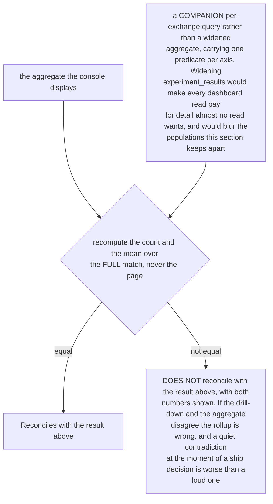

Four populations, four predicates, four controls, each rendered beside the number it explains:

| Control | Population | Reconciles against |
|---|---|---|
| Sample (exchanges) | Probabilistic turns for one variant. Battle turns excluded, matching the A/B averages. | `exchange_count` and `avg_score` |
| Battle scorecard turns | Battle turns for one variant: the replies produced inside a battle. | `turn_count` and the battle `avg_score` |
| User approval | One row per counted vote on ordinary traffic. | `feedback_count` and `approval_rate` |
| Battle wins | One row per counted pick. Ties credit neither side, so they are neither counted nor shown. | `battle_wins` |

Battle turns and battle picks are deliberately separate controls: a battle produces a turn from each side and at most one pick per person, so a single control would misreport whichever axis it was not filtered for. **Two conventions have to be stated or the number is not reproducible even with every row in view.** The quality mean is over scored exchanges only, matching the aggregate (`AVG(relevance_score)` skips an unscored row), so the view reports how many rows carry no evaluator score and notes that the average describes only what was scored. And a paginated view states the full N and that the checked figures are computed over all of it.

**A pick carries no conversation reference of its own.** `battleId` is a one-way hash of the channel and the user message, so a pick is traced to its conversation by matching that id against the archived battle turns rather than by decoding it. A pick whose battle has no archived turn keeps its row, reports no conversation, and is counted in a stated total of unresolved picks; dropping it would make the list disagree with the win count it explains.

**Access adds the request path, not the mechanism.** The admin plane already vends scoped, short-lived, audited credentials, the Aurora admin read derives redaction and deletion from the `-RED` and `-DEL` sibling rows, and `moderation_actions` records who acted and when. **Three further conditions, and one that misses any of them is worse than none**, because it puts an operator in front of evidence contradicting the number beside it at the moment they decide whether to ship. It must resolve to exactly the scored set - same experiment id, same `assignmentMode` split as the aggregate beside it, since a looser filter surfaces exchanges that did not count. What is scored must measure what the objective names, which is not yet true of `accuracy` (§4.5). And each axis needs its own drill-down, because the populations differ and the surface states which one it shows.

**Redaction against the audit trail is an unresolved tension, flagged deliberately.** A redacted exchange **still contributed to the score**, so removing it would break the reconciliation above and misrepresent what the verdict was computed from: the row and its numbers stay. Whether its CONTENT renders is a different question this document does not settle, because the two obligations genuinely conflict. **Auditability** says an operator must be able to see what produced a number they are about to ship on; **redaction** says a participant asked for that text to stop being readable. The current position is the conservative split - the row and its measurements remain, and the transcript for a redacted exchange is withheld and labeled as redacted - so the arithmetic reconciles while the retracted text is not re-surfaced, at the cost of a partially-auditable row. The count of withheld rows is surfaced ("3 of these 40 rows have a redacted or deleted message") and each such row labeled, so the view cannot look complete when it is not.

**OPEN:** redaction and deletion are not the same act. `-RED` hides content; `-DEL` removes a message. A deletion made under an erasure request may carry an obligation the score itself inherits, in which case retaining a derived metric is a separate question from re-displaying the text.

**OPEN:** does a score derived from erased content need to be excluded, recomputed, or retained with a note? Retaining it is the current behavior by default rather than by decision.

**OPEN:** who may see a redacted row's metadata at all? The graded admin levels are not distinguished for this surface.

### 4.4 Combining the signals

The recommendation is a pre-registered decision rule over the primary metric, the guardrails and the battle-pick axis, evaluated in order.

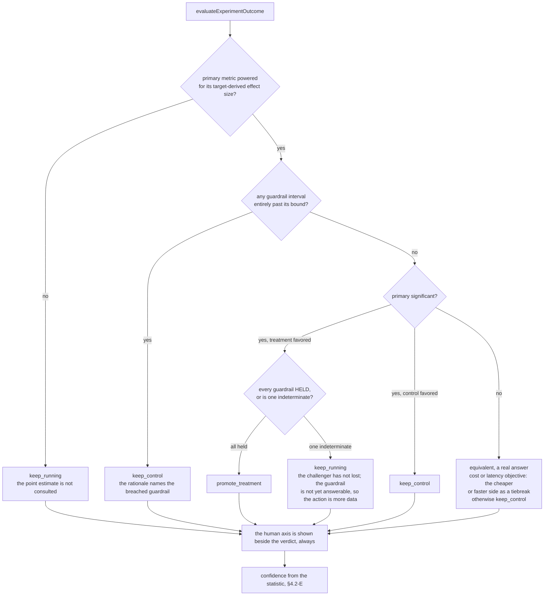

**The comparison is against the bound, never against zero.** A difference can be significantly different from zero and still be entirely consistent with sitting inside the bound, and a result that misses an `at_least` floor by a wide margin can be indistinguishable from zero. Both are answers to a question the guardrail did not ask. A primary win bought with a cost or compliance regression is not a ship. **`equivalent` is a real answer rather than a failure**, and it is always surfaced as equivalent rather than dressed as a winner.

**Disagreement is surfaced as an explicit conflict rather than averaged away.** When `humanPickWeight` is above zero and the human preference is itself significant, agreement with the primary raises confidence, and conflict reads as conflict: "Metrics favor control (p<0.05), but humans preferred treatment 72% [58-83%]. Your call." Honesty over a false single number (INV-3).

**A verdict is not a decision.** The computed verdict is advisory (INV-1); the operator's recorded `ExperimentDecision` (§3.2.1) is separate and may differ, including `no_decision`. Storing both lets the console show recommended against chosen, a cheap meta-signal on how far the statistics are trusted, without letting the recommendation act on its own.

### 4.5 What does not change

- **No auto-promotion**, and the advisory tag stays. **Athena mode** shows the honest Aurora-only banner, because the statistics need the analytics database.
- **`accuracy` has no measurement of its own in §4.** It is accepted as `objective.metric` only on a `classification` experiment, which in turn rejects `quality`, so the two are exclusive by experiment type rather than interchangeable. Inside this rollup the evaluator maps `accuracy` to the same underlying `score` field that backs `quality`, relabeled (`experiment-stats.ts`, `case 'accuracy'` returns `{ key: 'score', label: 'accuracy' }`), which for a `classification` experiment compares one response model against itself. Its real measurement is §5's gate, a separate mechanism on a separate corpus rather than a metric in this rollup; the operator guide marks the accuracy objective *(not available)* until §5 is wired end to end.
- **A `classification` experiment reports rows, and both variants share one response model.** The rollup keys on the `experiment_id` stamped on an exchange, and this type stamps it for the turns its classifier labeled (§5). It does not change the model that answers, so `avg_score` compares a model against itself and correctly shows no difference. §4 tells you what happened downstream of the different routing; §5 is where the labeling evidence lives.

### 4.6 Worked examples

Every figure below is produced by the functions named beside it and pinned by `backend/test/lib/experiment-worked-examples.test.ts`, so this section cannot drift from the code without a test failing. The examples take one exchange per conversation and one judge per battle, where the design effect is exactly 1 and the per-conversation figures equal the per-exchange ones (§4.2); `backend/test/lib/experiment-stats-per-conversation.test.ts` pins the correlated case. One experiment runs through all of it: **control** is the incumbent, **treatment** is the challenger, the objective is `quality` with a target of 5%, and the single guardrail is `latency no_worse_than 10%`.

**4.6.1 The per-variant aggregate.** The results query groups by (experiment, variant, model, intent, assistant), so a variant is usually several rows and the console collapses them by exchange count. Control is `research 30 at 72.0` plus `general 10 at 60.0`: `(72.0 x 30 + 60.0 x 10) / 40` = `2760 / 40` = **69.0** over **40** exchanges. Treatment is `research 28 at 78.0` plus `general 12 at 70.0`: `(78.0 x 28 + 70.0 x 12) / 40` = `3024 / 40` = **75.6** over **40** exchanges. Pooling two groups is not an average of their two standard deviations, so `poolGroups` uses the exact between-and-within decomposition: from `{n:30, mean:72.0, sd:16.0}` and `{n:10, mean:60.0, sd:20.0}` it returns `{n:40, mean:69.0, sd:17.617}`. The pooled SD is **larger than either input** because the group means differ, and that spread is real variance in the variant's traffic.

**4.6.2 The drill-down reconciliation, and why unscored rows matter.** Opening the exchanges behind treatment returns `total = 40` and a full-match mean of `75.6`, both equal to the aggregate, so the view reports *Reconciles with the result above*; had the predicate been looser, with battle turns left in for instance, the count would move and the view would say so. The mean is over scored exchanges only, because the aggregate is `AVG(relevance_score)` and an unscored row is NULL (`analytics-query.ts`). Suppose 32 of treatment's 40 exchanges carry an evaluator score and those 32 average **75.6**: the mean is **75.6** over 32, not over 40. So the drill-down states *8 of 40 exchanges carry no evaluator score*, because the mean describes the scored 32 and says nothing about the 8; if the unscored ones differ systematically (a sampling rule that skips long answers, a backlog that lags one variant), the mean is biased toward what was scored. Raising evaluator coverage changes what the mean represents without any model changing.

**4.6.3 The approval rate, and the collapse in front of it.** Take 62 raw append-only records for treatment: 50 are a single vote each (42 up, 8 down) and count 50; 6 are three voters who revised up then down and count 3, the downs; 4 are two voters who voted up then cleared and count 0; 2 are single ups and count 2. Counting rows gives **60** votes at **49 / 60 = 81.7%**, with the three superseded ups and the two withdrawn ups still in the numerator. Counting the latest record per (voter, message) gives **55** votes at **44 / 55 = 80.0%**, and the two cleared pairs drop out entirely because their latest record is a withdrawal. The second is the rate, and the drill-down lists exactly those 55 rows. Control, by the same rule, is **30 / 48 = 62.5%**.

**4.6.4 The approval axis (rate metrics, §4.2-A).** `twoProportionTest(44, 55, 30, 48)`, treatment against control, returns `pA 0.800`, `pB 0.625`, `delta +0.175` (**+17.5 percentage points**), a Newcombe `ci` of `[+0.0007, +0.3397]` (**+0.07pp to +33.97pp**), `pValue 0.0489`, `method z` because every cell is 5 or more, and significant because the interval excludes zero. The lower bound is **0.07 of a percentage point** above zero, so a single vote either way would flip the significance. That is why the axis is reported with its interval rather than as "80% versus 62.5%", and why 4.6.3 matters: the uncollapsed 81.7% would have been tested against a different denominator and reported a different interval from the same underlying opinions.

**4.6.5 The battle pick axis (§4.3).** 27 battles produce 2 ties and 25 decisive picks, 18 for treatment. Ties credit neither side and leave the denominator, so `humanPickTest(18, 25)` returns `picks 25`, `wins 18`, `winRate 0.72`, a Wilson `ci` of `[0.524, 0.857]`, `pValue 0.0433`, `significant` because the interval excludes 50%, and `favors: 'a'`, the treatment. The drill-down behind this lists 25 rows rather than 27: the two ties are absent because they moved no number, and the view says so rather than letting a shorter list read as fewer battles.

**4.6.6 The primary metric (continuous, §4.2-B).** Quality across the full run, control `mean 69.0, sd 18.0, n 500` against treatment `mean 75.6, sd 15.0, n 500`. `welchTTest(75.6, 15.0, 500, 69.0, 18.0, 500)` returns `delta +6.6` score points, `ci [+4.544, +8.656]`, `t 6.299`, `df 966.57` (Welch, not 998), `pValue 4.55e-10`, and `deltaPct` of `6.6 / 69.0 x 100` = **+9.6%**. Two things to read carefully: the **CI is on the raw mean difference in the metric's own units** rather than on the percentage, +4.5 to +8.7 score points; and the API rounds `pValue` to four decimals, so a p this small is reported as `0.0000`, which is a display rounding rather than a claim of certainty.

**4.6.7 Power (§4.2-D).** The minimum detectable effect comes from the objective's target rather than from a fixed number: a 5% target against a control mean of 69.0 is `0.05 x 69.0` = **3.45 score points**. With `sd = 18.0`, `requiredSampleForMean(18.0, 3.45, n)` gives `requiredN = ceil( (1.95996 + 0.84162)^2 x 2 x 18.0^2 / 3.45^2 )` = `ceil(427.3)` = **428 per variant**. At `n = 500`: `powered: true`, `additionalNeeded: 0`. At `n = 40`: `powered: false`, `additionalNeeded: 388`, and the console says *underpowered, need about 388 more per variant* instead of naming a winner. The same 40 exchanges that reconcile perfectly in 4.6.2 are nowhere near enough to decide on: reproducible and decisive are different properties.

**4.6.8 A guardrail that holds, and one that cannot say.** Latency, lower is better, `no_worse_than 10%`, against a control of `mean 1800ms, sd 600, n 500`. **Treatment at `1850ms, sd 500`** gives `delta = +50ms`, `ci = [-18.5, +118.5]`, `p = 0.153`; as percentages of the 1800ms baseline, a point estimate of **+2.8%** and an interval of **-1.03% to +6.59%**. The whole interval sits inside the 10% margin, so `held: true`. **Treatment at `1950ms, sd 700`** gives `delta = +150ms`, `ci = [+69.1, +230.9]`, `p = 0.00029`; as percentages, **+8.3%** and **+3.84% to +12.83%**. The point estimate is inside the bound and the interval is not:

- `pointWithinBound: true` (8.3 is less than 10)
- `held: false` (12.83 is not less than 10, and the worst case consistent with the data is what a non-inferiority claim has to survive)
- `breached: false` (a breach requires the whole interval to lie past the bound, and this one reaches back to +3.84%)
- `indeterminate: true`

`held` and `breached` are the two ends of the same comparison against the bound, so they are mutually exclusive and everything between them is indeterminate. A guardrail is never breached because the difference is significant against **zero**: here the difference is significant (`p = 0.00029`) and the guardrail is still not breached, because 10% bounds the latency regression and the data cannot place the regression past it. **Indeterminate blocks a ship.** The data cannot rule out a 12.8% latency regression, and "we could not tell" must not read as "it held". This is the case a point-estimate check waves through: on thin or noisy data the estimate lands inside the bound by chance, and the ship goes out on ignorance.

**4.6.9 The verdict (§4.4).** `evaluateExperimentOutcome` over the numbers above, from the *same winning primary metric* in both columns:

| | Holding guardrail, `humanPickWeight: 0.5`, picks 18 to 7 | Indeterminate guardrail, no picks recorded |
|---|---|---|
| `primary` | quality +9.6%, CI [4.5437, 8.6563], p 0.0000, significant, powered, favors treatment | the same |
| `guardrails` | latency +2.8% (bound 10%): held | latency +8.3% (bound 10%): indeterminate |
| `human` | 72% for treatment, CI [52.4%, 85.7%], significant | none recorded |
| `verdict` | `promote_treatment`, confidence **high**, `humanAgrees: true` | `keep_running`, confidence **low** |

A significant, powered, 9.6% quality win does **not** ship, because the latency guardrail cannot be shown to have held. That is the rule working as pre-registered, and it is the clearest reason to write guardrails down before the test rather than after the result.

**4.6.10 Cost, and metrics that are shown but not tested.** Estimated cost per reply is priced from the model rate table: control $0.0021, treatment $0.0026, a `(0.0026 - 0.0021) / 0.0021` = **+23.8%** increase. That figure is descriptive until `cost` is named as the objective metric or as a guardrail, at which point it is tested by the same Welch path as quality with the direction inverted, because lower is better. Compliance, fallback rate and task completion are never tested at all (§4.2): a column on the results table is not evidence unless one of the tests above is behind it.

---

## 5. Classification experiments: the shadow gate, then the online confirm

A `classification` experiment changes which model LABELS a message. That is a change to routing, applied to real users, and the machinery in §4 cannot see it: §4 measures the ANSWER, produced by a different model the experiment did not change. Measuring a labeling change by the quality of the answers downstream is a proxy at best.

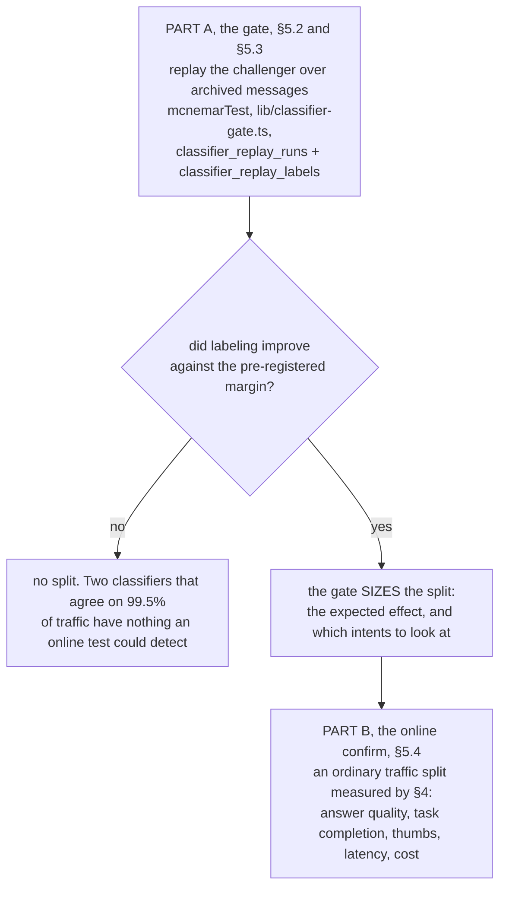

**The order is deliberate.** Part A answers *did labeling improve?* on archived traffic, exposing nobody. Only a passing Part A authorizes Part B, which answers *were users better served?* Neither question substitutes for the other, and §5.4 exists to stop the first being mistaken for the second.

**The path is exercised end to end on test traffic only**, including an Amazon Bedrock call from the replay role inside the VPC, and that says nothing about production traffic: a corpus of test traffic has one shape, and a replay over an operator-chosen window is what the gate needs before it informs a decision. The execution record is kept outside this repository.

**The §5.4 precondition is enforced in the CONSOLE rather than in the API.** The experiments API is DynamoDB-only while the gate's evidence lives in Aurora, so a programmatic caller can still create a classification experiment with no gate behind it. Closing that needs the experiments Lambda to resolve the gate over the data-plane seam.

**Part B's prerequisite is attribution**: the router resolves the classifier experiment and stamps `experimentId` and `variantId` on the turns it labeled, recording it on the turn rather than only in its log. Two properties of that attribution are deliberate. **Only turns the LLM classifier actually ran on are attributed** - a greeting is answered by the fast path without asking any model, so the variant did nothing and the turn is correctly absent; attributing it would pad the experiment with exchanges it never touched, and because both the aggregate and the drill-down would read the same inflated set, the §4.3 reconciliation could not catch it. And **both variants show the SAME response model**, so `avg_score` compares a model against itself and shows no difference, which is honest and is precisely why Part A exists.

### 5.1 Why this type needs a different mechanism

Intent classification is a deterministic function of the message, so both candidate models can score the SAME messages. That makes a paired design available, which a traffic split throws away:

| | Traffic split | Paired shadow |
|---|---|---|
| User exposure to a worse classifier | yes, for the whole run | none |
| Messages informing the comparison | half | all |
| Statistical frame | two-proportion z-test, independent samples | McNemar's test on discordant pairs |
| Power at a given volume | low, and the sample floor is already the weak axis | materially higher, because the pairing removes between-sample variance |

### 5.2 Part A, the gate: replay, not live shadow

**Default: replay the challenger over archived messages.** The corpus is the Aurora projection: the person's message of each `exchanges` row, read from `messages`. It is available in Aurora mode only (tenet D7: Aurora is the store that answers per-exchange questions; the S3 archive is the system of record and is not read here). Results arrive in minutes rather than over a run, and no user is exposed. Five constraints are not optional:

- **Off the request path.** The replay is a batch job. Adding a second classifier call to a live turn would spend user latency on an internal measurement.
- **One classification, on that classification's own reach (tenet D12, [ADR-054](../../../design/decisions/054-compute-is-per-classification-and-an-assistant-is-data.md) decision 5).** A run names its classification and the assistant whose classifier it compares (the classification's primary when none is named). It reads only that classification's exchanges answered by that assistant. Both candidates must be text models the classification allows (`modelFits`), checked when the run is requested, opened and executed. Each conversational classification has its own replay function, `ClassifierReplayLambda-<classification>`, pinned by `REPLAY_CLASSIFICATION`, on a role whose Bedrock grant is `modelArnsForClassification` for that classification; it refuses a run of any other classification and a stored run that names none. The non-VPC starter (`classifier-replay-start.ts`) dispatches a run to its classification's function and to no other. The classification filter on `exchanges` is a bound query parameter set from the function's own environment: the database does not partition `exchanges` by classification, so the read is narrowed by the function rather than by a database role.
- **The assistant's own taxonomy.** Both candidates classify against the intent pack the assistant serves: its active version's pack, else the classification's deployment pack (`assistant-intent-pack`), else the platform's. The starter resolves it, since the replay function has no route to SSM, and the run keeps it (`classifier_replay_runs.intent_pack`, migration 078), so a re-execution asks the question the first one did. A classification candidate differs from its control only in `models.classifier` (§3.5), so the pack is the same for both.
- **Erasure and redaction carry through.** A message retracted by a deletion or redaction request must not be replayed. The archive read honors the `-RED` and `-DEL` sibling rows and the replay inherits that, or the gate quietly reprocesses content a user asked to have removed.
- **Representativeness is asserted rather than assumed.** The replay window is recorded on the result and stated in the console. A corpus that predates a prompt change, an intent-pack change or a seasonal shift is not evidence about today's traffic.

The console's experiment form accepts a classification split only when every classification it covers has a finished, passing run of the same pair in that classification (`gateRunsFor`). A run from before runs named a classification read every classification's traffic and gates none.

**Forward shadow is the fallback**, for a deployment whose archive is too small or too stale to be representative. It classifies live messages with both models asynchronously and accumulates over time: the same comparison, slower, still no user exposure. **NOT BUILT.**

### 5.3 What is compared, and what needs a human

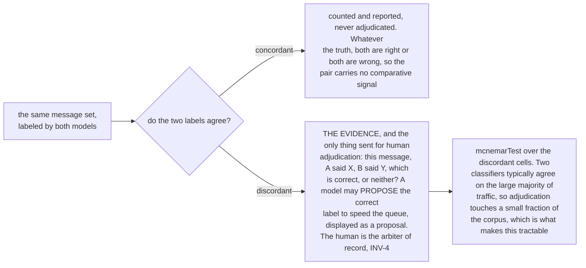

**One honest limit:** this measures RELATIVE accuracy, the question "which classifier is better". Absolute per-model accuracy would additionally require labels on the concordant pairs, and the console must not report a relative result as though it were an absolute accuracy figure.

**Worked example.** Replay 400 archived messages through both classifiers. Adjudication of the discordant pairs yields:

| | Incumbent right | Incumbent wrong |
|---|---|---|
| **Challenger right** | 300 | 42 |
| **Challenger wrong** | 18 | 40 |

**340 of the 400 pairs carry no comparative signal** (300 agreements on right, 40 on wrong). They are counted and reported and not adjudicated, which is what makes this affordable: the human queue is 60 messages rather than 400. `mcnemarTest(42, 18)` over the discordant cells returns 60 discordant pairs, 42 challenger wins (**70.0%**), a Wilson `ci` of `[0.575, 0.801]`, `pValue 0.00267`, and `significant` because the interval excludes 50%.

Read against the non-inferiority margin, the challenger is right on `342 / 400` = **85.5%** of this corpus and the incumbent on `318 / 400` = **79.5%**, a **+6.0 point** difference against a default margin of 2 points (`DEFAULT_ACCURACY_MARGIN_PCT`). Those two percentages are accuracy **on this adjudicated corpus** rather than absolute accuracy on live traffic, for the reason stated above. `mcnemarTest` returns `null` when there are no discordant pairs at all, and that is a real finding rather than a tie: the two classifiers are indistinguishable on this corpus, and the right conclusion is not to split traffic between them.

### 5.4 Part B, the online confirm

The gate answers whether labeling improved. It cannot answer whether USERS were better served, and those can diverge: a taxonomy is itself imperfect, and a label that is "wrong" against the taxonomy can still route to a model that answers better. Treating the intermediate metric as the outcome is the Goodhart failure this section exists to avoid. So a passing gate authorizes a normal traffic split, measured with the machinery in §4. The gate does not replace the split; it earns it, and it sizes it: agreement on 99.5% of traffic means no online experiment can detect a difference, while a disagreement of 8% concentrated in two intents names both the expected effect and where to look.

### 5.5 How the objective is honored, including "cheaper but slightly worse"

The gate has no decision rule of its own. It uses the objective from §1, which already expresses this case: **the thing being optimized is the primary metric, and the thing that must not degrade is a guardrail.** For "move to a cheaper classifier if it is not meaningfully less accurate":

```ts
objective: {
  metric: 'cost',                 // PRIMARY: the metric to improve
  target: 30,                     // % decrease sought
  guardrails: [
    { metric: 'accuracy', direction: 'no_worse_than', bound: 2 },  // the margin
  ],
  statement: 'Move intent classification to the cheaper model if it costs at least 30% less and is no more than 2 points less accurate.',
}
```

The verdict rule in §4.4 then does the work: a cheaper model inside the accuracy bound is `promote_treatment`, and one that breaches it is `keep_control` even though it won on cost, with the rationale naming the breached guardrail. **The margin is pre-registered**, which is the point: "2 points worse is acceptable" is a decision made before seeing the result rather than a rationalization after it.

**A guardrail must show evidence of no harm, not merely absence of evidence of harm.** A two-sided significance test cannot support "not meaningfully worse": on thin data it fails to detect a regression and the guardrail reads as held, so a cheaper-and-worse model ships on ignorance. The correct frame for a bounded-regression guardrail is a **non-inferiority test against the bound**, where the challenger passes only when the confidence interval on the difference lies entirely within the margin, so underpowered data correctly fails to ship rather than defaulting to permissive. This applies to every `no_worse_than` guardrail rather than only to classification, and it is a change to the evaluator rather than to this type.

### 5.6 Answer replay for intent and base-model candidates

**ROADMAP** ([SPEC-BATTLE](./SPEC-BATTLE.md) FR13). The gate in §5.2 replays a challenger classifier over archived messages. The same shape applies to an `intent` or `base_model` candidate (§3.5): the candidate version answers archived turns of the intent, before live traffic. It earns and sizes the split (§5.4) and never replaces it: replay measures cost, latency and judged quality, not task completion, thumbs or the human pick.

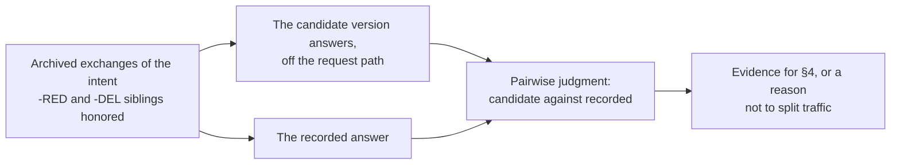

The §5.2 constraints carry over unchanged: a batch job off the request path, erasure and redaction honored, and the replay window recorded with the result. The answer is judged pairwise against the recorded one ([DESIGN-EVALUATION](./DESIGN-EVALUATION.md), routing correctness role 1, is the classifier analogue).

- **Per classification.** The run executes with the classification's own reach, never a shared role (tenet D12).
- **No side effects.** Tools that write, send or open work are not offered; the replay is text-only.
- **Retraction on both sides and in context.** The user message, the recorded answer and every prior context turn are excluded when retracted; a conversation or user deleted after the run removes its replay rows. **Derived copies expire** (tenet D7).
- **Who judges.** A model may propose a preference per pair; a human rules where it disagrees with the recorded outcome (§5.3), and the result is a paired preference read with `mcnemarTest` against a pre-registered margin (§5.5), advisory only (INV-4).
- **Build and attach.** Generating candidate answers is built, because it runs this deployment's version, pack, guardrails and classification grants; judging and reporting over exported pairs may attach an external evaluation tool.

---

## 6. Backward compatibility and cross-cutting concerns

- **Schema (INV-2):** every added field is optional, and absent means prior behavior. A row armed before experiments pinned two versions keeps its pins or its per-turn resolution until it is paused and resumed, which pins both versions (§3.5). **Status enum widening:** existing rows are `active`, `paused` or `completed`, which readers already tolerate, and `draft` and `deleted` appear only on new writes.
- **Scale:** the experiments table is scanned rather than queried, which is why a cap on active experiments exists. If lifecycle states grow the row count, a `status` GSI lets the resolver and the expiry sweep query instead of scan.

## 7. Resolved defaults

| Default | Why it is settled this way |
|---|---|
| Battle pick weighting presents two verdicts and does not blend them (§4.4) | `humanPickWeight` raises confidence on agreement and never averages a conflict into one number, which avoids inventing the composite SPEC-BATTLE FR6 forbids |
| Editing during active hard-locks the variants once traffic accrues (§3.2) | Changing what is compared means a new experiment |
| The briefing is semi-blind (§2.2) | Preserves the measurement property §2.2 states without a new reveal mechanism |
| Continuous-metric testing uses Welch's t | Latency, cost and tokens are approximately normal at aggregate n |
| Expiry is handled lazily on read | Avoids a new scheduled Lambda, and a past end date stops resolving traffic on the same read, before the status label catches up |

## 8. Worked example: one experiment through every mechanism

Numbers are illustrative. The decision: whether premium code generation should move from Sonnet to Opus, as an `intent` experiment on `code_generation` for the premium classification. The control is the live premium version, whose `code_generation` route is Sonnet, named "Advisor" by its profile, at weight 70; the treatment is its candidate with that route on Opus, at weight 30, which carries the same name and so reads "Advisor (alt)" in a battle; `battleEnabled` with `challengerAssistant: "alt-primary-premium"`.

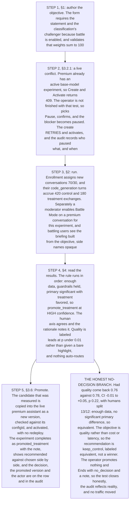

The objective authored in step 1, and the briefing step 3 builds from it:

```jsonc
"objective": {
  "statement": "Decide whether premium code-gen should move to Opus. Ship Opus only if it clearly improves code quality without blowing up cost.",
  "metric": "quality", "target": 8,
  "guardrails": [
    { "metric": "cost",    "direction": "no_worse_than", "bound": 25 },
    { "metric": "latency", "direction": "no_worse_than", "bound": 30 }
  ],
  "humanPickWeight": 0.3
}
```

> **Battle Mode is ON.** Two assistants will answer the same prompt so you can compare them. **We are deciding:** whether premium code-gen should move to a stronger model. **Most useful prompts:** ask a real coding task you would actually ship, for example *"Write a function that ..."* or *"Add retry/timeout to this call"*. Try `/battle <your prompt>`.

Over several battles, 25 decisive picks accrue with "Advisor (alt)" winning 18, and the four signals the rule reads are:

| Signal | Control | Treatment | Test | Result |
|---|---|---|---|---|
| **Quality** (primary) | 0.76 (n=420) | 0.83 (n=180) | Welch's t | +0.07, CI [+0.03,+0.11], **p<0.01**, significant |
| **Cost per reply** (guardrail) | $0.011 | $0.013 | two-sample | +18%, within the +25% bound, held |
| **Latency** (guardrail) | 2.1 s | 2.4 s | two-sample | +14%, within +30%, held |
| **Human pick** | 7/25 | 18/25 = **72%** | Wilson on 25 | [52%, 86%], excludes 50% |

---

## 9. Appendix - data model

### A.1 `Experiment` record, and the transition type

`ExperimentObjective` and `ObjectiveGuardrail` are in §1.2, and `ExperimentDecision` in §3.2.1; neither is repeated here.

```ts
export interface Experiment {
  experimentId: string;
  status: 'draft' | 'active' | 'paused' | 'completed' | 'deleted';
  experimentType?: ExperimentType;
  intent: string;
  tiers: Classification[];
  variants: ExperimentVariant[];        // model/count immutable once a variant has exchanges
  startDate: string;                    // enforced at resolve time
  endDate?: string;                     // auto-completes on expiry
  createdAt: string;                    // preserved on update
  description?: string;                 // populated alias of objective.statement
  objective?: ExperimentObjective;      // §1.2
  decision?: ExperimentDecision;        // set when a test that RAN is completed (§3.2.1)
  transitions?: ExperimentTransition[]; // append-only lifecycle audit
  battleEnabled?: boolean;
  challengerAssistant?: string;        // alt-{role}-{classification}
  // rows written before the re-key carry altBotSlotId and altBotSlotArn instead
  boundBy?: string; boundAt?: string;
  longFormMode?: 'one-shot' | 'outline-first';
  servesVersions?: boolean;             // armed with two pinned versions (§3.5); set by the server
  promotion?: { profileName: string; version: number; configId: string; at: string; by: string }; // set by Promote (§3.6)
}

// On ExperimentVariant, set by the server when the experiment is armed (§3.5):
//   controlPin?: { profileName; version; configId? }  variants[0]: the live active version
//   altPin?:     { profileName; version; configId? }  variants[1]: the candidate in the alt's history

export interface ExperimentTransition {
  from: Experiment['status'] | 'create';
  to: Experiment['status'];
  by: string; at: string;
  reason?: string;                      // e.g. 'auto:endDate', 'conflict:paused', 'delete:soft'
}
```

### A.3 Status enum and transitions

The enum is `draft | active | paused | completed | deleted`. Server-enforced transitions: `draft→active`, `active↔paused`, `active|paused→completed` (terminal), `any→deleted` (terminal soft delete), and `active|paused→completed` through auto-expiry. `completed` and `deleted` are terminal, and `draft` and `deleted` are excluded from active resolution and from the console's default list.

### A.4 Battle data model

- **Both battle sides are the experiment's two pinned versions (§3.5).** When any experiment is created `active` or activated later, the experiments handler asks the profile writer to pin its versions (`deriveExperimentVersions`, DESIGN-SEPARATE-ASSISTANTS-AND-DELEGATION §3.7) and stores them on the variants: `variants[0].controlPin` names the live assistant's active version and `variants[1].altPin` the candidate in the alt's history, each with its `configId`. A variant carries no name: each battle side is named from its pinned version (`battleSideNames`). The arm is refused, and nothing is stored, when a derivation fails or a pin does not name the expected version (`armRefusal`). In a battle the control answers from the live identity and the treatment from the alt identity; outside one, an enrolled conversation is served its arm's version under the live identity, and an ordinary turn the alt answers serves its candidate.
- **Outcomes are per-user.** A battle outcome is a `votes` map keyed by the voter's person id (their AppInstanceUser id) carrying `{ winner, chosenAt, experimentId?, variantId?, intent?, controlConfigId?, treatmentConfigId? }` (the two `configId`s read from the experiment's pins at pick time), so `battle_wins` aggregation is a per-battle tally summed across battles. A legacy v1 row with a top-level `winner` and `chosenByUserSub` and no `votes` map is read as one pick keyed by its `chosenByUserSub`, so the cutover needs no migration step. A malformed row degrades to an empty tally and the UI shows no recorded pick rather than erroring.
- **Battle state** carries an optional round-phase deadline used by the fail-loud timeout, and a terminal completion marker so consumers get an explicit signal rather than inferring from TTL absence. Neither changes the key.

### A.5 `ChannelBattleConfig` briefing fields

To render the briefing without a per-render experiment read, the objective is snapshotted onto the config row at enable time:

```ts
briefingStatement?: string; // = experiment.objective.statement at enable time
briefingIntent?: string;    // = experiment.intent, drives the intent-to-prompt chips (§2.2)
```

### A.6 Analytics query and recommendation contract

The experiment results query carries per-variant standard deviation and an explicit count alongside the aggregates, which is what makes the continuous-metric tests in §4.2-B possible, and a `units` section giving each variant's `conversation_count`, `exchange_count`, `scored_conversation_count` and `scored_count` (§4.2, the unit of analysis). The recommendation carries the computed statistics rather than a self-assessed confidence:

```ts
interface ExperimentRecommendation {
  verdict: 'promote_treatment' | 'keep_control' | 'keep_running' | 'equivalent' | 'inconclusive';
  confidence: 'low' | 'medium' | 'high';        // derived from the statistic (§4.2-E)
  rationale: string;                            // prose narration only
  primary:   { metric; deltaPct; ci: [number, number]; pValue; significant; powered };
  // Three states, not two: held, breached, and neither, which is "not established". A caller cannot
  // derive the third from `held` alone, and reading `!held` as breached reports a wide interval as a
  // demonstrated regression, so both flags ride the contract.
  guardrails: Array<{ metric; deltaPct; bound; held: boolean; breached: boolean }>;
  human?:    { picks: number; duels: number; winRate: number; ci: [number, number]; significant: boolean };
  approval?: { controlRate; treatmentRate; delta; ci: [number, number]; pValue; significant; votes: number; conversations: number };
  recommendedVsChosen?: { recommended: string; chosen?: ExperimentDecision['outcome'] };
  minSamplePerVariant?: number;                 // conversations per variant
  unit: 'conversation';                         // every test, guardrail and the floor count conversations
  variants: Array<{ variant_id; unit: 'conversation'; conversation_count; exchange_count; scored_conversation_count; scored_count; /* means */ }>;
}
```

### A.7 API surface

| Method / route | Behavior |
|---|---|
| `POST /admin/experiments` | Pins the two versions when the row is created or edited `active` and is not already armed (§3.5), keeps an armed row's pins on every edit, paused included, and pins again when an edit arms a paused or draft row; the pins and `servesVersions` are the server's, never the client's. The active cap and the classification conflict are checked before anything is derived, so a refused arm publishes no candidate. Preserves `createdAt` on update; rejects an edit of what the experiment compares (variant models and count, type, intent, classification) once it has left draft (409, `EXPERIMENT_LIVE_EDIT_LOCKED`); warns rather than rejecting when `objective.statement` is absent; validates that weights sum to 100 (400). |
| `POST /admin/experiments/{id}/status` | Activating pins the two versions (§3.5), after the active cap and the classification conflict are checked, so a resume re-arms a row armed before pins existed and a refused one publishes nothing. Accepts an optional `decision` when completing a test that ran; returns 404 on a missing id; the 409-on-activate body carries the conflicting experiments so the console can drive the End, Pause or Delete resolution (§3.2.1). |
| `POST /admin/experiments/{id}/promote` | The `activate-profiles` capability. Copies the measured candidate into the live assistant as a new version and activates it, refused before any write unless the live version is still the pinned control and the copy hashes to the candidate's `configId`; completes the experiment as `promoted_treatment` and releases the alt (§3.6). Takes an optional `note`. |
| `DELETE /admin/experiments/{id}` | Hard-deletes a never-started draft with no data; otherwise writes a `deleted` tombstone. Frees the classification and releases the challenger, and returns the freed classification so the console can retry a blocked create. |
| `POST /channels/battle/outcome` | Keyed per `userSub` from the token rather than one overwritable row. |
