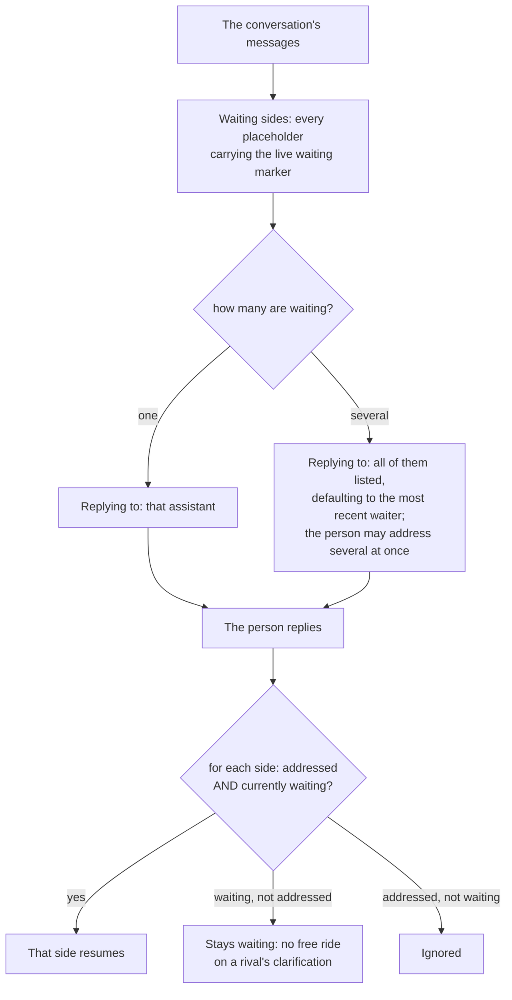

# SPEC: Battle Mode (`/battle`) - Product Specification

**Status:** Partial. The battle path ships. Three rows are partly delivered (FR3, FR9, FR10), FR11 and FR12 are deployed and verified on a deployment, and FR13 is **ROADMAP**; the requirements table is the authority on which. FR10 stays partly delivered: on a deployment the owner's reply reaches the waiting side and resumes it, and a non-owner's does not, but B-E7 has not yet passed end to end (see FR10). Gated by the classification's `battleCapable` capability (standard and premium out of the box; basic is not capable) plus a per-classification runtime setting that is off until an operator turns it on (ADR-049).

**Coverage:** `tests/e2e/an-image-duel-runs-both-chains-to-an-image.battle.spec.ts` - an image battle runs both chains to an image and prices each side by its summed steps; `tests/e2e/battle.spec.ts` - FR1-FR9. FR10's answer-then-resume round trip is asserted by B-E7, which parks a side `WAITING_FOR_USER` via a task-shaped battle, sends the same `Target`-ed reply first as a second member and then as the battle's owner, and asserts that the non-owner's reply leaves the side waiting and is released as ordinary conversation, while the owner's is applied to the awaited task (an entry in the task's history after the reply) and moves the side on: a state entered after the reply, `COMPLETED` or `WAITING_FOR_USER` with the side's next question posted publicly. The side's row is read by its `enteredStateAt`, because a resumed task-shaped side is `INVOKED` only while its turn runs. B-E8 asserts an explanatory refusal and no battle started: a `/battle` from a standard user in a channel that has not enabled Battle Mode is answered by whichever of the two explanatory refusals the deployment's configuration produces, never silence, and the channel's battle pointer stays empty. `tests/e2e/a-tested-treatment-is-promoted-into-the-live-assistant.spec.ts` - FR12, and FR11's ordinary-experiment half: it arms a `base_model` experiment on premium, asserts each arm's turn is served by its pinned version, promotes from the console, and reads back the new active version, its `configId` and `promotedFrom`, the experiment completed as `promoted_treatment`, the released alt and the next turn served by the promoted version; a promotion after the live version moved is refused and writes nothing. The refusal of a caller holding only the experiment capabilities is unit-tested only, because no e2e user holds those capabilities without `activate-profiles`. Both specs ran against a deployment carrying FR11 and FR12 on 2026-10-27: the promotion spec 2 of 2 and the battle e2e 20 of 21, its battles armed with both sides pinned, B-E7 the one failure (FR10); `tests/e2e/experiments.spec.ts` (13 of 13) and `tests/e2e/experiment-results-trust.spec.ts` (4 of 4, each type attributing its turns to its own variant) cover FR11's ordinary experiments of every type. The battle e2e exercises battles but does not read a battle side's pinned version back per turn, so that half of FR11 is unit-tested only. FR13 is not built.

**Verified by:** `backend/test/lib/battle-turn.test.ts` (a battle turn serves its side's pinned version, carries no variant field, and refuses a workflow that version deselected; `isSanctionedBattleBot` admits only the room's own assistants and its alt), `backend/test/lib/battle-outcome.test.ts` (a pick credits one side, a tie credits neither, and a pick is bound to its channel), `backend/test/battle-orchestrator.test.ts` (round 2 dispatches exactly once per side and inherits round 1 intent), `backend/test/manage-profiles.test.ts` (arming pins the live active version and a candidate derived by each type's recipe; promotion copies the measured candidate), `backend/test/admin-experiments.test.ts` (every type arms, battle or not; the promote route), `backend/test/lib/experiment-manager.battle.test.ts` (an ordinary turn of a pinned experiment is served its arm's version through enrollment), `backend/test/lib/an-experiment-turn-serves-its-version.test.ts` and `backend/test/lib/a-duel-side-serves-its-pinned-version.test.ts` (a served version answers through its routes), `backend/test/a-shared-service-only-speaks.test.ts` (round 2 re-resolves the side's version and drops a forged one), `frontend/packages/admin/src/components/admin/PromoteExperiment.test.tsx` (the console's Promote action).

**Related:** [DESIGN-BATTLE.md](./DESIGN-BATTLE.md) - the mechanics: the turn path, the state, the markers, the measurement and the IAM. This document is the product surface only. [DESIGN-EXPERIMENTS-BATTLE-DECISION-LOOP.md](./DESIGN-EXPERIMENTS-BATTLE-DECISION-LOOP.md) - the written objective, the briefing, the experiment lifecycle, the two versions an experiment compares (§3.5), promotion (§3.6), and the statistics a pick feeds.

**Site section:** Interaction layer, quality.

---

## Overview

Battle Mode is the platform's comparison capability: one prompt fanned out to several assistants, a rebuttal round, and an inline scorecard the person reads and decides on. It is triggered by a user in chat (`/battle <prompt>`) and read back by operators in the admin console, which is why it sits in the platform vertical rather than beside it.

**A battle runs on the ordinary request engine, and that is what makes the result worth anything.** Each side takes the same handler, the same classification boundary, the same version resolution, the same delivery selection and the same worker as any other turn. A battle adds exactly two things: who is asked, and a coordination context telling a side which battle it is in, which round, who its rival is and which side it is. A battle is not a task and not a second engine; certain intents are tasks, and a battle turn opens one only when it would have anyway. If a side answered on a special path, the thing being measured would be the path rather than the assistant.

**The second assistant is the treatment variant of an existing A/B experiment, not a parallel persona stack.** Routing that assigns one variant per conversation instead fans out to both, so a pick and ordinary experiment traffic feed the same per-variant results.

**The second identity is bounded by the same governance as every other assistant.** `classification` is the only closed axis IAM evaluates, so both sides of a battle answer at the room's classification and no result changes the grant set. The alternate side answers as its own bearer-pinned identity rather than borrowing the primary's, and the turn path validates that identity against the classification's assignment record for its own `(classification, role)` (`duelChallengerOf`): an alt of another classification is refused, and so is an alt of the same classification assigned to a different role. That check is proven by the unit test `backend/test/lib/battle-turn.test.ts` (`isSanctionedBattleBot`); an IAM deny-test that names the alt's identity is **NOT BUILT**. What the alt reaches is exactly what its role's live assistant reaches, because scope attaches to the role rather than to the assistant, which is what keeps a battle measuring behavior rather than access.

**Battle numbers follow the three-store split.** Live conversation state, including membership and the battle's own messages, comes from Amazon Chime SDK Messaging; the record of what each side answered and what it cost comes from the archive; the per-variant rollup and the per-battle review come from the Aurora projection. One question is answered from one of them, with one stated exception: the "Battle wins" column in the experiment results is joined in from the `BattleOutcome` table into the Aurora rollup, one figure sourced from two stores, and it is named here rather than left for a reader to discover.

**An experiment compares two complete versions of one assistant.** The control is the version the live assistant serves, pinned by number when the experiment is armed, and the treatment a candidate derived from it, so a result names exactly what was measured (FR11, deployed and verified on a deployment).

**No result promotes anything.** A leading variant produces a recommendation and an operator decides. The Promote action activates a copy of exactly the version that was measured, refused unless the copy hashes to it (FR12, deployed and verified on a deployment). No third-model judge decides, and there is no control loop.

## Business Problem

A team choosing which model or persona should serve a class of requests usually does it blind: it picks a default from a catalog, ships it, and infers from aggregate dashboards months later whether the call was right, while the existing A/B experiment measures real traffic correctly but assigns each conversation one variant while it runs, so no single person ever sees both variants answer the *same* prompt. A stakeholder who wants to feel the difference between two personas, or a developer who wants to ship one model over another for code review, has no fast and tangible way to run a controlled side by side, and an aggregate dashboard does not settle a room. Battle Mode puts both variants of an experiment into one conversation as real, named participants, runs them on the same prompt, and surfaces a scorecard the human decides on directly, while still feeding the same per-variant results the A/B experiment already collects.

## Personas

Personas are defined in [PERSONAS.md](../../../overview/PERSONAS.md) and are not redefined here. Four use Battle Mode. **Channel moderator** is not a persona but a per-conversation role any member can hold (a `ChannelModerator`); it appears as an actor in the journeys below. **The assistant** is a system actor rather than a persona, and competing in a battle is one of its behaviors: it answers round 1, then sees its rival's reply and chooses to rebut, build on it or stay silent, aware that it is in a battle.

### End user

**How Battle Mode relates to them:** they work inside a conversation and never open admin tooling. They want to ask one question, see two assistants answer it side by side, and say which answer was better.

| What they need | Requirement |
|---|---|
| A one-command trigger inside the conversation they are already in | FR3 |
| Both answers labeled by who gave them, on the same prompt | FR3 |
| A readable side-by-side result and a single pick control | FR6 |
| To be told what is being decided before producing evidence for it | FR2 |
| A command that is unavailable to say so rather than fail | FR5 |
| To answer an assistant that needs something, in the open, without losing the battle | FR10 |

### AI developer

**How Battle Mode relates to them:** they compare models and personas to decide what to ship, and they need the comparison to count toward the same decision as ordinary experiment traffic rather than sitting in a side channel.

| What they need | Requirement |
|---|---|
| Two candidate models, or two persona addenda on one model, run on representative prompts | FR1, FR3 |
| Objective cost and latency per side, read separately rather than as one score | FR6 |
| A quality judgment they make themselves from real output | FR6 |
| Picks credited per variant in the same experiment results as ordinary traffic | FR7 |
| Nothing rerouted or promoted by a result | FR8 |
| The treatment to differ from what serves in exactly what the experiment type names | FR11 |
| A candidate checked against archived traffic before any person sees it | FR13 |
| A rebuttal round, so the comparison is a head-to-head rather than two isolated answers | FR4 |

### Admin / operator

**How Battle Mode relates to them:** they run one deployment. They author the experiment and its variants, decide where battles may run at all, and read accumulated results across conversations.

| What they need | Requirement |
|---|---|
| Name the classification's challenger for the treatment variant, and refuse an incomplete or double-booked arming | FR1 |
| Turn the capability on per classification, off by default, so a deployment that has not asked for battles does not pay for them | FR2 |
| A per-step breakdown: which model ran each step, how long, at what estimated cost | FR6 |
| Picks credited per variant, with a tie crediting neither side | FR7 |
| A result that changes no routing until they change it | FR8 |
| To promote the winner and know the live assistant now serves exactly what was measured | FR12 |
| Escalating battle types, with the extra deploy-time setup required only where it is used | FR9 |

### QA / test engineer

**How Battle Mode relates to them:** they gate releases on the assistants their organization builds, so a battle is a controlled, repeatable side-by-side test rather than a way to route live traffic.

| What they need | Requirement |
|---|---|
| The same representative prompts through two candidate variants, repeatably | FR3 |
| Objective cost and latency plus the human quality pick, as a release-gating comparison | FR6 |
| A battle that is a fair test, because both sides took the ordinary turn path | FR3, FR8 |
| One battle at a time per conversation, and a battle that never silently stalls | FR3 |
| Report, document and image battles covered by the same flow and scorecard | FR9 |

## Functional Requirements and Acceptance Criteria

**Priority is a keep-or-cut decision set against what the field expects, not against how interesting the work is.** `Table stakes` means a deployment without it is behind. `Differentiator` is worth the cost because few platforms do it. `Gap - prioritize` marks a requirement whose absence puts this below comparable systems. `Above bar - optional` is more than the field asks and can wait. `Optional - attach instead` should be bought rather than built. `Enabler` is not user-visible and is what makes another row affordable.

| # | Requirement | Priority | Delivered | Validated by |
|---|---|---|---|---|
| FR1 | An admin marks a two-variant experiment battle-enabled, with an optional short system-prompt addendum, and names its classification's challenger, the alt assistant `alt-{role}-{classification}`, for the treatment variant; each side is named from its profile, never by a name on the variant | Enabler | Yes | `experiment-manager.battle` (unit, behavior) |
| FR2 | A moderator turns Battle Mode on for a conversation whose classification is battle-capable and has battle turned on, choosing an armed experiment; the treatment variant joins as a real, named member and a system message announces it, and turning it off removes the member and announces the departure | Table stakes | Yes | `battle-enablement` (unit, behavior), `channel-battle` (unit, behavior), `battle-runnable` (unit, behavior) |
| FR3 | `/battle <prompt>` makes every assistant in the conversation answer the same prompt in parallel, each labeled with its profile's name, each knowing it is in a battle, and each running the ordinary turn path | Differentiator | Partly - nothing in a side's prompt forbids proposing a new conversation, so a side may deflect an explicit request that way | `battle-turn` (unit, behavior), `flow-does-not-run-the-turn` (unit, source text), `battle` (e2e, behavior) |
| FR4 | After every side has completed round 1, each assistant receives the other's answer and may rebut, build on it, or decline; round 2 is commentary and the deliverable is round 1 | Differentiator | Yes | `battle-orchestrator` (unit, behavior), `async-processor-battle` (unit, behavior), `battle` (e2e, behavior) |
| FR5 | `/battle` where Battle Mode is not enabled, or where the classification cannot run battles at all, is a visible and explained no-op to the sender, with nothing broadcast and no error | Table stakes | Yes | `battle-runnable` (unit, behavior), `battle-enablement` (unit, behavior), `battle` (e2e, behavior) |
| FR6 | The scorecard shows three axes side by side and never folds them into one number: response time, estimated cost labeled as an estimate, and quality as an explicit human pick of A better, tie or B better, with a "Show steps" expander naming the model behind each step | Differentiator | Yes | `battle-outcome` (unit, behavior), `battleTally` (unit, behavior), `battle` (e2e, behavior) |
| FR7 | Each battle ends with its own inline result card for that prompt, and in Aurora mode each pick is credited per variant as a "Battle wins" column in the same experiment results as ordinary traffic, joined from the `BattleOutcome` table into the Aurora rollup, with a tie crediting neither side while still being recorded | Differentiator | Yes | `battle-outcome` (unit, behavior), `battle-outcome-api` (unit, behavior), `battle` (e2e, behavior) |
| FR8 | A battle is the same experiment's two variants compared head-to-head rather than assigned one per conversation, and no battle outcome changes routing on its own: promotion is a deliberate operator action (FR12) | Table stakes | Yes | none |
| FR9 | Battle types escalate in capability - single-turn, report creation, document creation as a downloadable attachment, image understanding, and image generation - and the scorecard and pick appear from the first battle onward | Above bar - optional | Partly - image generation runs only where the extra deploy-time setup is present | `battle-vision-plan` (unit, behavior), `battle-generation-out-plan` (unit, behavior), `battle-attachment` (unit, behavior), `battle` (e2e, behavior) |
| FR10 | A side that needs input before it can answer asks in the battle where everyone can see it, the battle waits for that side rather than treating it as finished, and the person who started the battle is told which assistant is waiting and answers that one | Above bar - optional | Partly - the routing, the waiting state and the composer queue exist, and the path is dormant because the round-1 prompt does not ask a model to raise a question. **OPEN:** folding it into task assignment (ADR-029). **Routing and the owner rule work on a deployment (dev, 2026-10-28 UTC, battle `8c9ef799c8503d0f`):** a `Target`-ed reply invokes the waiting side's Amazon Lex (`TargetedMessages: ALL`, ADR-041 Appendix A); the owner's reply was applied to the awaited task (`deferred_to_model` from `collecting_requirements`) and the router logged `duel side resumed from WAITING_FOR_USER`, while the non-owner's ran as an ordinary turn and resumed nothing. B-E7 failed that run for two other reasons: the owner's reply text was blocked by the input guardrail (`PROMPT_ATTACK`), so the turn produced no document and the side parked again three seconds after resuming, and the test sampled the side's state every 5 s and missed that window. B-E7 now sends both members the same text and reads the row's `enteredStateAt`; it has not been rerun since | `battle-clarification` (unit, behavior), `battle` (e2e, behavior) |
| FR11 | Every experiment, battle or not, compares two complete versions of one assistant: the control is the live assistant's active version, pinned by number when the experiment is armed, and the treatment a candidate derived from it by the experiment type's recipe (`intent` changes only `models.byIntent[<intent>].primary`, `base_model` the base model, `classification` the classifier, `profile` a referenced version, intents excepted). Every turn serves its version unmodified, per-intent routes included: an ordinary experiment enrolls a conversation once at creation and serves it its arm's version under the live identity, and a battle serves the control from the live identity and the treatment from the alt identity. A battle has no alias: each battle side is named from its profile, the challenger's marked `{name} (alt)` when the two names match | Gap - prioritize | Yes - deployed and verified on a deployment, 2026-10-27: `experiments` 13 of 13 (E9 serves a live turn from a profile-vs-profile experiment), `experiment-results-trust` 4 of 4 (each type attributes its turns to its own variant), and the promotion spec reads each arm's archived `profile_name`, `profile_version` and `profile_config_id` matching its pin; the battle e2e runs battles with both sides pinned, and a battle side's per-turn pinned version is unit-tested only. Every test counts conversations rather than turns (DESIGN-EXPERIMENTS-BATTLE-DECISION-LOOP §4.2). **NOT BUILT:** a `profile` experiment whose two referenced versions carry different intent packs is replayed by the classifier gate against one pack | `manage-profiles` (unit, behavior), `admin-experiments` (unit, behavior), `experiment-manager.battle` (unit, behavior), `an-experiment-turn-serves-its-version` (unit, behavior), `a-duel-side-serves-its-pinned-version` (unit, behavior), `battle-turn` (unit, behavior), `a-shared-service-only-speaks` (unit, behavior), `experiments` (e2e, behavior), `experiment-results-trust` (e2e, behavior), `a-tested-treatment-is-promoted-into-the-live-assistant` (e2e, behavior), `battle` (e2e, behavior) |
| FR12 | An operator promotes a tested treatment: the platform copies the candidate into the live assistant as a new version, refuses a copy that does not hash to the measured candidate's `configId`, refuses once the live version has moved since the experiment started, records `promotedFrom` (candidate, version, experiment), activates it, completes the experiment as `promoted_treatment` and releases the alt. Promotion is an activation of the live assistant's profile through the profile writer: its route is in the `activate-profiles` capability, so a caller holding only the experiment capabilities is refused. Rejected candidates stay in the alt's history as the record of what was tried. The durable record is the `configId` on the experiment row (its pins and its `promotion`) and on every archived turn, `promotedFrom` on the promoted version, and the experiment's `decision` and `transitions`; Parameter Store keeps at most 100 versions of a parameter, so it is not the retention record. Between instances the by-hand path stays: export the candidate and import it as a draft | Gap - prioritize | Yes - deployed and verified on a deployment, 2026-10-27, by `a-tested-treatment-is-promoted-into-the-live-assistant.spec.ts`, 2 of 2: a promotion after the live version moved is refused, writing nothing and leaving the experiment active; a promotion creates a new live version whose `configId` equals the measured candidate's, `promotedFrom` names candidate, version and experiment, the experiment completes `promoted_treatment` with `promote` as its last transition, the alt holds nothing, and a fresh turn is served by the promoted version. The refusal of a caller holding only the experiment capabilities is unit-tested only | `manage-profiles` (unit, behavior), `admin-experiments` (unit, behavior), `profile-lifecycle` (unit, behavior), `PromoteExperiment` (unit, behavior), `a-tested-treatment-is-promoted-into-the-live-assistant` (e2e, behavior) |
| FR13 | **ROADMAP:** an `intent` or `base_model` candidate answers archived exchanges of its intent off the request path, erasure and redaction honored, judged pairwise against the recorded answer, before or instead of live traffic, as a classifier candidate is replayed today | Above bar - optional | No - **NOT BUILT** | none |

**Reading the "Validated by" column.** Each entry is one specific test, named by its filename without its extension. Backend unit tests live in `backend/test/` and `backend/test/lib/`; the chat client's and the admin console's unit tests live under `frontend/packages/*/src/` beside the module they cover; end-to-end specs live in `tests/e2e/` and are listed against their phase in [e2e-coverage-matrix.md](../../../reference/e2e-coverage-matrix.md). The status in brackets is what the test does, which matters more than that it is green:

- **behavior** - executes the code path and asserts on the result.
- **source text** - asserts that a convention still appears in the source. It catches the convention being dropped; it does not catch a wrong number.
- **none** - no test exists.

**FR8 carries no test, and it is the one row where that matters most.** The requirement is the absence of a behavior, which nothing currently asserts: no test refuses a call that would promote a variant from a result. The property holds structurally, because picks are written to an outcome record that selection never reads and the only promotion is the operator's Promote action, but it holds by nobody having written the call rather than by a guard.

**Acceptance criteria.** An experiment with exactly two variants and its classification's challenger saves as battle-enabled; one missing any of those is rejected with an actionable message, and a challenger another active battle experiment already names is rejected. Enabling adds a visible second assistant and makes `/battle` available; disabling removes it; a classification that is not capable, or has battle turned off, cannot enable it. One `/battle` produces one round-1 reply per assistant on the same prompt. Round 2 begins only once both sides have completed the intent, not merely posted a first message; an assistant that declines leaves no stale placeholder, because its "One moment..." is updated in place to a visible `No rebuttal.`, and both declining is a valid outcome. The three scorecard axes render separately; a pick is stored per member under their own sub, re-picking overwrites the caller's own pick and not another member's, and cost carries a "not a bill" caveat. Each pick maps A to control and B to treatment, a tie credits neither side while still being recorded, and the credited picks surface in per-variant results. No battle outcome changes routing on its own. Each enabled battle type produces a round-1 and round-2 flow with a scorecard. A question from a waiting side is visible in the conversation and attributed to the assistant that asked; the composer names the assistant being answered and lists all of them when several are waiting; the answer arrives as a new message rather than replacing the question; and round 2 does not start until every side has either finished or been answered (dormant: **OPEN**, FR10). An experiment whose control differs from the live assistant's active version is refused; an `intent` candidate differs from the control only in that intent's route; a battle side answers a routed intent through its route. Promotion activates a version whose `configId` equals the candidate's, is refused once the live version has moved, and leaves the live history holding only versions that served or were promoted. A battle side's per-turn pinned version is unit-tested only.

**Open product questions.**

**OPEN:** should the end-of-battle summary retain the verbatim clarifying-question exchange rather than only the quantitative count of how often each side asked? Half of it is available already: under [ADR-029](../../../design/decisions/029-clarification-is-public-and-answers-get-their-own-placeholder.md) the question is a public, permanent message and therefore in the transcript and the archive, while the person's answer is denied by the flow, never reaches Amazon Lex, and is persisted nowhere. Retaining the full exchange depends on that decision rather than on the summary.

**OPEN:** for report and document battles, is one-shot (the full deliverable in round 1) or outline-first the better default for comparing directions?

**OPEN:** which image-generation model ships as the baseline for generation-out battles, and what default image-output guardrail is reasonable before a deployer tunes it?

**OPEN:** ending a battle has no requirement in this document. [DESIGN-BATTLE](./DESIGN-BATTLE.md) specifies `/battle end`, who may use it, the recorded abandoned state, and that no result is counted from an abandoned battle; none of that is stated here as something the product promises, so the mechanism is specified and the requirement is not.

## Non-Goals - Out of Scope

| Out of scope | Why | Where it is covered instead |
|---|---|---|
| Algorithmic judging | No third-model judge decides. A model may propose a preference on replayed pairs (FR13), ruled on by a person and advisory only (INV-4), and no signal feeds automated variant or model selection. The human pick and objective time and cost telemetry are first-class; a control loop is not | [SPEC-EVALUATION.md](./SPEC-EVALUATION.md) - what a judge does score, and why calibration never retunes the judge on the labels it is measured against |
| Automatic promotion of a winning variant | A result that promotes makes the score a control surface, and nobody can then tell a regression from a rollout; promotion is an operator action (FR12) | [DESIGN-EXPERIMENTS-BATTLE-DECISION-LOOP.md](./DESIGN-EXPERIMENTS-BATTLE-DECISION-LOOP.md) - the advisory verdict, and the operator's separately recorded decision |
| Arbitrary persona authoring by end users | End users enable, disable and run battles. Variants and their addenda are authored by admins and sanitized server-side | [GUIDE-AB-TESTING-AND-BATTLES.md](../../../guides/admin/GUIDE-AB-TESTING-AND-BATTLES.md) - the operator's authoring path |
| More than two variants per battle | A battle compares exactly two, because a scorecard and a forced choice are defined over a pair | [DESIGN-MULTI-ASSISTANT-TURN-ENGINE.md](../assistants/DESIGN-MULTI-ASSISTANT-TURN-ENGINE.md) - the design target for generalizing the fan-out |
| Cross-classification battles | Both variants must be allowed at the conversation's classification, which is the one closed axis IAM evaluates. A battle that crossed it would measure access rather than behavior | [SPEC-CONVERSATION-SECURITY.md](../governance/SPEC-CONVERSATION-SECURITY.md) - the layered access model; [DESIGN-BATTLE.md](./DESIGN-BATTLE.md) states the role-scoped identity check |
| Free-form "pick any two models" battles | A battle always runs an armed experiment, because the experiment is the authoring surface and the thing a pick is credited to | [DESIGN-EXPERIMENTS-BATTLE-DECISION-LOOP.md](./DESIGN-EXPERIMENTS-BATTLE-DECISION-LOOP.md) - the objective an experiment carries |
| Streaming a battle's replies | Both rounds use the placeholder-then-update pattern, so one bubble per side fills in rather than a bubble followed by an answer | [DESIGN-BATTLE.md](./DESIGN-BATTLE.md) - the handler and worker split behind that pattern |

## User Experience Description and Mocks

Battle Mode has no surface of its own: it is a command in the chat client and a set of reads and actions in the admin console. The journeys differ in scope and entry point before they differ in screen.

### The end user's journey

1. **Be told what is being decided** (FR2). When a moderator turns Battle Mode on, the conversation is told that two assistants will answer the same prompt, what decision is being made, and which prompts actually settle it. It never says which side is which model, so a picker cannot favor a name they already trust.
2. **Run one** (FR3). `/battle What is the best caching strategy for a read-heavy database?` produces two answers, from "Advisor" and "Advisor (alt)", side by side, each labeled. Each side is named from its profile: the live assistant keeps its own name, the alt wears the treatment's while the experiment holds it, marked as the challenger when the two match, and each side's placeholder and its rival's rebuttal note use both names. No admin tooling is opened.
3. **Read the scorecard** (FR6). Each side's response time, an estimated cost marked as an estimate, and a pick-the-winner control. "Show steps" reveals which model produced each answer and how long it took.
4. **Read round 2** (FR4). A divider marks the rebuttal round, and each assistant rebuts, builds on, or stays visibly silent about its rival's answer.
5. **Pick** (FR6, FR7). A tap records A better, tie or B better under that person's own identity, and the battle ends with its own result card. The next `/battle` gets a fresh card, so the conversation reads as a sequence of independent results rather than one running total.
6. **Answer a side that asks** (FR10). If an assistant needs the scope of a report or the columns of an extraction, it asks in the battle where everyone can see it, the composer names which assistant is being answered, and the battle waits for that side rather than treating it as finished. Only the person who started the battle may answer; the path is dormant (**OPEN**, FR10).
7. **Be refused clearly** (FR5). `/battle` where Battle Mode is off replies to the sender with a one-line hint and broadcasts nothing.

### The channel moderator's journey

1. **Open the members panel** of a conversation whose classification is battle-capable and has battle turned on (FR2).
2. **Pick an armed experiment and turn Battle Mode on.** The treatment assistant joins as a visible member under the treatment's profile name, a system message announces it, and `/battle` becomes available.
3. **Turn it off when done.** The assistant leaves cleanly and the departure is announced.

### The AI developer's journey

1. **Arm an experiment for battle** (FR1, FR11): the live assistant's active version as control, named by nothing more than the experiment's type, and as treatment a candidate that changes only what the type names. For an `intent` experiment that is one route, for example code generation answered on Opus while every other intent, and the base model, stay the control's. An optional short persona addendum on the treatment; each side is named from its profile.
2. **Run representative prompts as battles** (FR3). Two models against each other, or two personas on the same model to compare voice and framing rather than raw capability, before committing either to production.
3. **Read cost and latency objectively and make the quality call** (FR6). The three axes stay apart, so a fast cheap answer is not averaged into a good one.
4. **Watch the picks accumulate** (FR7). Each becomes a "Battle wins" signal per variant in the same experiment results table as ordinary traffic.

### The admin / operator's journey

1. **Read the two variants together** in the Experiments results (FR7): conversations, exchanges, average score, latency, tokens, compliance, fallbacks, user approval and battle wins. The tests count conversations and the battle pick counts battles: several people judging one battle are one battle of evidence, and the recommendation states picks and battles ([DESIGN-EXPERIMENTS-BATTLE-DECISION-LOOP](./DESIGN-EXPERIMENTS-BATTLE-DECISION-LOOP.md) §4.2, "The unit of analysis").
2. **Review battle by battle** in the Battles section of the experiment's page, where a summary sentence says who is winning, each version's wins, quality and cost per reply are listed, and each battle's row opens the conversation it ran in, where both versions' answers and the pick are; a battle nobody picked reads "Not picked yet" rather than "Tie".
3. **Promote the winner, or decline to** (FR8, FR12). On a running or paused experiment that pinned two versions, the Promote action (offered to a role holding `activate-profiles`) confirms what happens (`admin.experiments.promoteConfirm`), takes an optional note, and reports the version that now serves (`admin.experiments.promoteDone`). The live assistant then serves a copy of the measured version and the experiment completes as "Promoted treatment"; every conversation the experiment enrolled is served that live version from its next turn, and a battle still running on it ends. A refusal is shown as the server gives it (`admin.experiments.promoteRefused`): the live version has moved since the experiment started, the copy does not hash to what was measured, or the experiment predates pinned versions (`admin.experiments.promoteNeedsVersions`). Declining is ending the experiment with "Kept control" or "No decision"; nothing is promoted for them.

### Per-assistant reply UX

How the composer routes an answer to the side that asked. The chat app derives the set of waiting sides from the conversation's messages, because each waiting side's placeholder carries a live waiting marker, so every member sees the same queue. Code cites this section by name (`ConversationProvider.chime.tsx`, `channel-flow-processor.ts`, `battle-state.ts`).

A reply resumes only the sides that are both explicitly addressed and currently waiting, which is the property the last three branches state.

## Related Documents

- [DESIGN-BATTLE.md](./DESIGN-BATTLE.md) - the turn path, the state model, the markers, the measurement chain and the IAM
- [DESIGN-EXPERIMENTS-BATTLE-DECISION-LOOP.md](./DESIGN-EXPERIMENTS-BATTLE-DECISION-LOOP.md) - the objective, the briefing, the lifecycle, the two versions and promotion, and the decision rule a pick feeds
- [PERSONAS.md](../../../overview/PERSONAS.md) - the canonical definitions of the four personas above, and of the assistant as an actor
- [GUIDE-AB-TESTING-AND-BATTLES.md](../../../guides/admin/GUIDE-AB-TESTING-AND-BATTLES.md) - the operator guide
- [SPEC-DRIFT-CONVERGENCE.md](../assistants/SPEC-DRIFT-CONVERGENCE.md) - drift, whose detection runs on a battle turn while the flow posts no suggestion and records no offer for as long as a battle is live
- [IMAGE-GEN-PROVIDERS.md](../../../guides/admin/IMAGE-GEN-PROVIDERS.md) - the deploy-time setup FR9's generation-out mode needs
- [SPEC-MESSAGE-METADATA-CODEBOOK.md](../../communication/SPEC-MESSAGE-METADATA-CODEBOOK.md) - the per-step metadata the scorecard reads
- [SPEC-EVALUATION.md](./SPEC-EVALUATION.md) - the judged score a battle's turns also carry
