# DESIGN: Admin Console

**Status:** Partial (7 sections built; Aurora-only quality views ship their scoring passes incrementally). Per requirement, what is delivered and what is not is stated in [SPEC-ADMIN-CONSOLE](./SPEC-ADMIN-CONSOLE.md), Functional Requirements, and nowhere else.

**Coverage:** `e2e/admin-dashboard.spec.ts`, `e2e/admin-dashboard-render.spec.ts`, `e2e/admin-flow.spec.ts`, `e2e/admin-nav.spec.ts`, `e2e/admin-console-reflects-role.spec.ts`

**Related:** [SPEC-ADMIN-CONSOLE.md](./SPEC-ADMIN-CONSOLE.md) - what the console is for, its requirements, and what it refuses to be. This document is the mechanics only. [DESIGN-SEPARATE-ADMIN-APP.md](./DESIGN-SEPARATE-ADMIN-APP.md) owns the app-split mechanics: packages, the invariant, CORS and deploy.

**Site section:** Interface layer.

---

## 1. Architecture

A standalone React app (`@ae/admin`) on its own origin. `AdminDashboard.tsx` (`frontend/packages/admin/src/components/admin/`) is the container: a section rail plus per-section sub-tabs over 7 sections and roughly 18 sub-views. `activeTab` (a `TabId`) is the single source of truth for both content and data loading; the `SECTIONS` array only groups sub-views for the rail, and is the authority on where a given view lives.

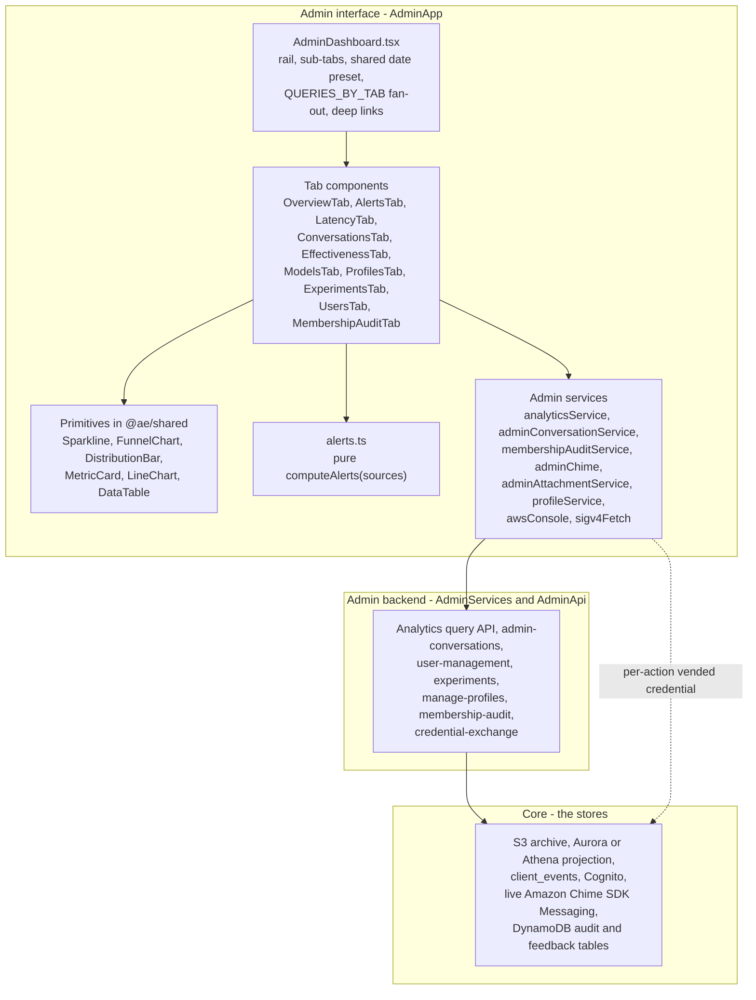

The console owns none of the stores. Several views that read as sections are sub-tabs, because a section answers one question from one store: Overview opens Operations, Conversations opens Oversight, Effectiveness (labeled "Evaluation") opens Performance, and the membership audit is a tab under Oversight rather than a section with one differently named child.

`EvaluationsTab` is absent from the nav and still backs the Effectiveness drill (section 4); the flow score panel, the task list and timeline, and the inline steps are components inside `EffectivenessTab` rather than tabs of their own. The one exception is `EvaluationsTab` in Athena mode, where the Aurora-only drill does not exist: `ATHENA_ONLY_TAB_IDS` keeps it reachable there as the evaluation surface.

## 2. Data model

Read-mostly, with no store of its own.

| Source | What it answers | Mode |
|---|---|---|
| S3 conversation event archive, via Athena Glue tables in the default mode; the Aurora projection's event rows in Aurora mode | History: messages, membership create and delete, moderator grant and revoke, redaction events. Read by `admin-conversations.ts`, which routes to `admin-conversations-aurora.ts` when the data-plane ARN is wired, because the Athena read exceeds API Gateway's response window. The archive stays the system of record in both modes, and pre-redaction content and the audit reads stay on it | Both, one source per mode |
| Analytics projection: Aurora Postgres, or Athena Glue tables | Derived quality: `exchanges`, `evaluation_results`, `intent_flows`, `task_metrics` / `task_details` / `task_timeline`, `execution_steps`, `drift_events` (pgvector), `model_effectiveness`, `experiment_results` | Aurora-only where a query needs relational joins or pgvector |
| `client_events`: an Athena Glue table in the default mode, the Aurora `client_events` table in Aurora mode | The browser's side: `active_users_daily`, `active_messaging_users_daily`, `error_rate_daily`, `page_load_metrics`, `connection_health_daily`, `messages_per_user`, and the sign-up and sign-in funnels | Both, one store per mode |
| Cognito user pool, via `user-management.ts` | Users, their derived status (pending, approved, disabled) and their classification group | Both |
| Live Amazon Chime SDK Messaging | Current membership (`ListChannelMemberships`), read client-side under `${personId}-admin` rather than from the archive | Both |
| Membership-audit table (DynamoDB) | Layer-6 findings and the `config/enforce` toggle item | Both |
| Feedback table (DynamoDB) | Thumbs and approval, aggregated over a trailing window, 30 days by default and caller-selectable up to 180 | Both |
| Conversation attachments (S3) | `generated-docs/<channelId>/*` (assistant deliverables) and `attachments/<channelId>/*` (user uploads), reached only through credentials vended per open | Both |
| Assistant-profile registry (SSM version store, via `manage-profiles`) | Each profile's versions, active pointer, draft and resolved config body. Model keys are catalog keys, never ARNs, so the manifest is instance-agnostic | Both |
| `metricTargets.ts` | The display-only registry of good / warn / bad bands, and the basis the alerts assembler reads | Both |

## 3. APIs and interfaces

**Analytics query API** - `queryAnalytics(queryType, dateRange, extra?)`, one POST endpoint dispatching on `queryType`. `QUERIES_BY_TAB` maps each tab to the query types it requests and `loadData()` fans them out with `Promise.all`. An Aurora-only query type is still requested in Athena mode and answered `200 + { unsupported: true, reason }`.

The date preset (`24h` / `7d` / `30d` / `90d`) yields `{start, end}` from `getDateRange`; presets and their spans come from one table, so a preset cannot render as a button with no window behind it. Bounds are `YYYY-MM-DD` calendar days in UTC and both modes include the whole of both days, so one request names the same window in either mode and one day is the shortest nameable window.

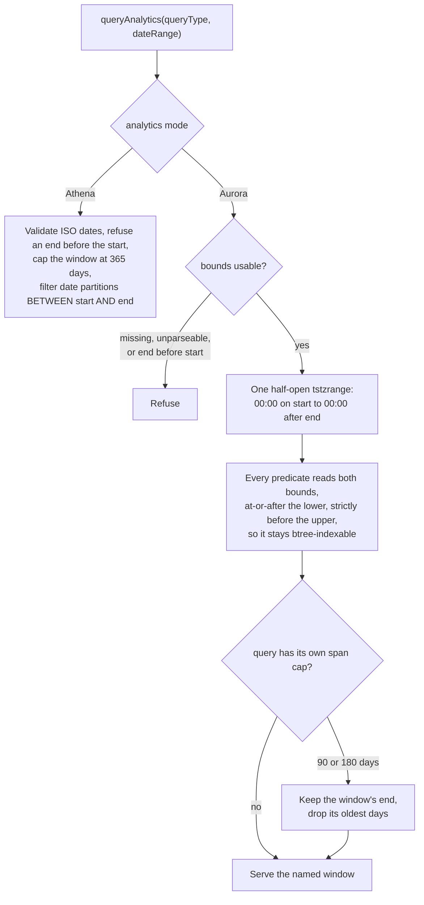

A named window is served or refused, never quietly replaced by a different one. Omitting `dateRange` is how a caller accepts the trailing default window.

**Admin-conversations API** - `admin-conversations.ts`, GET, admin-gated, origin `adminAppUrl`, and it holds no Amazon Chime SDK bearer. It reads the archive through one archive reader (`lib/archive-reader.ts`), which selects Athena in the default mode and the projection's event rows through the data plane in Aurora mode, one source per mode. `listConversations` returns the latest name per `ChannelArn` with a placeholder-excluding title fallback, so the client's "New conversation" placeholder never wins the name and a conversation whose title auto-derive never ran falls back to a title derived from its first human message, plus last activity and classification from the archive partition. `listMessages` returns the latest row per `MessageId`, body decoded and unwrapped from the Lex envelope. `listMessages` and `membershipHistory` return no participant name to any caller. Every row of both passes through `withoutIdentity`, which takes no caller argument and so applies identically in both modes: it drops `senderName`, `memberName`, `invitedBy` and `moderatedByName`, and blanks the nested `raw.Sender.Name` and `raw.ModeratedBy.Name` to the literal `(identity withheld)`. The nested blanking stays necessary because `raw` is the archived Amazon Chime SDK payload, which carries `Sender.Name` inherently, and it is blanked in place rather than deleted so the drawer shows a field that exists and was not disclosed rather than an archive with no sender. The participant ARN (`senderArn`, `memberArn`, whose last segment is the person's AppInstanceUser id) is always present, so a caller can identify a participant without being told who they are. The name is worth its own grant because it identifies the person: the credential exchange creates the `AppInstanceUser` at first sign-in and names it from the IdP's `name` claim, otherwise from the local part of the email address, falling back to the person id (`displayNameFor` in `backend/lambda/src/lib/person-identity.ts`). `resolveIdentities` answers `GET admin/conversations/identities?channelArn=…` with `{ identities: { [arn]: name } }` for a caller holding `see-user-identity`, 403 otherwise, 400 on an invalid ARN, and 403 outside the classification boundary. It has its own `execute-api` resource, which is what lets API Gateway refuse it to a role without the capability and what makes `callerCanSeeUserIdentity` satisfying an IAM-signed caller sound: that resource authorizes nothing else. The `USER_IDENTITY_VIEW_GROUP_NAMES` group set (defaulting to the admin groups) is that function's fallback for a call with no trusted IAM identity, which no deployed admin route receives. It answers from the same rows the conversation views read - `archiveMembershipRows` on the Athena path, the Aurora readers otherwise (both in `lib/archive-reader.ts`) - so the names and the transcript cannot disagree.

**User-management API** - `user-management.ts`, GET and POST, every route IAM-authorized (`view-users` for the list, `manage-users` for the changes, `delete-users` for delete) and origin-checked; the console signs each call. `GET /users`; `POST /approve` (sets approved and classification, syncs the single classification group, enables, provisions the member Amazon Chime SDK Identity app-instance-user); `POST /reject`; `POST /enable`; `POST /tier` (validates and syncs the classification group); `POST /delete` (best-effort channel-membership cleanup as the service app-instance-admin, then delete the app-instance-user and the Cognito user; idempotent).

**Experiments API** - `admin-experiments.ts`, on `AdminApi`, declared by the assistant administration nested stack when `experiments` is declared, admin origin, every route IAM-authorized (`view-experiments`, `manage-experiments`, `manage-battle-settings`) and signed by the console through `experimentsService.ts`: `listExperiments()` over the registry, `experiment_results` from Aurora, create / pause / resume / complete, and a per-experiment recommendation built from an LLM call over collapsed per-variant rows.

**Profiles API** - `manage-profiles`, `/admin/profiles` on `AdminApi`, declared by the `AssistantAdministration` nested stack of `AdminServices`, client `profileService.ts`: list profiles with versions, active pointer and draft; read a version's resolved config body; create a version; edit, validate and activate a draft; roll back; export and import. Every route is IAM-authorized and the client SigV4-signs with the operator's sign-on credentials; reading (`GET`, `export`, `validate`) is `view-profiles`, writing (`version`, `draft`, `import`, `variant-version`) is `edit-profiles`, and `activate` and `rollback` are `activate-profiles`, each its own route. Every mutation is audited. The service serves the tool registry alongside the profiles, so the console describes a tool from the one definition rather than a mirrored copy. `awsConsole.ts` builds the profile's AWS deep links client-side from server-resolved identifiers.

**Membership-audit API** - `membership-audit-admin.ts`, admin-gated by `requireAdmin`: `GET` and `POST /membership-audit/enforce` read and write the DynamoDB `config/enforce` item; `POST /membership-audit/revoke` calls `DeleteChannelMembership` as the service app-instance-admin and marks the finding revoked, idempotently. The Layer-6 construct deploys in either analytics mode, so this surface is always present.

**Admin credential exchange API** (the handler in `AdminServices`, its routes on `AdminApi`) - `POST /exchange-credentials` with `{ identity: 'console' }` and the person's ID token, behind `AdminApi`'s own edge authorizer, issues the console session; each per-conversation capability is then `POST /exchange-credentials/admin/<capability>`, IAM-authorized and signed with that session, with a stated reason. It vends a 30-minute credential for one literally named conversation, returning the operator's `${personId}-admin` ARN as the `ChimeBearer` where the capability acts in the Amazon Chime SDK. Called client-side per action. `AdminApi`'s CORS allows the admin origin.

**Administration actions** - client-side in `adminChime.ts`, each vending its own credential and emitting a telemetry event.

| Action | Amazon Chime SDK call | Capability |
|---|---|---|
| List members | `ListChannelMemberships` (live) | `view` |
| Join (visible / invisible) | `CreateChannelMembership` (DEFAULT / HIDDEN) | `manage-membership` |
| Add member | `CreateChannelMembership` for an ARN | `manage-membership` |
| Remove member | `DeleteChannelMembership` | `manage-membership` |
| Redact | `RedactChannelMessage` (soft; body cleared, message remains) | `redact` |
| Delete | `DeleteChannelMessage` (hard, irreversible) | `delete` |

## 4. Key flows and algorithms

### 4.1 Per-tab load and the banner decision

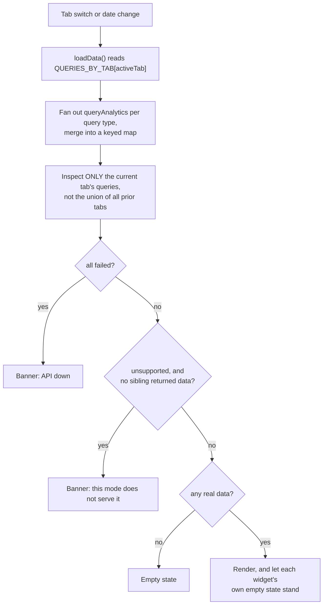

### 4.2 Conversation read and administer

Two sources by design: the event record for a faithful audit trail, the projection for derived context. Amazon Chime SDK Messaging has no membership-history API, so the timeline of who joined or left and when is read from the archive in the default mode and from the projection's event rows in Aurora mode; the archive is the system of record in both, and pre-redaction content is read from it alone.

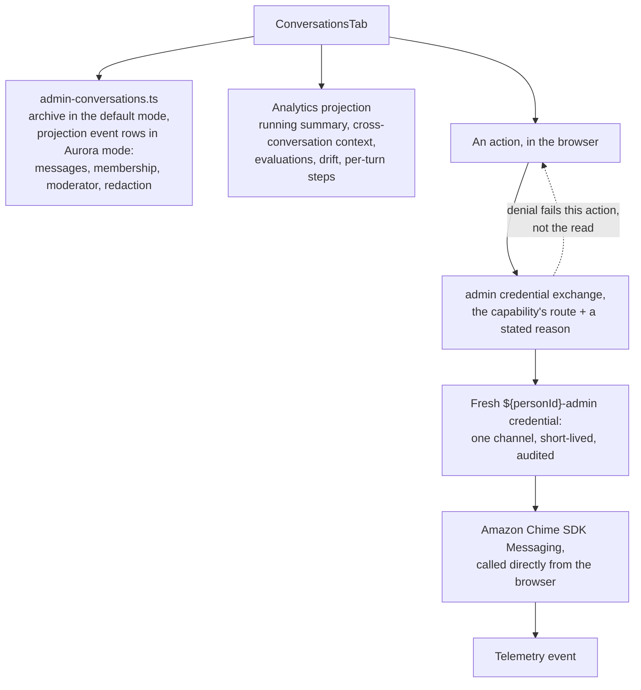

**One timeline, the full record by default** (SPEC FR55). An internal view of a conversation - this one and the de-identified copy (5.3) - answers "what happened" before "what is there now", because an operator investigating a reply needs the message it answered even after that message was removed, and needs to see who was in the room when it was sent. So messages and membership changes are one stream ordered by time, everything is shown by default, and a filter narrows it to the current state.

| Event | Full record (default) | Current state (filter) |
|---|---|---|
| A message | In place | In place |
| A redacted or deleted message | In place, content replaced by a marker naming the removal, who made it and when | Absent |
| An edited message | Each version, marked edited, the version an assistant answered identified | The latest text |
| A join, leave or moderator grant | In place, between the messages it separated | Only the memberships participants can see |
| A hidden join (an operator joining invisibly) | In place, marked hidden | Absent |
| The service admin assembling a room it created (its own join, moderator grant and leave) | In place, labeled "room setup by the service" | Absent |
| A subject change, in Aurora mode (a drift flag, how the offer ended, a subject a summary version added or dropped) | In place, at the time it was flagged, decided or summarized | In place |

The full record is the default because the filter can only remove, and a view defaulting to the current state hides the evidence an operator came for without saying so. The filter is named for what it shows, so it cannot be read as the record.

**Built:** the record view is one timeline: the archived membership events are merged with the messages by time, a removed message stays in place as a distinct redacted or deleted marker attributed to who removed it, and a membership change carries no message controls (`ConversationsTab.redaction`, `ConversationsTab.timeline`). Archival keeps each membership event's `Type` (`DEFAULT` or `HIDDEN`) as `metadata.membershipType`, the history answers `hidden` from it, the record marks a hidden member, and the "Current state" filter hides removed messages and hidden members (`a-hidden-join-is-recorded-as-hidden`). Each edit appends its text and time to the message's own row (`content_versions`, migration 070), so a read-time removal covers every version; the read returns them original first, the record lists the earlier ones under the latest text, and "Current state" shows the latest only. A team's read keeps only the versions made inside its assistant's membership periods (`every-version-of-a-message-is-kept`, `a-team-reads-only-while-its-assistant-was-there`, `ConversationsTab.timeline`). **NOT BUILT:** identifying which version an assistant answered. **OPEN:** an edit archived before migration 070 shows only the original and the latest; the S3 archive holds every UPDATE event, so a backfill can recover the rest. **Room setup (built, Aurora mode).** The service admin creates conversations (person-created, drift splits, event-opened), joins, is a moderator from `CreateChannel` and leaves once the room is assembled (`channel-creation.ts`). `adminMembershipHistory` (`admin-conversations-aurora.ts`) marks `roomSetup` on the events of the identity that sent `CREATE_CHANNEL`, when it is a person (`/user/`) identity, for its own join, moderator grant and leave within 2 minutes of `CREATE_CHANNEL`; the record labels them and "Current state" drops them. The same admin joining later, to oversee, is not marked (`admin-conversations-aurora`). **Subject changes (built, Aurora mode).** `adminMembershipHistory` folds `subjectTimeline` (`admin-conversations-aurora.ts`) into the membership history: a `subject_flagged` row for each live drift flag in `drift_events` at the time of the flag, a `subject_resolved` row (for example "Flagged subject · kept in this conversation") at `outcome_at`, the time the outcome was decided (migration 077; a row with no `outcome_at` falls back to the flag's time), saying how the offer ended (kept here, moved to a new conversation, moved then rejected there, or moved and unused), and `subject_added` and `subject_dropped` rows from the topics of consecutive `conversation_summaries` versions. The record renders them from `admin.conversations.subject.*`, and "Current state" keeps them. A failed read leaves the membership timeline without them (`admin-conversations-aurora`, `ConversationsTab.timeline`). An `abandoned` offer with no new conversation is one nobody answered and reads "offer not answered"; with one, it reads "moved, and the new conversation was not used". **NOT BUILT:** the default-mode (Athena) history marks no room setup, so there the service admin's setup rows read as ordinary joins and leaves. **OPEN:** a membership row archived before the type was kept answers no `hidden`, and the filter keeps it rather than guess; the raw events in the S3 archive carry `Type`, so a backfill can settle those rows.

### 4.3 Effectiveness drill, L1 to L4

`intent_effectiveness` returns one row per intent, ranked worst-first on two separated axes: Classification (average confidence plus reroute rate) and Execution (DIRECT intents by Pass A relevance, task intents by completion rate). Latency, cost per reply (tokens times model rate, null-honest) and tool-error rate (from per-step `tools[]` outcomes, failures only) are independently sortable and colored against `metricTargets.ts`. A call the task workflow refused by a declared rule (`errorClass: 'workflow_refusal'`) is not a failure: it stays in `tool_calls`, is excluded from `tool_errors` and `tool_error_rate`, and is counted as `workflow_refusals` in an unbanded Refused column. A step action the platform ran on entering a workflow state (`steps[].action`) is not a model tool call either: it is counted per intent as `platform_actions`, in an unbanded Platform actions column. The whole row is the drill target, which is what makes it usable on touch.

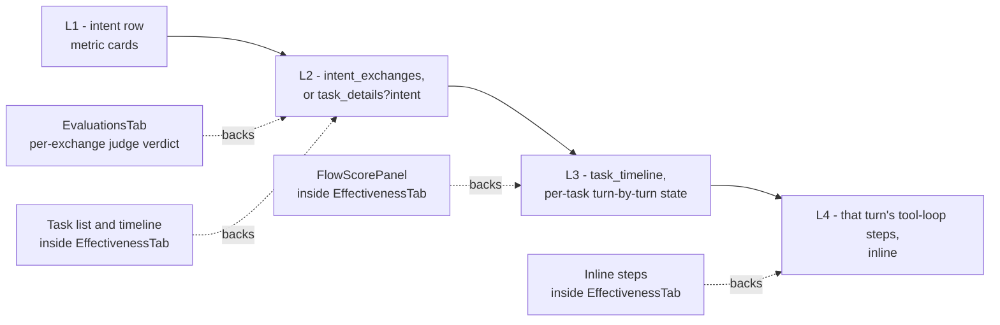

`EvaluationsTab` is the only one of these that is its own component file; the other three are panels inside `EffectivenessTab`. None carries a nav entry, and only the two human-action views, Flagged and Ground Truth, are separate sub-tabs. Scores are context-aware and marker-stripped with the same deterministic `stripMessageMarkers` the chat client uses, so the judge scores exactly what the person saw.

### 4.4 Alerts assembly

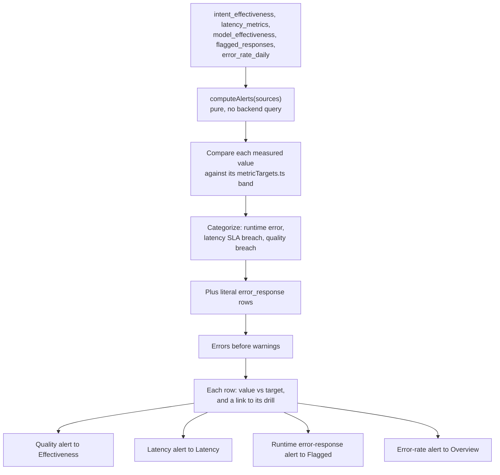

The assembler reads the results the dashboard already holds, so it adds no query. Because the effectiveness and model sources are Aurora-only, so is the tab.

**Every score the alerts read is an average over scored rows, with its count beside it.** `model_effectiveness.avg_score` is `AVG(er.relevance_score)` and returns `scored_count`; `avg_total_ms` and `p95_total_ms` are taken over the turns that recorded a duration and return `timed_count`. Judging is a sample and a backlog - the evaluation runner draws a percentage by hash and works a bounded batch per run - so at any moment most exchanges are unscored by design. Zero-filling that tail makes the column measure evaluation coverage rather than quality: it falls as traffic grows and rises when the backlog catches up, and an "evaluated quality below target" alert then fires on how much has been judged. Nothing is counted as zero because it was not judged, a turn that recorded no duration is not counted as instant, and a group nothing has judged returns NULL, renders as a dash and sorts last.

### 4.5 Assistant-profile lifecycle

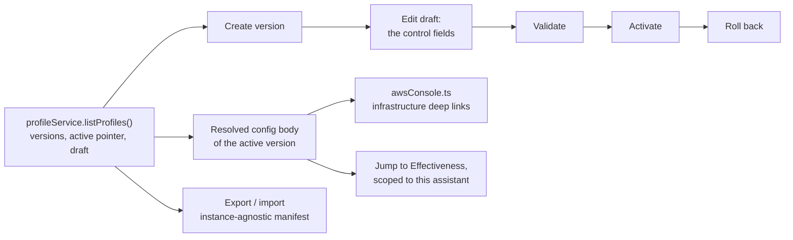

The models-bundle editor covers base, classifier, complex and per-intent routes. The classifier default is the explicit `'default'` sentinel, which tracks the platform default rather than pinning a key.

**The Assistants tab** (`ProfilesTab.tsx`) is built around the assistant as the top-level object. The tab owns the reads and writes (the listing, the active and draft bodies, saving an area, Validate, Activate, Discard, export and import), and shows its loading line in place of the tab only until the first load, so a reload after a save, an activation or Edit keeps the open section and the wizard's step; an assistant's page is `AssistantPage.tsx`:

- **One list** (`AssistantsList.tsx`). `assistantRows` merges the profile listing with the console-created roster into one row per assistant: classification, role, owning team, status, active version, and how it was created (`origin`: `deployed` or `console`) as a quiet detail. The owner is the listing's when the profile is listed (its identity's `owner-team` tag, `null` when cleared or split) and the roster's only for a row with no profile yet. Retire appears only on a console-created row; a console row shows `ownerSeedError` and `firstDraftError` when the build could not record them. An admin's rows come from `GET /admin/profiles`; a team member's from `listOwnedProfiles` (each owned assistant's team route) and `listTeamRoster` (each team's), so the server filters and nothing outside their reach is fetched. The team filter narrows what was returned; the count reads "N of M assistants" when it does.
- **One creation wizard**, seven steps sharing one stepper (`WizardSteps.tsx`, named by `creationSteps` in `assistantSections.ts`). `CreateAssistantFlow.tsx` runs the two that make the assistant: Classification and name (classification and role, identifier, assistant name, owning team) and Starting point and models (starting point, intent classification, `ModelChoice` for the classifier and the default model, as Scope and models renders them, and an optional turns per hour), every field a `StackedField` (label, help, control) in the page's words, with a live preview of the choices. After the create it waits on the build; a load of the listing (Check the build, or a refresh) that shows the new assistant with its draft renders `AssistantPage.tsx` with `wizard`: the page's Behavioral, Workflows, Scope and models and Tools and context sections as steps (`WIZARD_SECTIONS`), Next saving the step's unsaved edits as one patch (`combinedPatch`), ending on the page's draft banner. There is no second editor for the wizard. The starting point is the classification's defaults, a profile file in the export format, or a copy of another assistant's active version in the same classification; the step shows what the first draft will hold, from the classification's catalog or from the file read in the browser, and a file fills in the models where it names a model the classification selects. The server checks a file or a copy before it takes the name (`aeCheckStartingPoint`) and lands it when the build finishes, with the create's name and models written over it (`lib/starting-point.ts`). Workflows are shown in two groups, there and on an assistant's configuration (`WorkflowGroups.tsx`): every assistant's, the turn queue's platform machines (`required` in the catalog, from `PLATFORM_TASK_MACHINE_KEYS`), labeled platform-level and not editable; and the ones it can open, which a version selects among and a classification adds to in its pack. Where it answers is `rosterTargets`, built by one helper (`lib/roster-targets.ts`) for the admin and the team route alike: the deployment's own conversational classifications and the roles each has enabled. The models are the classification's, from the catalog the listing serves (`lib/classification-catalog.ts`). The build seeds a first draft through `manage-profiles` (`aeSeedFirstDraft`, `seedFirstDraft`), so the wizard continues on a draft that already holds for the persona, tools, guardrail and intents, rather than carrying a second copy of that editor. Its first step's help says that an assistant belongs to one classification for its life and fills a role the deployment provides, and that a new classification or role is added by a deploy because it brings its own tools, context, tags and IAM role, with links to the guide; nothing on an assistant's page presents its classification, role or reach as changeable.
- **The draft's areas** (`draftAreas.ts`, `DraftStep` in `DraftControls.tsx`). `draftAreas.ts` lists the areas (name and persona, tools and context, models, routing rules, welcome, message templates, event workflows, variables) and, for each, the version fields it owns, the one sentence its card says (`areaSummary`) and its part of the diff against the active version (`draftDiff`, comparing by content; a field no area owns is reported under `other`). An area's step (`DraftStep`) holds the area's controls (`DraftAreaFields.tsx`, which reuses the existing editors: `WelcomeFields`, `EventWorkflowsFields`, `GuardrailAndSources` and `RetiredCopyNote` in `AssistantConfigFields.tsx`, `MessageTemplatesEditor`, `RoutingRulesEditor`, and the tools, name and persona controls; the models are `ScopeDraft` on the page), its help behind a `HelpToggle`, and a live preview of its sentence. The area's unsaved edit is held by the tab (`unsavedAreas.ts`: `Unsaved`, one patch per area), not by the controls: each area seeds from the saved draft with its edit laid over it (`draftWith`) and reports each change back, so a section switch, the version toggle or a remount after another area's save keeps it. Two areas share a field (welcome and events share `eventWorkflows`, models and routing share `models`), so an area's patch is read as its own part laid over the latest draft (`rebase`) before it is saved, and Save sends that area's patch alone, then forgets it. Leaving the assistant with an edit held asks (`window.confirm`, and `beforeunload` while one is held); so does Activate, and Discard's confirm names them. Variables are JSON-only (`profile-field-decisions.ts`), so they are listed with `EditPath`.
- **An assistant's page** (`AssistantPage.tsx`). The header holds the performance links and the version toggle (`mode`: `active` or `draft`, held by the tab and reset to active on activation and discard; forced to the draft while nothing is active). While the draft shows, the banner holds `DiscardDraft`, Validate, Activate and `DraftDiff`. A menu opens one section at a time; `assistantSections.ts` maps each section to the draft areas it edits (`SECTION_AREAS`), marks the ones the draft changes (`changedSections`, from `draftDiff`), splits workflows into the version's own and the platform's (`PLATFORM_EVENT_WORKFLOWS`; Copy writes one into the draft's `eventWorkflows` under a free name, `withPlatformCopy`), and builds the intent cards (`intentCards`) from the version's pack, the classification's catalog `intents` and the version's routes; the Intent pack row lists only the pack's own intents (`packIntentKeys`), not a route no pack names. In the draft, each section renders its areas' `DraftStep`s inline (`autoFocus` off), keyed by the draft's configId so a save re-seeds them; Scope and models edits `models` in one `ScopeDraft` whose route selects sit on the intent cards. A task workflow opens a read-only step view from the catalog's `steps` (`MachineSteps`). The read-only rows (`Row`, label then help then value) and groups come from `AssistantConfigFields.tsx` (`PersonaExtras`, `ClassifierModeRow`, `ContextGroup`, `LimitsGroup`, `WordsGroup`, `PlatformSection`), with `AssistantInfrastructure.tsx`. `AssistantConfigFields.tsx` renders each version field by its decision in `profile-field-decisions.ts` (control, JSON with its command and guide, or read-only with what drives it), served with the listing as `fieldDecisions`, with each classification's catalog (`classifications`) and the named messages (`copyCatalog`).
- **Performance links** (`assistantLinks.ts`) are URLs the console opens on: `?admin=effectiveness&as=<assistant>&ver=<n>` (or `&intent=<key>`) and `?admin=conversations&as=<assistant>`. `AdminDashboard.tsx` seeds the Performance filter set from `as` and `ver` (`filtersFromUrl`), and the Effectiveness intent view and drill from `intent` (`intentFromUrl`, kept in the URL by `changePerfView`); a click on the page applies the same values without a reload (`openAssistantLink`) and remembers the assistant, so Back returns to it. `ConversationsTab` reads the filter set's assistant and passes it to `listAdminConversations`, which sends `assistant` on the admin route; `admin-conversations.ts` resolves that assistant's identities (`listAssistantIdentities`, the read a team's scope check already makes, so no grant is added) and lists by member under the caller's classification scope. The catalog behind the intent cards and step view is the listing's own (`classification-catalog.ts`: `intents`, and `steps` on each workflow).
- **Infrastructure links** come from `resolveProfileInfra` (`lib/profile-infra.ts`), which places the assistant in its classification first and reads the classification-keyed parameters (`/assistant/{classification}/processor-arn`, `router-arn`, `vend-arn`, `guardrails`), the acting role from the vend function and its boundary from IAM, the Amazon Lex bot from the identity, and the channel flow's Lambda from `DescribeChannelFlow`. Each link is marked as the assistant's own, shared by its classification's assistants, or shared by the deployment. `awsConsole.ts` builds each console URL from the resolved region; a resource the console has no page for (an Amazon Chime SDK channel flow or `AppInstanceBot`) is shown with its ARN and the CLI describe command.
- **Session re-issue.** A team session names the assistants owned when it was issued. After a team member's create, `useReissueSession` asks the exchange once and swaps the session in place; when a later load shows an active assistant on the team's roster that the session does not name, it asks once more. Both are triggered by what the console has just done or read, not by a timer.
- **One team selector** (`TeamSelector.tsx`) wherever the console scopes by team: the list filter, the create flow's owner, the owner control and the team member's identity line (`TeamIdentity.tsx`). One team and nothing else to choose is a fixed label.

### 4.6 Attachment review

From the Info drawer, `adminAttachmentService.getAdminAttachmentDownloadUrl(channelArn, fileKey)` vends channel-scoped, short-lived, audited S3 credentials whose session policy permits `s3:GetObject` on that one key, presigns the GET client-side, and opens it as a top-level navigation.

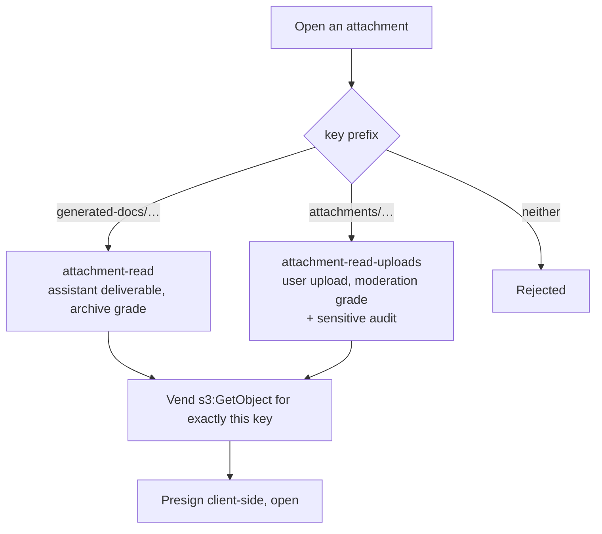

Two capabilities rather than one, so the sensitivity boundary is IAM-enforceable. A key under neither prefix is rejected, and a missing capability fails the single open rather than the read.

### 4.7 Model comparison and experiments

`listExperiments()` reads the registry. `experiment_results` (Aurora) aggregates per variant weighted by exchange count, derives cost from average tokens and model price, and folds in the feedback and battle stores. The advisory objective is evaluated client-side against the experiment target; the recommendation LLM call is descriptive and changes no routing. Create supports an optional `/battle` config: display names, prompt addenda, a per-variant image-generation model, the challenger (listed from `GET /admin/experiments/challengers`), and long-form mode.

### 4.8 Turn debugging

`execution_steps` (Aurora) reads each message metadata's `steps` array, newest first. Each step carries `tools: Array<{name, ok, errorClass, refusal?}>` with a bounded `errorClass` - `timeout`, `not_found`, `unauthorized`, `bad_input`, `error`, `workflow_refusal` - and never raw text or PII, which is what feeds the Effectiveness `tool_error_rate` and renders inline at L4. The inspect drawer renders the stored fields plus the raw archived `Payload`. It gets no name from the message read, which carries none for any caller, so it renders the sender's ARN and the literal text `identity not shown` where a name would sit, stating that a field is withheld rather than reading as an empty record. The raw `Payload` is the archived Amazon Chime SDK record and holds `Sender.Name` inherently, so the handler blanks that nested name to `(identity withheld)` before the drawer prints the object.

### 4.9 Membership audit

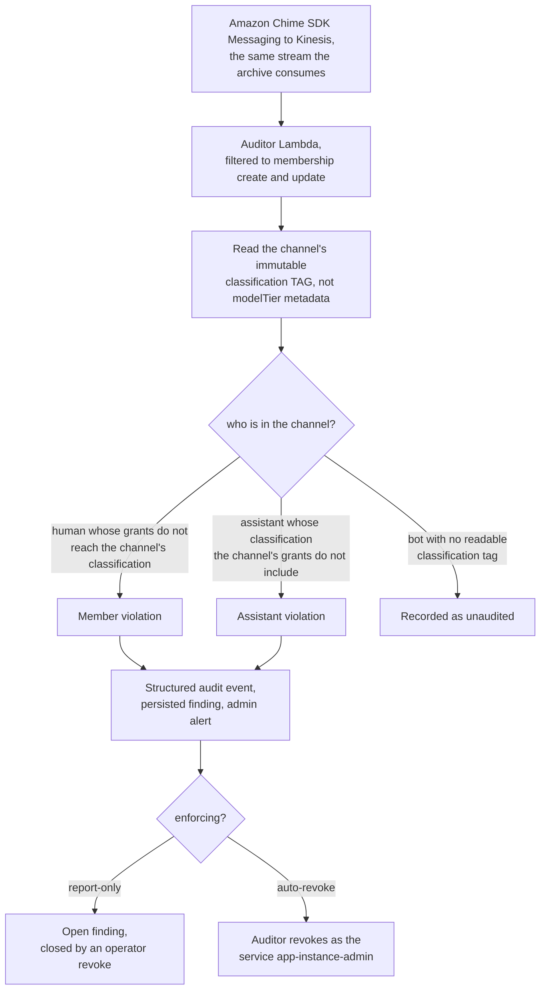

Both directions are set membership over declared grants rather than a rank comparison (ADR-046): the human check asks whether the member's grants reach the channel's classification, and the assistant check asks whether the channel's grants include the assistant's classification. A battle alt is tagged with its classification at creation and audited on the same rule; only a bot whose tag cannot be read is skipped, and that is recorded rather than silent. The assistant direction still matters even though Layer 1 now denies the assistant acting in such a channel (ADR-042): nothing prevents it being added as a member, because membership is created by a moderator or an administrator and consults no grant of the assistant's, and that membership is the gap this detector covers.

### 4.10 Deep-linking and history

`?admin=<tab>` deep-links to a sub-tab. `?conv=<channelId>` opens a conversation detail, expanding the short channel id to a full ARN via `VITE_APP_INSTANCE_ARN`. Tab selection pushes history so browser Back steps through tabs, and a tab with an open drill-down registers a drill-back handler so Back closes the detail before leaving the list.

### 4.11 Nav tree

The sitemap in [SPEC-ADMIN-CONSOLE.md](./SPEC-ADMIN-CONSOLE.md) is one array: `SECTIONS` in `AdminDashboard.tsx`, a list of `{ id, label, tabs }` where `tabs` holds the `TabId` values of that section's sub-views. `activeTab` remains the single source of truth for content and data loading; the section rail only groups. Section labels are literal English in the array, and sub-tab labels resolve through `tabI18nKey` against the shared locale bundle, which is the one inconsistency in the tree worth knowing about before adding a section.

Three rules decide what renders, from the mode, the session's capabilities and, for a team member, `TEAM_TABS` (`TEAM_TABS_ATHENA` in Athena mode):

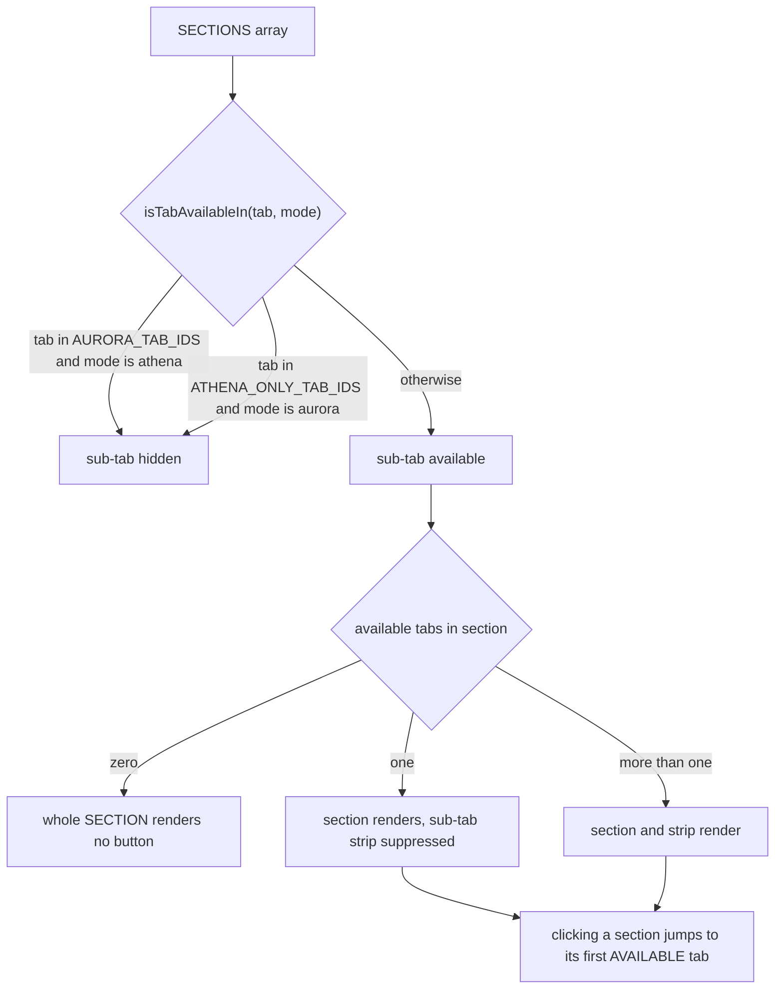

`AURORA_TAB_IDS` holds `flagged`, `ground_truth`, `effectiveness`, `alerts` and `battles`; `ATHENA_ONLY_TAB_IDS` holds `evaluations`, which stays reachable in the default mode because the richer per-intent drill that supersedes it does not exist there. The consequence a reader should carry: **Assistants shows no sub-tab strip today** because it has one child, and gains one as soon as the classification entry point does (SPEC-ADMIN-CONSOLE FR17), and **Experiments shows none in the default mode** because `battles` is the second child and it is hidden there.

`QUERIES_BY_TAB` maps each `TabId` to the analytics reads to prefetch when that tab opens, and the fan-out issues them together. Two things follow from that shape. Alerts declares the reads it assembles from rather than a read of its own, which is why it is a consolidation rather than a query and why it cannot exist where those reads do not. And **a tab absent from the map fetches nothing**: Page and Connection renders `page_load_metrics` and `connection_health_daily`, which only the Latency tab requests, so it is empty until Latency has been opened in the same session.

### 4.12 Reach and refusal

A tab renders only for a session holding its capability (`TAB_CAPABILITY`), and a team member sees only the team tabs (`TEAM_TABS`). That is presentation: IAM refuses what the session lacks whatever renders, so the scoping stays on the IAM-backed capability behind each read.

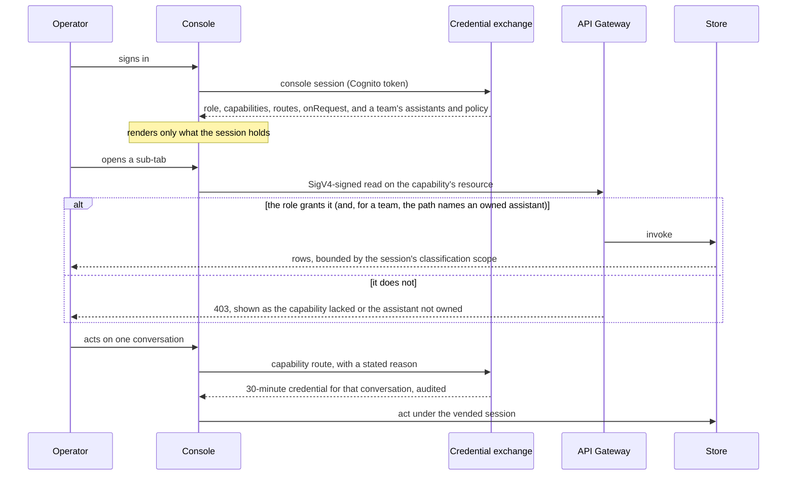

Which path a read takes is the `enforcement` field on each catalog entry in `backend/lib/config/admin-capabilities.ts`. A `signOnRole` capability rides the console session, and the gateway refuses a role that does not hold the resource. An `exchangeVend` capability is requested per use on its own route, which is how message content and every moderation action stay accountable rather than standing, and why the conversation id is a path segment the role boundary wildcards and the vended session policy narrows.

## 5. Security and IAM

- **Entry gate.** The console opens on the console session's capability set (`CapabilityProvider`): a sign-in holding none, a team member in no `team-<name>` group (`NO_TEAM`), or one whose team owns more than one session can name (`TEAM_SCOPE_TOO_LARGE`) sees a refusal that says why (SPEC FR44, FR53). A team member whose team owns no assistant yet gets a session naming only their team routes, and the console opens on Assistants alone (`isTabAvailableToTeam`), where they create one for their team.
- **Team creation and assignment, two layers (P4).** A team member creates an assistant on `/admin/teams/{team}/roster` and moves an owned assistant on `/admin/assistants/{assistant}/ownership`. The session policy the exchange vends names `*/teams/<team>/*` for the person's own teams and `*/assistants/<a>/*` for the assistants they own, so IAM refuses another team before any handler runs. The handlers re-check: `manage-assistants` refuses another team (`TEAM_NOT_YOURS`) after asking the ownership function whether the person the signed session names is in it (`op: 'in-team'`), because the provisioner's own role holds no identity or directory read, and lists the team's assistants from its own directory entries; it refuses a classification the person's clearance does not reach (`CLASSIFICATION_NOT_CLEARED`) and an unowned create; `assistant-ownership` refuses another team and a cleared owner on the team route; both refuse a team console session on the admin routes (`ADMIN_ROUTE`). The console offers only the person's teams in the shared `TeamSelector`.
- **Deploy-only, refused at run time.** A classification, a role and what a role reaches change IAM, so they are declared in `deploy.config.json` and deployed. The roster create refuses a classification or role the deployment does not declare, and a profile draft refuses a patch naming `classification`, `role`, `roles`, `grants`, `reach` or `ownerTeam`. An assistant's page shows its classification, role and acting role as facts; the create flow's instructions link [HOW-TO-ADD-OR-MANAGE-A-PROFILE.md](../../guides/developer/HOW-TO-ADD-OR-MANAGE-A-PROFILE.md) for adding either by a deploy.
- **Backend gate.** Every admin route is IAM-authorized, and each handler trusts the gateway-vetted signed principal (`isAdminIamEnforcedCall`) because the resource it reached authorizes exactly one capability. The actor an audit line names is the person id the signed session names (`callerPersonId`), not the role. `callerIsAdmin` and `requireAdmin` (`backend/lambda/src/lib/auth.ts`) treat every IAM-signed caller as an admin and keep the group check for a call the edge authorizer admitted, so the gateway grant is the whole of the IAM-signed decision; a session name of the form `console-<personId>` on a role named `*-admin-console` or `*-team-console` is read as the actor, whatever shape the id has. Every route is origin-checked.
- **Administration identity, not chat identity.** Live actions run as the per-human `${personId}-admin` app-instance-admin identity, vended per action on the capability's exchange route as a credential for one literally named conversation, lasting 30 minutes and audited with its reason. A separate no-human service app-instance-admin covers automation (Layer-6 auto-revoke, delete-user cleanup). No server-side bearer swap for a human action. Authority model: [SPEC-ADMIN-IDENTITY.md](../interaction/governance/SPEC-ADMIN-IDENTITY.md).
- **Classification scoping.** Membership audit, per-classification assistant resolution and channel clearance read the immutable `classification` tag, never the mutable metadata.
- **Injection defense.** Displayed messages and evaluated text are marker-stripped with the deterministic `stripMessageMarkers`, so the console renders no raw control marker and the judge scores what the person saw.
- **Attachment review is vended, not proxied.** No standing S3 access; one conversation's attachment prefix per vend, with user uploads moderation-grade and sensitively audited, distinct from archive-grade assistant deliverables.
- **Per-capability IAM.** Every route the capability catalog (`backend/lib/config/admin-capabilities.ts`) names is `AWS_IAM`-authorized, with no deploy switch, and each admin role is granted exactly its capabilities' routes by `grantAdminRolesOnApi` (`backend/lib/constructs/admin-role-grants.ts`). Analytics writes (`triage`, `ground-truth`, `moderation-record`) have resources of their own, and the handlers refuse a `queryType`, or a write `action`, that belongs to a different resource. `admins` and `team-members` are the two roles; the `team-members` group sits at precedence 2 (`TEAM_MEMBERS_GROUP_PRECEDENCE`) and carries no role of its own; the deployment creates no Identity Pool, so a team member's chat credentials come from the person credential exchange on their classification. Each vendable capability has its own IAM-authorized request route (5.1). Design: [DESIGN-ADMIN-ACTION-IAM-ENFORCEMENT.md](../interaction/governance/DESIGN-ADMIN-ACTION-IAM-ENFORCEMENT.md).

### 5.1 Capability enforcement

SPEC-ADMIN-CONSOLE's capability matrix is the target, and each row becomes an entry in `backend/lib/config/admin-capabilities.ts`, which the CDK already builds every role's policy from and the exchange already vends against. The mechanisms below extend what exists; none replaces it.

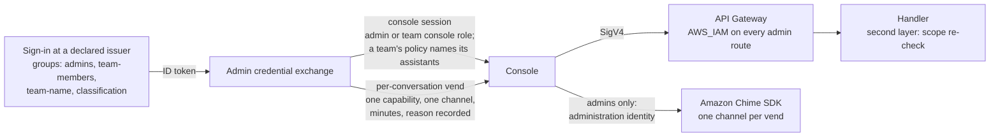

- **Temporary, scoped credentials (built).** The console asks the admin credential exchange, with the person's Cognito token, for a console session (`{ identity: 'console' }`): an hour on `AdminConsoleRole`, or 15 minutes on `TeamConsoleRole`, whose reach is a snapshot of ownership and clearance taken when it is issued, chosen from their groups and named `console-<personId>` (a team session `console-<personId>@<clearance>`, which `caller-scope.ts` reads as its classification scope), returned with the list of capabilities the role holds. The two roles are named rather than exported (`admin-role-grants.ts`), only the exchange may assume them, and every admin API stack grants them from the catalog; the deployment creates no Identity Pool, so no other credential reaches an admin route. The handlers read the person from the session name (`callerPersonId`). `TeamConsoleRole` holds no Amazon Chime SDK permission at all, so a team session cannot reach a live conversation whatever its policy says. A team member's session carries a session policy naming `arn:aws:execute-api:*:*:*/assistants/{assistant}/*` for each assistant their team owns and their clearance reaches, which the exchange reads from their groups and the `owner-team` tags when it issues the session (5.2); a team member in no `team-<name>` group is refused one (`NO_TEAM`), a team that owns none yet gets one naming only its team routes (`*/teams/<team>/*`), and a team too large for one session policy is refused rather than truncated (`TEAM_SCOPE_TOO_LARGE`).
- **Every route on IAM (built).** User management, experiments, battle settings and deployment are `AWS_IAM`-authorized with a catalog entry per row (`view-users`, `manage-users`, `delete-users`, `view-experiments`, `manage-experiments`, `manage-battle-settings`, `manage-deployment`), and there is no `adminIamEnforcement` or `VITE_ADMIN_IAM_ENFORCEMENT` switch, so each route has one authorizer and the console has no mode to disagree about.
- **One grant per capability (built).** The analytics writes have resources of their own (`triage` for `triage-responses`, `ground-truth` for `label-ground-truth`, `moderation-record` for `record-moderation`), `admin-capability-map.ts` routes each `queryType`, and each write `action`, to exactly one of them, and the handler refuses one on any other resource. `classifier-replay-start`, the profile actions and the membership-audit actions are each their own capability (`run-classifier-replay`, `view-profiles` / `edit-profiles` / `activate-profiles`, `enforce-membership-audit` / `revoke-membership`). That is what keeps the handlers' trust of an IAM-signed caller sound: it is sound only while the resource reached authorizes one capability.
- **Exchange requests (built).** Each capability the exchange issues has a request route (`POST /exchange-credentials/admin/<capability>`), IAM-authorized and granted from the catalog to the console roles that hold it. The exchange vends only what the route names, whatever the body lists, so a session holding the `redact` route and not the `delete` route cannot obtain a delete session; it re-checks the role against the catalog as a second layer and requires a reason. The Cognito route answers an admin-plane request with `ADMIN_VEND_MOVED`.
- **Administration identity (built).** The `${personId}-admin` AppInstanceAdmin identity is held by the people in a role granted a capability that acts in the Amazon Chime SDK (`rolesNeedingAdministrationIdentity`, `admins` today), decided by the catalog rather than a group name. It is provisioned at their console session (`ensureAdminIdentity`) and removed by the reconcile in `admin-conversation-sync.ts` when they no longer hold such a role. Its power is app-instance-wide, so each vend is the whole boundary: the session policy names one capability, pins the `${personId}-admin` bearer, names one literal channel (a wildcard is refused, `CHANNEL_NOT_LITERAL`), and expires in 30 minutes. That narrows the credential and not the reach: `admins` act on every conversation, and only team members are scoped. The id is derived from the person id and carries an `owner` tag naming the person's AppInstanceUser ARN (`ensureAdminIdentity` in `admin-credential-exchange.ts`).
- **Stated reason (built).** Every per-conversation vend requires a non-empty reason, recorded on the exchange's CloudWatch audit line beside the capability and the conversation, and the vend refuses without it (SPEC FR51). The console's `ReasonDialog` asks through `adminReason.ts`: once per conversation for its reads (messages, live members, attachments), and on every change. Deleting a conversation is the `delete-conversation` capability, which vends `manage-channel`. Archiving one is `archive-conversation`: `POST /admin/conversations/{id}/archive` on the admin API, integrated with the conversation-management function a moderator's archive runs (found by an SSM parameter, so neither stack exports to the other), which requires an admin console session and a reason and records the reason on the archive's audit row. A team member's message read and a team's flagged and ground-truth lists take a reason on the handler, recorded on its audit line. The other reads on the console session take no reason: the raw event log, the analytics exchanges, the conversation list and the membership timeline.
- **Console entry (built).** The console session's capability set is returned with it, and the console opens if the set is non-empty and renders only what it holds (SPEC FR0e, FR0f, FR36, FR44). Beside the set, the session names which of it is granted only on request (`onRequest.capabilities`: the catalog's `exchangeVend` entries the role is granted, `capabilitiesVendedOnRequest`) and how long one such credential lasts (`onRequest.ttlSeconds`, `MODERATION_SESSION_SECONDS`). The Access log tab states the operator's reach from these under "Your access", as what the session holds and what is granted on request, one conversation at a time with a stated reason; the dashboard header carries no capability list, and the console keeps no copy of the catalog. A refusal still reaches the console when a session expires or a scope changes mid-session: on a team route it names the assistant that is not the team's, and elsewhere the capability lacked and who grants it (SPEC FR53). A refusal a handler words itself, other than `ASSISTANT_NOT_OWNED`, `NO_TEAM` and `TEAM_SCOPE_TOO_LARGE`, reaches the console as the handler's text. The client enforces nothing; it presents a decision IAM already makes.

### 5.2 Assistant ownership scoping

**Ownership tag.** Ownership is a tag on the `AppInstanceBot`, read live, so no policy names an assistant. An assistant's bots carry `owner-team=<team>`, and the bot's `assistant` tag names the assistant in a route. A person's team is a Cognito group `team-<team>`. When it issues a team session, the exchange resolves the caller's teams from their groups, lists the app instance's bots and their tags, and names in the session policy exactly the assistants that (1) every bot serving the name assigns to one of those teams - a split owner reaches only a person in every team named - and (2) serve only classifications the person's clearance reaches. Within this app's roles the ownership function, behind `manage-ownership`, is the only principal permitted to write the tag; a change takes effect at the caller's next console session, within 15 minutes for a team session. A profile's `ownerTeam` seeds the tag at provisioning onto a bot with no `owner-team` tag, and a cleared owner is recorded as `_none`, so a seed never undoes a decision made in the console. **The tag is the one source of truth for ownership**, console-created assistants included: a team's roster lists a runtime assistant with an identity by its tag (the ownership function's `owned-by`, so the provisioner role still reads no identity), and by the team it was created for only while it has none. A seed that fails is recorded on the directory entry (`ownerSeedError`) and shown on its row.

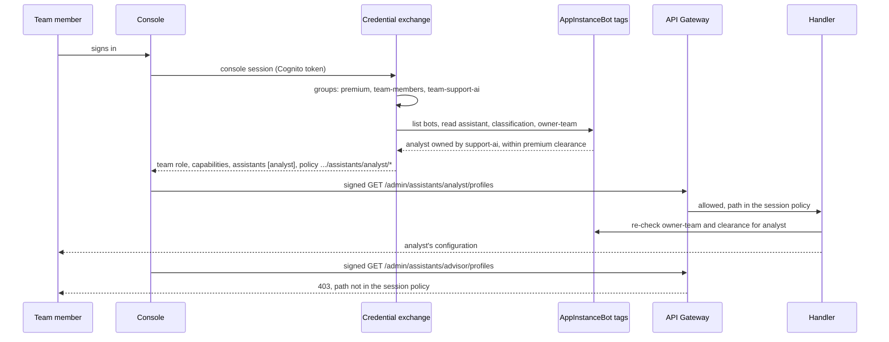

**IAM and exchange decisions.** IAM refuses any path outside the vended set, and that holds only because the `team-members` boundary grants no unscoped admin path: a session policy narrows, so a boundary that already held `/admin/profiles/*` would let the unscoped route through. Which paths go into the policy is decided by the exchange from groups and tags, which is a declared step outside IAM rather than an IAM decision; SPEC acceptance criterion (a) proves it by deny-test. The profile, experiment and conversation handlers then re-read the tag and the caller's clearance for the assistant in the path and refuse a mismatch, so a stale session or a mis-built policy is caught by a second check rather than being the only one (tenet D3). Analytics is the exception: its handler runs in a VPC with no route to Cognito or the Amazon Chime SDK, so ownership there rests on the exchange and IAM alone and a reassignment reaches it only when the session is re-issued (section 8).

**Not a closed axis.** `classification` stays the only closed axis IAM evaluates as a condition (SPEC-CONVERSATION-SECURITY). No policy condition reads `owner-team`; it only selects paths inside the classification boundary, so it can narrow a grant and never widen one.

**Tag writes.** The tag is only an ownership record if nobody it scopes can write it. Every Allow statement in the app whose actions match `chime:TagResource` or `chime:UntagResource` by wildcard, or whose `NotAction` leaves them, carries `ForAllValues:StringNotEquals aws:TagKeys owner-team`, applied once at synthesis by `ExcludeOwnerTeamTag` (`lib/constructs/exclude-owner-team-tag.ts`); `OwnerTeamTagOnly`, the ownership function's statement, is the one exception. The bot's `assistant` and `role` tags are excluded the same way, with the provisioner's `StampOwnClassificationOnAssistantIdentityOnly` as their one writer (`PROTECTED_TAG_WRITERS`). `every-tag-grant-excludes-ownership` proves all three at synthesis, and `deny-test-owner-team-tag` proves all three against the deployed policies of the deployment's roles (SPEC acceptance criterion (i)). Principals outside the deployment are outside this guarantee. The bot's `classification` tag is protected by value rather than by key, because every creator writes `classification` on its channels and `CreateChannel` with `Tags` checks `chime:TagResource` on the bearer too. `tagOnCreateStatements` (`lib/stacks/agent-classification-common.ts`) splits each creator's grant: the app instance, `channel/*` and the named service-admin user under the creator's own conditions, and `bot/*` only where `aws:ResourceTag/classification` equals `aws:RequestTag/classification`, one statement per classification. A grant naming only channels refused every creation, so the synthesis test also checks that each creator still reaches its bearer. `deny-test-owner-team-tag` proves it on the deployed policies, and the creation, archive and drift e2e specs prove every creator still creates.

**Scope by surface.**

| Surface | IAM layer | Handler layer |
|---|---|---|
| Profiles | `/admin/assistants/{assistant}/profiles` and `.../profiles/{action}` | Re-check the tag and the caller's clearance before every read and write; the list is the path's assistant alone; a body naming another assistant is refused, and an import lands on the path's assistant. The handler still writes with its own role (see section 8) |
| Creating an assistant | `/admin/teams/{team}/roster` (`GET` lists the team's console-created assistants and where it may create one; `POST` creates) | Refuse a team the caller is not in, a classification their clearance does not reach, and an owner other than the path's team; the created assistant is owned by that team |
| Ownership | `/admin/assistants/{assistant}/ownership` | Re-check the tag and the caller's clearance; the new owner must be one of the caller's own teams, and a team member cannot clear the owner |
| Analytics | `/analytics/assistants/{assistant}/query` (Aurora mode only) | Force the path's assistant and the rooms the session's clearance reaches into every query, run only the queries that take both (`ASSISTANT_FILTERED_QUERIES` in `analytics-query.ts`: intent effectiveness and its steps, latency exchanges, model usage and effectiveness, turn kinds, drift, workflow trajectory, safety readings, frustration, retrieval sources, judge calibration, tool and template outcomes, message flow, flow turns and the welcome flow) or whose rows carry both (`ASSISTANT_ROW_QUERIES`: latency metrics), and refuse the rest. The handler runs in a VPC with no route to Cognito or the Amazon Chime SDK, so ownership is checked by the exchange and IAM and not re-read here |
| Experiments | `/admin/assistants/{assistant}/experiments`, `.../{experimentId}/status` and `.../{experimentId}` | Admit only a `profile` experiment whose every variant names the assistant, on classifications it serves, and not armed for battle, on every route; answer another team's experiment id as not found. Battle settings have no team route |
| Conversations | `/admin/assistants/{assistant}/conversations` and `.../find` (Aurora mode only) | List and look up only conversations the assistant was made a member of, from the archived membership events, in rooms the session's clearance reaches; an empty scope answers nothing. The membership filter runs in the data-plane query, and the handler re-checks only that a lookup returned the conversation asked for. Messages, at `.../conversations/{channelId}/messages` with a stated reason: only the turns from the periods the assistant was a member (`membership-period.ts`), and a conversation it was never in as not found |
| Triage and labels | `/analytics/assistants/{assistant}/triage` and `.../ground-truth` (Aurora mode only) | A write lands only on a turn the assistant answered in a room the clearance reaches (`turnIsTheAssistants`), and a classifier adjudication is refused. The flagged and ground-truth lists run on the team's query route, filtered in SQL and requiring a reason |
| Attachments | `exchange-credentials/admin/assistants/{assistant}/attachment-read` | The exchange re-checks ownership, asks the Amazon Chime SDK as the assistant's own identity whether it is a member of the conversation now, and vends `s3:GetObject` on that conversation's `generated-docs/` prefix on `TeamAttachmentRole`, whose boundary is deliverables alone |

**Analytics attributed per assistant.** A query is scoped by assistant through the exchange each turn belongs to, read at query time, so no migration and no stored copy is needed. Each `exchanges` row carries `assistant` and `conversation_classification`: cost and tokens (`model_usage`, `model_effectiveness`) and turn kinds join a bot message to the exchange it answered; a drift event joins the exchange its originating message opened; the flagged and ground-truth lists join their exchange. Attribution is per turn, so a room with several assistants splits by who answered, whatever the conversation's own single `assistant` says. A row no exchange claims, including those migration 055 could not backfill, matches no assistant and reaches `admins` alone, by the fail-closed rule. Conversation volumes are room-wide counts and are refused on a team route.

**Limits.** A tag holds one value, so an assistant has one owning team. A session policy is limited to 2,048 characters of plain text, and its packed binary size is a separate limit shared with any session tags. A team session's inline policy names one wildcard per owned assistant (`arn:aws:execute-api:*:*:*/assistants/{assistant}/*`, about 45 characters plus the name) and one per team (`.../teams/{team}/*`), and nothing else, so about 30 to 35 assistants fit with short names; a team beyond that is refused with `TEAM_SCOPE_TOO_LARGE`, never truncated, and a packed-size overflow fails closed as an exchange error. Following console events is granted by a managed session policy attached beside it (`teamSessionPolicyArns`), so it takes none of that budget. **NOT BUILT:** a scope that does not grow per assistant, such as one managed session policy per team, for a team that owns more. Reading the tags costs one `ListAppInstanceBots` and one `ListTagsForResource` per bot when a session is issued, and again, with a Cognito group lookup, on every request to a scoped profile, experiment or conversation route, uncached.

### 5.3 De-identified conversation copy

**Built and deployed** (SPEC FR54, Phase 8); `a-conversation-is-read-without-who-said-it` reads the deployed copies and finds no person named, no email address and no user id: `lambda/src/clean-copy-batch.ts`, `lib/de-identify.ts`, `lib/pii-detector.ts`, `analytics-aurora/clean-copy.ts`, migration 069, `lib/config/deidentify-guardrail.ts`, and `CleanConversationView` in the console. What is not built says so below.

**Problem.** Reading what was said is the work behind quality review, labeling, triage and analysis, and today every such read is a read of the raw conversation: `view-messages`, a stated reason, and the full identity of everyone in it. A de-identified copy separates the two questions the raw read answers together - what was said, and who said it - so the first can be granted widely and the second stays narrow.

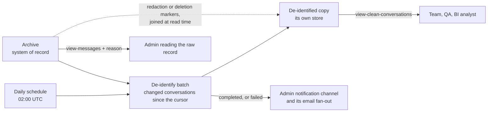

- **A projection, never a record.** The copy is derived from the archive, which stays the one source for what happened (tenet D7). It answers no audit question, and a redaction, deletion or edit in the archive re-derives the affected conversation.
- **The full record by default.** The copy follows the same rule as the console (4.2): one timeline of messages and membership changes, everything shown, with the current-state filter beside it.
- **A removed or edited question stays in place.** An assistant answers a message as it stood when it was sent, so the message stays in the copy wherever it sat, whatever happens to it later; otherwise an answer appears with nothing it answered. A redacted or deleted message keeps its position, its pseudonymous sender and its reply, with its content replaced by a marker naming the removal and when it happened, never by its text. An edited message shows the version the assistant answered and the current one, both de-identified, marked as edited. The raw operator view already keeps a removed message in place the same way, blanked and attributed to who removed it. **OPEN:** that view shows only the latest text of an edited message. A person cannot edit a message today (the chat credential grants send and read marker only), so the only edits are an assistant finalizing its own reply, but enabling edits would hide the version an assistant answered.
- **Participants.** Each human participant becomes a pseudonym (`Person 1`, `Person 2`) stable within one conversation and different across conversations, so a reader can follow a thread and cannot link a person between conversations. The mapping is not stored with the copy. Assistants keep their assistant name, which is not personal data and is what a team reviews.
- **What was said.** Personal data in message text - names, email addresses, phone numbers, postal addresses, account and card numbers, and the other entity types the detector reports - is replaced by a typed placeholder (`[EMAIL]`, `[NAME]`), so a reader still sees that something was given and what kind. The detector is a provider behind one interface, as every model call is (tenet P3). The default is an Amazon Bedrock guardrail of its own, built by the existing guardrail construct with a policy that anonymizes every entity type and blocks nothing (`deidentify-guardrail.ts`), applied with `ApplyGuardrail`: it reuses the guardrail construct and the Bedrock access the deployment already has rather than adding a service (tenet D8). The copy applies the guardrail's matches itself rather than taking its rewrite, replacing each with a description of what was removed (`[an email address removed]`, `[a person's name removed]`). That is what lets addresses be told apart: the guardrail reports a city and a street address alike as `ADDRESS`, and a match with a number or a street-level word is masked while a bare place name - a city, a region, a country - is kept, because masking it removes the meaning of ordinary work ("a trip from Seattle to Denver") and a place on its own rarely identifies anyone (`replacementFor` in `deidentify-guardrail.ts`). A guardrail intervention that reports no match falls back to its own rewrite, which masks everything. A participant's own name or address in what was said becomes their bracketed pseudonym before the detector runs. A user's ARN, which carries their sign-in id, is replaced by rule rather than left to the detector, which was measured masking only the front of one: a participant's becomes their pseudonym, anyone else's `[a user id removed]`.
- **What is left out.** The content of a redacted or deleted message, attachments, whose content is not de-identified, and the raw stored payload the inspect drawer shows.
- **Access.** Its own capability, `view-clean-conversations`, on its own resource (`GET /admin/conversations/{id}/clean`, and for a team `/admin/assistants/{assistant}/conversations/{id}/clean`), so the IAM evaluation that admits the copy can never admit the raw conversation; the deny-test proves the refusal in both directions. A team reads the copy for its own assistants only, bounded to their membership periods exactly as `view-messages` is (5.2), because a pseudonym does not make another team's conversation the team's business. Every read requires a stated reason today and is audited (`clean_conversation_read`).
- **Residual risk.** A detector does not find everything, so the copy reduces exposure and does not remove it. Every read is audited like a raw read. **OPEN:** whether a read of the copy also requires a stated reason, decided against the detector's measured recall on this deployment's own conversations rather than assumed.
- **A daily batch.** No reader of the copy needs it within the minute - review, labeling and analysis read hours-old data - so it is derived by a scheduled run rather than per message. The run reuses the existing bounded-batch pattern (`evaluation-runner.ts`): it reads the conversations whose archive changed since they were last derived (new messages, redactions, deletions, edits), most recent change first, de-identifies each conversation as one document, and writes it whole, recording what it was derived from, so a failed or cut-short run leaves the rest pending and the next resumes them. Each copy also records what derived it - the detector and the version of the rules (`DEIDENTIFY_RULES_VERSION`) - and a copy derived with anything else is pending again, so a change to the rules re-derives every conversation rather than only those that change next. It adds no consumer to the archival stream, so a detector outage or throttle never slows or fails the archive (tenet D8: reuse before building). One document per conversation also pays the detector's per-request minimum once per conversation rather than once per message.
- **How often.** Once a day at 02:00 UTC by default, beside the existing nightly job, set by a CDK context rate as the admin sync's is. The cost is per character, so a deployment that wants a fresher copy can raise the rate without paying more for detection. A deployment also starts its copy when it is deployed: the stack invokes the batch once, asynchronously, on create and again only when the function is replaced (`CleanCopyFirstRun`), so a new deployment does not wait for the next 02:00. The run is safe to repeat, since it derives only what is pending.
- **Not for incidents.** The copy can be a day old, so the console never points an alert at it. A breached threshold, including a failed or incomplete run of this batch, leads to the archive and the raw conversation (SPEC section 1.2), which are current; the copy is for review, labeling and analysis after the fact.
- **Removals are enforced at read time, not by the next run.** A read of the copy joins the archive's redaction and deletion markers, as the raw view does, so a message removed after the last run never shows its content. Freshness is a convenience; the removal guarantee does not depend on it.
- **Completion and failure are announced.** Each run posts one message to the admin notification channel, through `resolveAdminAlertTarget` and the channel's email fan-out (`channel-notify`), as other admin alerts do. On completion: conversations processed, messages withheld for an unsupported language, how far the cursor advanced and how long the run took. On failure: what failed (the detector, the store, the archive read), how many conversations were written before it, and that the next run resumes from the cursor. A run cut short by its time limit is reported as incomplete, not complete. A run that never starts cannot announce itself, so its absence is alarmed on: `CleanCopyNeverStartedAlarm` fires when the function has no invocation in two consecutive 24-hour windows (missing data counts as a breach; two windows, because a daily run near the edge of one window can leave it empty), and the deploy-time run gives it a datapoint before its first evaluation, so a fresh deployment does not raise it and reaches the admin channel through the generic alarm notifier (`alarm-to-admin-channel.ts`), as its recovery does. Every notice the channel receives is posted through one helper (`lib/admin-notice.ts`), which encodes the content and keeps it inside the Amazon Chime SDK caps.
- **Its store.** Separate from the archive, so a grant on one is never a grant on the other. It lives in Aurora (`clean_conversation_rows`, `clean_conversations`, `clean_copy_runs`, migration 069), read only on the admin plane as `messages` is, and is not a bounded table.
- **Scale.** Grouped detector calls per changed conversation, at most 10,000 characters each, fit a day's volume inside one bounded run at the detector's request rate for typical deployments. **OPEN:** past that, the same run hands the day's documents to the detector's asynchronous S3 job instead, whose completion it reads on the next run.
- **Languages.** A detector covers a fixed set of languages, and a deployment is not confined to one (tenet D11). **NOT BUILT:** withholding a message in a language the detector does not cover. Until it is, such a message reaches the copy having been examined only by a detector that may not understand it. **OPEN:** how a deployment adds a detector for its other languages.

## 6. Testing

- **Console unit tests** (Vitest, under `frontend/packages/admin/src/`): `EffectivenessTab` and its drill, low-N suppression, relevance, tools and metric-drill variants; `alerts` for the assembler; `AdminDashboard.tabs` and `AdminDashboard.dateRange`; `PerformanceFilters` for the cascade; `LatencyTab.onePopulation`, `LatencyTab.routerSteps` and `LatencyTab.browserVsServer`; `ConversationsTab.back`, `ConversationsTab.redaction`, `ConversationsTab.drift`, `ConversationsTab.flag` and `ConversationsTab.identity` for the id-by-default render and the name an answered identity call supplies; `ExperimentsTab.objective`; `FunnelChart`, `DataTable` and `metricTargets.tiers`; `adminAttachmentService` and `sigv4Fetch`; and for capabilities and team scope, `capabilities`, `AdminDashboard.capabilities`, `ConversationsTab.capabilities`, `sigv4Fetch.refusal`, `sigv4Fetch.teamVend`, `teamScope` and `analyticsService.team`.
- **Backend tests** (`backend/test/`): the admin handlers through their own entry points - `analytics-query`, `user-management-delete`, `membership-audit`, `manage-profiles`, `admin-experiments`, `admin-iam-enforcement-wiring`, `credential-exchange`, `user-feedback-latest`, `the-console-reads-one-tool-registry`, `every-latency-metric-the-console-shows-is-defined`, `lib/who-a-person-is-is-a-separate-grant` for the identity capability, its catalog entry and its resource, and `a-withheld-name-is-withheld-everywhere-it-rides`, which runs the handler and reads the response body in both modes, because a source-text guard proves nothing about the branch a deployment runs. Its deployed-API counterpart is `backend/scripts/deny-test-admin-capabilities.mjs`, which calls every route the capability catalog declares as a team member, who must be refused at the gateway, and as an admin, admitted live for reads and by IAM policy simulation of the deployed role for writes, so a refusal cannot pass for a broken route. The Aurora query layer is covered under `backend/test/analytics-aurora/`, including `a-named-window-is-served-or-refused`, `analytics-query.execution-steps`, `a-person-can-raise-a-flag`, `a-human-label-names-its-author` and `a-rate-states-the-population-it-was-computed-over`, and `a-team-reads-only-its-assistants-analytics` for the team analytics route. Capabilities and ownership: `one-grant-per-function`, `a-conversation-is-found-by-its-id`, `a-team-reaches-only-the-assistants-it-owns`, `a-team-reads-only-while-its-assistant-was-there`, `a-team-opens-only-its-assistants-deliverables`, `conversation-management` for an archive from the console, `assistant-ownership`, `a-team-experiment-is-its-own-assistants` and `every-tag-grant-excludes-ownership`, which reads the synthesized templates. `backend/scripts/deny-test-owner-team-tag.mjs` asks IAM's policy simulator whether each deployed role may write `owner-team`, and whether any but a provisioner may write a bot's `assistant` or `role`.
- **End-to-end** (Playwright, `tests/e2e/`): `admin-dashboard`, `admin-nav` and `admin-dashboard-render` for load, navigation and render; `admin-flow` for the triage and investigation loops; `admin-profiles` and `portable-profile-lifecycle` for the profile lifecycle; `admin-attachments` for attachment review; `experiments` and `battle` for the experiment lifecycle; `drift-detection`, `task-state-machine` and `tasks` for the quality data behind the drill; `feedback` for the feedback summary; `credential-exchange` and `access-auditing` for the administration-identity vend and its record; `admin-console-reflects-role` for what an admin and a team member each see; `archive-membership` for an archive from the console, a reasonless one refused, and the record surviving.

## 7. Modes and rollout

- **Analytics mode.** Athena is the default; Aurora is opt-in with `--context analyticsMode=aurora`. Aurora is a strict superset: every Athena view is served in Aurora, and Aurora adds the quality views. An Aurora-only sub-tab is hidden in Athena mode.
- **Team scoping is Aurora-only.** The team analytics route and the team conversation list exist in Aurora mode; in Athena mode a team member keeps their assistant's profile and experiments, and the console hides the tabs that would read the archive.
- **Layer-6 always on.** The membership audit deploys in either mode. The enforce default is off (`membershipAuditEnforce`, report-only) and the DynamoDB `config/enforce` item overrides it at runtime with no redeploy.
- **App split.** Deploy phasing and stack ordering are in [DESIGN-SEPARATE-ADMIN-APP.md](./DESIGN-SEPARATE-ADMIN-APP.md).
- **Drill consolidation.** The detail from Evaluations, Flows, Tasks and Steps lives inside the Effectiveness drill, and those components carry no nav entry; Evaluations keeps one in Athena mode, where the Aurora-only drill cannot supersede it. Flagged and Ground Truth are the two human-action sub-tabs.

## 8. Open technical questions

| Question | Why it is open |
|---|---|
| Which store and query shape serve the flagged-response and ground-truth reads in each analytics mode | The write path exists in both modes; the read has to pick a store, and the Athena side cannot do the joins the Aurora side uses |
| How a deployment maps its own operator personas onto the capability set | The enforcement is built and has no off switch (section 5). What is unsettled is the mapping beyond `admins` and `team-members`, which are illustrations rather than a taxonomy |
| Whether any Aurora-only quality view warrants an approximate Athena rendering | An approximation that reads like the real figure is worse than an honest gate, and the honest gate costs a deployment the view entirely |
| Where cost lives: its own view, or a column on the existing ones | It is computed per turn (`estimateStepCostUsd`) and sliceable by the same axes as everything else, so both shapes are available and neither is chosen |
| How the graded conversation read is calibrated | Grant lifetime and silent renewal, what the reason field accepts, what a denied grant degrades to, and whether the subject of a read can see the log of it. The mechanism narrows the existing credential-exchange vend; the calibration is in [SPEC-ADMIN-CONSOLE](./SPEC-ADMIN-CONSOLE.md) |
| Non-Cognito admin federation | Designed for, and not exercised end to end |
| Who owns an assistant created at runtime | A deploy-time assistant is seeded from its profile's `ownerTeam`. One created at runtime with no declared owner is `admins`-only; whether the creating operator's team should seed it is unsettled |
| How the analytics handler could re-check ownership | It runs in a VPC with no route to Cognito or the Amazon Chime SDK, so a reassignment reaches analytics only when the team member's session is re-issued, within 15 minutes (a team session lasts 900 seconds, `TEAM_CONSOLE_SESSION_SECONDS`). A data-plane `op` on the existing seam or an ownership snapshot it can read would close that gap; neither is chosen |
| An assistant whose bots name different owners | It is reachable only by a person in every team named until an admin saves one owner across its bots; the console marks it, and nothing reconciles it automatically |
| Whether the bot's `assistant`, `classification` and `role` tags need the same protection as `owner-team` | They decide route identity and the clearance check, and the provisioners write them; they are not excluded the way `owner-team` is |
| How the admin assistant and other platform-owned assistants are scoped | They belong to no team, so an untagged assistant is `admins`-only by the fail-closed rule; whether a platform team group should own them instead is unsettled |
| How a profile write could run on a credential narrowed to the assistant | The handler writes SSM and S3 with its own role, and it never receives the caller's session. It also reads classification-keyed parameters (`/assistant/{classification}/guardrails`, `.../context-sources`) and invokes the name applier, so a write credential narrowed to `/assistant/{assistant}/*` would refuse work the handler legitimately does. Until this is settled the profile surface has two layers - the scoped path in IAM and the handler's tag re-check - and the write itself is not narrowed |
| A team that owns more assistants than one session policy can name | About 30 to 35 fit (section 5.2), and beyond that the session is refused with `TEAM_SCOPE_TOO_LARGE`. The options are a team segment in every route (`/admin/{team}/...`), which puts the team rather than the assistant in IAM, or several sessions; neither is chosen |

## 9. Implementation plan

Each phase ends on deny-tests against the deployed API, because a scoped role is a claim about what is REFUSED and only a refusal measured against the deployment proves it. A phase's status changes to Done only when its exit criteria pass live, never on a green build. Statuses: **Not started**, **In progress**, **Done**.

| Phase | Scope | Requirements | Exit criteria | Status |
|---|---|---|---|---|
| 0. Specify | This design and SPEC-ADMIN-CONSOLE's capability matrix, two groups and FR43 to FR53 | - | Doc review passes against the code | **Done** |
| 1. Every route on IAM, nothing optional | IAM authorizers and catalog entries for user management, experiments and deployment; remove `adminIamEnforcement` and `VITE_ADMIN_IAM_ENFORCEMENT`; one grant per capability (split the analytics writes and the moderation-audit write onto their own resources; give the profile, classifier-replay and membership-audit actions capabilities of their own); `manage-users` limited to classification groups | FR22, FR35, FR43, FR46 | Every matrix row is refused to a session that does not hold it, measured on the deployed API; no group-name check remains in a handler's authorization path | **Done** - `deny-test-admin-capabilities` passes on every route the catalog declares against the deployed API |
| 2. Temporary scoped credentials | No Identity Pool, so the exchange is the only source of credentials; sign-on sessions issued by the exchange on per-group boundary roles; a request route per vendable capability; the administration identity provisioned and reconciled by capability; a reason required on every conversation vend; archive and delete conversation as capabilities | FR0c, FR45, FR51 | A session holding `redact` and not `delete` is refused a delete; an administration-identity session for one conversation is refused on another; no conversation vend succeeds without a reason | **Done** - console sessions, a request route per vendable capability, a literal-conversation check and a required reason are live. `deny-test-admin-capabilities` proves the administration identity's one-conversation scope live against the Amazon Chime SDK and the reason live for message reads, and proves redact without delete by IAM policy simulation of a redact-only policy; the reason on the other vends is unit-tested. Archiving is a capability route, proven by `archive-membership`, and the administration identity is provisioned and reconciled by capability |
| 3. The console reflects what the session holds | Entry on the capability set; navigation and controls rendered from it; refusals that name the capability lacked and who grants it; lookup by conversation id | FR0e, FR0f, FR36, FR44, FR52, FR53 | A persona-role user opens the console and sees only their sections; no control renders for a capability the session lacks; a refusal never shows a raw status | **Done** - `admin-console-reflects-role` passes against the deployed console; a refusal names the capability lacked, or on a team route the assistant, and only refusals a handler words itself reach the console as its text |
| 4. Ownership | The `owner-team` tag, `manage-ownership`, `team-members` and `team-<name>` groups, the `team-members` boundary role with no Amazon Chime SDK permission, and the `aws:TagKeys` exclusion on every other `TagResource` grant | FR47 | No principal but `manage-ownership` can write `owner-team`; a team member with no team group reaches nothing; retagging an assistant changes a team's reach on the next vend with no deploy | **Done** - the ownership function, its routes and panel, seeding and the team session are live; `deny-test-owner-team-tag` proves only the ownership function can write the tag on the deployed roles, and `deny-test-admin-capabilities` proves a team member with no team group is refused and that reach follows the tag with no deploy. Seeding at provisioning is observed when the next assistant declaring an owner is provisioned |
| 5. Team-scoped surfaces | Scoped routes for profiles, analytics, experiments and conversations; handler re-checks; reads bounded to an owned assistant's membership period | FR48, FR50 | A team member is refused another team's configuration, experiments and conversations by IAM, and the handler refuses a mismatched tag on its own, except analytics, which cannot re-read ownership from its VPC (section 8) | **In progress** - profiles, experiments, the conversation list and analytics are scoped to the owned assistant, proven against the deployed API, and to the person's clearance, unit-tested, in Aurora mode for the conversation list and analytics. A team member reading its assistant's conversation with a reason is proven live (`admin-console-reflects-role`); the team routes for messages, attachments, triage and labels are admitted and refused by IAM as declared, proven by `deny-test-admin-capabilities`; the membership-period bound, the attachment membership check and the turn binding of a triage or label write are unit-tested |
| 6. Analytics attributed per assistant | Cost and token queries, turn kinds, volumes and drift grouped by assistant; ground truth joined through `exchange_id`; every assistant in a conversation recorded; unattributed rows resolved to `admins` only | FR31, FR49 | Every analytics read a team member can reach returns only their assistants' rows, measured against seeded rows for two teams | **In progress** - cost and tokens, turn kinds, drift, and the flagged and ground-truth lists are attributed per turn through `exchanges` and unit-tested on the SQL each runs; unattributed rows reach `admins` alone. Conversation volumes stay refused, and the two-team seeded measurement is not run |
| 7. Purpose-scoped reads | The stated reason graded per FR29, the console's own access log, Legal and HR, and peer approval | FR0d, FR29, FR30 | Defined by FR29's open calibration | **Not started** (**ROADMAP**) |
| 8. De-identified conversation copy | A copy of every conversation derived from the archive by a daily batch with pseudonymous participants and personal data replaced by typed placeholders, with removed and edited messages kept in place, re-derived on the next run after a redaction, deletion or edit, with removals enforced at read time in between, every run announcing its completion or failure to the admin notification channel, read under `view-clean-conversations` and scoped for a team to its assistants' membership periods (5.3) | FR54 | On a labeled set of seeded conversations, no planted personal data survives above the declared recall threshold, no redacted or deleted message's content appears while each stays in place, marked, beside the reply that answered it, an edited message shows the version that was answered, a pseudonym never links one person across two conversations, a run that fails or is cut short is announced as such and the next resumes from its cursor, and a grant on the copy reaches no raw conversation, measured against the deployed API | **In progress** - built and deployed; the copies the deployed batch writes are checked for names, email addresses and user ids by `a-conversation-is-read-without-who-said-it`, and the batch reports how each run ended. The never-started alarm is deployed; the deploy-time run that starts a new deployment's copy is built and unit-tested, not yet deployed. Not done: the recall measurement on a labeled set, the cross-conversation pseudonym check and the language check |

Phases 1 and 2 come first because ownership adds nothing while any function bypasses IAM or any credential is standing. Phase 3 can run beside 4 to 6, and phase 6 is the one that needs a schema migration.

## Related Documents

- [SPEC-ADMIN-CONSOLE.md](./SPEC-ADMIN-CONSOLE.md) - requirements, personas, non-goals, and what is delivered
- [DESIGN-SEPARATE-ADMIN-APP.md](./DESIGN-SEPARATE-ADMIN-APP.md) - workspace packages, the invariant, CORS and deploy
- [DESIGN-ADMIN-ACTION-IAM-ENFORCEMENT.md](../interaction/governance/DESIGN-ADMIN-ACTION-IAM-ENFORCEMENT.md) - per-capability enforcement
- [SPEC-ADMIN-IDENTITY.md](../interaction/governance/SPEC-ADMIN-IDENTITY.md) - the administration identity the actions run as
- [SPEC-CONVERSATION-SECURITY.md](../interaction/governance/SPEC-CONVERSATION-SECURITY.md) - the layered access model; the membership audit is Layer 6
- [SPEC-ADMIN-CONSOLE-EFFECTIVENESS.md](./SPEC-ADMIN-CONSOLE-EFFECTIVENESS.md) - the intent-anchored drill in section 4.3
- [SPEC-AURORA-VPC-MODE.md](../foundations/SPEC-AURORA-VPC-MODE.md) - the mode the quality views require
- [LATENCY-TARGETS.md](../../guides/developer/LATENCY-TARGETS.md) - the latency definitions and the `client_events` gap
