# DESIGN: Chat Application

**Status:** Implemented

**Coverage:** `e2e/signin.spec.ts`, `e2e/signup.spec.ts`, `e2e/agent-intents.spec.ts`, `e2e/mentions.spec.ts`

**Related:** [SPEC-CHAT-APP.md](./SPEC-CHAT-APP.md) - what the app is for, its requirements, and what it refuses to be. Per requirement, what is delivered is stated there and nowhere else. This document is the mechanics only.

**Site section:** Interface layer.

---

## Package and build topology

Three npm workspace packages, two build targets, two origins. The chat entry's import graph is walked by the chat deploy (`backend/scripts/deploy-frontend.mjs`, not `npm run build`) and the deploy fails if the graph resolves anything under the admin package, including by way of the shared package's source.

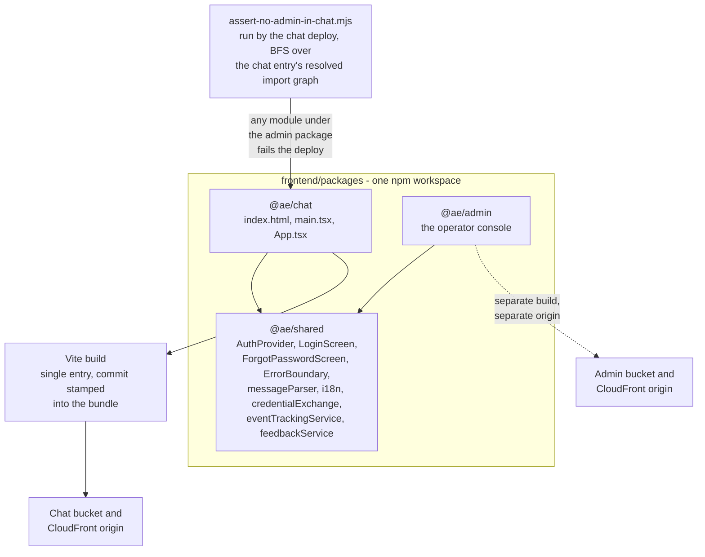

The assertion runs over the source graph rather than the built bundle: minification mangles identifiers and drops module paths, so grepping the output is unreliable while the static graph from the entry is deterministic. The commit stamp exists because the end-to-end suite runs against the deployed app, and a bundle behind the commit under test reads as a product bug until the two are compared by hand.

The app-split mechanics - CORS, environment generation, deploy ordering - are in [DESIGN-SEPARATE-ADMIN-APP.md](./DESIGN-SEPARATE-ADMIN-APP.md).

## Provider stack

`App.tsx` composes five providers, outermost first. Each owns one thing, and the order is the dependency order: nothing below can run before the thing above it exists.

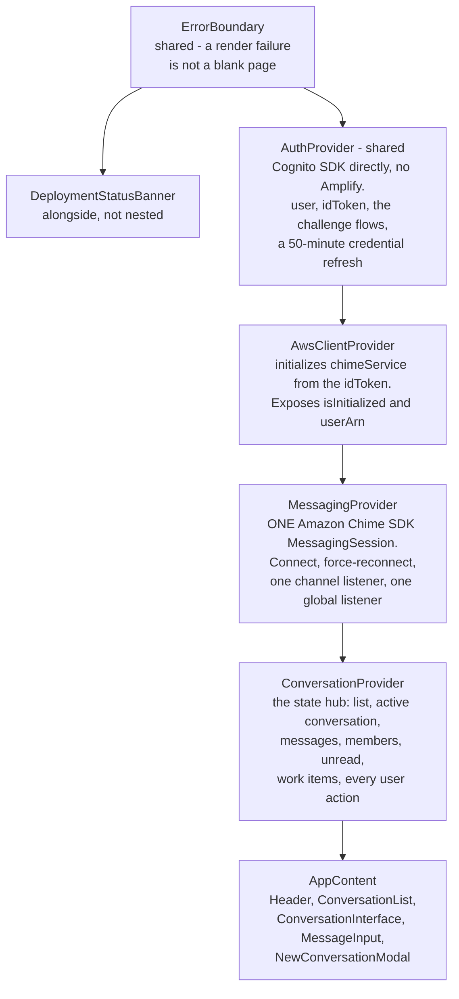

`AppContent` puts a class on the content element when a conversation is active, and that class alone drives the mobile master-detail swap: below the breakpoint the list and the conversation exchange places, above it they sit side by side.

## Screen selection, and why there is no router

The sitemap in [SPEC-CHAT-APP.md](./SPEC-CHAT-APP.md) is not a route table. There is no router in this package: which screen renders is a chain of early returns in one component, driven by the auth provider's flags and one local view state.

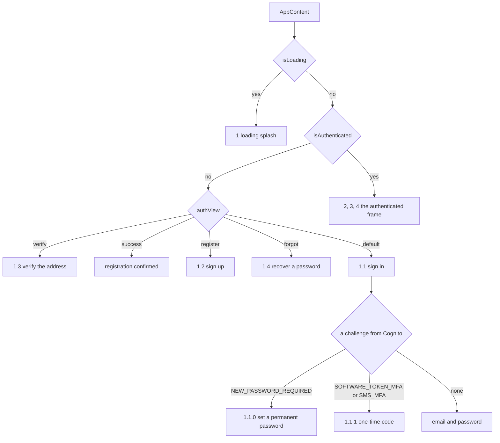

**The two challenges are branches of the sign-in screen rather than screens of their own**, selected from props the auth provider sets when Cognito answers with a challenge. A person meets them mid-attempt, and a separate screen would discard the attempt that produced them.

**The deployment-paused banner renders outside the authenticated tree**, above the whole chain, because a person meets a paused deployment before they authenticate and a banner inside the frame would never be seen.

URLs are deep-link input and output only, never navigation: `?conversation=` selects a conversation and `#message=` scrolls to one, and selecting a conversation replaces the URL rather than pushing history, so Back does not walk a thread list. A deep link to a conversation not in the loaded list resolves it directly and folds it in.

## Data model

The app owns no store. Everything below is session state derived from a platform store, and the store it came from is the answer to any question about it (tenet D7).

| Held in the client | Derived from | Notes |
|---|---|---|
| `Conversation[]` | Amazon Chime SDK Messaging channels, via `chimeService.listConversations` | The memberships the server answered with the person's own bearer, with no client filter: the client does not subtract from them. Carries the channel ARN, title, tier, last message and read times, and an archived flag |
| `Message[]` | Amazon Chime SDK message payloads, unwrapped from the Lex envelope | Beyond content, sender and time: the active task, an attachment descriptor, model id, intent, whether it was targeted, the experiment-feedback join, multi-part grouping fields, and the navigate-channel, battle and battle-waiting markers. A generated image arrives as an attachment like any other |
| `ChannelMember[]` | `ListChannelMemberships` | Refetched whole on any membership event, because at-least-once delivery makes incremental reconciliation brittle |
| Moderator set | `ListChannelModerators`, live | Role is read, never inferred from who created the channel |
| Unread state | Two sources: the eventually-consistent read marker, plus an in-session viewed map and ephemeral ticks from the global listener | See the unread diagram below |
| Sticky mention target | The last targeted message received | Prepended to the next send until the channel changes or it is dismissed |
| `OpenWorkItem[]` | The user-tasks API | Event-driven off this conversation's messages, with a slow reconciliation sweep behind it |
| Turn state | The turn-state API | Whether the assistant is busy, which visible messages are still waiting, the deferral notice, and a reason code for a turn that never ran |
| Attachment capability | The battle and profile configuration read for this conversation | Three states, because the caller renders a statement of fact |
| Attachment descriptor | The presigned POST response | The file itself goes to S3 and never through the app's state |

## APIs and interfaces

| Interface | Called as | What the app uses it for |
|---|---|---|
| Amazon Chime SDK Messaging, browser SDK | The person's own app-instance-user identity, via the credential exchange's bearer-pinned credentials | `ListChannelMessages`, `SendChannelMessage`, `ListChannelMemberships` and the per-app-instance-user form, `DescribeChannel`, `UpdateChannel`, `UpdateChannelReadMarker`, `ListChannelModerators`, `DeleteChannelMembership` |
| Amazon Chime SDK messaging session | The same identity | One WebSocket for every channel the person belongs to |
| Credential exchange, chat plane | The shared exchange primitive | One capability only: `rename`, vending a single-channel-scoped `chime:UpdateChannel` credential that the service authorizes only for a moderator |
| Conversation-management API | `PersonApi`, edge authorizer | Archive, remove-member and leave - the moderator mutations a chat-plane client cannot perform for itself. Leave has a provider action and no control in front of it |
| Create-conversation and share APIs | `PersonApi`, edge authorizer | Creating a conversation at a tier, and adding an existing user to one |
| Presigned-URL API | `PersonApi`, edge authorizer | A signed POST whose policy carries the size cap |
| Channel-battle API | `PersonApi`, edge authorizer | Reading a channel's battle configuration and turning Battle Mode on and off |
| Turn-state API | `PersonApi`, edge authorizer | What is waiting in this conversation |
| User-tasks API | `PersonApi`, edge authorizer | The person's own open work items, across conversations |
| Battle-outcome and feedback APIs | `PersonApi`, edge authorizer | Recording a winner, and a thumbs rating on a reply |
| Client-events API | `PersonApi`, edge authorizer | The browser's own telemetry, including connect and reconnect events |
| Deployment-state endpoint | `PersonApi`, public, no authorizer (handler in `archive-stack-aurora.ts`), read by `DeploymentStatusBanner.tsx` on load and when a person returns to the tab (visibility, focus, the network returning), never on a timer; no client-side event exists for this state, and the deployment sleeps only after the idle window, so arrival and return are when it can matter | Whether cost-sleep has paused the data plane |
| Message markers | Parsed, not fetched | Assistant replies carry structured signals as HTML comments, parsed by the shared parser; metadata parsers read the active task and the feedback join |

Every route above is on `PersonApi`, whose CORS allows the chat origin, the admin origin and the origins issuers declare. The person credential exchange vends the chat plane only: it refuses a request for a console session or an admin credential (`ADMIN_VEND_MOVED`), which the admin credential exchange on `AdminApi` serves ([DESIGN-SEPARATE-ADMIN-APP.md](./DESIGN-SEPARATE-ADMIN-APP.md)).

## The send path

The composer resolves a grammar before anything is sent, and the resolution decides three separate things: what the message says, who may read it, and which participant is expected to answer.

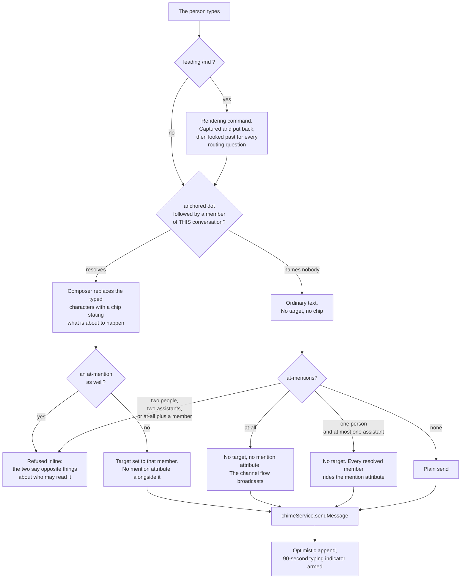

**The dot is the only thing that sets a target, and the target is why privacy holds.** Amazon Chime SDK Messaging enforces a target before delivery, so privacy is a property of the service rather than a rule this client follows; a client-side rule would be a disclosure with extra steps. The anchor on the dot is load-bearing in the other direction: unanchored, a decimal or a file extension becomes an address, and over-matching hides a message somebody meant the room to see.

**A near miss never becomes privacy.** The token has to match a member of this conversation in full. Refusing the send on an unresolved token is worse than the thing it guards: a room where people discuss code produces dotted tokens constantly, and every one of those sentences becomes unsendable. What protects the expensive direction is that the chip appears only when the token resolves, so somebody addressing a person who is not here sees no chip before they commit.

**The picker writes the member's id beside the name.** A display name falls back to the local part of an email address, so two members can carry one name, and the channel flow sees no target on its callback and so cannot break the tie the way the composer can. Writing the id into the delimited token is what makes the address unambiguous on both sides, and the reader sees only the name.

**Both grammars exist twice, deliberately.** The client lexes them to decorate and to route; the backend re-resolves the address from the live roster, because the meaning of an address must not depend on which client sent it - this platform has more than one ingress. Tests on each side keep the two copies one grammar.

## Who answers, and exactly once

The composer's resolution is an input to the routing decision, not the decision. Two components could each answer a turn, and the rule that stops them both answering is read from one function by both.

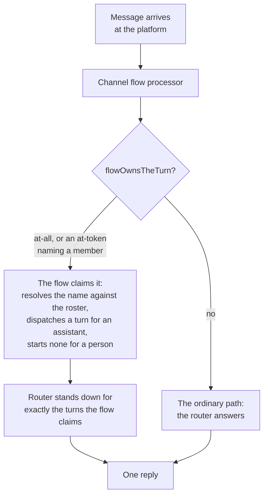

`@all` always takes the flow bypass. A member-count test and a deny were both rejected for this: the count collapses assistants into the human roster, and a deny leaves the turn unanswered rather than answered once.

## The receive path, and why there is one subscription

There is deliberately **no per-channel subscription**. The session is app-level and always on, so a per-channel registration only ever added a window in which a channel had no handler - and that window opened on every conversation create, because the assistant is added, and greets, before a client could register anything. The handler is registered once, receives the channel ARN, and the consumer decides what is current.

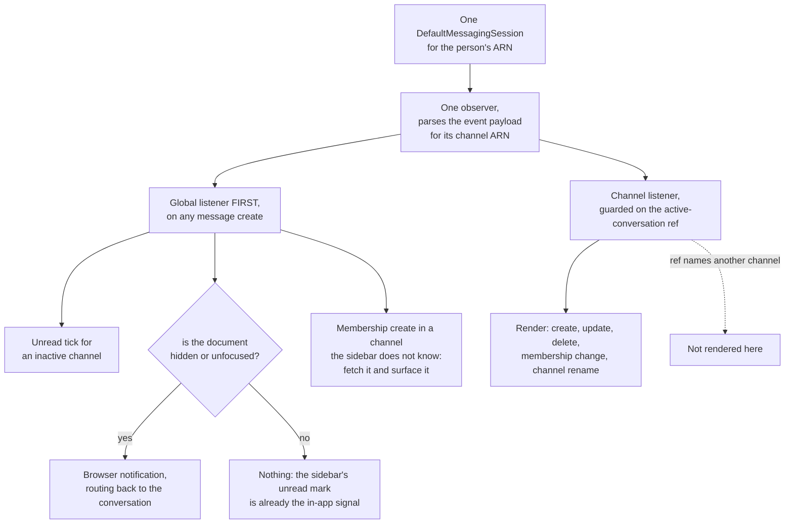

**The active-conversation ref is set synchronously as well as in state.** React commits state on the next render, so setting state alone leaves a short window in which the ref still names the previous conversation and an arriving message is discarded as not-active. That is the same class of defect as the create-then-subscribe window, so it is closed the same way rather than left as a smaller version of it.

**The notification gate is the document, not the channel.** Gating on "not the active channel" fired an operating-system notification for conversation B while the person was reading conversation A and watching the sidebar flip in front of them: two signals for one event, one of which interrupts the desktop.

**A welcome can still be missed, and is recovered rather than waited for.** After creating a conversation, a bounded sweep re-reads the history at increasing delays, stops at the first assistant message or when the person navigates away, merges by id so an optimistic message is never dropped, and only ever adds.

## Placeholder, then update

A reply returns either directly or as a placeholder that is updated in place. The update carries only some fields, so the merge is selective, and which fields are preserved is load-bearing.

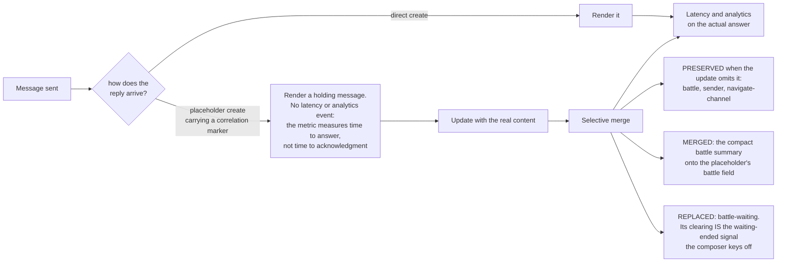

A continuation part is a new message created when a long answer is delivered, so anything created in between - a queue notice posted while the turn ran - sorts between the parts by time and breaks the grouping. Each part is therefore moved to directly after the message it continues, keyed on the parent the backend declares; a part whose parent is not loaded stays where time put it.

## Session, connect and reconnect

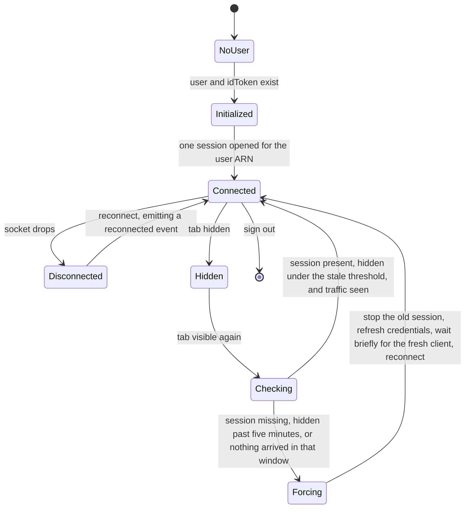

The credential refresh inside a forced reconnect is the part that matters: the scheduled 50-minute refresh is throttled by the browser while the tab is hidden, so a session resumed after a long idle would otherwise reconnect with credentials that have expired. The reconnecting indicator renders only while disconnected, so a healthy session shows nothing.

A refresh has three outcomes and they are not the same fact.

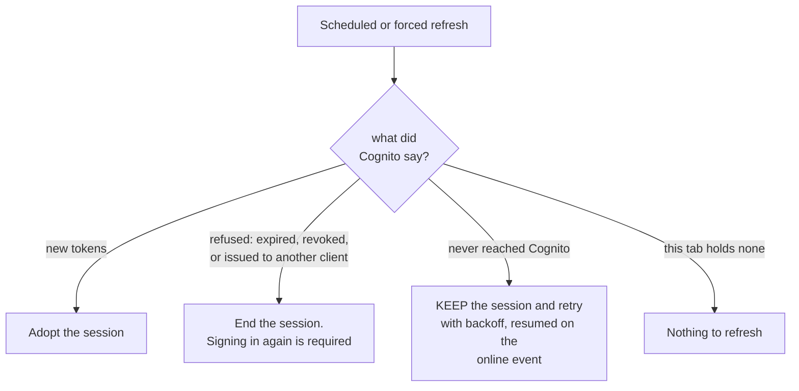

Collapsing those into one boolean cost people their sessions: clearing tokens deletes the refresh token, which is the only way back in, so a connectivity blip landing on the scheduled refresh ended the session for good.

## Unread state, from two sources

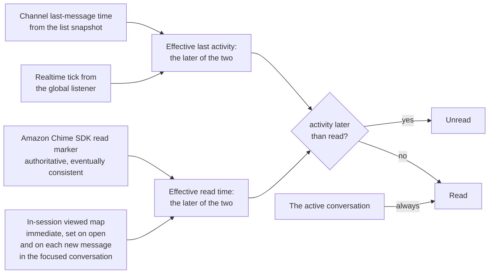

The dual source is not redundancy. The marker alone lags by seconds to minutes, so a channel the person just opened keeps its dot; the in-session map alone does not survive a reload. Together, a channel flips to unread in real time and does not flicker on reopen.

## The queue, and what the composer shows

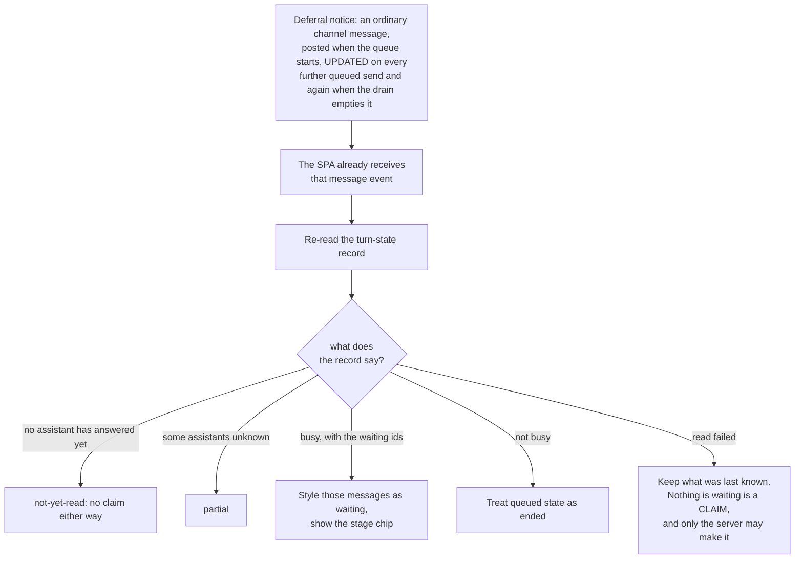

Polling on an interval here is implementation tenet D6 stepped over: the event already exists, because the notice is a message the client is handed anyway. The record stays authoritative - the event says something changed and the client re-reads - so a message event can never be mistaken for the state itself.

**The composer is never disabled by the assistant's busy state.** Queueing exists so a person can keep typing; a blocked composer turns a deferral into a refusal they cannot even attempt, and it removes the only way to stop the work in flight. The hook reports state and has no disabled flag to return. The composer is disabled in exactly three other cases, none of them about the assistant: no conversation is selected, the person's own send or upload is in flight, and the conversation is archived (`MessageInput.tsx`). The stage chip is deliberately the same presentation as the task chip, down to sharing its stylesheet, because a queue being worked and a task being worked are the same thing to the person watching. The stage arrives as a token so it can be said in the person's language, and a wording the deployment configured wins over the translation.

## Work items: the event half and the sweep

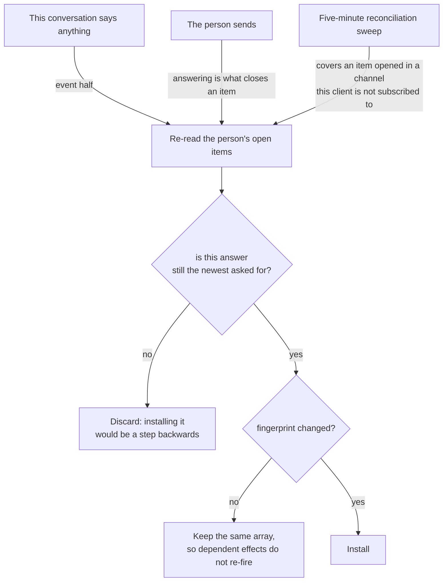

The sweep is a correctness backstop behind an event path rather than the mechanism, which is the shape tenet D6 allows. The sequence number exists because one answer can put three reads in flight - placeholder, interim, final - and without it an older list that still contains the item the person just closed overwrites the fresher one, so the item reappears in the sidebar until the sweep corrects it.

Which item a message answers is the person's decision and nothing else's. It is the item whose reference the message starts with, or the one they chose with its Answer action; choosing travels as the item's id in the message metadata rather than as words in the message, so the client writes no routing syntax into what the room reads. The answer target takes precedence over the sticky mention target, whose prefix stands down for that send - without the precedence the message went to the sticky human with no task id while the interface said it was answering, and the item stayed blocked.

## Attachments

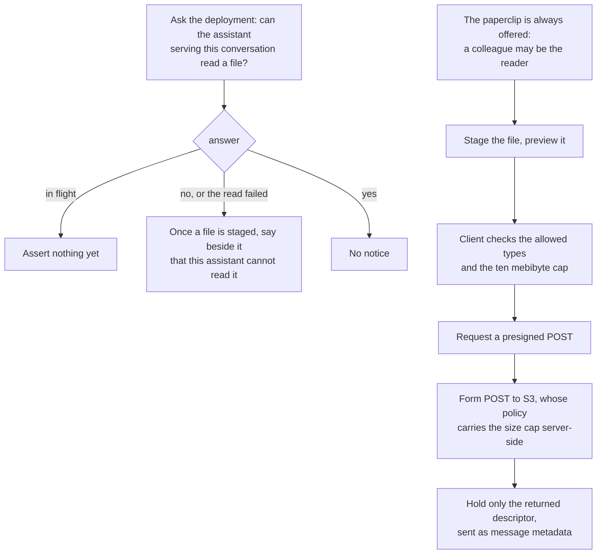

The control is never withheld: a person sends a colleague a file in a shared conversation without any assistant reading it, and the composer cannot know at staging time which reader the finished message will address. What it can do is state, beside the staged file and before the send, what this conversation's assistant will do with it. The capability is asked of the deployment rather than read from the tier the client already holds, for two reasons: the tier on the channel is member-writable metadata and so is authoritative about nothing, and keying on it would put a capability rule inside one client, duplicating a decision the deployment makes in its own infrastructure. The flag the app reads is the same one that decides whether the turn's role carries the object read on the attachments prefix, so the boundary reports itself. It remains an affordance and not an enforcement: a client that ignored it would still meet a role with no grant. A failed read answers "cannot", not "unknown", because the defect this exists for is an assistant silently answering from the caption alone.

## Battle in the conversation

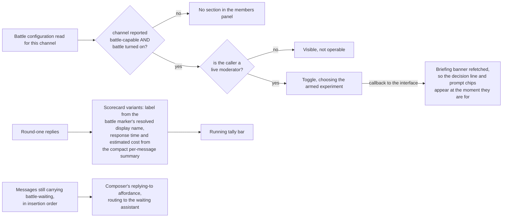

The panel is rendered on the configuration read rather than on a hardcoded tier check, because eligibility is a field on the configuration being fetched: pre-gating the fetch on a tier is what made the field unreachable. The briefing callback exists because the interface's copy is otherwise fetched once when the conversation opens, so a moderator who turned Battle Mode on saw no briefing until they switched conversations.

## Membership actions, and where each is authorized

| Action | Path | Authorized where | Drawn in the client when |
|---|---|---|---|
| Rename | Credential exchange vends a `rename` capability, then `UpdateChannel` from the browser | Amazon Chime SDK Messaging authorizes it only for a channel moderator | **always** - no standing check; a refusal is shown inline under the title (FR37) |
| Archive | Conversation-management API | The moderator check and the app-instance-admin bearer are server-side | the person is in the live moderator set |
| Remove member | Conversation-management API | Same | the person is a moderator, and the row is neither the assistant nor themselves |
| Battle mode on or off | Channel-battle API | The API applies the same moderator and eligibility gates | the person is a moderator and the profile reports itself battle-eligible |
| Leave | Conversation-management API, through a provider action no component calls | The caller can only remove their own membership | **never** - no control exists (FR12) |
| Add member | Share API, by email | The share path applies the classification check | always, for any member |

Local state changes only after the call returns, never before it. Archiving flips the local archived flag, drops the conversation out of the active list behind the archived toggle, and leaves it read-only for every member.

**Standing is read, not inferred.** The moderator set comes from the live Amazon Chime SDK moderator list per conversation rather than from who created the channel, and a failed read yields an empty set, so every moderator-gated control fails closed to absent. That is the correct direction: an operator action the client wrongly offers is refused where it is served, and one it wrongly hides is a missing affordance rather than a leak.

**Inside this app the role is granted in exactly one place.** `CreateChannelModerator` runs inside channel creation (`lib/channel-creation.ts`), so the creator is a moderator, and nothing in the chat app makes another one. Outside it, two paths grant the role: the operator console, where an operator who joins a conversation as a visible member is made a moderator through the vended `manage-membership` capability (`adminAddMember` in `adminChime.ts`), and the scheduled membership reconcile of an admin conversation (`lib/membership-reconcile.ts`). On the way out: remove-member checks that the caller is a moderator but not that the target is not, and leave checks nothing at all because a member may always leave. A user conversation can therefore reach zero moderators, after which rename, archive, remove-member and battle configuration are gone from it until an operator joins it as a visible member. The seam for a member-facing grant already exists (tenet D8): `chime:CreateChannelModerator` is in the `manage-membership` action list, a vended, channel-scoped, audited capability of the shape every other action here already uses. What needs deciding is the rule, not the mechanism - who may pass the role, whether the last moderator is blocked from leaving or the role passes automatically, and to whom. FR38 carries it.

**Which is what makes the client's affordances safe to be approximate, and why rename is the exception that matters.** Archive and Remove member are drawn from standing, so the control's absence is the refusal. Rename is drawn for everybody and denied by Amazon Chime SDK for a member who is not a moderator: the denial is shown inline under the title, so the person learns it was refused, but the control is still offered to someone who cannot use it. The battle sections use two different eligibility tests on purpose - the configuring control requires eligibility to be affirmatively true while the read-only briefing renders unless it is explicitly false - so a member who cannot configure a duel still sees the one they are in.

Two resolution details that are easy to get wrong: a deep link to a conversation not yet in the loaded list resolves through `DescribeChannel`, and a navigate-channel marker retries briefly for the target to appear in the local list before giving up rather than navigating nowhere.

## Rendering, and the injection surface

An assistant message renders through the Markdown pipeline; a person's message renders as plain text unless they asked for formatting with the rendering command, which is stripped at display so a reader sees its effect and never the instruction. Raw HTML is dropped by the renderer with no sanitizer in the path, and dangerous URL protocols are sanitized by it. Every rendered link, whoever wrote it, opens with no handle on this window and no referrer: the exposure belongs to the renderer, and assistant output is the input a prompt injection reaches.

Control markers are consumed rather than shown. The Lex envelope is unwrapped so the person reads plain text, and the same deterministic marker stripping the platform uses elsewhere is what keeps a raw control marker from reaching the page - which is also what lets an evaluator score exactly what the person read.

The collapse threshold applies by length rather than by author. Gating it on the sender meant a pasted five-thousand-character log rendered in full forever while a model's reply of the same length was collapsed.

## Security and IAM

- **Chat identity only.** Every action runs as the person's own app-instance-user. There is no admin plane here and no server-side bearer swap for a human action.
- **One vended capability, scoped and short-lived.** Rename is the only client-side Amazon Chime SDK credential the app vends, and it is single-channel-scoped, short-lived and audited rather than a standing bearer.
- **Privileged-looking actions are authorized where they are served.** Rename, archive and remove-member are checked by the service or by the management handler, so the client cannot grant itself a capability it lacks.
- **The creation offer is an affordance.** The list is the memberships the server answered, with no client filter. The creation options are the declared classifications the person's own classification grants (`creatableClassifications`); the creation path refuses a classification the caller does not clear for, and that is the enforcement. Being wrong in the client costs a confusing offer, not access.
- **No admin code in the bundle.** The chat entry resolves nothing under the admin package, admin-only environment variables are not written into the chat environment, and the deploy fails on a regression.
- **The refresh token lives in session storage**, so a successful cross-site scripting attack is bounded to the open tab rather than to the refresh token's lifetime.
- **Nothing the person reads is decided by recognizing a phrase** (tenet D11). Markers, correlation tokens and ARNs are matched because the platform wrote them; a stage, a reason code and a task reference all arrive as data and are resolved through the translation catalog.

## Testing

- **Chat unit tests** (Vitest, under `frontend/packages/chat/src/`): `CollapsibleText`, `Header`, `AttachmentDisplay`; `MessageInput.private-prefix`, `MessageInput.task-answer`, `MessageInput.slash-command`, `MessageInput.attachment-capability`; `OpenWorkItems`; `ConversationProvider.sticky-target`, `MessagingProvider`; `useTurnState`, `useTurnState.dispatchFailed`; `attachmentService`, `battleOutcomeService`, `channelBattleService`, `messageLatencyTracker`, `chimeService.history-queue-fields`; `mentionParser`, `battleTally`, `modelLabel`, `senderLabel`, `markdownPrefix`, `taskReference`, `continuationOrder`, `focusMessage`; `BattleScorecard.remount`, `battleScorecardAnchor`, `scorecardVariant`, `ChannelMembersPanel.battle-briefing`.
- **Shared unit tests** (under `frontend/packages/shared/src/`): `messageParser`, `eventTrackingService`, `AuthProvider`, `aModelNameFitsInACard`.
- **Backend unit tests** for the two halves of the addressing seam (`backend/test/lib/`): `the-flow-routes-every-at-token`, `the-handler-stands-down-for-every-at-token`, `a-mention-names-one-member-or-nobody`, `a-dot-addresses-a-real-member-or-nobody`.
- **End-to-end** (Playwright, `tests/e2e/`): `signup` and `signin` for the deployment's own auth screens; `welcome` and `onboarding-intake` for the opening; `mentions` for the whole addressing grammar in a two-browser room, including a file sent to one member; `identical-private-messages` for two private answers not crossing; `turn-state-without-lex` for a private message that names the assistant; `agent-intents` for the ordinary turn; `classification-context` for the tier cap; `turn-queue` and `private-stop` for the queue and the stop; `open-work-items`, `task-answer`, `task-reference`, `tasks` and `task-state-machine` for work items and task state; `feedback` for the rating; `battle` for the duel surface; `credential-exchange` for the chat-plane vend; `drift-detection` for the navigate-channel redirect; `archive-membership` for archive; `speaker-attribution` for how a reply is labeled; `bilingual-conversations` for the language independence; `deployed-build` for the commit stamp.
- **Gaps worth naming.** Cross-device continuity and the WebSocket reconnect are exercised by hand and at deploy rather than by an automated multi-client or network-fault harness. The mobile master-detail swap is covered by component behavior rather than by device emulation. Attachment upload against real presigning is validated at deploy rather than in CI. The unread mark, the archived toggle, rename, remove-member, the members panel and the browser notification have no test of their own, and leave has nothing to test in this client because no control calls it.

## Modes and rollout

- **One entry, one build.** No phasing inside the app.
- **The split is one-way.** There is no bundled-into-chat mode; the import-graph assertion pins it.
- **Optional surfaces degrade to inert.** The sleep-mode flag gates the paused banner, which reads the public deployment-state endpoint on load and when a person returns to the tab, because no client-side event carries that state; the channel-battle endpoint gates the Battle Mode toggle, and the turn-state endpoint gates the queue surface: unset, each renders nothing rather than erroring. A deployment that has not wired the turn-state endpoint simply has no queueing.
- **Vocabulary.** Product copy presents the tier; several code symbols still read as tier variants. The rename is tracked separately and changes no behavior.

## Open technical questions

| Question | Why it is open |
|---|---|
| Whether the reconnect and cross-device paths deserve an automated multi-client or network-fault harness | They are the paths a person is most likely to meet and the least covered, and the harness is a standing cost |
| Whether the selective merge should become one typed reducer over markers | Preserving battle and replacing battle-waiting is load-bearing and order-sensitive, and the rule lives in a hand-written merge |
| Whether membership reconciliation can become incremental | Refetching the whole list on every event is robust and chatty, and at-least-once delivery is what made the incremental path brittle the first time |
| Where the attachment type and size policy belongs | The list and the cap are a client constant matched by the upload authorizer; a deployer-tunable source has to reach both |
| Whether the two copies of the addressing grammar should become one shared module | They are separate on purpose - the backend must not trust a client's lexing - and the cost is two implementations kept in step by tests |

## Related Documents

- [SPEC-CHAT-APP.md](./SPEC-CHAT-APP.md) - requirements, personas, non-goals, and what is delivered
- [DESIGN-SEPARATE-ADMIN-APP.md](./DESIGN-SEPARATE-ADMIN-APP.md) - the workspace split, the shared package, CORS and environment wiring, and the deploy
- [DESIGN-BATTLE.md](../interaction/quality/DESIGN-BATTLE.md) - the duel mechanics behind the scorecard and tally
- [SPEC-TURN-QUEUE.md](../interaction/conversation/SPEC-TURN-QUEUE.md) - the record the turn-state read is reading
- [SPEC-TASK-STATE-TRANSITIONS.md](../interaction/conversation/SPEC-TASK-STATE-TRANSITIONS.md) - the states the task chip and the work-items queue render
- [SPEC-MESSAGE-METADATA-CODEBOOK.md](../communication/SPEC-MESSAGE-METADATA-CODEBOOK.md) - the metadata fields the message parsers read
- [SPEC-ADMIN-IDENTITY.md](../interaction/governance/SPEC-ADMIN-IDENTITY.md) - the identity model, where the chat identity is never elevated
- [SPEC-CREDENTIAL-EXCHANGE.md](../interaction/governance/SPEC-CREDENTIAL-EXCHANGE.md) - the vend behind the rename capability
- [ADR-033](../../design/decisions/033-a-conversation-answers-one-turn-at-a-time.md) - the queue this client renders
- [ADR-034](../../design/decisions/034-addressing-a-message-is-not-making-it-private.md) - addressing and privacy as two acts
- [ADR-035](../../design/decisions/035-a-reply-names-the-work-it-answers.md) - how a reply names the work it answers
