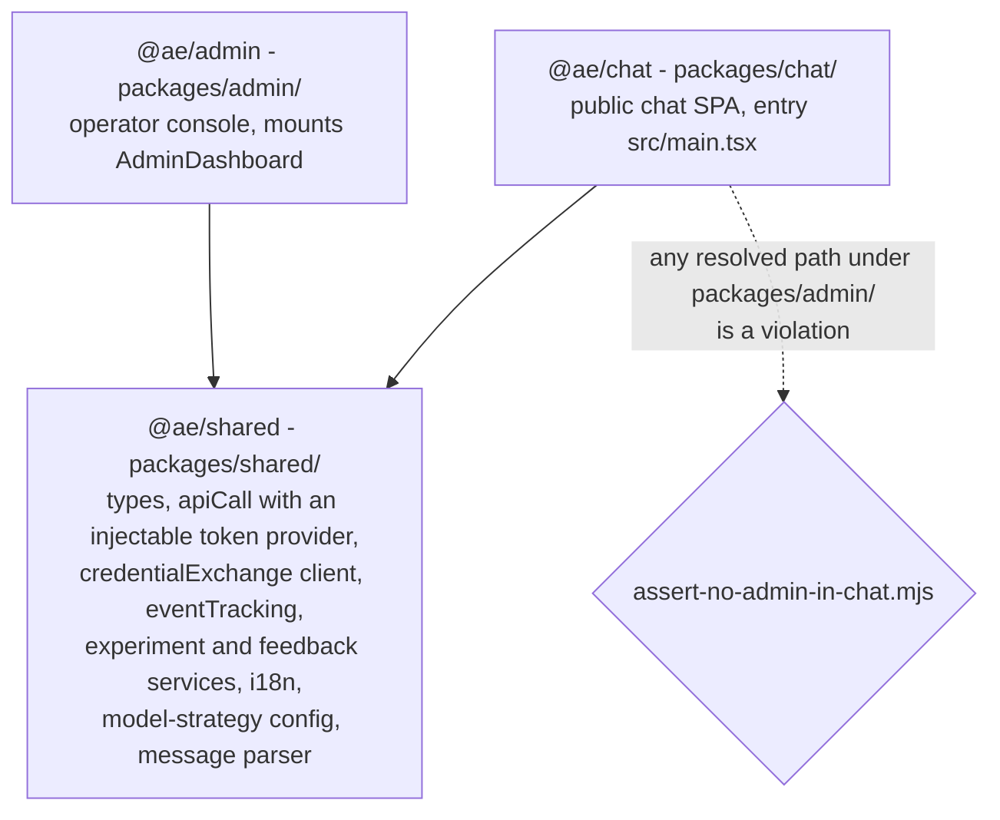
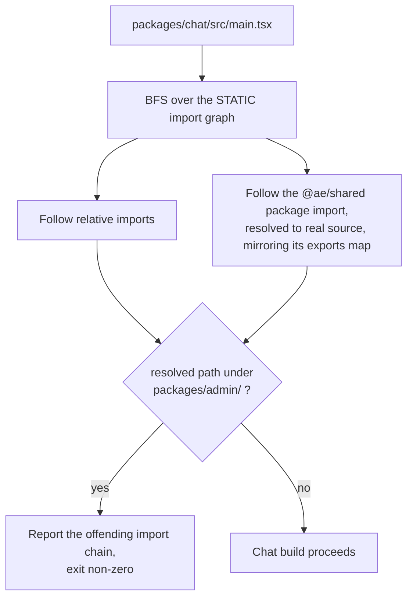
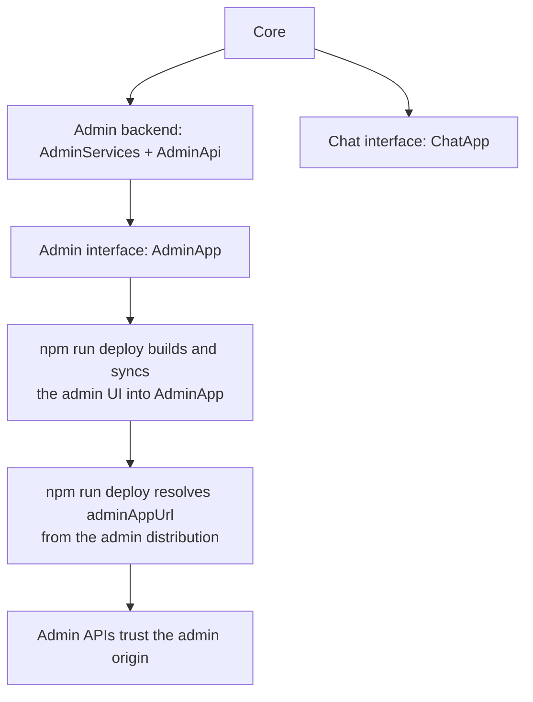

# DESIGN: Separate Admin App

**Status:** Partial (frontend workspace split and CORS/env split built through P3; further docs and hardening remain)

**Coverage:** `e2e/admin-nav.spec.ts`, `e2e/admin-dashboard.spec.ts`

**Related:** [`SPEC-ADMIN-CONSOLE.md`](./SPEC-ADMIN-CONSOLE.md) - what the console is for and its requirements; the split serves the row that says one console administers one instance. This document is the mechanics of the split only. [`DESIGN-ADMIN-CONSOLE.md`](./DESIGN-ADMIN-CONSOLE.md) owns the console container internals.

**Site section:** Interface layer.

---

The privileged admin surface - its code and its endpoint URLs - stays out of the public chat app that any visitor loads, and deploys, hardens, is replaced or is omitted on its own schedule. The admin console is therefore its own npm-workspace package (`@ae/admin`), built and deployed to its own CloudFront origin, sharing `@ae/shared` with the chat app (`@ae/chat`), with a build-time import-graph assertion keeping admin code out of the public chat bundle.

## Three packages, and what may import what

The frontend is an npm-workspaces monorepo under `frontend/packages/`. Each app is an independent Vite build with its own output, its own origin and its own env, against the same Cognito pool, app instance, users and credential-exchange.

`@ae/admin` holds `components/admin/*`, the admin services (`analyticsService`, `adminConversationService`, `membershipAuditService`, `adminChime`, `adminAttachmentService`, `profileService`, `awsConsole`, `sigv4Fetch`), `metricTargets.ts`, and the dependency-free chart and table primitives (`Sparkline`, `FunnelChart`, `DistributionBar`, `MetricCard`, `LineChart`, `DataTable`), which only the console renders. `@ae/chat` carries no admin code and no admin endpoint URLs.

Platform fit: the platform core - conversation substrate, identity, assistant profiles - and the admin plane are the product, and the chat SPA and the console are two pluggable interfaces on top. AgentEchelon deploys in order - the core first, then the chat interface and the admin backend on it, then the admin interface on the admin backend - so the admin surface is deployed, hardened, replaced or omitted independently of the chat surface. This deploy order is a view over the four architectural layers ([STACKS.md](../../overview/STACKS.md#layers-and-capabilities)): the admin backend is two stacks omitted together, `AdminServices` (every admin handler, the admin credential exchange and its roles, the admin conversations and alert channel) and `AdminApi` (the IAM-authorized HTTP API in front of it), declared by the `admin` capability; the admin interface is `AdminApp`. Authorization is one gate (`requireAdmin`, `AWS_IAM` on every admin route, and an admin session from any registry issuer that declares `admin: true`), and this split carries the same separation onto the frontend. The `admin` capability is read (`backend/lib/config/capabilities.ts`): it stands up `AdminServices`, `AdminApi` and `AdminApp`, and a deployment that does not declare it has no admin handler, route or role.

## The security-relevant invariant

The chat entry's import graph never resolves a module physically under `packages/admin/`.

`frontend/scripts/assert-no-admin-in-chat.mjs` asserts on the source graph rather than the minified bundle: minification mangles identifiers and drops module paths, while the static graph is deterministic and fails a re-coupling refactor at build time. Resolving `@ae/shared` through its own `exports` map is what catches an admin-only module smuggled into shared. The check is wired into the chat deploy, so a regression cannot ship silently.

## No new datastore

The split is a build-and-deploy concern over existing seams.

| Seam | What the split adds |
|---|---|
| Vite entries and build outputs | One per app package, each syncing into its own S3 bucket |
| Env files, emitted by `backend/scripts/gen-frontend-env.mjs` | `packages/chat/.env` carries only chat-facing `VITE_*`; `packages/admin/.env` carries the admin-only vars plus the shared auth vars |
| Origin config, `backend/lib/config/app-origins.ts` | `appUrl` (chat) and `adminAppUrl` (admin) CDK context values, `adminAppUrl` falling back to the chat origin until the admin frontend deploys |
| Cognito, `identity-stack.ts` | An optional dedicated admin app-client on the same pool, created with the `admin` capability and opt-out-able with `-c adminAppClient=shared` |

## Origin-to-API contract

`app-origins.ts` gives each API the origin or origins that legitimately call it. `chatOrigin(scope)` reads `appUrl`, then `APP_URL`, then `http://localhost:5173`. `adminOrigin(scope)` reads `adminAppUrl` and falls back to `chatOrigin`. `sharedOrigins(scope)` returns the deduped `[chat, admin]` pair, and `sharedOriginsEnv(scope)` its comma-joined form for the multi-origin echo handlers.

| Surface | Origin or origins | Reason |
|---|---|---|
| Analytics query, user-management, admin-conversations, membership-audit | `adminOrigin` only | Admin-only; the chat app never calls them |
| The admin credential exchange (`admin-credential-exchange.ts`, on `AdminApi`) | `adminOrigin` only | Vends the console session and every admin-plane credential; the chat app never calls it |
| The person credential exchange (`credential-exchange.ts`, on `PersonApi`), experiments, user-feedback | `sharedOrigins` | The person exchange resolves the signed-in person for both apps, and experiments and feedback are consumed by both |
| Client-events, deployment-state, messaging, create-conversation | `appUrl` | Chat-only; these do not use `app-origins.ts` |

The person credential exchange is the load-bearing case: it is the one exchange both apps call, the chat app for its chat credentials and the console to resolve its person before it asks the admin exchange for a console session, so a single-origin assumption there breaks one of them. It vends no admin reach: a request for `identity: 'admin'` or `'console'` is refused with `ADMIN_VEND_MOVED`. The admin app signs `GET /feedback`, an `AWS_IAM` catalog route on `AdminApi`, while the user-facing `POST /feedback` is on `PersonApi`; `user-feedback.ts` echoes the matching request Origin from the shared comma list rather than pinning one.

**Env split.** The admin-only vars are `VITE_ADMIN_API_URL`, `VITE_ADMIN_API_CAPABILITIES`, `VITE_CONSOLE_EVENTS_HTTP`, `VITE_CONSOLE_EVENTS_REALTIME`, `VITE_ANALYTICS_MODE` and `VITE_ADMIN_CLIENT_ID`, and only the admin env carries them. The chat-only vars are `VITE_ADMIN_APP_URL`, `VITE_SLEEP_MODE_ENABLED` and `VITE_WIDGET_ORIGIN`. Everything neither admin-only nor chat-only is shared and written to both envs: the auth pool and client, `VITE_PERSON_API_URL` and `VITE_PERSON_API_CAPABILITIES` (the console resolves its person on `PersonApi` before it asks `AdminApi` for a console session), `VITE_ISSUERS` and the app-instance ARN. Dropping the admin-only vars from the chat env is what removes the admin endpoint URL from the public bundle.

**Configurable link-out.** With `VITE_ADMIN_APP_URL` set, the chat Header shows an admin a plain `<a href>` out to the console, admin-only and in a new tab. It is a URL string rather than admin code or an admin endpoint, so the chat bundle stays admin-free and the invariant assertion still passes. Unset means no link, and a deployer can point it at their own console on the same admin APIs.

## Admin actions are origin-independent

The console performs **administration** - acting on conversation resources across channels as an app-instance-admin - which is distinct from channel-level **moderation**, a ChannelModerator scoped to one channel that the console does not do. Per [`SPEC-ADMIN-IDENTITY.md`](../interaction/governance/SPEC-ADMIN-IDENTITY.md), an operator's actions run as the per-human admin-plane AppInstanceUser, `${personId}-admin`, whose short-lived, scoped, audited credentials are vended per action by the admin credential exchange on `AdminApi` (`POST /exchange-credentials/admin/<capability>`, signed with the console session), never by the person exchange. It is the one second principal a human holds: the exchange creates it, never anything else, and tags it with its owner's AppInstanceUser ARN, so analytics, audit and erasure attribute it to its owner through that tag rather than by parsing the suffix. The console session name carries the person id and accepts any id, not only a UUID (`CONSOLE_SESSION_ARN` in `backend/lambda/src/lib/auth.ts`).

That identity is created by the admin credential exchange from the operator's console session, independent of which origin served the page and of which `admin: true` registry issuer signed the operator in, so actions work identically from the standalone admin origin once the CORS of `PersonApi` and `AdminApi` allows it. The split therefore changes where the console is served and gated, and not the admin authorization model.

**Entry gating.** The admin app opens for a sign-in whose console session holds at least one capability, never for a group name (`AdminApp.tsx`). The admin exchange issues that session on the console role the person's groups name at an `admin: true` issuer, `admins` or `team-members` (`consoleRoleFor`, `lib/vend.ts`), so an admin and a team member both reach the console, each with their own role's capabilities. A sign-in that gets no session, or a session with no capability, sees an access-denied screen, never the console. `isAdmin` in the shared `AuthProvider` is a display hint read from the exchange's `consoleRole`, not from `cognito:groups`. The gate decides what renders; every admin route is IAM-authorized on its own. There is no chat Header in the admin app, so it gates its own entry.

## Deploy order

`AdminServices`, `AdminApi` and `AdminApp` deploy only with the `admin` capability: every admin handler is in `AdminServices`, and every admin route is on `AdminApi`.

`npm run deploy` resolves `adminAppUrl` from the admin distribution the way it resolves `appUrl`, with one extra backend pass the first time that distribution exists. Two fail modes follow for a deploy that does not go through it: until `adminAppUrl` is wired, `adminOrigin` falls back to the chat origin, so admin actions from the admin origin are CORS-rejected; and without the `admin` capability the dedicated admin app-client is skipped and the admin app falls back to the shared `VITE_CLIENT_ID`.

## Security and IAM

- **Smaller public attack surface.** The chat bundle carries no `components/admin/*` code and, with the admin-only `VITE_*` vars out of its env, no admin endpoint URLs. Server-side `requireAdmin` already protects the data, so this removes a discoverable surface rather than closing a data leak.
- **One admin gate, unchanged by the split.** Every admin route is `AWS_IAM`, so API Gateway admits a request only when the signing console session's role holds that route; the `admins` and `team-members` console roles hold different route sets. The handlers' `callerIsAdmin` and `requireAdmin` (`backend/lambda/src/lib/auth.ts`) accept a call the gateway already vetted (`ADMIN_IAM_ENFORCEMENT=true` on the admin handlers), and fall back to the issuer's groups and `ADMIN_GROUP_NAMES` only where IAM enforcement is not set. A route that needs a second layer re-reads the caller's groups itself, as `activate-past-golden-gate` does ([ADR-065](../../design/decisions/065-a-draft-answers-the-golden-set-before-it-is-activated.md)). Which frontend issued the request is irrelevant to it.
- **Handler mode flag.** `adminAuthMode` attaches no authorizer: every admin route is `AWS_IAM` in every mode. It sets `ADMIN_AUTH_MODE` on the admin handlers, and `service` makes them trust any IAM-signed caller. The exercised configuration is the built-in `ae-cognito` `admins` group.
- **Dedicated admin app-client (P3).** An admin app-client on the same pool, with admin-origin-only callback and logout URLs, isolates the admin session and token from the chat session. Per-capability enforcement is [`DESIGN-ADMIN-ACTION-IAM-ENFORCEMENT.md`](../interaction/governance/DESIGN-ADMIN-ACTION-IAM-ENFORCEMENT.md), and it attaches to the admin APIs rather than to the app-client.
- **CORS isolation.** `AdminApi` trusts only `adminAppUrl`; `PersonApi`, which both apps call, trusts both origins explicitly rather than assuming one.

## Testing

- **Unit.** The admin package's Vitest suite, enumerated in [`DESIGN-ADMIN-CONSOLE.md`](./DESIGN-ADMIN-CONSOLE.md), Testing, runs against `@ae/admin` in isolation, which is what proves the package builds and renders without the chat app. `frontend/packages/chat/src/components/Header.test.tsx` covers the chat Header after the split.
- **Build assertion.** `frontend/scripts/assert-no-admin-in-chat.mjs` is the split's own test: it fails the chat build if the chat entry's import graph reaches `packages/admin/`.
- **End-to-end.** `tests/e2e/admin-dashboard.spec.ts`, `tests/e2e/admin-nav.spec.ts` and `tests/e2e/admin-dashboard-render.spec.ts` drive the standalone console against the admin origin via `E2E_ADMIN_BASE_URL`.
- **Gaps.** The dual-origin CORS and env model are exercised by deploy rather than by an automated multi-origin test; an admin session from a registry issuer other than the deployment's own pool is unexercised end to end; the admin distribution carries the shared managed WAF and response-headers policy, and anything stricter than that shared policy for the admin origin is open.

## Phasing

P3 is the one label cited from the code that implements it (`identity-stack.ts` and `gen-frontend-env.mjs` both name it), so it is a stable identifier; P0 through P2 name work that is built and carry no label in the code, and the remaining hardening is listed under Open technical questions rather than as a phase.

| Phase | What it does |
|---|---|
| P0 | Stand the admin app up: the `@ae/admin` package and the `AgentEchelonAdminApp` stack, `gen-frontend-env` emitting the admin env, `adminAppUrl` and the widened admin-API CORS including the credential-exchange list, and the console's own entry gate |
| P1 | Remove admin from chat: drop the admin import, the `?admin` branch and the Header admin button, drop the admin-only `VITE_*` vars from the chat env, and add the import-graph assertion. This is the step that shrinks the public surface |
| P2 | Factor `@ae/shared`: shared types, the `apiCall` helper with its injectable token provider, and the credential-exchange client both apps use, de-duplicating the per-service fetch boilerplate; the chart and table primitives stay in `@ae/admin` because only the console renders them |
| P3 | Dedicated admin Cognito app-client with admin-origin callback and logout URLs (the `admin` capability; opt out with `-c adminAppClient=shared`) |

**Cutover, not backward compatibility.** Removing admin from the chat app at P1 is one-way: there is no bundled-into-chat mode, and anyone who reached the console through the chat origin uses the admin origin. Deploying an admin UI at all is optional - a headless or host-owned-console deployment may skip it - but where one is present it is always the separate app.

## Open technical questions

| Question | Why it is open |
|---|---|
| Whether the admin app warrants its own dependency set and release cadence beyond the shared workspace | The workspace split is the chosen shape over two Vite entries in one package; how far the app diverges from there is a separate call |
| Cognito callback URL management | Reuse the shared app-client by adding the admin origin to its callback list, versus the dedicated admin app-client: cleaner isolation against one more stack resource and redirect configuration |
| `GET /feedback` refusals under the split | `GET /feedback` is on `AdminApi`, whose CORS allows the admin origin. Whether a refusal the gateway answers itself (the `403` for a missing capability) carries CORS headers is a property of the deployed API and is not verified yet; where it does not, the refusal reaches the admin app as a network error rather than a readable `403`, and the Models tab shows the failure without naming the missing capability |
| Non-Cognito admin federation | The admin plane takes every registry issuer that declares `admin: true`, resolved to the AppInstanceUser at the same edge ([ADR-059](../../design/decisions/059-the-admin-identity-provider-is-any-registry-issuer.md)): the `AdminApi` edge authorizer admits such an issuer's token to the console-session route and denies every other issuer. A session from an issuer other than the deployment's own pool is not exercised end to end, so verify before relying on it |
| Second distribution cost | A second CloudFront distribution and bucket are a small fixed addition, provisioned only where an admin UI is deployed |
| Docs and hardening beyond the shared policy | Folding the standalone app into the BYO-console integration guide as the reference own-console, applying admin-origin security headers or WAF rules stricter than the shared managed policy the admin distribution already carries, and documenting the two-origin CORS and env model in the deploy guide are each open, and none has a phase label in the code |

## Related Documents

- [`SPEC-ADMIN-CONSOLE.md`](./SPEC-ADMIN-CONSOLE.md) - requirements, personas and non-goals for the console the split serves
- [`DESIGN-ADMIN-CONSOLE.md`](./DESIGN-ADMIN-CONSOLE.md) - the console container internals, the stores and the per-tab load
- [`SPEC-ADMIN-IDENTITY.md`](../interaction/governance/SPEC-ADMIN-IDENTITY.md) - the administration identity, which the split does not change
- [`SPEC-CREDENTIAL-EXCHANGE.md`](../interaction/governance/SPEC-CREDENTIAL-EXCHANGE.md) - the dual-plane vend both origins call
- [`DESIGN-ADMIN-ACTION-IAM-ENFORCEMENT.md`](../interaction/governance/DESIGN-ADMIN-ACTION-IAM-ENFORCEMENT.md) - per-capability enforcement on the admin APIs both origins call
- [`SPEC-MODERATION.md`](../interaction/governance/SPEC-MODERATION.md) - channel-scoped moderation, distinct from the administration this app performs
- [`ADMIN-INTEGRATION-GUIDE.md`](../../guides/admin/ADMIN-INTEGRATION-GUIDE.md) - the BYO-console path this app is the reference implementation of
