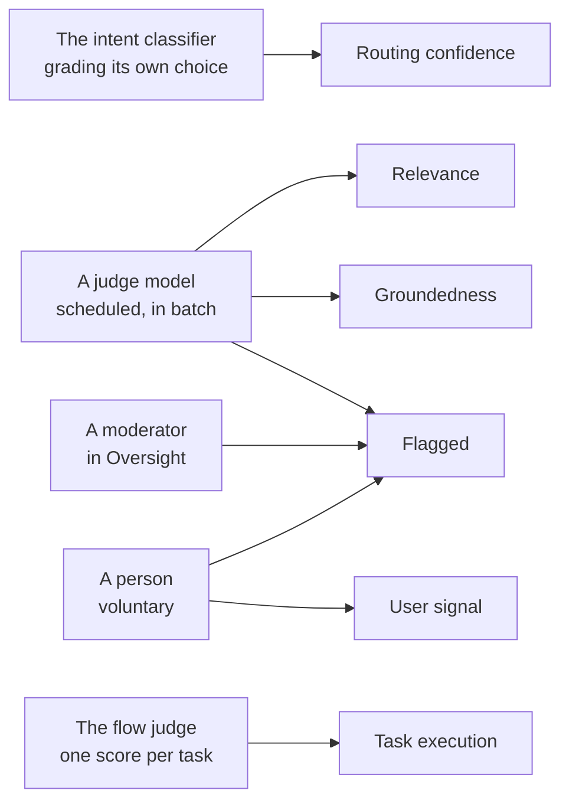

# SPEC: Admin console effectiveness, the intent-anchored drill

**Status:** The intent spine is implemented. The Effectiveness section is one intent-anchored drill served by the `intent_effectiveness`, `intent_exchanges`, `task_details`, `task_timeline` and `intent_steps` queries; the requirements table states, per requirement, what is delivered and what is not.

**Verified by:** `frontend/packages/admin/src/components/admin/EffectivenessTab.test.tsx` (the drill, the two axes and the worst-first ranking, against the component) and `backend/test/analytics-aurora/analytics-query.test.ts` (the `intent_effectiveness` and `intent_exchanges` queries the spine is served by).

**Coverage:** `e2e/admin-dashboard.spec.ts`, `e2e/admin-dashboard-render.spec.ts`, `e2e/admin-nav.spec.ts`, `e2e/agent-intents.spec.ts`, `e2e/a-console-edits-an-intents-image-and-step-models.spec.ts`

**Related:** [`SPEC-ADMIN-CONSOLE.md`](./SPEC-ADMIN-CONSOLE.md) (the console this section belongs to), [`DESIGN-ADMIN-CONSOLE.md`](./DESIGN-ADMIN-CONSOLE.md) (the console's internals, including this drill's components), [`SPEC-TASK-STATE-TRANSITIONS.md`](../interaction/conversation/SPEC-TASK-STATE-TRANSITIONS.md) (the declared state graph and the append-only transition log the turn timeline renders), [`SPEC-CAPABILITY-PROFILES.md`](../interaction/assistants/SPEC-CAPABILITY-PROFILES.md).

**Site section:** Interface layer.

---

## Overview

**The measured unit on this surface is an assistant within its classification, because `classification` is the only closed axis IAM evaluates and the assistant is what a team is accountable for.** `assistant` holds the assistant the turn declared rather than a name guessed from a bot ARN, so two assistants serving one classification are separated by the assistant filter rather than by the row: `intent_effectiveness` is one row per intent, and unfiltered it pools every assistant that served that intent. The room's classification keeps its own handle on messages, exchanges, conversations and flows, so both halves of the effectiveness query can be cut by it. A figure that names a classification alone cannot answer a decision taken per assistant - promoting a version, narrowing a taxonomy, handing a subject to the team that owns it - because it pools two separately owned assistants into one row nobody answers for.

**The assistant and the definition it served are different facts, and the column holds the assistant.** An assistant serves a profile definition, and on a cross-assistant `profileRef` experiment variant, which serves a version of another assistant's profile, the two come apart. Both sides of a duel serve a pinned version of their own assistant, so on a duel they are the same name. `assistant` groups by the assistant; `metadata->>'profileName'` names the definition that assistant was serving. A surface that reads one and labels it as the other names an assistant that did not answer the turns being counted, so the L1 banner leads with the assistant the rows were selected by, names the definition beside it, and carries `assistant_definition_count`: a single name is the whole story only when that count is one.

**The intent is the spine, and single-turn and multi-turn are two delivery classes of one pipeline.** `exchanges` is the hub, carrying `intent`, `task_id`, `delivery_option`, `intent_confidence`, `original_intent` and `was_rerouted` plus foreign keys to both the user and the agent message, so one section reads intent classification, then a delivery class, then either a single exchange or a task, then tool use per turn, then an outcome. Organizing the same pipeline by storage artifact - one tab per table - asks the operator to know the platform's internals and still leaves the end-to-end question unanswerable, because the joins live in the data and the interface keeps them in separate rooms. An exchange is an answer to a message: a notice the router says as an assistant and a join recap declare that they answer none, so neither is in the exchange population, and a duel side's exchange carries its duel and round while its answer message carries its experiment, variant and pinned version ([SPEC-MESSAGE-METADATA-CODEBOOK](../communication/SPEC-MESSAGE-METADATA-CODEBOOK.md), "Turn shapes in analytics").

**Every number on this surface names the store that produced it and the population it was computed over.** Derived quality comes from the analytics projection; transcripts do not. Tool payloads are deliberately not stored, so drilling from a turn into what was said deep-links to Oversight, which re-checks the operator's authority and vends its own scoped credential - the link is a navigation hint and confers no content access on its own. Where a rate cannot be supported by its population it is withheld rather than rendered, and it is withheld from the ranking too, because refusing to print a number while still ordering the table by it puts the row at position one and lets the reader take the position as the finding.

**Aurora mode is the full drill; Athena mode keeps an evaluation surface rather than an empty table.** The drill needs relational joins across exchanges, flows, evaluation results, messages and the step JSON, so it is Aurora-served. The aggregated relevance-by-intent view, a per-day average by assistant and intent, is reachable in Athena precisely where the drill is not, so each mode has an evaluation surface and neither renders a silently empty one. Because the gap is that wide, **every requirement below states the mode it is expected in.**

## Business Problem

An operator wants to ask how well the assistant handles a particular kind of question and get an answer that separates two different failures with two different owners: the request was routed to the wrong place, or it was routed correctly and then the work failed. One quality score cannot distinguish them, and a console organized by storage table cannot either, so the operator is left rewriting instructions that were already correct while a data source quietly errors on a third of its calls. Quality, latency and cost compound the problem when they sit on separate tabs: a good but slow intent, or a good but expensive one, reads as fine. What a team needs is one surface where the intent is the spine, the assistant is a scope on it, and quality, latency, cost and tool use are read together against stated targets.

## Personas

Personas are defined in [PERSONAS.md](../../overview/PERSONAS.md) and are not redefined here. Three of them use this surface, and they differ in scope before they differ in screen: the operator triages across the deployment, the AI developer fixes one team's assistants, and the QA engineer gates a release on them.

### Admin / operator

**How this surface relates to them:** they triage quality across the deployment and need the ranking to point somewhere before they open anything, so the landing has to be readable without a drill and every figure has to say what it counts.

| What they need | Requirement |
|---|---|
| Intents ranked worst-first, with no drill needed to see where to look | FR1, FR3 |
| Routing failure and execution failure told apart, because they are different fixes | FR2 |
| Latency and cost held beside quality rather than on another tab | FR4 |
| A compliance rate with its coverage, and blocking breaches counted rather than averaged away | FR15, FR16 |
| A rate that cannot be supported withheld rather than rendered, and kept out of the ranking | FR22 |
| Model spend that says it is not a bill | FR6, FR7 |
| An evaluation surface in whichever analytics mode is live | FR36 |

### AI developer

**How this surface relates to them:** they own one team's assistants and tune how those assistants are built, so their question is always whether a weak answer belongs to the instructions, the model, the tools or the data source behind them.

| What they need | Requirement |
|---|---|
| Drill from an intent to an exchange to a task timeline to a turn's tool loop | FR1, FR5 |
| Tool use as a cause rather than a debug leaf, with per-tool error attribution | FR11, FR12 |
| A platform capability told apart from a domain tool, so a platform fault is not read as theirs | FR13 |
| Scope the whole view to one assistant, entered from the profile they were editing | FR23, FR25 |
| The assistant that answered named distinctly from the definition it served | FR24 |
| Groundedness, so a fabricated answer that cites a real document does not read as excellent | FR17 |
| The quality of a delivered report, extraction or code file, read apart from the chat reply beside it | FR37 |
| A score that names the rubric it was judged under, so a prompt change segregates rather than re-baselines | FR18 |
| Latency read per entry population rather than as one number over turns that do different work | FR29, FR30 |

### QA / test engineer

**How this surface relates to them:** they gate releases on the assistants their organization builds, so these columns are release signals and have to be reproducible and comparable before and after a change.

| What they need | Requirement |
|---|---|
| Relevance and task execution as separate columns, so two intents stay comparable | FR19 |
| A triage queue to work down before a release, with each row naming who raised it | FR33, FR34 |
| A calibration form whose submissions carry their provenance | FR34 |
| A window spanning more than one rubric flagged rather than averaged | FR18 |
| Agreement figures that report NULL until somebody adjudicates, rather than a clean zero | FR35 |
| The user signal read as a floor on dissatisfaction, never as a measure of satisfaction | FR20, FR21 |

**OPEN:** whether the manager is a reader of this surface. [PERSONAS.md](../../overview/PERSONAS.md) puts the manager's primary surface at the scoped conversation views, and the decisions this section is built around - promote a version, narrow a taxonomy, hand a subject to a team - are decisions a manager takes. Nothing here is scoped to a manager's own use case today, so the question is whether the ranking gains a manager-scoped entry or the manager reads effectiveness through [SPEC-ADMIN-CONSOLE](./SPEC-ADMIN-CONSOLE.md) instead.

## Functional Requirements and Acceptance Criteria

**Priority is a keep-or-cut decision set against what the field expects, not against how interesting the work is.** `Table stakes` means a deployment without it is behind. `Differentiator` is worth the cost because few platforms do it. `Gap - prioritize` marks a requirement whose absence puts this below comparable systems. `Above bar - optional` is more than the field asks and can wait. `Optional - attach instead` should be bought rather than built. `Enabler` is not user-visible and is what makes another row affordable.

**Mode** is the mode the requirement is expected in for first release, whether or not it is delivered yet.

| # | Requirement | Priority | Mode | Delivered | Validated by |
|---|---|---|---|---|---|
| FR1 | One intent-anchored section with five depth levels - the L0 ranking, an intent at L1, exchanges or tasks at L2, a task's turn timeline at L3, a turn's tool loop at L4 - with the drill position held above the tab so it survives a tab switch and an honest empty state at every level | Table stakes | Aurora only | Yes | `EffectivenessTab` (unit, behavior), `admin-nav` (e2e, behavior) |
| FR2 | Classification and Execution are two quality axes reported side by side and never blended, so a taxonomy problem, a prompt or model problem and a tool-dependency problem do not read identically | Differentiator | Aurora only | Yes | `EffectivenessTab` (unit, behavior) |
| FR3 | Ranking is worst-first by distance past target of the worse quality axis rather than by a blend, so the axis that surfaced an intent is the one that reads red | Table stakes | Aurora only | Yes | `EffectivenessTab` (unit, behavior) |
| FR4 | Latency, cost per reply and tool-error rate sit beside quality as independently sortable decision columns, colored from one registry of good / warn / bad bands that also carries the task-completion, reroute, cost and tool-error targets | Table stakes | Aurora only | Yes | `metricTargets.tiers` (unit, behavior - the latency bands' ordering and fallback; the registry's other targets are not asserted), `EffectivenessTab.metricDrill` (unit, behavior) |
| FR5 | The axes carry down and reconcile at the step: one turn's step list explains its score, its latency and its cost together, with model, tokens in and out, cost, duration, tool and outcome per step | Differentiator | Aurora only | Yes | `analytics-query.execution-steps` (unit, behavior), `EffectivenessTab.metricDrill` (unit, behavior - placeholder binding and card pressability; the step list itself is asserted by `EffectivenessTab`) |
| FR6 | The cost column is model spend for the turn - the intent classifier that routed it plus every Converse call in the answer's tool loop, tokens accumulated across iterations - priced per model slice at that model's own published rate rather than at one mode rate, and it states on the surface that it is not a bill | Differentiator | Aurora only | Yes | `a-cost-says-what-it-covers` (unit, behavior) |
| FR7 | A model slice that cannot be priced is left out of the blend, the figure is NULL only when no slice prices, and `cost_priced_replies` states the population the blend was taken over, so a partly priced intent is never read as fully priced | Table stakes | Aurora only | Yes | `a-cost-says-what-it-covers` (unit, behavior) |
| FR8 | The rest of a reply's real spend is reachable: guardrail text-unit charges, the drift embedding per turn, and the scheduled summarizer and evaluation judge as a period total shown beside the per-reply figure rather than divided into it | Gap - prioritize | Aurora only | Partly - the classifier leg is stored and priced as its own leg; guardrails, embeddings and the scheduled work are not carried | `a-cost-says-what-it-covers` (unit, behavior) |
| FR9 | Infrastructure spend is published as an allocation - the period's bill over the period's replies - labeled as an allocation and never summed into the per-reply model figure | Gap - prioritize | Aurora only | No | none |
| FR10 | One period's computed total is reconciled against the cloud provider's own billing for the same period and the gap explained, before any figure here is presented as a charge | Gap - prioritize | Aurora only | No | none |
| FR11 | Tool use is a first-class dimension at three depths: a lens at L0 and L1 naming which tools an intent leans on and its tool-error rate, the mechanism at L3 where a turn row distinguishes the step that advanced task state from the step that did work, and per-tool aggregation at L4 | Differentiator | Aurora only | Yes | `EffectivenessTab.tools` (unit, behavior), `the-tool-lens-reads-the-row-the-steps-landed-on` (unit, source text) |
| FR12 | A step records per-tool outcome as name, success and a bounded error class, so a single Converse iteration invoking several tools attributes to the right one, and no tool input, output or personal data is persisted on the step. A call the task workflow refused by one of its declared rules (a target the machine does not declare, an edge the graph does not hold, a `presented` step, an unsourced need, a delivering move without its document, a document from a step that does not deliver) is recorded as `workflow_refusal` with the rule's code in `refusal`, assigned from the handler's structured marker and never from message text. The tool-error rate counts failures only: a refusal is in `tool_calls`, excluded from `tool_errors` and `tool_error_rate`, and counted per intent as `workflow_refusals`, shown in its own Refused column without a band. A declared step action the platform ran (`steps[].action`) is not in `tool_calls`: it is counted per intent as `platform_actions`, shown as a plain count in its own column | Enabler | Both (recorded); read in Aurora only | Yes | `converse-step-tools` (unit, behavior), `task-tools` (unit, behavior), `analytics-query` (unit, source text), `EffectivenessTab.workflowRefusals` (unit, behavior), `EffectivenessTab.platformActions` (unit, behavior) |
| FR13 | A platform capability and a domain tool are separated wherever tools are listed, declared by the tool registry rather than by this surface, so a rising platform tool error is not read as one assistant's context problem | Gap - prioritize | Aurora only | Partly - the tool registry declares each tool's `owner` (`platform`, `connector:<id>` or `context:<id>`, `lib/tool-registry.ts`) and the tool-outcome query carries it per row (`toolOwnerOf`); **NOT BUILT:** the Effectiveness tool lens does not separate by it | none |
| FR14 | Evaluation join keys are stamped at Pass A write time - `task_id` on a task exchange and `flow_id` once the flow exists - so a per-exchange score joins to its flow directly instead of round-tripping through `exchanges` | Enabler | Aurora only | Yes | `flow-eval` (unit, behavior) |
| FR15 | Compliance reads here: a per-intent rate with its coverage stated as assessed over exchanges, a count of blocking breaches, and the per-exchange verdict in the exchange list | Table stakes | Aurora only | Yes | `EffectivenessTab.evalSignals` (unit, behavior - groundedness and the rubric banner; the compliance card is not asserted) |
| FR16 | `is_compliant` NULL means not assessed, is never coalesced and is never weighted as a zero, and a blocking breach raises an alert on a count rather than on a threshold | Table stakes | Aurora only | Yes | `an-unjudged-row-is-not-a-verdict` (unit, source text), `alerts` (unit, behavior) |
| FR17 | Groundedness is reported over the assessed set with `groundedness_assessed_count` and the average retrieved-passage count beside it, and its three states do not collapse: supported, unsupported, and unretrieved or unreached as the absence of a verdict rather than a negative one | Differentiator | Aurora only | Yes | `an-answer-is-checked-against-what-it-was-given` (unit, source text), `EffectivenessTab.evalSignals` (unit, behavior) |
| FR18 | Every score states how it was chosen and what it was judged under: a rubric version derived from the prompt text, a sample stratum of `always` or `sampled`, and the retrieved-passage count, with a card that appears only where a window spans more than one rubric | Differentiator | Aurora only | Yes | `a-score-names-the-rubric-it-was-judged-under` (unit, source text), `EffectivenessTab.evalSignals` (unit, behavior) |
| FR19 | Relevance and task execution are separate columns and stay separate: relevance applies to every scored turn, task execution only to intents that open tasks, and an intent that opens none shows a dash rather than 0% | Table stakes | Aurora only | Yes | `EffectivenessTab.relevance` (unit, behavior) |
| FR20 | The user signal is a floor on dissatisfaction: the rate is over rated replies, the rated count travels with it, an unrated intent renders a dash, and a real 0% over twelve ratings is a different fact from that dash | Table stakes | Aurora only | Yes | `EffectivenessTab.userSignal` (unit, behavior), `user-signal-counts-who-spoke` (unit, behavior) |
| FR21 | A filtered page reports the thumbs its own traffic received: votes are narrowed through the Aurora population using the same predicates the rows were built with, a vote the page cannot place is reported as a page-level `userVotesUnattributed` rather than dropped or folded into an `unknown` key, and the row's intent decides over the vote's | Differentiator | Aurora only | Partly - the votes are narrowed and attributed as stated, and `userVotesUnattributed` is returned by the API and not yet read by the console | `user-signal-counts-who-spoke` (unit, behavior), `EffectivenessTab.userSignal` (unit, behavior) |
| FR22 | A rate over fewer than ten observations is withheld and does not rank, while the count and the drill stay, each rate is judged on its own population, zero keeps its own reason, and the surface states from the rows how many rates the reader-facing option is affecting and whether they are ranking | Differentiator | Aurora only | Yes | `EffectivenessTab.lowN` (unit, behavior), `a-rate-states-the-population-it-was-computed-over` (unit, source text - the recorded stratum and rate, not the ten-observation floor) |
| FR23 | The assistant is a scope on the ranking rather than a second key in it, keyed on the assistant the turn declared, so an intent's traffic is not split across rows and ranked against itself; a row below the reporting floor is shown with its count and without a rank rather than dropped | Differentiator | Aurora only | Yes | `a-drill-param-reaches-the-query` (unit, source text), `EffectivenessTab.assistantVsDefinition` (unit, behavior) |
| FR24 | The assistant and the definition it served are named distinctly at L1, and a banner naming one definition where the rows hold several says how many there were | Table stakes | Aurora only | Yes | `EffectivenessTab.assistantVsDefinition` (unit, behavior) |
| FR25 | Four axes - the room's classification, the assistant's role, the assistant's identity and the profile version - are filter parameters carried by every CTE the query builds, each a column rather than a JSON key, with a version filter that reads as absent rather than silently matching a string, rendered as progressive pills that can always be cleared | Differentiator | Aurora only | Yes | `PerformanceFilters` (unit, behavior), `a-drill-param-reaches-the-query` (unit, source text) |
| FR26 | Every rate is per assistant or says it is not, because an average over two separately owned assistants is a number nobody is accountable for | Table stakes | Aurora only | Partly - filtered to one assistant the rates are per assistant; unfiltered, `intent_effectiveness` pools every assistant into one row per intent, the L1 assistant is a plurality and `assistant_definition_count` counts definitions rather than assistants, and the surface does not say so | `EffectivenessTab.assistantVsDefinition` (unit, behavior) |
| FR27 | The assistant is a ranking axis at L0 in its own right, rather than a scope on the ranking and a label at L1 | Above bar - optional | Aurora only | No | none |
| FR28 | Role is displayed where a classification hosts more than one assistant, declared by the turn and recorded on the row rather than derived here, and never defaulted: a turn that declared no role records NULL | Differentiator | Aurora only | Partly - the dimension is recorded and filterable, and with one role declared there is nothing to render | `PerformanceFilters` (unit, behavior) |
| FR29 | Latency separates by how the turn entered, from a recorded signal rather than an inferred one, as four named populations inside this section: standard flow, targeted, task and queue | Table stakes | Aurora only | Partly - `turn_entry` is recorded and read per step in the latency views; the four are not named populations inside Effectiveness | `LatencyTab.entryFilter` (unit, behavior), `a-drill-param-reaches-the-query` (unit, source text) |
| FR30 | The queued population is read on its own rather than as a filter over the displayed numbers, and a count of queued messages and a count of exchanges are never presented as parts of one total | Table stakes | Aurora only | Yes | none |
| FR31 | An absent span reads as absent rather than as zero or an omission, nesting is stated wherever spans are shown together, and a population with no turns says so rather than rendering an empty chart that reads as a fast one | Table stakes | Aurora only | Partly - the one-population rule and the absent-span rule hold on the latency views; the per-population statements inside Effectiveness follow FR29 | `LatencyTab.onePopulation` (unit, behavior) |
| FR32 | Each quality reading names its producer - the classifier for routing confidence, a judge model for relevance and groundedness, the flow judge for task execution, a person for the user signal and a flag, a moderator for a flag - and the user signal is never shown to a judge | Differentiator | Aurora only | Yes | `the-judge-is-not-told-the-intent` (unit, source text - asserts the intent is withheld from the judge; the producer naming and the withheld user signal are not asserted) |
| FR33 | Flagged names which of its three producers raised each row, because a judge score, a moderator's opinion and a person's vote are different claims | Table stakes | Aurora only | Yes | `a-person-can-raise-a-flag` (unit, behavior), `flag-a-response` (e2e, behavior) |
| FR34 | Flagged and Ground Truth stay standalone human-action views, each a filterable list with its own pending count, and each row links back to its exchange in the drill so a triage carries its context and a calibration sample carries its provenance | Table stakes | Aurora only | Partly - both views and their pending filters ship; neither row links back into the drill | `a-human-label-names-its-author` (unit, behavior), `flag-a-response` (e2e, behavior) |
| FR35 | Routing agreement and pairwise agreement report NULL until somebody adjudicates a replay or picks a duel winner, rather than rendering a clean zero, because "nothing was compared" and "no disagreement found" are different statements | Table stakes | Aurora only | Yes | `routing-is-measured-against-a-person` (unit, behavior), `the-scores-are-checked-against-a-preference` (unit, behavior) |
| FR36 | The section keeps an evaluation surface in both analytics modes: the drill in Aurora, the aggregated relevance-by-intent view in Athena precisely where the drill is not, and no table renders as silently empty | Table stakes | Both | Yes | `AdminDashboard.tabs` (unit, behavior) |
| FR37 | A delivered document's own grade ([SPEC-EVALUATION](../interaction/quality/SPEC-EVALUATION.md) FR22) reads here per intent and per task type, its relevance, groundedness and compliance each with its assessed count, beside the reply's relevance on the same turns and never pooled with it; every delivered document is counted in one grading state (scored, skipped with its reason, retrying, failed after its attempts, waiting); and the conversation drawer shows a delivered file's grade, or why it has none, next to the file | Table stakes | Both | Partly - built and covered by unit tests on the Effectiveness tab, the Evaluations tab and the conversation drawer, served by `document_evaluation`; Athena mode carries relevance and grading state only, and the drawer reads per-conversation rows in Aurora mode only. Not yet exercised on a deployed stack | `a-document-score-has-a-reader` (unit, behavior), `DeliveredDocumentsPanel` (unit, behavior), `a-delivered-document-is-graded-in-athena-mode` (unit, behavior) |
| FR38 | A task turn counts under its task's type on the intent row, its exchange and task lists and its vote scope (`COALESCE(task_type, intent)`), so a confirmation classified as `acknowledgment` inside a report task counts under `report_generation`; `intent` keeps the classifier's intent on every row and no column changes meaning ([ADR-064](../../design/decisions/064-a-turn-takes-its-model-from-the-intent-and-the-step-it-runs.md) decision I) | Table stakes | Aurora only | Yes, built and not yet exercised on a deployed stack - `WORK_INTENT_SQL` in `backend/lambda/src/analytics-aurora/analytics-query.ts` groups and filters `intent_effectiveness`, `intent_exchanges` and `task_details`. **NOT BUILT:** Athena mode, because the Athena line is one JSON column and the Effectiveness drill it would group is Aurora only (FR36) | `an-intent-reads-its-steps-and-the-models-that-served-them` (unit, behavior), `analytics-query` (unit, behavior) |
| FR39 | An intent breaks down by the steps its turns recorded, for every intent: each `steps[]` entry grouped by what it is (a model call by its model, a model call that called or proposed a tool by the tool's name, a platform action such as `generate_image` or `deliver_document` by its tool, a correction by its label), with the turns it appeared in, its calls, average and p95 time per call, the models it ran on and the cost summed from what each entry recorded (`steps[].estCostUsd`, text and image alike) rather than a dominant model times an average, and the number of step entries that recorded no cost beside it. For an intent with a workflow the steps sit under the task state each turn started in (`task_step`), with that task step's turn count, average latency and cost, and a task step whose turns recorded no steps still shows with them and a "No recorded steps" line; a turn bound to no task has no task step and none is invented for it, and an intent with no workflow shows no task-step column. A single-turn intent such as `competitive_intel` reads its model calls and its tools, and a turn that draws its answer on an image model records that call as its step (`image-gen`, priced per image) | Differentiator | Aurora only | Yes, built and not yet exercised on a deployed stack - `getIntentSteps` (`intent_steps`, `dimension = 'step'` with `task_step`, `step_kind` and `step_key` per row, and `dimension = 'task_step'` for each task step's turns, latency and cost) in `backend/lambda/src/analytics-aurora/analytics-query.ts`, under the intent row's filters (assistant, room classification and a team's reach, role, version, path, round, type), and `IntentStepBreakdown.tsx` below the L1 cards, the platform's actions and corrections labeled through the locale files and a tool by its own name. **NOT BUILT:** Athena mode, because `task_step` and the per-step costs are Aurora columns and `steps[]`; the console says so where the breakdown would be | `an-intent-reads-its-steps-and-the-models-that-served-them` (unit, behavior), `an-image-turn-records-its-image-call-as-a-step` (unit, behavior), `EffectivenessTab.steps` (unit, behavior); e2e `a-console-edits-an-intents-image-and-step-models` |
| FR40 | An intent breaks down by the model that served it: each model a step entry names (`steps[].modelId`; the platform's non-model actions left out), whether it is a text or an image model, the turns it served, its calls, its average time per call, its summed cost and the steps it ran in | Differentiator | Aurora only | Yes, built and not yet exercised on a deployed stack - `intent_steps` (`dimension = 'model'`, `intentStepRows` naming the kind from the image-model registry) and `IntentStepBreakdown.tsx`. **NOT BUILT:** Athena mode, for FR39's reason | `an-intent-reads-its-steps-and-the-models-that-served-them` (unit, behavior), `EffectivenessTab.steps` (unit, behavior) |
| FR41 | `?step=` beside `?intent=` opens an intent's step and model breakdown narrowed to one task step, as a URL the console applies on load and an assistant page's step links write; a task step in the breakdown narrows to itself, and the narrowing is said with a way back to every step. The intent row's own cards are not narrowed, because the row is one intent's figures | Table stakes | Aurora only | Yes, built and not yet exercised on a deployed stack - `STEP_PARAM`, `stepFromUrl` and `withIntentParam` in `assistantLinks.ts`, the drill's `step` in `EffectivenessTab.tsx`, `step` on `intent_steps`. **NOT BUILT:** Athena mode, for FR39's reason | `EffectivenessTab.steps` (unit, behavior), `an-intent-reads-its-steps-and-the-models-that-served-them` (unit, behavior) |
| FR42 | The L3 task timeline names each turn's model, the step it started in and which rule chose its model (`model_from`) | Table stakes | Aurora only | Yes, built and not yet exercised on a deployed stack - `task_timeline` returns `task_type`, `task_step`, `model_kind` and `model_from`, and `L3Timeline` in `EffectivenessTab.tsx` shows them | `an-intent-reads-its-steps-and-the-models-that-served-them` (unit, behavior), `EffectivenessTab.steps` (unit, behavior) |

**Reading the "Validated by" column.** Each entry is one specific test, named by its filename without its extension. Backend unit tests live in `backend/test/` (the analytics ones under `backend/test/analytics-aurora/`); this section's own unit tests are the admin package's Vitest suite under `frontend/packages/admin/src/`, beside the component or service they cover; end-to-end specs live in `tests/e2e/` and are listed against their phase in [e2e-coverage-matrix.md](../../reference/e2e-coverage-matrix.md). The status in brackets is what the test does, which matters more than that it is green:

- **behavior** - executes the code path and asserts on the result.
- **source text** - asserts that a convention still appears in the source. It catches the convention being dropped; it does not catch a wrong number.
- **none** - no test exists, which is expected where `Delivered` is No.

**Resolved against the code.** FR6's per-slice pricing is in force: the query returns `model_mix` as per-model reply counts and token sums, and the reader prices each slice at its own published rate before dividing once. Pricing an intent's average tokens at a single `MODE()` model is exact for a single-model intent and wrong otherwise: measured on the general intent, 57 replies on one model, 30 on a second and 170 on a third, all priced at the third model's rate, overstated the intent by about 40%. The rate table stays in one place rather than being copied into SQL, because a second copy drifts. FR7's denominator matters for the same reason: a turn whose model was never recorded cannot be priced, and neither can one whose model the rate table has no entry for, so the blend is over the replies that carry a priceable model, which is not always the exchange count - 270 against 273 on the general intent and 39 against 44 on report generation in the measured window.

**OPEN:** FR10 is the acceptance test for the whole cost line and nothing satisfies it yet. Until one period's computed total is compared against the provider's own billing and the gap is explained, every cost figure here is a published rate multiplied by a measured quantity: defensible for comparing intents, and not a charge.

**Acceptance criteria.** An operator can, in Aurora mode, (a) open the section and read intents ranked worst-first with each rate carrying its population and an unsupportable rate withheld and unranked; (b) tell a routing failure from an execution failure from the two axes alone; (c) re-sort on latency, cost or tool-error rate without losing the quality ordering; (d) scope the whole view to one assistant, entered from that assistant's profile, and read the assistant and the definition it served named apart; (e) drill from an intent to an exchange, to a task's turn timeline, to that turn's tool loop, and see one step list account for the score, the latency and the cost; (f) read a compliance rate with its coverage and a blocking-breach count, and a groundedness rate over the assessed set with its three states distinct; (g) work the flagged queue and submit a human label. In Athena mode the aggregated relevance-by-intent view is reachable and the drill is withheld with the mode note rather than rendered empty.

## Non-Goals - Out of Scope

| Out of scope | Why | Where it is covered instead |
|---|---|---|
| Calibrating the judge against human labels from this deployment's traffic | No decision on this surface hangs off those columns today, and this deployment's traffic is mostly synthetic, so labels drawn from it would certify the judge against robot conversations. Relevance, groundedness and task execution are a model's opinion, consistently produced and not yet checked against anyone, and the surface says so | [SPEC-EVALUATION](../interaction/quality/SPEC-EVALUATION.md) FR15 owns judge-versus-person agreement and the population it is computed over |
| A correction loop feeding reviewer input back into the judge | Flags, ratings and ground-truth submissions are recorded and reported, and none adjusts the rubric, the pass mark, or which exchanges get judged. A rubric tuned on the labels it is measured against is no longer independent | [SPEC-EVALUATION](../interaction/quality/SPEC-EVALUATION.md), Non-Goals - a deployment that needs one attaches an existing tool to the S3 and Athena archive |
| A regression workbench, a dataset view or an experiment tracker on this surface | Those are offline analysis over history, and the archive already serves them. What this surface owns is the per-exchange verdict against this deployment's own rules, read beside the traffic that produced it | [SPEC-EVALUATION](../interaction/quality/SPEC-EVALUATION.md), Non-Goals, for the attach-rather-than-build call |
| Changing either evaluator pass beyond the join-key write | The passes, rubrics and selection belong to evaluation, not to its reader | [DESIGN-EVALUATION](../interaction/quality/DESIGN-EVALUATION.md), The passes, and where each verdict lands |
| Editing the intent taxonomy or the delivery classes from this section | That is intent-pack configuration rather than analytics, and a surface that can both judge a routing decision and rewrite the taxonomy behind it cannot be read as a record of what happened | [SPEC-CONFIGURABLE-INTENT-PACK](../interaction/assistants/SPEC-CONFIGURABLE-INTENT-PACK.md) |
| Any change to task creation or routing | Reading a number must not move traffic | [SPEC-TASK-STATE-TRANSITIONS](../interaction/conversation/SPEC-TASK-STATE-TRANSITIONS.md) for the state graph this surface renders |
| Real-time streaming of the dashboard | Every figure here is scoped to a named window, and a live tail is a different question with a different store | [SPEC-ADMIN-CONSOLE](./SPEC-ADMIN-CONSOLE.md), the Operations surface, for the right-now question |
| Off-console delivery of a breach | This section publishes the rate, the coverage and the blocking count, and the console consolidates them into one view with a link to its drill. Pushing a page or an email is a delivery concern with its own escalation policy | [SPEC-ADMIN-CONSOLE](./SPEC-ADMIN-CONSOLE.md) FR6 for the consolidated view; **OPEN:** no document in this repository owns off-console notification delivery |
| A category rollup above intent | A natural grouping that needs a per-deployment intent grouping the intent pack does not declare, so the per-intent spine comes first | [SPEC-CONFIGURABLE-INTENT-PACK](../interaction/assistants/SPEC-CONFIGURABLE-INTENT-PACK.md) is where such a grouping would be declared |
| A new retention surface | Transition history and step tool telemetry inherit the analytics store's existing retention and archival policy | [SPEC-AURORA-VPC-MODE](../foundations/SPEC-AURORA-VPC-MODE.md) for the stores; [SPEC-ACCESS-AND-CONTROLS-AUDITING](../interaction/governance/SPEC-ACCESS-AND-CONTROLS-AUDITING.md) for the audit events |
| An approximate Athena rendering of the Aurora-only drill | **Open question, not a decision.** An approximation that reads like the real figure is worse than an honest gate | FR36 keeps an evaluation surface in each mode in the meantime |

## User Experience Description and Mocks

### The admin / operator's journey

1. **Land on the ranking, and read it without drilling** (FR1, FR3). One row per intent, worst-first by distance past target of the worse quality axis. Issue tiles sit above it. In Athena mode the drill is withheld with the mode note and the aggregated relevance-by-intent view is where evaluation is read (FR36).
2. **Read the two axes together** (FR2). A red Classification cell beside a green Execution cell is a taxonomy or router problem; the reverse is a prompt, model or task-graph problem; a red tool cell is a tool-dependency problem. A high Refused count beside a green tool cell is neither: the model keeps trying moves its workflow forbids, so the instructions and the workflow disagree about what comes next. One composite score would have made all three look identical.
3. **Check the population before acting on the figure** (FR22). A rate over fewer than ten observations reads as too few to report and is withheld from the ranking as well, while its count and its drill stay. Zero keeps its own reason - no task flows, nobody rated - because that is a different statement from too few.
4. **Re-sort for the decision at hand** (FR4). Latency, cost per reply and tool-error rate sort independently against their bands, so a latency regression or a cost outlier is reachable without losing the quality ordering.
5. **Read compliance where the rate lives** (FR15, FR16). The per-intent header carries the rate, its coverage and the blocking-breach count; a blocking breach is raised as an alert on a count. An unassessed exchange is not a compliant one.
6. **Read the cost column for what it is** (FR6, FR7). Model spend for the turn, priced per model slice, stated on the surface as not a bill. A slice that cannot be priced is left out and `cost_priced_replies` says how many replies the figure covers; the figure is NULL only when no slice prices.

### The AI developer's journey

1. **Arrive from the assistant, not from a dashboard** (FR23, FR25). The assistants surface links in at the ranking, filtered by the profile's name as the assistant filter, because that is the path the decision is made along. The link passes the definition's name where the filter expects the assistant, so on a cross-assistant variant, where the two come apart, the pre-filter names the definition rather than the assistant that served it.
2. **Confirm which assistant the rows belong to** (FR24, FR26). The banner leads with the assistant the rows were selected by and names the definition it served beside it, with the definition count where the rows hold more than one. Every rate is per assistant or says it is not.
3. **Narrow on the axis the question needs** (FR25). Classification, then the assistants and roles within it, then versions once an assistant is chosen. Each axis is a column the whole query carries, so no half of the page is cut differently from another.
4. **Drill until the owner is obvious** (FR1, FR5, FR11). Intent to exchange or task, task to its turn timeline, turn to its tool loop. A tool that errored on a third of its calls is the answer, and it is not in the instructions. The turn row distinguishes the step that advanced task state from the step that did work.
5. **Separate the readings rather than averaging them** (FR19, FR17, FR32). Relevance for the message, task execution for the work, groundedness against the passages the turn was actually given. A confidently routed intent with good relevance and a high flag rate is the most informative state on the page: the machine thinks it did well and the people using it disagree.
6. **Change something, and keep the comparison fair** (FR18). The rubric version is derived from the prompt text, so a window spanning two rubrics is flagged rather than averaged, and the per-exchange version says which side of the change a row falls on.

### The QA / test engineer's journey

1. **Read the columns as a gate** (FR19, FR22). Relevance and task execution apart, each over its own population, with an unsupportable rate withheld rather than rendered.
2. **Work the flagged queue** (FR33, FR34). A filterable list with its own pending count, each row naming which of the three producers raised it.
3. **Submit a calibration label** (FR34). Ground Truth is a form rather than a read surface, and its submissions carry their provenance.
4. **Read the agreement figures as NULL until somebody adjudicates** (FR35). Routing agreement and pairwise agreement stay NULL rather than rendering a clean zero, so a release is not gated on a comparison nobody made.
5. **Know what the columns cannot tell you** (Non-Goals). The judge is not calibrated against human labels, so the validity of relevance, groundedness and task execution is unknown, and the surface states that rather than implying otherwise.

**OPEN:** this document carries no mocks. Whether this section warrants rendered mocks drawn with the console's own stylesheets, as the evaluation views are, is unsettled.

## Related Documents

- [SPEC-ADMIN-CONSOLE.md](./SPEC-ADMIN-CONSOLE.md) - the console this section belongs to, and the four-surface rule that places it
- [DESIGN-ADMIN-CONSOLE.md](./DESIGN-ADMIN-CONSOLE.md) - the console's internals, including this drill's components and the alerts assembler
- [SPEC-EVALUATION.md](../interaction/quality/SPEC-EVALUATION.md) - what evaluation is for, its requirements, and the calibration position this surface inherits
- [DESIGN-EVALUATION.md](../interaction/quality/DESIGN-EVALUATION.md) - the passes, the rubrics and the selection that fill these columns
- [SPEC-AURORA-VPC-MODE.md](../foundations/SPEC-AURORA-VPC-MODE.md) - the deployment mode the drill requires, and the producer diagrams behind these columns
- [SPEC-TASK-STATE-TRANSITIONS.md](../interaction/conversation/SPEC-TASK-STATE-TRANSITIONS.md) - the declared state graph and the append-only transition log the turn timeline renders
- [SPEC-CAPABILITY-PROFILES.md](../interaction/assistants/SPEC-CAPABILITY-PROFILES.md) - the profile a version filter selects on
- [SPEC-CONFIGURABLE-INTENT-PACK.md](../interaction/assistants/SPEC-CONFIGURABLE-INTENT-PACK.md) - where the intent taxonomy and the delivery classes are declared
- [PERSONAS.md](../../overview/PERSONAS.md) - the canonical definitions of the three personas above
- [TENETS.md](../../overview/TENETS.md) - tenets P5 and D7, which the per-step control and the one-source-per-question rule follow from

## Appendix A - Which producer fills which column

Every column on this surface answers to one producer, and this is what a reader needs when a number looks wrong: it says which thing to go and look at. The pipeline that fills them is in [SPEC-AURORA-VPC-MODE](../foundations/SPEC-AURORA-VPC-MODE.md), How a turn becomes rows and How a score is derived.

| Reading | Who produced it | When | Column |
|---|---|---|---|
| Routing confidence | The classifier, about its own decision | At classification | *Routing confidence* |
| Post-hoc evaluation | A judge model, reading the exchange afterwards | Scheduled, in batch | *Relevance*, *Groundedness* |
| Delivered document evaluation | A judge model, reading the file a turn delivered from the archive's copy, as its own artifact | Scheduled, in batch, one grade per document | *Delivered documents*: *Document relevance*, *Document grounded*, *Document compliance*, beside *Reply relevance (same turns)* |
| Task execution | The flow judge, reading the whole task afterwards | Scheduled, in batch, one score per task | *Task execution* |
| User signal | A person | Whenever somebody chooses to speak | *User signal* |

Three things the diagram is drawn to make visible (FR32).

**The person feeds two columns and no judge.** Thumbs are never shown to a model, because the user signal is the only reading produced outside the system being measured, and letting it into a prompt removes the one independent check there is.

**An offboarded person's votes stay in every count.** Each thumbs vote, change and clear is a UserFeedback record carrying the voter's AppInstanceUser id as `userSub`, and offboarding the person keeps every one of them ([SPEC-CREDENTIAL-EXCHANGE](../interaction/governance/SPEC-CREDENTIAL-EXCHANGE.md) §6a), so the approval rate, the per-variant thumbs join and the flagged list's user-signal origin do not move when a person leaves. No index finds a record by voter. **NOT VERIFIED** on a deployment.

**Flagged has three producers and says which raised each row** (FR33). A judge score, a moderator's opinion and a person's vote are different claims, and a reader deciding what to do about a row needs to know which one they are looking at.

**Routing confidence has no arrow from anything human.** It is the classifier grading itself, and nothing on this page contradicts it except the voluntary user signal. Routing agreement, which compares the classifier against a human label, is a separate reading that reports NULL until somebody adjudicates a replay (FR35), so on most deployments the ranking reports how sure the classifier was rather than whether routing was right.

**Two of the three readings inherit the decision the third is meant to check.** For a turn belonging to a task, the judge is handed the intent as established fact and asked to score the reply's contribution to it, so a wrong routing decision anchors the judge to the wrong frame and a reply can score as highly relevant to an intent the person never wanted. That leaves the user signal as the only reading that can contradict a bad routing decision, and it is voluntary. The sequencing that separates them is in [DESIGN-EVALUATION](../interaction/quality/DESIGN-EVALUATION.md), The standard is fixed before the answer is seen.

**The flow rubric's "grounded" dimension is not the groundedness column** (FR17). The flow judge sees only the transcript, never the documents, so it is an opinion about coherence rather than a check against a source, and a reader who takes it for groundedness is reading a number that cannot mean what its name says.

## Appendix B - The four latency populations

One latency figure over every turn is not a figure about any of them. Four populations do different work before the first frame, and mixing them hides the one that regressed (FR29).

| Population | What it is | Signal |
|---|---|---|
| Standard flow | The turn entered through the channel flow | `messages.turn_entry = 'flow'` |
| Targeted | The turn entered through the assistant's Amazon Lex bot | `messages.turn_entry = 'lex'` |
| Task | A turn inside a tracked multi-step task | `task_id NOT NULL` |
| Queue | A turn that waited behind another before it could answer | `exchanges.queued_as`, and the `v_queued_exchange` view that reads that population beside the wait it already measured |

**The signal is recorded rather than inferred.** `messages.turn_entry` exists for exactly this reason and holds `lex`, `flow` or nothing; distinguishing the two entries by the shape of a correlation id means the measurement is reading its own defect. A turn whose entry was not recorded reads as an absence rather than as a third kind of entry.

**Polling is a property of locating the placeholder, not of the targeted population.** `poll_ms` is the fallback scan that runs when the correlation mapping has not named a target yet, and that mapping is written by the channel flow, so the scan belongs to the flow path. It is left null rather than zero on turns that did not scan, which makes a count of it how often the handoff failed to supply a target and an average of it what a scan costs when it happens. Reading it as the marker of the Amazon Lex population attributes a flow-path regression to the wrong path.

**The queued population is excluded rather than merely unshown** (FR30). Every CTE of `intent_effectiveness` carries `AND e.queued_as IS NULL`, deliberately: a person typing again while the assistant works would otherwise inflate the denominator. So the Queue row is a separate population read on its own rather than a filter over the displayed numbers, and the two are never presented as parts of one total. It also sits at a different grain, because queueing is a property of a message while the rest of this surface aggregates exchanges, so a count of queued messages and a count of exchanges do not divide into one another.
