# SPEC: Admin Console

**Status:** Partial. This document describes the design for first release; the requirements table states what is delivered and what is not.

**Coverage:** `e2e/admin-dashboard.spec.ts`, `e2e/admin-dashboard-render.spec.ts`, `e2e/admin-flow.spec.ts`, `e2e/admin-nav.spec.ts`, `e2e/admin-attachments.spec.ts`, `e2e/admin-console-reflects-role.spec.ts`, `e2e/admin-workflow-builder.spec.ts`, `e2e/archive-membership.spec.ts`, `e2e/a-conversation-is-read-without-who-said-it.spec.ts`, `e2e/an-ops-role-reaches-only-its-own-classification.spec.ts`, `e2e/experiment-battles.spec.ts`

**Related:** [DESIGN-ADMIN-CONSOLE.md](./DESIGN-ADMIN-CONSOLE.md) - the mechanics: architecture, stores, APIs, flows, IAM. [DESIGN-SEPARATE-ADMIN-APP.md](./DESIGN-SEPARATE-ADMIN-APP.md) - the standalone app split.

**Site section:** Interface layer.

---

## Overview

**The console is one operator surface over a platform whose only closed access axis is `classification`, and that axis is what makes a single console serve every operator rather than one console per team.** A conversation carries an immutable classification tag, every live decision reads that tag rather than mutable metadata, and a scoped operator is served by narrowing an IAM-enforced grant rather than by building a second surface. The surfaces below are how the same data is organized; [DESIGN-ADMIN-ACTION-IAM-ENFORCEMENT.md](../interaction/governance/DESIGN-ADMIN-ACTION-IAM-ENFORCEMENT.md) is how it is bounded.

**No privileged action runs as a standing bearer.** An operator's live administration runs as their own per-human `${personId}-admin` app-instance-admin identity, created by the credential exchange and tagged `owner` with its owner's AppInstanceUser ARN, vended per action as a credential scoped to one literally named conversation, lasting 30 minutes by default and audited, never as their chat identity and never through a server-side bearer swap. Attachment review works the same way: the console holds no standing S3 access, and each open vends `s3:GetObject` for exactly one key, with assistant deliverables and user uploads split into two capabilities so the sensitivity boundary is IAM-enforceable rather than conventional.

**Every question is answered from the one store that owns it, per mode.** Conversation history, the membership and moderator timeline and redaction come from the append-only S3 archive through Athena in the default mode and from the Aurora projection's event rows in Aurora mode, one source per mode; pre-redaction content and the audit reads stay on the archive in both. Derived quality signals come from the analytics projection; current membership comes from live Amazon Chime SDK Messaging; right-now health comes from CloudWatch. The console introduces no system of record of its own, and a figure shown in more than one place comes from one query (tenet D7).

**Isolation is a finding, not an assurance.** The membership audit consumes the same channel event stream as the archive and flags cross-classification leaks in both directions - a human whose grants do not reach the channel's classification, and an assistant whose classification the channel's grants do not include - with a runtime switch between report-only and auto-revoke and a per-finding revoke. A classification is a declared set of grants rather than a rank (ADR-046), so both directions are set membership and neither compares a position.

**The organizing rule is that a surface answers one question from one store, and the question decides where a panel belongs.**

| Surface | The question | Store | Time |
|---|---|---|---|
| Performance | How fast and how good is it, sliced by assistant | Aurora projection (`v_turn_latency`, `messages`) | a range you choose |
| Client | What does the browser experience | `client_events` | a range you choose |
| Operations | Is it healthy right now | CloudWatch `GetMetricData` | now, and a short trailing window |
| Adoption | How much is it used, and by whom | `client_events` | a range you choose |
| Oversight | What was said, by whom, and who looked | the archive in the default mode, the projection's event rows in Aurora mode, plus Amazon Chime SDK | a matter, not a range |

That table is the argument. A CloudWatch panel sitting beside SQL-derived latency legs invites a reader to compare two numbers that share neither a clock, a population, nor a refresh cadence, so provenance and time semantics decide which surface a panel belongs to. **Client is a sub-view of Operations, not a peer surface:** it asks the same operational question from the browser's side, and a top-level section holding exactly one child teaches nobody where to look. The rows are questions rather than nav entries, and the count is not the point: **Adoption earned a row because it is a question the other four do not answer.** It is not Performance, which is sliced by assistant rather than by person; not Client, which is what the browser experienced rather than how much anyone used it; not Operations, which answers now; and not Oversight, which answers about a matter. Shipping it as a sub-tab beside account administration put a range-scoped read from `client_events` and a right-now read from Cognito behind one nav entry, which is the arrangement this rule exists to prevent (FR39).

Two consequences of that rule shape the layout. **A leg is only shown inside the metric it decomposes** - the Router-leg table sums to `router_ms` by construction and `router_ms` sits inside TTFF, so it is a drill on TTFF and nowhere else, which then places `classifier_ms` under Router and `model_ms` / `tool_ms` under worker compute and stops the metric grid growing a card per measurement forever. And **the parent of the conversation views is Oversight, not Moderation**, because browsing every conversation is administration: [SPEC-MODERATION.md](../interaction/governance/SPEC-MODERATION.md) keeps channel-scoped moderator `redact` distinct from cross-conversation admin `delete`, and naming the parent after the narrower authority would entrench the conflation the identity model exists to prevent. Moderation is what an operator does to a message inside Oversight.

## Business Problem

An enterprise runs many AI use cases at once, owned by different teams, and each team needs a different slice of the same conversations, costs and quality signals: a platform organization needs breadth across every conversation, a use-case team needs depth on its own assistants, and Legal and HR need one matter's content with proof of who looked. Standing these up as separate tools multiplies the places a privileged read can happen and guarantees that two of them disagree about the same number, so one console, cut finer through AWS IAM rather than by building another surface, is what lets those teams read the same platform without reading the same data. Configuration is the second half of the need: changing what an assistant does has to be a versioned, reviewable change an operator makes from the console, not a redeploy.

## Personas

Personas are defined in [PERSONAS.md](../../overview/PERSONAS.md) and are not redefined here. The console serves the operator-facing personas; the end user is the subject of the data rather than a user of the console. Legal and HR are compliance roles that act through the admin / operator surface, under the accountability calibration in [SPEC-ADMIN-IDENTITY.md](../interaction/governance/SPEC-ADMIN-IDENTITY.md).

### Admin / operator

**How the console relates to them:** this is the break-glass role for a deployment, and it is the only persona whose reach is the whole platform. It reads and administers any conversation across classifications, keeps user access aligned with policy, watches health, and proves isolation.

| What they need | Requirement |
|---|---|
| Open any conversation and read its full history, members and membership timeline | FR1 |
| Redact or delete a message, and add or remove a member, under an accountable identity | FR2 |
| Review a message's attachment without holding standing access to the bucket | FR3 |
| Read traffic, error rate, latency SLOs, web vitals and WebSocket stability at a glance | FR5 |
| One view of everything currently breaching its target, each row linking to its drill | FR6 |
| Approve, classify, disable, re-enable or delete a user | FR18 |
| See and close a cross-classification membership leak | FR20 |
| Know which analytics mode is live, and never read a silently empty table as a healthy one | FR26 |
| Hold cost constant while looking at performance or quality | FR31 |

### AI developer

**How the console relates to them:** they own one team's assistants and tune how those assistants are built, so their question is always whether a weak answer belongs to the instructions, the model, the tools or the data source behind them.

| What they need | Requirement |
|---|---|
| One ranked view of where quality is weakest, drillable to a single turn | FR7 |
| Quality by agent and intent, with the per-exchange judge verdict behind it | FR8 |
| Multi-turn task and flow quality, not just per-turn scores | FR9 |
| Triage a low-quality or non-compliant response | FR10 |
| Calibrate the automated evaluator against human labels | FR11 |
| Which model does best on which intent, and what users said about it | FR12 |
| A score that states the population it was computed over | FR13 |
| Change assistant behavior as a versioned artifact with no redeploy | FR16 |
| One filter set shared by the performance and quality views, and a URL they can send | FR24 |

### Platform developer

**How the console relates to them:** they debug AgentEchelon itself, so they need the raw event structure and the per-step telemetry rather than a curated view, and they read health signals as early warnings.

| What they need | Requirement |
|---|---|
| Trace a turn's tool loop step by step with tokens, cost and per-step latency | FR14 |
| Inspect the full raw stored payload for a message | FR1, FR14 |
| Error rate and reconnect spikes as early warnings | FR5 |
| Compare what the browser measured against what the server measured | FR25 |
| A leg shown only inside the metric it decomposes, so the numbers stay comparable | FR23 |

### Manager

**How the console relates to them:** they monitor a use case rather than build it, so they read outcomes and need the conversation content for their own scope without any platform internals.

| What they need | Requirement |
|---|---|
| Adoption and engagement trends for their use case | FR19 |
| Assistant effectiveness rankings they can act on without opening a store | FR7 |
| An experiment's head-to-head result and a promote-or-hold reading | FR15 |
| Conversation content and the redact capability for their scope | FR1, FR2 |
| An authority scoped to their own actions rather than the full operator role | FR22 |

### QA / test engineer

**How the console relates to them:** they gate releases on the assistants their organization builds, so the console's quality surfaces are release signals and have to be reproducible.

| What they need | Requirement |
|---|---|
| Evaluations and per-intent scores as a release-gating signal | FR8 |
| Triage the flagged queue before a release | FR10 |
| Human labels and the evaluator's error and agreement against them | FR11 |
| A named window that is served as named or refused, so two runs are comparable | FR27 |
| What good is, stated on every measurement surface | FR28 |
| Compare two models or profiles head to head | FR15 |

### BI analyst

**How the console relates to them:** they take the data into their own stack, so what they need most from the console is not another view but governed, queryable access and export. Their primary path is AWS-native on the governed archive.

| What they need | Requirement |
|---|---|
| Read the analytics surfaces without needing a console-side workbench | FR5, FR12, FR19 |
| Queryable access and export to their own BI stack | FR32 |
| A figure that says what it counts and over what population | FR13 |

### Legal

**How the console relates to them:** a matter names its conversations, so their access is purpose-scoped to those and has to leave a trail. High-sensitivity, audited, and no platform configuration.

| What they need | Requirement |
|---|---|
| Read a specific conversation's full preserved history, including redacted and deleted content | FR1 |
| Redact or delete a specific message as a matter requires | FR2 |
| A request scoped to one named conversation rather than the whole surface | FR29 |
| Establish who accessed a conversation and when | FR30 |

### HR

**How the console relates to them:** the same purpose-scoped, audited read as Legal, entered from a person rather than from a matter, under strict accountability logging.

| What they need | Requirement |
|---|---|
| Review a specific user's conversations and their participants | FR1 |
| A reason recorded before the read, not a dialog in front of it | FR29 |
| Confirm who had access and when | FR30 |
| Identities distinguishable without display names being on screen by default | FR29 |

### End user

Not a console user. Their trust and safety are why moderation, evaluation and audit exist, and their conversations are what the console reads. Every requirement below is bounded by that: [SPEC-CONVERSATION-SECURITY.md](../interaction/governance/SPEC-CONVERSATION-SECURITY.md) is the layered access model the console operates inside.

## Roles, and what each may do

A persona is who someone is; a **role** is the set of capabilities their sign-in actually carries. The two are deliberately separate, because a deployment assigns roles to its own people and should not have to adopt this repository's idea of who works there.

**Two roles, each a Cognito group and the IAM role it maps to.** `admins` holds every capability in the [role-based capability matrix](#role-based-capability-matrix); `team-members` holds the team capabilities, for the assistants a `team-<name>` group owns ([admin and team-member groups](#admin-and-team-member-groups)). Both are declared in `backend/lib/config/admin-capabilities.ts` and created by the AdminServices stack, and every grant either role holds is built from the matrix, so a deployment assigns its people to a group rather than editing a policy. Legal and HR are purpose-scoped reads under FR29 and FR30.

| Role | Group | Reach |
|---|---|---|
| `admins` | `admins` | every capability, every classification, every assistant |
| `team-members` | `team-members`, plus a `team-<name>` naming the team | the team capabilities, for the assistants the team owns and the person's clearance reaches, and within them only the conversations and rows their clearance reaches; creating assistants for, and moving an owned assistant between, their own teams only; a member in no team group is refused a console session, and a team that owns none yet opens on Assistants alone. A team may own several assistants, up to what one console session's policy can name, about 30 to 35 (see [DESIGN-ADMIN-CONSOLE](DESIGN-ADMIN-CONSOLE.md) "Limits"); past that its members are refused a session with `TEAM_SCOPE_TOO_LARGE` |
| `legal` | **NOT BUILT** | one named conversation per recorded reason |
| `hr` | **NOT BUILT** | one named person's conversations per recorded reason |

**Scope narrows a role; it does not rank one.** `admins` reach every classification and every assistant; a team member reaches the assistants their team owns, and within those only the conversations and analytics rows their own clearance reaches - the exchange writes that clearance into the team session's name (`console-<personId>@<clearance>`), and `caller-scope.ts` reads it as the session's classification scope. A role that declares no grant for a capability reaches nothing rather than falling back to a lesser view (ADR-046, tenet D2).

**A team member is shown by their team.** The console names a team member by the team and what it owns ("Ops team, owner of the ops-premium assistant"), on the console's identity line and on the Access log tab, rather than by the role label. The Cognito group names stay `team-members` and `team-<name>`: the group is what the exchange, the console roles, the deny-tests and every deployment's provider mappings read, so renaming it is a migration rather than a label change. The sample deployment shows the role through one team: the Ops team owns the Ops assistant (`ops-premium`, `ownerTeam: 'ops'` in the shipped profiles, seeded onto its `AppInstanceBot` by the ownership function when it is provisioned), `backend/deploy.config.example.json` declares `ops-premium`, and `provision-test-users.mjs` provisions `testuser-team-ops@` in `team-ops` and `testuser-team-none@` in no team.

**Three enforcement classes.** A capability on the **sign-on role** is granted at sign-in and refused by API Gateway, so a role that does not hold it cannot call the route at all. An **exchange vend per conversation** is requested per action and narrowed to one conversation, which is what makes message content and moderation accountable rather than standing. A **team session** is a team member's console session, narrowed by a session policy to the assistants their team owns (FR47, FR48). Every route the matrix names is IAM-authorized, with no deploy switch that returns one to a group-only gate (FR43).

**Exchange vends.** The credential exchange issues a console session on the `admin-console` or `team-console` role the person's groups name. Every per-conversation credential is then requested on that capability's own IAM-authorized route (`exchange-credentials/admin/<capability>`) with a stated reason, so IAM decides who may request redact, delete or message content, one capability at a time (FR45, FR51). The console opens on the session's capability set (FR44).

**No field-level capability.** A capability that decides only a FIELD on a route it shares with another capability cannot be IAM-enforced: the field owns no `execute-api` resource, so there is nothing for API Gateway to refuse and the handler is asked to decide something IAM was never told about. `see-user-identity` is therefore an ordinary sign-on-role capability on a route of its own - the conversation reads return participant ARNs and no names to any caller, and resolving an ARN to a name is `GET admin/conversations/identities`, which authorizes nothing else (FR41).

**Rendered from the session.** The console reads the capability set its session carries (`capabilities.tsx`): a tab whose capability the session lacks is absent, a moderation, membership, triage, label, experiment or profile control it lacks is not rendered (the Flagged and Ground Truth tabs render their review and label controls only when the dashboard passes the handler, which it does only for a session holding `triage-responses` or `label-ground-truth`), and a refusal names the capability that was missing, or for a team route the assistant that is not the team's (FR0f, FR36, FR53). A team member's console is scoped to one owned assistant at a time, with a picker when the team owns several and the shared team selector when the person is in several teams, and shows only the sections its routes serve (`TEAM_TABS` in `AdminDashboard.tsx`): in Aurora mode Effectiveness, Latency, Answer Types, Models, Flagged, Ground Truth and Conversations (the list, and with a stated reason what was said while the assistant was a member), and in either mode Assistants and Experiments. A team that owns no assistant yet sees Assistants alone, with "Your team owns no assistants yet" and the create flow. None of this is enforcement: IAM refuses what the session lacks whatever renders.

Holding no permission model is distinct from rendering badly when the server withholds something, and the identity fields are the one case where the client is already correct: every person-bearing surface renders the participant id from the ARN and treats the name as an enrichment, so a withheld name degrades to an id rather than to a blank or the word `undefined` (FR42). The Access log tab states the operator's role and reach in two lists, what the console session holds and what is granted only on request for one conversation, as the exchange reports them (FR0e); the dashboard header carries no capability list.

### Role-based capability matrix

Every admin function is a capability, IAM enforces every capability, and a group is a set of capabilities with a scope. The matrix below splits every function the console offers into a capability a policy can grant or deny on its own. `deny-test-admin-capabilities` checks each wired row against the deployment rather than by reading a policy: reads and every team refusal live against the deployed API, and an admin write by IAM policy simulation of the deployed role. A deployment builds its own groups from the same keys; `admins` and `team-members` are the two this repository ships. The capability catalog (`backend/lib/config/admin-capabilities.ts`) is the one place the CDK and the credential exchange read, so every key here becomes a catalog entry rather than a second list, and `backend/test/admin-role-matrix-is-published.test.ts` fails the build when this table and the catalog disagree about which role holds a capability.

**Temporary, scoped credentials.** No person holds a long-lived AWS key, and the deployment creates no Identity Pool, so the credential exchange is the only source of a console's AWS credentials. The console asks the credential exchange, with the person's Cognito ID token, for a one-hour STS session on the console role their groups name; for that hour it carries the role's sign-on capabilities, and is re-issued at the next sign-in or expiry. Per-conversation credentials last 30 minutes by default. The `${personId}-admin` AppInstanceAdmin and the service app-instance-admin are standing Amazon Chime SDK principals, reached only through those sessions or the handlers. A deployment in `adminAuthMode=service` trusts a host IAM principal instead of these sessions. Three ways of narrowing cover every row, and IAM enforces all three:

- **Console session:** issued at sign-in on the `admin-console` or `team-console` role. A capability is `execute-api:Invoke` on its own API resource, and API Gateway refuses a session that does not hold it before the handler runs. The handlers rely on that gateway grant to treat an IAM-signed caller as an admin, and on a team route the handler re-checks ownership (below); they read the person from the session name.
- **Vend, per conversation:** a session narrowed to one capability on one literally named conversation - a wildcard or multi-segment channel is refused (`CHANNEL_NOT_LITERAL`) - lasting 30 minutes by default. `manage-membership` also carries `CreateChannelModerator`, and `delete-conversation` also carries `UpdateChannel`. The exchange issues a capability only on the request route that names it, and only a session holding that route may call it, so who may request redact or delete is an IAM decision rather than a group lookup.
- **Team session:** a team member's console session, whose session policy names `.../assistants/{assistant}/*` for exactly the assistants their team owns and their clearance reaches, and `.../teams/{team}/*` for each of their own teams (where they create an assistant). Every team route sits under one of those paths, and the `team-console` role grants the team routes with the assistant as a wildcard, so IAM admits the intersection. Which assistants are named is decided by the exchange reading the caller's groups and each assistant's `AppInstanceBot` tags when it issues the session. That decision is a declared step outside IAM; `deny-test-admin-capabilities` proves the ownership half on the deployed API (acceptance criterion (a)), and the clearance half is unit-tested. The profile, experiment and conversation handlers check the tag and the clearance again as the second layer (tenet D3). The analytics handler runs in a VPC with no route to read them: it binds every row it returns to the assistant in the path and filters rows by the session's clearance, and does not re-check ownership, so a reassignment reaches analytics only when the team member's session is re-issued. A team session lasts 15 minutes rather than an admin's hour for that reason, which bounds the lag. Team routes are served in Aurora mode only.

**Administration identity.** Only `admins` hold it, and every use of it is scoped down. Live operations on a conversation (listing its live members, joining, adding or removing a member, redacting, deleting a message or deleting the conversation) run as the operator's per-human `${personId}-admin` AppInstanceAdmin identity, which is app-instance-wide in the Amazon Chime SDK. Who holds it is decided by the capability, not the group name: a role granted a capability that acts in the Amazon Chime SDK (`rolesNeedingAdministrationIdentity` in `admin-capabilities.ts`, which is `admins` today). It is provisioned at that person's console session and removed by the reconcile in `admin-conversation-sync.ts` when they no longer hold such a role. Every vend of it is narrowed by the session policy to one capability, one literal conversation and 30 minutes, so an `admins` session never carries more than the action in hand. That narrows the credential, not the reach: `admins` can act on every conversation, and only team members are scoped. `team-members` hold no administration identity. Their message reads come from the archive on their assistant's route, bounded to its membership period. Their attachment reads are vended per conversation on a role whose boundary is assistant deliverables, and only while one of the assistant's identities is a member of the conversation.

**Stated reason.** Every per-conversation credential and action requires a non-empty stated reason: reading messages, the live member list and attachments, redacting or deleting a message, archiving or deleting a conversation, and changing its membership. A team member's message read and a team's flagged and ground-truth lists, which return what was said, require one too, recorded on the handler's audit line. The reason is a precondition of the vend rather than a dialog in front of it, and the exchange writes it, beside what was reached, to its CloudWatch audit line and to the Access Log before the credential is returned (FR0c, FR29, FR30, FR51). The console asks once per conversation for its reads and again for every change. Reads on the console session take no reason: the raw event log, the analytics exchanges, the conversation list with its titles, and the membership timeline. Every vend, the console session included, is recorded in the Access Log (FR30), and a vend whose record cannot be written is refused.

| Capability | Key | `admins` | `team-members` | How it is controlled | Today |
|---|---|---|---|---|---|
| Open the console | - | Yes | Yes | The console session's capability set: the console opens for a sign-in holding at least one capability and renders only what it holds | The exchange's group lookup; the client renders it |
| List conversations and their membership history | `view-conversations` | All | Conversations an owned assistant was made a member of | Console session; a team member's on `/admin/assistants/{assistant}/conversations`, where the handler re-checks ownership and the data-plane query keeps only conversations that assistant was made a member of, in rooms the person's clearance reaches | IAM; a team member lists, without the membership history, in Aurora mode only |
| Find a conversation by its id | `find-conversation` | All | Conversations an owned assistant is a member of | Console session on its own resource; a team member's on `/admin/assistants/{assistant}/conversations/find`; the handler applies the same scope as the list and re-filters the answer to the id asked for | IAM; a team member looks up in Aurora mode only |
| Resolve who a participant is (PII) | `see-user-identity` | All | None | Console session, own resource | IAM |
| Read message content | `view-messages` | All | The periods an owned assistant was a member of the conversation | `admins`: vend, per conversation. A team member: team session, on `/admin/assistants/{assistant}/conversations/{id}/messages`, where the handler re-checks ownership, answers a conversation the assistant was never in as not found, and returns only the turns from the periods it was a member, read from the archived timeline | IAM, with a stated reason; a team member reads in Aurora mode only |
| Read the de-identified copy of a conversation | `view-clean-conversations` | All | The periods an owned assistant was a member of the conversation | Console session, own resource (`GET /admin/conversations/{id}/clean`); a team member's on `/admin/assistants/{assistant}/conversations/{id}/clean`, bounded like `view-messages`. A grant on the copy never reaches the raw conversation | IAM, with a stated reason; Aurora mode only |
| Read the live member list | `view-live-members` | All | None (the archived membership timeline serves them) | Vend, per conversation, of the administration identity | IAM: requested on its own route with a stated reason |
| Redact a message | `redact` | All | None | Vend, per conversation, of the administration identity | IAM: requested on its own route with a stated reason |
| Delete a message | `delete` | All | None | Vend, per conversation, of the administration identity | IAM: requested on its own route with a stated reason |
| Join, add or remove a member | `manage-membership` | All | None | Vend, per conversation, of the administration identity | IAM: requested on its own route with a stated reason |
| Archive a conversation | `archive-conversation` | All | None | Console session, own resource (`POST /admin/conversations/{id}/archive`), which runs the same archive sequence a moderator's archive runs | IAM, with a stated reason; the Conversations tab |
| Delete a conversation | `delete-conversation` | All | None | Vend, per conversation, of the administration identity | IAM: requested on its own route with a stated reason; the Conversations tab |
| Read the tasks open in a conversation | `tasks-read` | All | None | Vend, per conversation | IAM: requested on its own route with a stated reason; not in the console |
| Cancel a task in a conversation | `tasks-manage` | All | None | Vend, per conversation | IAM: requested on its own route with a stated reason; not in the console |
| Reassign a task's owner | `tasks-reassign-owner` | All | None | Vend, per conversation | IAM: requested on its own route with a stated reason; not in the console |
| Read everything one owner has open, across conversations | `tasks-read-owned-by` | All | None | Vend, per principal | IAM: requested on its own route with a stated reason; not in the console |
| Read everything one person is assigned, across conversations | `tasks-read-assignee` | All | None | Vend, per principal | IAM: requested on its own route with a stated reason; not in the console |
| Open an assistant deliverable | `attachment-read` | All | Conversations an owned assistant is a member of | Vend, one conversation's deliverable prefix. A team member's is requested on `exchange-credentials/admin/assistants/{assistant}/attachment-read`; the exchange re-checks ownership, asks the Amazon Chime SDK as the assistant's own identity whether it is a member now, and assumes a role whose boundary is deliverables alone | IAM: requested on its own route with a stated reason |
| Open a user upload | `attachment-read-uploads` | All | None | Vend, one conversation's upload prefix | IAM: requested on its own route with a stated reason |
| Read the raw event log | `view-events` | All | None | Console session, own resource | IAM |
| Read the moderation audit | `view-moderation-audit` | All | None | Console session, own resource | IAM |
| Record a moderation action in the audit | `record-moderation` | All | None | Console session, own resource | IAM |
| Read quality, latency, model, cost and experiment analytics | `view-analytics` | All | Owned assistants | Console session; a team member's on `/analytics/assistants/{assistant}/query`, where the handler forces the path's assistant into every query and returns only that assistant's rows | IAM; a team member reads only the queries bound to one assistant and to the rooms their clearance reaches, in Aurora mode only: those in `ASSISTANT_FILTERED_QUERIES` (intent effectiveness and its steps, latency exchanges, model usage and effectiveness, turn kinds, drift, workflow trajectory, safety readings, frustration, retrieval sources, judge calibration, tool and template outcomes, message flow, flow turns and the welcome flow, attributed per turn, FR49), latency metrics filtered to the assistant's rows (`ASSISTANT_ROW_QUERIES`), and with a stated reason the flagged, ground-truth, label-queue and golden-set lists (`ASSISTANT_BOUND_QUALITY`), all in `analytics-query.ts`. Every other query is refused on a team route: those counting every assistant together (conversation volumes, intent distribution, user ratings), those with no way to bind the clearance (intent exchange lists, router steps, task details), and those returning what was said outside one assistant's turns (`evaluation_exchanges`, `execution_steps`) |
| Flag, unflag and review a response | `triage-responses` | All | Owned assistants | Console session, own resource; a team member's on `/analytics/assistants/{assistant}/triage`, where the handler writes only on a turn that assistant answered, in a room the session's clearance reaches | IAM and handler check |
| Submit a human label, adjudicate the classifier | `label-ground-truth` | All | Owned assistants' labels; never adjudication, which is classification-wide | Console session, own resource; a team member's on `/analytics/assistants/{assistant}/ground-truth`, where the handler labels only that assistant's turns and refuses an adjudication | IAM and handler check |
| Start a classifier replay, which spends model calls | `run-classifier-replay` | All | None | Console session, own resource | IAM |
| Read per-person activity (PII) | `view-user-activity` | All | None | Console session, own resource | IAM |
| Read an assistant's configuration and versions, export and validate, and how a golden-set upload or generation ended | `view-profiles` | All | Owned assistants | Team session, on `/admin/assistants/{assistant}/profiles` and `.../profiles/golden-set-batch` | IAM and handler re-check; a team member's list is the owned assistant alone. Every console role is told when a run or batch it started ends, on the console events API (ADR-065 decision 9): it may connect and subscribe, only the publisher may publish, and the namespace refuses any channel but one batch's exact path |
| Create and edit a version, import; generate golden entries from the draft's intent pack, which spends a model call per intent, and retire a generation ([ADR-065](../../design/decisions/065-a-draft-answers-the-golden-set-before-it-is-activated.md) decision 8) | `edit-profiles` | All | Owned assistants | Team session; a body naming another assistant is refused, and an import lands on the path's assistant whatever its manifest names; a generation on `.../golden-set-generate` and `.../golden-set-retire-generation` | IAM and handler re-check; a batch retire takes capability entries only |
| Upload golden entries, retire an upload ([ADR-065](../../design/decisions/065-a-draft-answers-the-golden-set-before-it-is-activated.md) decision 7) | `import-golden-set` | All | Owned assistants | Team session, on `/admin/assistants/{assistant}/profiles/golden-set-import` and `.../golden-set-retire-upload`; a body naming another assistant is refused | IAM and handler re-check; every line is checked against the assistant's intents and de-identified before it is stored |
| Activate and roll back a version | `activate-profiles` | All | Owned assistants | Team session | IAM and handler re-check |
| Activate a draft the golden gate refuses ([ADR-065](../../design/decisions/065-a-draft-answers-the-golden-set-before-it-is-activated.md) decision 5) | `activate-past-golden-gate` | All | None | Console session, own resource; no team route | IAM, and the handler reads the caller's groups from the directory and requires an admin group |
| Create and retire an assistant at runtime | `manage-assistants` | All | Create for their own teams only | Console session, own resources (`POST /admin/roster`, `POST /admin/roster/{assistantId}/retire`); a team member creates on `/admin/teams/{team}/roster` for a team their groups name (read by the ownership function, so the provisioner's own role reads no directory), the new assistant is owned by that team, and retiring has no team route; retire is one path for every assistant with a directory entry, declared or created in the console, and refuses a classification's primary and a battle's alt; every assistant identity and Amazon Lex bot is the provisioner's, tagged `provisioner=runtime`, and the provisioner reaches nothing else (ADR-048, amended 2026-10-23) | IAM; the handler re-checks the capability; the Profiles tab's Runtime assistants panel |
| Set or change an assistant's owning team | `manage-ownership` | All | Owned assistants, to their own teams only | Console session, own resource (`GET`/`POST /admin/ownership`); a team member assigns on `POST /admin/assistants/{assistant}/ownership`, only to a team their groups name, and never clears an owner; within this app's roles the ownership function is the only principal permitted to write the `owner-team` tag, and a change requires a reason | IAM; the Assistants tab's Team ownership panel |
| Read experiments and their results | `view-experiments` | All | Owned assistants | Team session, on `/admin/assistants/{assistant}/experiments`; the handler lists only `profile` experiments whose every variant names that assistant, on classifications it serves | IAM and handler re-check |
| Create, pause, resume, complete or delete an experiment | `manage-experiments` | All | Owned assistants, when every variant names an owned assistant | Team session; the handler refuses an experiment that is not the assistant's own, answers another team's id as not found, and treats a battle-armed experiment as never a team's, on every route | IAM and handler re-check |
| Change a classification's battle settings | `manage-battle-settings` | All | None | Console session, own resource (`POST /admin/experiments/battle-settings`) | IAM |
| Read membership-audit findings | `view-security` | All | None | Console session, own resource | IAM |
| Read the Access Log: who was given access to which conversation, when, and why; the read is itself recorded | `view-access-log` | All | None | Console session, own resource | IAM |
| Switch the audit between report-only and auto-revoke | `enforce-membership-audit` | All | None | Console session, own resource | IAM |
| Revoke a membership from a finding | `revoke-membership` | All | None | Console session, own resource | IAM |
| Read a conversation's invitations: who was invited, by whom, how they join and where each stands | `view-invitations` | All | None | Console session, own resource (`GET /admin/conversations/{channelId}/invitations`); the handler asks the invitations function, which lists the records through their one index and returns no token and no address | IAM and handler check |
| Withdraw an invitation, which removes the invitee from the conversation | `revoke-invitations` | All | None | Console session, own resource (`POST /admin/conversations/{channelId}/invitations/{invitationId}/revoke`); the revocation is the invitations function's one, recorded with the administrator | IAM and handler check |
| List users | `view-users` | All | None | Console session, own resource | IAM |
| Approve, reject, enable, disable, or change a user's classification | `manage-users` | All | None | Console session, own resource; a person's clearance and membership groups (`POST /users/group`) and their console teams (`POST /users/team`), where joining a first `team-<name>` group also adds the `team-members` role group and leaving the last removes it; never `admins`, which the identity provider assigns | IAM; the group route accepts only declared membership groups such as `ops`, and the team route only a `team-<name>` group that exists in the pool |
| Delete a user | `delete-users` | All | None | Console session, own resource | IAM; the console does not offer it |
| Export everything kept about one person, as one archive (GDPR Articles 15 and 20) | `export-users` | All | None | Console session, own resource (`POST /users/export`); user management asks the offboarding function, which reads the inventory an erasure walks and records the export once | IAM and handler check |
| Read the guest issuer's kill switch and who changed it | `view-guest-sessions` | All | None | Console session, own resource (`GET /users/guest`); read only, the switch is changed by `scripts/guest-switch.mjs` | IAM |
| List the visitors' registrations waiting for approval, and approve one, which emails its sign-in link | `approve-registrations` | All | None | Console session, own resource (`GET /users/guest/registrations`, `POST /users/guest/registrations/{registrationId}/approve`), served only where the guest issuer declares `guest.registration.approval: "admin"`; the handler asks path B's function, which sends the link and forgets the address | IAM and handler check |
| Sleep and wake a deployment | `manage-deployment` | All | None | Console session, own resource | IAM; not in the console |
| Read deployment configuration | `view-config` | All | None | No API surface to gate | Unwired by design |

**One grant per function.** A capability granted together with a function of a different weight is not a capability. Reading quality data and starting a classifier replay are separate grants, as are viewing an assistant's configuration and activating it. Each row above is its own grant on its own resource for the reason FR41 gives: the handler trusts an IAM-signed caller only because the resource it reached authorizes nothing else, and `one-grant-per-function.test.ts` refuses two capabilities sharing a route.

### Admin and team-member groups

**`admins`.** The super administrator. It holds every capability in the matrix, across every classification and every assistant, and is the break-glass group for a deployment. Its sessions are built from the matrix like every other group's, and no handler authorizes on the group name, so `admins` is a set of IAM grants rather than a gate. It is also the only group that holds the administration identity, and every use of that identity is narrowed per vend.

**`team-members`.** The role a team works through, scoped by a team group. It holds the `team-members` column above. Which assistants it reaches is decided by a second group naming the team, `team-<name>`: a person in `team-members` and `team-support-ai` reaches the assistants whose `AppInstanceBot` carries the tag `owner-team=support-ai`, and nothing else. Two things narrow independently and both apply: the team group selects owned assistants, and the person's clearance sets the classification boundary on the assistants named and on the conversations and rows read through them.

- **Not a closed axis.** `owner-team` narrows inside the classification. `classification` stays the only closed axis IAM evaluates as a condition. `owner-team` is an open, string-keyed attribute that no policy evaluates: it only decides which paths the exchange writes into a vended session, so it can narrow what a classification grants and never widen it. A team that owns a premium assistant reaches nothing of it without premium clearance, and a standard assistant that served in a premium conversation does not show a standard-cleared member that conversation (tenet D4: capabilities are delegated by narrowing a vended grant).
- **No policy names an assistant.** The policies grant capabilities; the vend reads ownership from the `AppInstanceBot` tags at the moment it vends. Assigning, reassigning or clearing an owner changes what the team reaches at their next console session, within 15 minutes, with no policy edit and no deploy. The tag is the only authority for ownership. A profile's `ownerTeam` (`profiles.ts`) seeds it, with no reason, when the assistant is provisioned or its stack deploys, and only onto a bot that has no `owner-team` tag at all; clearing an owner records `owner-team=_none` rather than removing the tag, so a reassignment or a clear made in the console survives every later deploy (tenet D7). The bot's own `assistant` tag names the assistant in a route, and every bot serving one name must be owned by one of the caller's teams, so an assistant whose bots name different teams reaches only a person in every team named.
- **One owner.** Ownership is one team per assistant. A tag holds one value, and one owner is the honest model of who answers for an assistant. A person in several team groups reaches the union of those teams' assistants.
- **Fails closed.** A person in `team-members` with no team group, or whose team owns nothing, reaches no assistant rather than every assistant (tenet D2, ADR-046). An assistant with no `owner-team` tag is reachable only by `admins`.
- **Tag writes.** Within this app's IAM roles, only the ownership function may write the tag, behind `manage-ownership`. A team that could tag a bot could claim another team's assistant, so the tag is only an ownership record because nobody it scopes can write it. Every other Allow statement whose actions match `chime:TagResource` or `chime:UntagResource` by wildcard, or whose `NotAction` leaves them, carries an `aws:TagKeys` condition excluding `owner-team`, applied once at synthesis by `ExcludeOwnerTeamTag` and refused by `every-tag-grant-excludes-ownership.test.ts` if any grant lacks it. `deny-test-owner-team-tag.mjs` asks IAM's policy simulator, for every role with the deployment's prefix, whether it may tag or untag one bot with `owner-team` (acceptance criterion (i)). Account administrators, single sign-on roles and the CDK bootstrap roles are outside this guarantee. The bot's `assistant` and `role` tags, which decide route identity, are protected the same way with one writer: the provisioner statement that stamps an identity at creation (`StampOwnClassificationOnAssistantIdentityOnly`). The same aspect and synthesis test cover them, and `deny-test-owner-team-tag` proves them on the deployed policies: no role but a provisioner may write either. The bot's `classification` tag cannot be excluded by key, because every creator writes `classification` on the channels it creates, and `CreateChannel` with `Tags` also checks `chime:TagResource` on the bearer it creates as. So each creator's tag grant names the app instance, `channel/*` and the one service-admin user, and reaches `bot/*` only where the bot's current `classification` equals the one requested (`tagOnCreateStatements`): the only write it allows on a bot is the value already there. `every-tag-grant-excludes-ownership` refuses any other tag grant that reaches a bot, and checks that each creator still reaches its bearer. `deny-test-owner-team-tag` checks on the deployed policies that no role may change a bot's classification to another value and that the conversation creator may still tag the bot and the service admin it creates as. Verified by: `deny-test-owner-team-tag` on the deployed policies (no role but the deploy-time app-instance provider may change a bot's classification), and `classification-context.spec.ts`, `a-person-opened-conversation-goes-through-the-canonical-creator.spec.ts`, `archive-membership.spec.ts` and `drift-detection.spec.ts` (conversation creation on every tier, archive and drift creation).
- **Membership period.** A team reads a conversation only for the period its assistant was in it. Owning an assistant that is a member of a conversation is the team's reason to read it, and that reason does not reach turns from before the assistant joined or after it left, so the read is bounded by the assistant's membership period from the archived timeline. Without the bound, anyone who adds an assistant to a conversation widens that team's read of the whole history. A period runs from a join, inclusive, to the leave that ends it, exclusive; a leave with no join before it opens nothing (`membership-period.ts`).
- **Group assignment.** `manage-users` changes a person's clearance group, their membership groups (`POST /users/group`) and their console teams (`POST /users/team`), each in the person's details. A team is a `team-<name>` group that already exists in the user pool. Joining a first team also adds the `team-members` role group, and leaving the last removes it, so team membership and console access never disagree; an administrator's groups are left alone beyond the team itself. Membership of `admins` is assigned in the identity provider, for the reason the Non-Goals give for admin status.
- **Persona roles.** `admins` and `team-members` replace the four example persona roles, which are removed. A deployment that needs another scoped role composes it from the same capability keys.

**Persona mapping.**

| Persona | Group | Note |
|---|---|---|
| Admin / operator | `admins` | The break-glass role |
| AI developer | `team-members` with their `team-<name>` | Configuration, analytics and experiments for the team's assistants |
| QA / test engineer | `team-members` with their `team-<name>` | Quality, triage and labels for the team's assistants |
| Platform developer | `admins` | Raw events and telemetry across every classification |
| Manager | `team-members` with their `team-<name>` | Outcomes, analytics and conversations for the team's assistants; moderation stays with `admins` |
| BI analyst | None | Governed AWS-native access to the archive (FR32); the de-identified copy (FR54, `view-clean-conversations`) is built, and no shipped role is made for an analyst to hold it |
| Legal, HR | **NOT BUILT** | Purpose-scoped reads under FR29 and FR30 |

## Functional Requirements and Acceptance Criteria

**Priority is a keep-or-cut decision set against what the field expects, not against how interesting the work is.** `Table stakes` means a deployment without it is behind. `Differentiator` is worth the cost because few platforms do it. `Gap - prioritize` marks a requirement whose absence puts this below comparable systems. `Above bar - optional` is more than the field asks and can wait. `Optional - attach instead` should be bought rather than built. `Enabler` is not user-visible and is what makes another row affordable.

### System requirements: what constrains every action below

**These come first because every requirement after them describes reach, and reach without these is God mode.** An admin console that begins "any conversation is readable across classifications" has described an unbounded operator and left the bounding to the reader. The four rows below are the bound: they are what makes the rest of this table safe to build, and a deployment that drops one of them is not shipping a narrower console, it is shipping an unaccountable one.

They are also not aspirational framing. Three of the four are enforced today and the fourth is explicitly roadmap, marked as such here rather than implied by silence.

| # | Requirement | Priority | Delivered | Validated by |
|---|---|---|---|---|
| FR0a | Every admin action is gated on a capability AWS IAM can evaluate, never on group membership alone, so a deployment can create a scoped role that holds some actions and not others. A check the client performs, or that a caller skips by not using the UI, is not an enforcement layer | Table stakes | Yes - every admin route is IAM-authorized and every function is a catalog capability that the CDK policies, the exchange and the console all read (`admin-capabilities.ts`); no route authorizes on a group name | `deny-test-admin-capabilities` (deployed API, behavior), `admin-role-matrix-is-published` (unit, source text), `one-grant-per-function` (unit, behavior) |
| FR0b | Every admin action is recorded - who acted, as which identity, on what, when, and under which capability - and the record is written where the actor cannot edit it. An action that cannot be attributed to a person is not permitted | Table stakes | Yes | `access-auditing` (e2e, behavior), `credential-exchange` (e2e, behavior) |
| FR0c | Reading sensitive content requires temporary credentials vended per action against a stated need, scoped to exactly the resource named and short-lived, rather than a standing grant the operator carries between actions. The vend is the audit record. FR29 is this requirement applied to a conversation read, and carries the calibration questions | Differentiator | Partly - every per-conversation credential and attachment read is vended per action, scoped to one literal conversation, and requires a stated reason recorded on the exchange's CloudWatch audit line (FR51). Reads on the console session (the event log, analytics exchanges, the conversation list and timeline) take no reason | `credential-exchange` (unit, behavior), `deny-test-admin-capabilities` (deployed API, behavior), `admin-attachments` (e2e, behavior) |
| FR0d | Access to sensitive content requires a second person's approval - a peer reviews the stated need and approves or refuses before the credential is vended - so no single operator can reach a conversation alone | Gap - prioritize | **No - ROADMAP.** Nothing requests, records or waits on an approval today. The vend is synchronous and single-party, so this is a change to the exchange's shape rather than a surface on top of it | none |

**Why FR0d is filed as a gap rather than a non-goal.** Single-party access to another person's conversation is the thing an operator is most often asked to justify after the fact, and a peer gate is how comparable systems answer it. It is not built, and this table says so plainly instead of leaving a reader to infer it from the absence of a row.

### The console is a client, so the restrictions need a surface

**Every requirement above is enforced on the backend, and none of it is visible until this client shows it.** The console cannot be the enforcement - a check a client performs is not a control (FR0a) - but it is the only place an operator learns what they hold, why an action is unavailable, and what happened to a request that is waiting on somebody else. A backend that refuses correctly and a UI that says nothing produces an operator who believes the product is broken.

| # | Requirement | Priority | Delivered | Validated by |
|---|---|---|---|---|
| FR0e | The console states what the signed-in operator's role holds, and in which form, so they can see their own reach without reading a policy | Gap - prioritize | Yes - the Access log tab states it under "Your access" in two lists (`AccessLogTab.tsx`): what the console session holds, and what the exchange grants only on request, one conversation (or one task owner) at a time with a stated reason the log records, for the vend lifetime in minutes. The split and the minutes come with the console session (`onRequest`: the catalog's `exchangeVend` entries the role is granted, and `MODERATION_SESSION_SECONDS`), so the console keeps no copy of the catalog. The dashboard header carries no capability list. The Access log is an administrator's tab, so a team member's reach is the assistant the console names and the sections present (FR0f) | `admin-console-reflects-role` (e2e, behavior: no list in the header, both lists on the tab, `delete-conversation` on request); `AccessLogTab.test.tsx` and `admin-credential-exchange.test.ts` (unit: the split) |
| FR0f | Navigation reflects the restrictions: a section a role cannot reach is absent rather than present-and-refusing, and a destructive action a role does not hold is never rendered | Gap - prioritize | Yes - every tab names the catalog capability that opens it (`TAB_CAPABILITY`), a team member sees only the team tabs (`TEAM_TABS`), a section with no reachable tab is absent, and the moderation, membership, triage, label, experiment and profile controls render only for a session holding them. The classifier replay and adjudication controls render disabled, naming the capability, for a role without it; a team member does not see that panel | `AdminDashboard.capabilities` (unit, source text), `ConversationsTab.capabilities` (unit, behavior), `admin-console-reflects-role` (e2e, behavior) |
| FR0g | An action requiring a stated need collects it in the flow, and an action requiring approval (FR0d) shows its request state - waiting, approved, refused, expired - and who it is waiting on | Gap - prioritize | Partly - the stated need is collected in the flow before the credential is requested (`ReasonDialog.tsx`, `adminReason.ts`). **NOT BUILT:** the request state, which depends on FR0d's approval | `adminReason` (unit, behavior) |
| FR0h | The console links to the backend requirement and design that govern each restriction, so an operator asking "why can I not do this" reaches the answer rather than a support thread | Enabler | No | none |

**Where the detail lives, and why it is linked rather than restated here.** This document specifies the console. The mechanisms it operates inside are specified elsewhere, and duplicating them is how two documents come to disagree:

- [SPEC-CONVERSATION-SECURITY.md](../interaction/governance/SPEC-CONVERSATION-SECURITY.md) - the layered access model, and what `classification` means as the closed axis.
- [SPEC-CREDENTIAL-EXCHANGE.md](../interaction/governance/SPEC-CREDENTIAL-EXCHANGE.md) - how a temporary, bearer-pinned, scoped credential is vended and recorded. FR0c is a requirement on this.
- [SPEC-ADMIN-IDENTITY.md](../interaction/governance/SPEC-ADMIN-IDENTITY.md) - the two-identity split, and why an operator's chat identity is never the one that reads across conversations.
- [SPEC-MODERATION.md](../interaction/governance/SPEC-MODERATION.md) - moderation against administration, and which bearer each action runs as.
- [SPEC-ACCESS-AND-CONTROLS-AUDITING.md](../interaction/governance/SPEC-ACCESS-AND-CONTROLS-AUDITING.md) - what is recorded, and where. FR0b is a requirement on this.
- [DESIGN-ADMIN-CONSOLE.md](./DESIGN-ADMIN-CONSOLE.md) - this console's own mechanics.

### Functional requirements

| # | Requirement | Priority | Delivered | Validated by |
|---|---|---|---|---|
| FR1 | Any conversation is readable across classifications - bounded by FR0a to FR0c: decoded message history with the Lex envelope unwrapped, live members, the membership and moderator timeline, and the full raw stored payload per message | Table stakes | Yes | `admin-dashboard` (e2e, behavior), `ConversationsTab.redaction` (unit, behavior) |
| FR2 | Content and membership actions - redact, delete, join, add member, remove member - run under the operator's own `${personId}-admin` identity, vended per action and audited | Table stakes | Yes | `credential-exchange` (e2e, behavior), `access-auditing` (e2e, behavior) |
| FR3 | A message attachment opens through short-lived, channel-scoped, audited credentials for exactly that key, with assistant deliverables and user uploads split into two capabilities | Differentiator | Yes | `adminAttachmentService` (unit, behavior), `admin-attachments` (e2e, behavior) |
| FR4 | Topic-drift events are reviewable from the conversation they happened in | Above bar - optional | Partly - Aurora mode only | `ConversationsTab.drift` (unit, behavior), `drift-detection` (e2e, behavior) |
| FR5 | Platform health reads at a glance: traffic volume, active conversations, session and messaging DAU, a trailing error-rate band, latency SLOs, page web-vitals percentiles, and WebSocket connect / disconnect / reconnect counts | Table stakes | Yes | `admin-dashboard-render` (e2e, behavior), `every-latency-metric-the-console-shows-is-defined` (unit, source text) |
| FR6 | One consolidated view lists every metric in `bad` or `warn` - runtime errors, latency SLA breaches, intent and model quality breaches, and any blocking compliance breach - each row stating value against target and linking to its own drill | Table stakes | Partly - Aurora mode only, because it reads the Aurora-only effectiveness and model data | `alerts` (unit, behavior), `admin-flow` (e2e, behavior) |
| FR7 | Quality is ranked worst-first from one intent-anchored dashboard on separated classification and execution axes, with latency, cost per reply and tool-error rate as independently sortable columns, drilling from intent to exchange to task timeline to tool-loop steps | Differentiator | Partly - Aurora mode only | `EffectivenessTab` (unit, behavior), `EffectivenessTab.metricDrill` (unit, behavior), `admin-flow` (e2e, behavior) |
| FR8 | Evaluation scores read by agent and by intent, with the per-exchange judge verdict behind them, and an evaluation surface exists in both analytics modes | Table stakes | Partly - the per-exchange verdict is Aurora mode only | `AdminDashboard.tabs` (unit, behavior), `EffectivenessTab.relevance` (unit, behavior) |
| FR9 | Multi-turn quality reads as its own unit: weighted flow dimensions, task completion metrics, a task list, and a per-task turn-by-turn timeline | Table stakes | Partly - Aurora mode only, and the flow table is empty until the scoring pass runs against the deployment | `tasks` (e2e, behavior - a task lands in `task_details` through the analytics API), `task-state-machine` (e2e, behavior - the same, per transition); the console's flow dimensions, task list and timeline are not asserted |
| FR10 | A low-quality or non-compliant response is triaged from a queue, approved or rejected with notes | Table stakes | Partly - Aurora mode only; the flagged list reads its three origins there and Athena mode serves no backing read | `a-person-can-raise-a-flag` (unit, behavior), `ConversationsTab.flag` (unit, behavior), `flag-a-response` (e2e, behavior) |
| FR11 | A human score is submitted against a judged exchange, and the evaluator's error and agreement against those labels are reported | Table stakes | Partly - Aurora mode only; the label submits and reads back there, a pooled agreement rate and mean absolute error render on Ground Truth, and per-assistant agreement with its population is not built | `a-human-label-names-its-author` (unit, behavior - author attribution only) |
| FR12 | Model behavior reads per model and per intent: usage count, latency and tokens, model-by-intent effectiveness, user thumbs and approval rate, and the documented routing and capability catalog | Table stakes | Partly - model-by-intent effectiveness is Aurora mode only | `feedback` (e2e, behavior), `user-feedback-latest` (unit, behavior) |
| FR13 | Every average is taken over the rows that carry the value and travels with its own count; nothing unmeasured is folded in as a zero, and a group nothing has judged returns NULL, renders as a dash and sorts last | Differentiator | Yes | `EffectivenessTab.lowN` (unit, behavior), `a-rate-states-the-population-it-was-computed-over` (unit, source text) |
| FR14 | A turn is debuggable step by step: the tool loop with a bounded error class per call, tokens, cost and per-step latency, inline at the deepest drill | Table stakes | Partly - Aurora mode only | `analytics-query.execution-steps` (unit, behavior) |
| FR15 | An experiment or a `/battle` match-up runs end to end from the console - create, pause, resume, complete - and reports per-variant head-to-head results with an objective banner and a ship recommendation that is descriptive and never reroutes traffic | Differentiator | Partly - the head-to-head results and the recommendation are Aurora mode only | `ExperimentsTab.objective` (unit, behavior), `ExperimentBattles` (unit, behavior), `ExperimentsTab.battles` (unit, behavior), `experiments` (e2e, behavior), `battle` (e2e, behavior), `experiment-battles` (e2e, behavior) |
| FR16 | An assistant profile is managed as a versioned, portable artifact: list with versions, active pointer and draft state; the resolved configuration an active version produces; create, edit, validate, activate and roll back; export and import as an instance-agnostic manifest whose model keys are catalog keys; rich draft editors for the models bundle and the tool set; infrastructure deep links; and a jump to that assistant's quality data | Differentiator | Yes | `manage-profiles` (unit, behavior), `admin-profiles` (e2e, behavior), `portable-profile-lifecycle` (e2e, behavior) |
| FR17 | The assistant surface is organized by classification, a classification opens onto the roles it declares, and each role shows both its assistant's identity and that assistant's active profile version | Differentiator | No - the section is a flat profile list, so the classifications an operator administers are not the way in, and a role's assistant and its active version are readable only by opening the profile. Depends on a classification declaring a SET of assistants with roles ([SPEC-CAPABILITY-PROFILES.md](../interaction/assistants/SPEC-CAPABILITY-PROFILES.md) FR13); today it names one profile and there is no role axis to open onto | none |
| FR18 | Users are managed against policy: list with derived status, approve at a classification, reject, disable, re-enable, change classification, and delete with membership cleanup | Table stakes | Yes | `user-management-delete` (unit, behavior) |
| FR19 | Adoption reads without opening a store: session and messaging DAU side by side, a per-user message leaderboard whose rows are person ids, named only for a role holding both `view-users` and `see-user-identity`, and sign-up and sign-in funnels, each step counted among the sessions that viewed the form; the sign-up and sign-in rates count every session that succeeded by default, which can read over 100% and says why, and only the sessions that went through the form under a filter carried in the URL (`funnel=form`) | Table stakes | Yes | `FunnelChart` (unit, behavior), `UsersTab.funnel` (unit, behavior), `a-funnel-counts-each-step-among-the-sessions-that-entered` (unit, shape), `signup` (e2e, behavior) |
| FR20 | Cross-classification membership leaks are detected in both directions, switchable at runtime between report-only and auto-revoke, and closed by a per-finding revoke | Differentiator | Yes | `membership-audit` (unit, behavior), `access-auditing` (e2e, behavior) |
| FR21 | Entry is gated on the console session's capability set with an access-denied screen for anyone who holds none (FR44), every admin endpoint re-checks server-side and is origin-checked, admin authority is granted by group membership an operator assigns and is never self-selected, and sign-in carries MFA, forgot-password and force-change challenges | Table stakes | Yes | `admin-dashboard` (e2e, behavior), `signin` (e2e, behavior) |
| FR22 | Each admin action is authorized per capability and IAM-enforceable, so a role can be denied one action while keeping the rest | Differentiator | Yes - every admin route the matrix names is IAM-authorized with no switch, each capability is its own grant (FR46), and every per-conversation credential is requested on its own IAM-authorized route (FR45) | `deny-test-admin-capabilities` (deployed API, behavior), `api-contract-reference` (synth, behavior), `one-grant-per-function` (unit, behavior) |
| FR23 | Each surface answers one question from one store, a browser-side measurement is never shown beside a server-side one as parts of one number, and a leg appears only inside the metric it decomposes | Enabler | Yes | `LatencyTab.onePopulation` (unit, behavior), `LatencyTab.routerSteps` (unit, behavior) |
| FR24 | The performance and quality views share one filter set that cascades classification, then the assistants and roles within it, then versions once an assistant is chosen, and the filter state lives in the query string so a filtered view can be sent to someone | Differentiator | Yes | `PerformanceFilters` (unit, behavior) |
| FR25 | The browser-versus-server diagnostic is gated on a capability rather than on a person | Above bar - optional | Partly - the browser figure and the delivery gap render as columns in the turn drill for every operator, and no capability gates them | `LatencyTab.browserVsServer` (unit, behavior) |
| FR26 | The live analytics mode is detected and badged, a query the mode cannot serve returns an honest unsupported response that the console banners, and no table renders as silently empty or misleading | Table stakes | Yes | `analytics-query` (unit, behavior), `AdminDashboard.tabs` (unit, behavior) |
| FR27 | One shared date preset scopes every analytics view, a window the caller names is the window the query runs, and a window that cannot be served is refused rather than quietly replaced by a different one | Table stakes | Yes | `a-named-window-is-served-or-refused` (unit, behavior), `AdminDashboard.dateRange` (unit, behavior) |
| FR28 | Every measurement surface states what good is, from one registry of good / warn / bad bands, and carries in-context explanation | Table stakes | Yes | `metricTargets.tiers` (unit, behavior) |
| FR29 | A conversation read is graded: a stored reason is a precondition of the vended credential rather than a dialog in front of an endpoint that would answer anyway; a request is made at one of two levels, the whole surface or one conversation named by id; each change costs its own reason and its own credential | Gap - prioritize | Partly - a stated reason is a precondition of every per-conversation credential and is recorded before the credential is returned (FR51, FR30), and each change costs its own reason and credential; the id-by-default half of the original wording is stated once, as FR41. **NOT BUILT:** the two request levels (the whole surface, or one conversation named by id) | `admin-credential-exchange` (unit, behavior), `an-access-is-recorded-before-it-is-granted` (unit, behavior) |
| FR30 | The console keeps its own log of what an operator did in it, readable in the console | Gap - prioritize | Partly - every credential the exchange vends to an operator (the console session, each per-conversation read, attachment read and action, a team's deliverable read) writes a record of who, which conversation, which capabilities and the stated reason to the Access Log table before the credential is returned, and the credential is withheld (`503 ACCESS_LOG_UNAVAILABLE`) when the record cannot be written (`lib/access-log.ts`, `credential-exchange.ts`). The Access Log tab in Oversight reads it by conversation, person and window under `view-access-log` (admins), and each read is recorded first. Records are kept 400 days. Each per-conversation read and each action needs its own credential, so each is recorded with its reason; what was done with a credential once it was held is not recorded | `an-access-is-recorded-before-it-is-granted` (unit, behavior), `credential-exchange` (unit, behavior), `AccessLogTab` (unit, behavior) |
| FR31 | Cost is a dimension an operator can hold constant, sliceable by the same axes as everything else - classification, assistant, role, version - rather than answerable only by moving between two sections | Gap - prioritize | No | none |
| FR32 | An analyst takes the data out: queryable access to the governed stores plus console-side export, saved views, custom dashboards and custom date presets, and scheduled or emailed reports | Optional - attach instead | Partly - the governed stores are queryable AWS-native, and none of the console-side conveniences exist | none |
| FR33 | Operator conveniences that reduce repetition: bulk user operations, a live tail on an active conversation, in-console editing of classification definitions, and a data-retention configuration surface | Above bar - optional | No | none |
| FR34 | Operator roles are deployable groups, each holding a declared capability set the CDK turns into that group's IAM policy, so a deployment assigns its own people without adopting this repository's persona names | Differentiator | Yes - `admins` and `team-members` are deployed groups with roles built from the catalog; Legal and HR are **NOT BUILT** | `admin-role-matrix-is-published` (unit, source text), `deny-test-admin-capabilities` (deployed API, behavior)
| FR35 | Every admin action is differentiated by capability, including user lifecycle and experiment lifecycle | Gap - prioritize | Yes - user lifecycle (`view-users`, `manage-users`, `delete-users`) and experiment lifecycle (`view-experiments`, `manage-experiments`, `manage-battle-settings`) are capabilities on IAM-authorized routes | `deny-test-admin-capabilities` (deployed API, behavior)
| FR36 | The console offers an operator only the actions their role holds, so a refusal is the absence of a control rather than a 403 after the click, and a destructive action a role does not hold is never rendered | Gap - prioritize | Yes - controls are rendered from the session's capability set (`useCan`, `capabilities.tsx`), except the classifier replay and adjudication controls, which render disabled (FR0f); IAM refuses what the session lacks whatever renders | `ConversationsTab.capabilities` (unit, behavior) |
| FR37 | The published role matrix is checked against the capability catalog the CDK and the credential exchange read, so a grant that changes in code cannot leave a stale permission table behind | Enabler | Yes | `admin-role-matrix-is-published` (unit, source text) |
| FR38 | A conversation reads with the assistants its classification makes available, marking which are enrolled and which are eligible, so an operator investigating a weak answer can see what the conversation could have had rather than only what answered | Gap - prioritize | No - depends on SPEC-CAPABILITY-PROFILES FR13; FR17 covers the same declaration from the assistant surface rather than from a conversation | none |
| FR39 | Each section answers one question from one store, so adoption and account administration are separate sections rather than two sub-tabs of one, and no section is named the same as a child | Enabler | No - the two ship under a single Users section whose first sub-tab carries the same name, putting a range-scoped `client_events` read and a right-now Cognito read behind one nav entry | none |
| FR40 | A person and their conversations read as one clean view: who they are, which conversations they hold, at which classifications, and the state of each, without assembling it from a telemetry range query beside a right-now identity read | Gap - prioritize | **No - ROADMAP.** Today a person's identity, their adoption events and their conversations are answered by three different reads across two sections, so the operator does the joining. Bounded by FR0a to FR0c like every other read, and by FR29's graded read where it reaches content | none |
| FR41 | Identifying a person is a separate grant from reading what they wrote: a conversation read returns the participant's id always and their name only to a caller holding the identity capability, so an operator can investigate a conversation without being told who is in it | Table stakes | **Yes.** No conversation read returns a participant name to any caller, in either mode: `admin-conversations` passes every row of the message list and the membership timeline through `withoutIdentity`, which takes no caller argument, so the Athena and Aurora branches cannot disagree and a branch added later inherits the omission. It drops `senderName`, `memberName`, `invitedBy` and `moderatedByName`, and blanks the nested `raw.Sender.Name` and `raw.ModeratedBy.Name` to the literal `(identity withheld)` - blanked in place rather than deleted, because `raw` is the faithful archived Amazon Chime SDK payload and a missing key there reads as an archive with no sender. The participant ARN is always returned, so the read stays followable. Resolving an ARN to a name is its own route, `GET admin/conversations/identities`, held by `see-user-identity` on the console role; the gateway refuses a role without `execute-api:Invoke` on that resource, which is sound precisely because the resource authorizes nothing else. It answers from the same rows the conversation views read, so the two cannot disagree, and it applies the same classification boundary. A payload with no name in it cannot leak one, which is the point: withholding a name that rides a payload means remembering every field it travels in. User ADMINISTRATION deliberately still shows the email, because approving or disabling an account is an act on an identity and an id alone cannot be checked against the person it belongs to | `a-withheld-name-is-withheld-everywhere-it-rides` (unit, handler behavior, both modes), `who-a-person-is-is-a-separate-grant` (unit, source text + the capability catalog), `ConversationsTab.identity` (unit, client render on a refusal); **deny-test:** `backend/scripts/deny-test-admin-capabilities.mjs` - the identity route refused at the gateway to a role without `see-user-identity` and admitted to one with it, against the deployed API |
| FR42 | A person-bearing surface identifies the participant by id, and their name is an enrichment on top of it: a withheld name degrades to the id rather than to a blank, a `null` or the word `undefined`, so an operator can always follow a participant across surfaces and a surface added later cannot reintroduce a bare name | Table stakes | **Yes.** The shared types declare `senderName`, `memberName`, `senderName` on an event and `invitedBy` as OPTIONAL, so a render site that assumes one does not compile - which is the half that holds the invariant, rather than the individual fallbacks. `ConversationsTab` renders the person id from the ARN through its `principalOf` helper in the Sender and Actor columns, `MembershipTimeline` does the same per member and omits the inviter clause entirely (no inviter id is archived to fall back to), and `MessageInspectDrawer` renders the literal `identity not shown` so a withheld field does not read as an empty record. A name reaches a surface from the identity call rather than from the list payload: `ConversationsTab` holds an ARN-to-name map loaded by `getAdminConversationIdentities` alongside the other conversation reads, and a refusal resolves to an empty map, so the ids that are already on screen stay there and nothing reports the console as broken. The live Members panel renders the id unconditionally: it is read client-side from Amazon Chime SDK `ListChannelMemberships` under the admin bearer, so no server-side omission reaches it and the client cannot gate what it was never told | `who-a-person-is-is-a-separate-grant` (unit, source text, including the optional-field declarations), `ConversationsTab.identity` (unit, the id renders and a resolved name replaces it) |
| FR43 | Admin IAM enforcement is not optional: no deploy flag returns any admin route to a group-only gate, and the console's signing mode is derived from the deployed backend rather than set separately | Table stakes | Yes - no `adminIamEnforcement` or `VITE_ADMIN_IAM_ENFORCEMENT` switch exists, every admin route is a catalog route IAM-authorized on `AdminApi` in every deployment, and the console always signs. That includes `GET /feedback`, the feedback summary the Models tab reads: a `view-analytics` route in `admin-capabilities.ts`, declared in `admin-services-stack.ts`, granted to the `admins` console role by `grantAdminRolesOnApi` in `admin-api-stack.ts` and signed by `fetchFeedbackSummary` in `feedbackSummaryService.ts`. A failed read is shown on the tab rather than as an empty table | `api-contract-reference` (synth, behavior: every catalog route is AWS_IAM and no admin path but the console session is behind the edge authorizer), `the-feedback-summary-is-an-admin-catalog-route` (synth and unit, behavior: `GET /feedback` is AWS_IAM, granted to `admins` and not to `team-members`, and its handler answers a console session), `ModelsTab.feedback` and `feedbackSummaryService` (unit, behavior: the read is signed, and a refusal is shown), `deny-test-admin-capabilities` (deployed API, behavior) |
| FR44 | The console opens for a sign-in that holds at least one admin capability and is decided from that capability set, never from a group name, so every group built from the matrix can use it | Gap - prioritize | Yes - the console opens on the capability set of the console session (`CapabilityProvider`); a sign-in holding none, including a team member whose team owns nothing, is told so and sees no console | `capabilities` (unit, behavior), `admin-console-reflects-role` (e2e, behavior) |
| FR45 | The credential exchange grants a moderation or content capability only when the caller's IAM role holds the permission to request that capability's vend, so a role can hold redact without delete, or message content without attachments | Gap - prioritize | Yes - every admin credential the exchange issues is requested on that capability's own IAM-authorized route (`exchange-credentials/admin/<capability>`), signed with a console session; the Cognito route vends nothing on the admin plane | `credential-exchange` (unit, behavior), `deny-test-admin-capabilities` (deployed API and IAM policy simulation of a redact-only policy, behavior) |
| FR46 | Every function in the capability matrix is its own grant on its own API resource, so reading is never granted together with writing or with spending: analytics reads apart from flagging, labeling and classifier replays; profile reads apart from editing and activation; moderation-audit reads apart from the audit write; membership-audit findings apart from the enforcement switch and revoke | Gap - prioritize | Yes - analytics writes, the moderation-audit write, the classifier replay, the profile actions and the membership-audit actions are each their own grant on their own resource | `admin-capability-map` (unit, behavior), `one-grant-per-function` (unit, behavior: no route under two capabilities), `deny-test-admin-capabilities` (deployed API, behavior) |
| FR47 | Ownership of an assistant is recorded as an `owner-team` tag on its `AppInstanceBot`, set by `admins` to any team or none and by a team member only between their own teams, and a team member's admin access is scoped to the assistants their `team-<name>` group owns, read from those tags at vend time, so an assistant joining, leaving or changing teams changes no policy and needs no deploy | Differentiator | Yes - ownership is the `owner-team` tag on each of an assistant's `AppInstanceBot`s. Within this app's roles only the ownership function writes it: on a request through `manage-ownership`, with a reason (an admin's on `/admin/ownership`; a team member's on `/admin/assistants/{assistant}/ownership`, refused for another team and for a cleared owner), and by seeding a profile's declared `ownerTeam` onto a bot with no `owner-team` tag at all; a cleared owner is recorded as `_none` so a seed never undoes it. The exchange reads the caller's groups and the tags when it issues a team session, so reassigning an assistant needs no policy change and no deploy. Every other tag grant excludes the key (`ExcludeOwnerTeamTag`), and excludes the bot's `assistant` and `role` keys except the provisioner's stamp at creation | `assistant-ownership` (unit, behavior), `a-team-reaches-only-the-assistants-it-owns` (unit, behavior), `every-tag-grant-excludes-ownership` (synthesis, behavior: `owner-team`, `assistant` and `role`), `deny-test-owner-team-tag` (deployed policies, behavior), `deny-test-admin-capabilities` (deployed API, behavior), `admin-console-reflects-role` (e2e, behavior) |
| FR48 | A team member reads and changes the configuration of only their team's assistants: the profile routes carry the assistant in the path, the vend per assistant names those paths, the list returns only owned assistants, an import's target must be owned, and the handler re-checks the tag before every read and write | Gap - prioritize | Yes - the profile routes for a team are `/admin/assistants/{assistant}/profiles/...`, the team session names only owned assistants within the person's clearance, the list is the path's assistant alone, a body naming another assistant is refused and an import lands on the path's assistant whatever it names, and the handler re-checks the tag and the clearance before every read and write (`assistant-scope.ts`). The handler still writes with its own role | `assistant-ownership` (unit, behavior), `deny-test-admin-capabilities` (deployed API, behavior), `admin-console-reflects-role` (e2e, behavior) |
| FR49 | A team member reads analytics for only their team's assistants: the analytics routes carry the scope in the path so IAM refuses another team's assistant, the handler forces the same scope into every query rather than reading it from the body, every query groups or filters by assistant (cost and tokens, turn kinds, volumes, drift and ground truth included), and a conversation records every assistant that answered in it rather than one | Gap - prioritize | Partly - in Aurora mode, a team member's analytics route is `/analytics/assistants/{assistant}/query`, IAM refuses another team's assistant, and the handler forces the path's assistant and the rooms the session's clearance reaches into every query, or for latency metrics filters the returned rows to them, rather than reading them from the body. Cost and tokens (`model_usage`, `model_effectiveness`), turn kinds and drift are attributed per turn at read time through the exchange the assistant answered, so a room with several assistants splits by who answered, with no migration. A drift event belongs to the assistant that answered the message it was detected on. The flagged and ground-truth lists join their assistant the same way and carry a stated reason. A row no exchange claims, including those migration 055 could not backfill, matches no assistant and reaches `admins` alone. Conversation volumes stay room-wide and are refused, the intent exchange list, router steps and task details cannot be bound to a clearance, and a conversation's own record still names one `assistant`. The handler cannot re-read ownership from its VPC, so a reassignment reaches analytics at the next team session, within 15 minutes | `a-team-reads-only-its-assistants-analytics` (unit, SQL binding: every attributed query and each triage and label write), `analyticsService.team` (unit, behavior), `deny-test-admin-capabilities` (deployed API, behavior: the route and the queries that predate per-turn attribution), `admin-console-reflects-role` (e2e, behavior). Per-turn attribution has no deployed-API proof yet |
| FR50 | Experiments are controlled down to the classification, and down to the assistant within it: the routes carry the classification and the assistant in the path, the handler binds the stored experiment's classification and requires every variant to name an owned assistant, and battle settings, which govern a whole classification, are controlled at the classification only | Gap - prioritize | Partly - a team member's experiment routes are `/admin/assistants/{assistant}/experiments/...`; the handler admits only a `profile` experiment whose every variant names the assistant, on the classifications it serves and not armed for battle, on every route, and answers another team's experiment id as not found. Battle, base-model, classifier and intent experiments stay a classification decision for `admins`. The classification is bound by the handler from the assistant's identities rather than carried in the path | `a-team-experiment-is-its-own-assistants` (unit, behavior), `deny-test-admin-capabilities` (deployed API, behavior), `admin-console-reflects-role` (e2e, behavior) |
| FR51 | Every conversation read and every conversation change - redacting or deleting a message, archiving or deleting a conversation, adding or removing a member - requires a stated reason before the credential is vended, and the credential is short-lived and scoped to the one conversation and the one action the reason names. Extends FR29 from reads to changes | Gap - prioritize | Partly - every per-conversation credential requires a non-empty stated reason, recorded on the exchange's CloudWatch audit line, and the console asks for it (once per conversation for reads, on every change). Archiving a conversation requires one on its route and records it on the archive's audit row; a team member's message read and a team's flagged and ground-truth lists require one on the handler. Reads on the console session take no reason: the raw event log, the analytics exchanges, the conversation list and the membership timeline | `credential-exchange` (unit, behavior), `adminReason` (unit, behavior), `conversation-management` (unit, behavior: an archive without a reason is refused), `a-team-reads-only-while-its-assistant-was-there` (unit, behavior), `deny-test-admin-capabilities` (deployed API, behavior), `archive-membership` (e2e, behavior: a reasonless console archive is refused) |
| FR52 | A conversation is found by its id: an operator, or a team member within their scope, enters a conversation id a person gave them and reaches that conversation's assistants, members and history for review, subject to FR51 | Table stakes | Yes - the Conversations tab takes a conversation id or channel ARN (`find-conversation`, `GET /admin/conversations/find`); the lookup is the list query narrowed to one conversation under the same classification scope, and a conversation outside that scope answers exactly as one that does not exist. A team member looks up within their assistant's conversations on its team route, in Aurora mode | `a-conversation-is-found-by-its-id` (unit, behavior), `ConversationsTab.capabilities` (unit, behavior), `deny-test-admin-capabilities` (deployed API, behavior: a real id found as an admin and as the owning team) |
| FR53 | A refusal tells the operator what happened and what to do: it names the capability they lack and the scope it applies to, says who can grant it, and never shows a raw status or error text. A whole view the operator cannot use states that once instead of rendering empty, and a partial refusal (a name withheld, a section out of scope) degrades in place rather than failing the view | Table stakes | Partly - a gateway refusal names the capability the request needed and says an administrator grants it, read from the route list the console session carries (`sigv4Fetch.ts`); a refusal on a team route names the assistant that is not the team's; a team that owns nothing, or more than one session can name, is told so once; a withheld participant name degrades to the id (FR42). A refusal the handler words itself, other than those, reaches the console as the handler's text | `sigv4Fetch.refusal` (unit, behavior), `capabilities` (unit, behavior), `admin-console-reflects-role` (e2e, behavior: the capability and who grants it) |
| FR54 | A de-identified copy of every conversation can be read without reaching who took part: each participant is a pseudonym stable within the conversation and never across conversations, personal data in what was said is replaced by a typed placeholder, and the copy is derived from the archive rather than kept as a second record. A redacted or deleted message stays in place with its content replaced by a marker naming the removal, and an edited message shows the version an assistant answered as well as the current one, because an answer read without the question it answered is not a faithful conversation. It is read under its own capability, so a grant on the copy is never a grant on the raw conversation, and a team reads it for its own assistants within their membership periods. It serves review, labeling and analysis, never incident response: it can be a day old, so a breached threshold is investigated in the archive (section 1.2) | Gap - prioritize | **Partly - built and deployed.** A daily batch (`clean-copy-batch.ts`) derives each changed conversation with an Amazon Bedrock guardrail that anonymizes every entity type, describes each removal (`[an email address removed]`), writes it through data-plane ops (migration 069), and announces completion or failure to the admin notification channel. The console shows it beside the record, full by default with a current-state filter. A run that never starts raises an alarm to the same channel. **NOT BUILT:** a language check, and the measured recall that decides whether a read still needs a reason (it does today) | `a-conversation-is-read-without-who-said-it` (unit, behavior), `the-de-identify-batch-says-how-it-ended` (unit, behavior), `a-clean-read-is-scoped-like-a-raw-one` (unit, behavior), `CleanConversationView` (unit, behavior), `a-conversation-is-read-without-who-said-it` (e2e, behavior: the deployed copies name nobody) |
| FR55 | An internal conversation view shows the full record by default, as one timeline: every message where it was sent, a removed one as a marked placeholder and an edited one with each version, and every membership change between them - joins, leaves and moderator grants, visible and hidden. A filter narrows it to the current state, what a participant sees now: removed messages absent, edited ones at their latest text, and only the memberships participants can see. An answer is never shown without the message it answered, and an operator never mistakes the current state for the record | Gap - prioritize | Partly - the record view and the de-identified copy are each one timeline of messages and membership changes, full by default: a removed message stays in place as a marker attributed to who removed it, and a hidden member's join is marked, and a "Current state" filter hides removed messages and hidden members. The service admin's own join, moderator grant and leave while assembling a room are marked "room setup by the service" in Aurora mode, and "Current state" drops them. In Aurora mode the timeline also shows subject changes: a drift flag at the time it was flagged, how it ended as a separate row at the time that was decided, and each subject a summary version added or dropped. The "Current state" filter keeps them. An edited message shows the latest text with every earlier version under it, and a team sees only the versions made while its assistant was a member. **NOT BUILT:** marking which version an assistant answered. **OPEN:** an edit archived before versions were kept shows only the original and the latest; **OPEN:** membership events archived before visibility was recorded carry no type, and the filter keeps them rather than guess (DESIGN-ADMIN-CONSOLE 4.2) | `ConversationsTab.redaction` (unit, behavior: a removed message stays in place, marked and attributed), `ConversationsTab.timeline` (unit, behavior: membership changes in time order, the current-state filter), `a-hidden-join-is-recorded-as-hidden` (unit, behavior: archival keeps the type, the history answers it), `every-version-of-a-message-is-kept` (unit, behavior: each edit is kept, a removal blanks every version), `admin-conversations-aurora` (unit, behavior: room setup marked, subject flags and their outcomes as separate rows, subjects added or dropped), `CleanConversationView` (unit, behavior) |
| FR56 | There is one kind of assistant: the console lists every assistant in one list however it was created, creates one in a wizard of visible steps whose steps, labels and help are the assistant page's own, shows the active version or its draft, edited in place, one section at a time, with the owning team inside it rather than in a separate section | Gap - prioritize | Yes - `AssistantsList.tsx` merges the profile listing and the console-created roster into one row per assistant, with how it was created as a detail and its event workflows by event (`activeEventWorkflows` and `activeOnboarding` from `listProfile` in `profile-lifecycle.ts`); the Workflows section reads each event workflow through `EventWorkflowSummary.tsx` over `eventWorkflowPreview.ts` (`workflowSteps`, `previewOpening`, which calls `welcomePlan`, `selectOpening` and `composeOpening` from the router's own modules), with Edit in a draft passing the workflow to `WorkflowBuilder` (`initialWorkflow`); the creation wizard has seven steps (`CREATION_STEPS` in `assistantSections.ts`): `CreateAssistantFlow.tsx` runs Classification and name (classification and role, identifier, assistant name, owning team) and Starting point and models (classification defaults, a profile file, or a copy of an assistant in the same classification, with what the first draft will hold; intent classification, classifier model, default model; turns per hour), each field stacked label, help, control (`StackedField`) in the page's words, the classifier and default model being the page's own control (`ModelChoice`); the build seeds the first draft from that starting point, and once a load shows the draft the wizard continues in `AssistantPage.tsx` itself (`wizard`), the page's Behavioral, Workflows, Scope and models and Tools and context sections as steps, edited by the same controls, Next saving the step's unsaved edits as one patch, ending on the page's draft banner (Discard draft, Validate, Activate, the diff open). `AssistantPage.tsx` is an assistant's page: a header with the classification, role, active version and config id, the performance links (FR60), and one toggle between the active version and the draft (Edit while there is none, which starts one from the active version; Draft (n changed) while one exists; switching back keeps the draft). While the draft shows, a banner holds Discard draft behind a confirm that names the areas lost (`DiscardDraft`, also on the wizard's review, and naming any unsaved edit it drops), Validate, Activate draft as the next version, each refusal reason beside them, and the field-by-field diff (`DraftDiff`); Discard sends the configId the draft was loaded from to `POST /admin/profiles/discard`: a discarded draft closes and Edit is offered again, and a draft saved since is kept with the reason shown and the page reloaded ([SPEC-PORTABLE-PROFILES](../interaction/assistants/SPEC-PORTABLE-PROFILES.md) FR18). The sections are one at a time from a menu with a one-line note each and a changed mark per section the draft changes (`assistantSections.ts`, reading `draftDiff`): Behavioral (name and persona; classification and role as facts; `AssistantOwnerControl`; the tested instruction and boundary), Workflows (welcome, event workflows, task workflows with their steps, message templates, onboarding, retired lines, Platform), Scope and models (the intent pack, listing only the intents the pack declares; classifier, default model, routing rules, and the intents as cards, a route for an intent no pack names among them), Tools and context (tools, guardrail, context and reach, limits, infrastructure), Variables (read-only with the edit path) and Versions (history, rollback, export and import). In the draft each section holds its areas' controls in place (`DraftStep` per area from `draftAreas.ts`, saving only that area's fields; the intents' models in Scope and models), and every field stacks label, help, value. An area's unsaved edit is held by the tab, not by its controls (`unsavedAreas.ts`), so switching sections, the Active/Draft toggle and another area's save keep it, laid over the reloaded draft (an area that shares a field with another, the welcome and the event workflows, or the models and the routing rules, keeps only its own part); the menu marks a section holding one, the banner names them, and leaving the assistant (Back, the browser's Back, a reload) or activating asks first, naming them. Every version field is a control, JSON with its command, or read-only with what drives it, declared in `profile-field-decisions.ts`. One `TeamSelector` serves the list filter, the create flow's owner, the owner control and the identity line | `AssistantsList` (unit, behavior), `AssistantPage.eventWorkflows` (unit, behavior: every event workflow listed, both opening shapes previewed, the onboarding note, Edit in a draft), `eventWorkflowPreview` (unit, behavior), `the-listing-names-each-assistants-event-workflows` (unit, behavior), `CreateAssistantFlow`, `DraftControls`, `DiscardDraft`, `draftAreas`, `unsavedAreas` (unit, behavior), `ProfilesTab.assistants` (the wizard's steps through the review), `ProfilesTab.unsaved` (unit, behavior: an unsaved edit across sections, the toggle and another area's save; Back and Activate ask first), `ProfilesTab.fields`, `ProfilesTab.lifecycle`, `assistantSections`, `AssistantInfrastructure` (unit, behavior), `profile-field-decisions` (unit, guard: a body field without a decision fails), `manage-profiles-page-fields` (unit, behavior), `AssistantOwnerControl` (unit, behavior), `admin-profiles`, `admin-console-reflects-role` (e2e, behavior; written for the draft's cards, and to be moved onto the page's sections and header toggle, not yet run against a deployment). **NOT BUILT:** a console e2e that walks the whole creation wizard through Activate, because it creates and builds an assistant on a deployment of this branch |
| FR57 | An assistant's classification, role and reach are shown as facts of the assistant, never as settings: it belongs to one classification for its life and fills a role the deployment provides. Where a new classification or role comes from is said in the create flow's instructions, which explain that each is added by a deploy because it brings its own tools, context, tags and IAM role, and link the guide; the run-time routes refuse a change to either | Gap - prioritize | Yes - the create flow's first step carries the instructions and the links to HOW-TO-ADD-OR-MANAGE-A-PROFILE; an assistant's page shows classification, role and acting role plainly. The roster create refuses a classification or role the deployment does not declare; a profile draft refuses a patch naming `classification`, `role`, `roles`, `grants`, `reach` or `ownerTeam` (422) | `CreateAssistantFlow` (unit, behavior: the instructions and links), `ProfilesTab.assistants` (unit, behavior: no notice beside classification, role or reach), `lib/profile-lifecycle` (unit, behavior: the draft refusal), `manage-assistants` (unit, behavior: an undeclared classification or role refused) |
| FR58 | A team member's console is filtered by their reach on the server, and they create and assign assistants for their own teams only: the list is read on their own routes, the create and owner fields offer only their teams, and the routes refuse another team, an unowned create and a cleared owner; an admin creates and assigns for any team | Gap - prioritize | Yes - the exchange's team session names `*/assistants/<a>/*` for owned assistants and `*/teams/<t>/*` for the person's teams, and returns `teams` and `owners`; `POST /admin/teams/{team}/roster` refuses `TEAM_NOT_YOURS` and `CLASSIFICATION_NOT_CLEARED`; `POST /admin/assistants/{assistant}/ownership` refuses `TEAM_NOT_YOURS` and `TEAM_REQUIRED`; the admin routes refuse a team session (`ADMIN_ROUTE`); a team member's create re-issues their session so the new assistant opens at once. A team that owns none yet opens on Assistants alone | `a-team-creates-only-for-itself` (unit, behavior), `assistant-ownership` (unit, behavior), `admin-credential-exchange` (unit, behavior), `TeamIdentity` (unit, behavior), `a-team-versions-only-the-assistants-it-owns` (unit, behavior), `deny-test-admin-capabilities` (deployed API, behavior; extended, not yet run; the `deny-tests` phase of `validate.mjs`), `a-team-creates-opens-and-moves-its-own-assistant` (e2e; not yet run against a deployment), `a-runtime-assistant-answers-as-itself` (e2e; not yet run against a deployment) |
| FR59 | A version's event workflows, the welcome included, are edited on a visual builder: a canvas of steps joined by their edges from the event that starts the run, a palette of the steps the runtime runs grouped Say, Do and Decide, and an inspector for the selected step that is the list editor's own controls, so the builder offers no field the runtime does not run; steps are added from the palette or a + under a step, connected with a port, removed, dragged into place and moved with the keyboard, and where they sit is saved with the draft; the server's rules and the last Validate's errors are shown on the steps they name; Preview run walks the workflow on the server with sample values and says nothing; the list editor stays one switch away as the form view | Gap - prioritize | Yes - `WorkflowBuilder.tsx` (palette, canvas, inspector, Preview run), `workflowGraph.ts` (edges, the automatic layout for a step with no saved point, errors anchored by `eventWorkflows.<name>.states.<step>`), `workflowEdits.ts` (the one set of edits both views make), with `StepFields`, `WorkflowSettings` and `WorkflowPicker` shared with `EventWorkflowEditor.tsx`; opened in place under Workflows, Event workflows while the draft shows, and on the wizard's events step (`EventWorkflowsFields`). The layout is a body of the version under `profiles/{name}/{configId}/layout/{contentId}` (`workflow-layout.ts`, `profile-bodies.ts`): never in the definition parameter, never hashed into `configId`, kept by activation, restored by a rollback, carried by export and import, read by nothing that runs. Preview run is `POST /admin/profiles/preview-run` (`workflow-preview.ts`, `previewDraftWorkflow`), a `view-profiles` route. Keyboard: Tab to a step, Enter selects, the arrow keys move (Shift further), a port then a step connects, Escape cancels, each announced in a live region. Validate and Activate stay on the draft's banner, where they check the saved draft | `WorkflowBuilder`, `workflowGraph`, `EventWorkflowEditor` (unit, behavior), `a-workflow-layout-rides-the-version` (unit, behavior), `a-preview-run-says-nothing-and-writes-nothing` (unit, behavior and deny: reads only, no SDK client, the team console role only on its assistant's route), `admin-workflow-builder` (e2e, behavior; written, not yet run against a deployment). **NOT BUILT:** the e2e's run, which needs a deploy of this branch |
| FR60 | An assistant's page says what the assistant answers and runs, from the same definitions the runtime reads, and links to its performance rather than restating it: each intent is a card with its key, Single turn or the task workflow it runs (opening that workflow), its purpose and its instructions from the classification's intent pack, its Text model and fallback, its Image model and fallback where a step of its workflow produces an image or the intent needs one, each step of its workflow with what it produces and the model it runs on (the route's text model, or its image model for a step that produces an image, unless the step names its own), and a link to Effectiveness for that intent and for each step; in the draft each is a select offering only the models of its kind the classification selects, a step override writes `models.byIntent[<intent>].steps[<state>]` and clearing it removes the key, and nothing writes `models.image` or an image model as a route's text model ([ADR-064](../../design/decisions/064-a-turn-takes-its-model-from-the-intent-and-the-step-it-runs.md) decision 5); a step that requires a tool shows it beside its tools; a read-only Platform intents group lists the universal intents and `platform_question`, each with Own route or Answers through the general route; a refusal Validate returns for a route or a step sits under that card or step, placed by the structured `{ code, path, params }` the server returns and worded through the console's message keys, never by reading the message; each task workflow lists its steps (who each waits on, what it does and needs before moving on, what it produces (`produces`: text, an image or a document) and with which template, its required tools, its next steps including reopens, its instructions) and says whether it is shipped or the classification's pack's; workflows are shown as the assistant's own (versioned, edited in the draft) or the platform's (shipped, read-only, hidden until asked, and copied into the draft on request). The header links to Effectiveness for the active version and to Conversations, each narrowed to the assistant, as URLs the console applies on load | Gap - prioritize | Yes - the classification catalog the listing already serves carries each pack intent's description, summary, instructions and machine (`intents`, the machine being the intent's own key as `planDelivery` opens it) and each machine's steps (`steps`, read through `awaitedPartyOf` from the machines `taskStateMachines()` merges), in `classification-catalog.ts`; no endpoint was added. `assistantSections.ts` builds the cards and the ownership split from the version, the catalog and `PLATFORM_EVENT_WORKFLOWS`; Copy to the assistant writes the platform workflow into the draft's `eventWorkflows` under a free name. The links are real URLs (`assistantLinks.ts`): `?admin=effectiveness&as=<assistant>&ver=<n>`, `&intent=<key>` for an intent (the card key is the intent key), `&step=<state>` beside it for a step, and `?admin=conversations&as=<assistant>`. An intent's models are edited by `IntentModels` in `AssistantPage.tsx` over the helpers of `IntentRouteModels.tsx` (`offersImageModel`, `modelsOfKind`, `withStepModel`, `withRoute`), which read the image-model rule from `backend/lambda/src/lib/image-route.ts`; the catalog serves each intent's `needs`, each step's `produces` and `requiresTool`, and `platformIntents` from the resolver's `ANSWERS_THROUGH_GENERAL` (`platformIntents` in `classification-catalog.ts`); Validate returns `errorDetails` (`routeErrorDetails`, `stepModelErrorDetails` and `requiredToolErrorDetails` in `profile-lifecycle.ts`, `routeKindErrorDetail` in `image-route.ts`), placed by `refusalsFor` and `cardRefusals` and worded by `admin.assistantPage.routeError.*`. The console seeds the Performance filters from `as` and `ver` (`filtersFromUrl`) and the Effectiveness intent view from `intent`; Conversations lists, for an admin, only the conversations one of the assistant's identities was a member of (`GET /admin/conversations?assistant=`, read by member as a team's route reads it, under the caller's classification scope) | `the-catalog-says-what-each-intent-and-step-does` (unit, behavior), `a-route-refusal-names-its-card-and-step` (unit, behavior), `an-admins-conversation-list-narrows-to-one-assistant` (unit, behavior), `assistantLinks`, `assistantSections`, `IntentRouteModels`, `ConversationsTab.assistantFilter`, `ProfilesTab.fields` (the card's text and image models, the step overrides, the Platform intents group and the anchored refusals), `ProfilesTab.lifecycle` (unit, behavior); e2e `a-console-edits-an-intents-image-and-step-models` (written, run on dev after the merge's deploy). **NOT BUILT:** opening a task workflow on the builder's canvas, because `WorkflowBuilder` draws an event workflow's step graph and has no read-only mode for a task machine's states; a step override's fallback, because the step select sets a primary and keeps a fallback only where the stored version already names one; a refusal for an image step whose intent names no image model, because `image_generation` is the platform default workflow and refusing it would refuse every version of a classification that selects no image model, so the turn fails naming why instead; anchored refusals for a route's other checks (a route naming a key no intent reaches, a model the classification does not select), because those are still returned as the flat list only |

**Why FR41 is a route and not a field, which is the whole of it.** `callerCanSeeUserIdentity` returns early for a trusted IAM-signed call, the same shape `callerCanReadArchive` uses on the recorded grounds that the gateway already proved the signed principal holds the capability through its `execute-api:Invoke` on the specific resource. That reasoning holds only for a capability that HAS its own resource, which is why identity resolution has one: reaching `GET admin/conversations/identities` proves the caller may be told who is in a conversation, because that resource authorizes nothing else. A field on the shared conversation route would prove only that the caller may read the conversation, and the handler would be deciding something IAM was never told about.

**Refusing the whole read is the wrong answer, which is why it is a sub-path rather than a denial.** An operator looking at a weak answer needs the messages, the membership and the timeline, and does not necessarily need to know which human sent which line. So `view-conversations` still serves the read in full with participant ARNs, and the identity half is a second call a role can be denied on its own. The split is enforced server-side for the reason FR0a gives: a value that reaches the browser is one devtools panel from being read, whatever the component draws.

**And it removes a bug class, not one bug.** While a name rode on the list payload, withholding it meant remembering every field it traveled in, and three were missed in one pass - the nested `raw.Sender.Name`, `invitedBy` and `moderatedByName`. A payload with no name in it cannot leak one, whichever branch assembles it and whatever a field added later is called. The blanking of `raw` is still required and does not go away with the field decision: `raw` is the archived Amazon Chime SDK payload, which carries `Sender.Name` inherently, and the inspect drawer prints every key of it.

**And what is being withheld is who a person is.** The `AppInstanceUser` `Name` is the person's display name from their identity provider, never an address (`backend/lambda/src/lib/person-identity.ts`), so it still names the human behind each line - which is why the id, not a friendlier label, is the fallback. The id is the person's AppInstanceUser id, whichever identity provider signed them in, and it is the person key every analytics table joins on, so an operator reading an id here can follow it everywhere else. The id is an opaque UUID v7 the exchange mints, and the analytics column that carries it is `person_id` (**NOT VERIFIED** on a deployment).

**Reading the "Validated by" column.** Each entry is one specific test, named by its filename without its extension. Backend unit tests live in `backend/test/` (the analytics ones under `backend/test/analytics-aurora/`); the console's own unit tests live under `frontend/packages/admin/src/` beside the component or service they cover; end-to-end specs live in `tests/e2e/` and are listed against their phase in [e2e-coverage-matrix.md](../../reference/e2e-coverage-matrix.md). The status in brackets is what the test does, which matters more than that it is green:

- **behavior** - executes the code path and asserts on the result.
- **source text** - asserts that a convention still appears in the source. It catches the convention being dropped; it does not catch a wrong number.
- **none** - no test exists, which is expected where `Delivered` is No.

**Resolved against the code.** FR10 and FR11 read as Aurora mode only. `analytics-query.ts` routes `ground_truth` to its own reader and records superset parity for `flagged_responses` and `ground_truth`, and the flagged list reads its three origins there. Athena mode serves neither backing read, which is what "Aurora mode only" means in those two rows.

**OPEN:** FR29's mechanism is decided and its calibration is not. How long a grant lasts and whether it renews silently; what the reason field accepts, since a free-text box nobody reads is the failure mode the requirement exists to avoid; whether a denied or expired grant degrades to the id-only view or to nothing; and whether the subject of a read can see the log of it, since a log only its operators can read is an assurance to them rather than to the person.

FR29 and FR30 are ordered dependencies: a reason with nowhere durable to land is theater, so the graded read cannot ship before the console logs its own operator actions. Who may read that log is the same question as whether a read's subject can see it.

**Acceptance criteria.** An operator can, from one app, (a) open any conversation and read it, redact or delete a message, and see who joined or left and when; (b) read platform health, latency SLOs and error rate over a chosen window; (c) in Aurora mode, rank intents by quality and drill to a single turn's tool loop; (d) create and read an experiment with a ship recommendation; (e) approve a pending user at a classification and later delete them; (f) see and revoke a cross-classification membership leak; (g) sign in with MFA and be denied entry when holding no admin capability (FR44). Athena mode serves every non-Aurora view and honestly labels the rest. Every privileged read and action is attributable to an identity and audited.

**Acceptance criteria, FR43 to FR53.** (a) A deny-test signs in as a `team-members` user in `team-support-ai` and is refused, by IAM before any handler runs, the configuration, analytics and experiments of an assistant tagged for another team, while reaching its own; (b) tagging a new assistant `owner-team=support-ai` makes it reachable to that user on their next vend with no deploy and no policy change, and removing the tag withdraws it; (c) a `team-members` user with no team group reaches no assistant; (d) every row in the capability matrix is denied to a role that does not hold it, measured against the deployed API rather than read from a policy; (e) a role holding `redact` and not `delete` can redact and is refused a delete; (f) no conversation read or change vends without a stated reason; (g) an operator enters a conversation id and reaches that conversation; (h) no deploy flag returns any admin route to a group-only gate; (i) a deny-test shows that no principal other than `manage-ownership` can write the `owner-team` tag on an `AppInstanceBot`, and none but a provisioner its `assistant` or `role` tag; (j) an administration-identity session vended for one conversation is refused on another; (k) a refused action shows the capability lacked and who grants it, never a raw status; (l) a team member reads a conversation only for the periods its assistant was a member, opens a deliverable only while it is a member, and triages or labels only that assistant's turns. Measured: (a), (b), (c), (d), (f), (g) and (j) against the deployed API by `deny-test-admin-capabilities` - (d) as the admin and team roles only, (f) live for message reads and, by `archive-membership`, for a console archive, and unit-tested for the rest, (j) live for the administration identity's live-member read and for every moderation capability refusing a wildcard; (e) by IAM policy simulation of a redact-only policy; (h) by `api-contract-reference` at synthesis; (i) by `deny-test-owner-team-tag` against the deployed policies of the deployment's roles, for `owner-team`, `assistant` and `role`; (k) by `admin-console-reflects-role` and `sigv4Fetch.refusal`; (l) by `a-team-reads-only-while-its-assistant-was-there`, `a-team-opens-only-its-assistants-deliverables` and `a-team-reads-only-its-assistants-analytics` (unit). (a) and (c) are measured for ownership; the clearance half is unit-tested.

## Non-Goals - Out of Scope

| Out of scope | Why | Where it is covered instead |
|---|---|---|
| Sending a message as an assistant or as a user | The console reads and administers conversations. A surface that can both judge a reply and write one cannot be trusted as the record of what happened | [DESIGN-CHAT-APP.md](./DESIGN-CHAT-APP.md) - the conversational client |
| Channel-level moderation configuration | Promoting a channel creator or member to moderate one channel is a channel-scoped authority, and conflating it with cross-conversation administration is what the identity split exists to prevent | [SPEC-MODERATION.md](../interaction/governance/SPEC-MODERATION.md) - channel-scoped moderation, distinct from administration |
| Off-console alerting and paging on a target breach | The console consolidates breaching metrics and links each to its drill (FR6); pushing an email, an SNS message or a page is a delivery concern with its own escalation policy | **OPEN:** no document in this repository owns off-console notification delivery |
| Rerouting live traffic from a result | An experiment result is descriptive. A console that promotes a variant on a score makes the score a control surface, and nobody can then tell a regression from a rollout | [SPEC-BATTLE.md](../interaction/quality/SPEC-BATTLE.md) and [DESIGN-EXPERIMENTS-BATTLE-DECISION-LOOP.md](../interaction/quality/DESIGN-EXPERIMENTS-BATTLE-DECISION-LOOP.md) - where the decision loop is bounded |
| Granting or revoking admin status, and provisioning the per-human administration identity | `admins` membership is assigned in the identity provider: minting the authority this surface runs under from inside itself is a privilege-escalation path. Team membership is not that authority (it reaches only the team's assistants, and only an admin assigns it), so it is managed here | [SPEC-ADMIN-IDENTITY.md](../interaction/governance/SPEC-ADMIN-IDENTITY.md) - who an admin is and how the authority is vended |
| Acting as a user | Every action is attributable to the operator who took it, and impersonation breaks that by construction. No identity the console can vend can act as a user | [SPEC-ADMIN-IDENTITY.md](../interaction/governance/SPEC-ADMIN-IDENTITY.md) - the `${personId}-admin` plane, which is never a user's identity |
| Administering more than one instance or tenant | One console administers one instance. A cross-instance console would hold standing credentials for every deployment it can see | [DESIGN-SEPARATE-ADMIN-APP.md](./DESIGN-SEPARATE-ADMIN-APP.md) - one app, one origin, one instance |
| A policy control plane | Policy is enforced in the channel flow and in Amazon Bedrock Guardrails, and guardrails are configured in the AWS console. A page showing guardrail state it cannot change would imply an authority the product does not have, so the answer is documentation rather than a tab. This is the one of tenet P5's four levers - cost, performance, quality, policy - that the console deliberately does not carry | [HOW-TO-CONFIGURE-COMPLIANCE-RULES.md](../../guides/developer/HOW-TO-CONFIGURE-COMPLIANCE-RULES.md) - what is enforced where, and what an operator can and cannot see from here |
| A second data store | The console reads the archive, the analytics projection, Cognito and live messaging, and introduces no system of record. Two stores answering one question disagree, and the operator has no way to tell which is right (tenet D7) | [SPEC-ACCESS-AND-CONTROLS-AUDITING.md](../interaction/governance/SPEC-ACCESS-AND-CONTROLS-AUDITING.md) - the analytics data sources and the audit events |
| A console-side BI workbench | Commodity tooling, and the analyst's governed data is already queryable in their own account | FR32 keeps the console conveniences narrow; the primary path is QuickSight or Athena on the governed archive |
| An approximate Athena rendering of an Aurora-only quality view | **Open question, not a decision.** An approximation that reads like the real figure is worse than an honest gate, and which views could carry one without that risk is unsettled | FR26 gates an unsupported view honestly in the meantime |

## User Experience Description and Mocks

The console has one nav and a question per surface behind it, so each persona's journey differs in scope and entry point before it differs in screen.

### Sitemap

Two levels: a section rail, and a sub-tab strip within the section. The strip is hidden when a section has one available sub-tab, and a section whose every sub-tab is unavailable in the live analytics mode renders no button at all, so the tree a given deployment shows is smaller than the tree below. **Mode labels are availability, not delivery status:** `Aurora` means the sub-tab exists only in Aurora mode, `Athena` only in the default mode, and an unlabeled sub-tab exists in both.

**A team member sees a smaller tree:** 2.1 Evaluation, 2.2 Latency, 2.3 Answer Types, 2.6 Flagged, 2.7 Ground Truth, 3.1 Conversations and 4.1 Models (all Aurora), and 5.2 Assistants and 6.1 Experiments, scoped to one assistant their team owns with a picker when it owns several; every other section is absent. A team that owns none yet sees 5.2 Assistants alone.

**Numbering shows depth:** a top-level page is `N.0`, a page within it `N.M`, and a page within that `N.M.0` onward, so a citation says how deep it sits as well as which page it is.

```mermaid
graph TD
  C["Admin console"]
  C --> S1["1.0 Operations"]
  C --> S2["2.0 Performance"]
  C --> S3["3.0 Oversight"]
  C --> S4["4.0 Models"]
  C --> S5["5.0 Assistants"]
  C --> S6["6.0 Experiments"]
  C --> S7["7.0 Adoption (NOT BUILT as a section)"]
  C --> S8["8.0 Accounts (NOT BUILT as a section)"]

  S1 --> T11["1.1 Overview"]
  S1 --> T12["1.2 Alerts (Aurora)"]
  S1 --> T13["1.3 Page and Connection"]

  S2 --> T21["2.1 Evaluation (Aurora)"]
  S2 --> T22["2.2 Latency"]
  S2 --> T23["2.3 Answer Types"]
  S2 --> T24["2.4 Queue Health"]
  S2 --> T25["2.5 Evaluations (Athena)"]
  S2 --> T26["2.6 Flagged (Aurora)"]
  S2 --> T27["2.7 Ground Truth (Aurora)"]

  S3 --> T31["3.1 Conversations"]
  S3 --> T32["3.2 Membership Audit"]
  S3 --> T33["3.3 Access Log"]

  S4 --> T41["4.1 Models"]
  S4 --> T42["4.2 Model Strategy"]

  S5 --> T51["5.1 Classifications (NOT BUILT)"]
  T51 --> T510["5.1.0 A role and its assistant (NOT BUILT)"]
  S5 --> T52["5.2 Assistants"]

  S6 --> T61["6.1 Experiments"]
  S6 --> T62["6.2 Classifier accuracy"]

  S7:::unbuilt
  S8:::unbuilt
  T51:::unbuilt
  T510:::unbuilt
  classDef unbuilt stroke-dasharray: 4 3
```

Each subsection below states the page's purpose, the personas it is for, and what it offers. The capability named per sub-tab is the read grant: a role holding it reaches the page, and what `Full` and `Scoped` mean for that role is in the matrix above. Mutating actions are collected once in the action matrix at the end, because the actions are what differ by role and eighteen near-identical tables would bury the rows that matter.

#### 1.0 Operations - is it healthy right now

CloudWatch and the client-event stream, answering now and a short trailing window. This is where the console opens, because an operator arrives asking whether anything is wrong rather than how last week compared.

**1.1 Overview.** *Purpose:* the deployment at a glance. *Personas:* admin / operator, platform developer, manager. *Offers:* traffic volume, active conversations, session and messaging DAU, a trailing error-rate band, message volume by date, and intent distribution. *Read grant:* `view-analytics` plus `view-user-activity` for the DAU panels, so a role without the PII grant sees the page with those panels refused rather than a different page.

**1.2 Alerts.** *Purpose:* everything currently in `bad` or `warn`, errors before warnings, each row stating value against target. *Personas:* admin / operator first, then QA. *Offers:* one consolidated triage list where each row jumps to the surface that owns the metric. It issues no query of its own: it is assembled from what the other Operations and Performance reads already returned, which is why it cannot exist where those reads do not. A breach is investigated in the archive, not the de-identified copy. The copy (FR54) is refreshed once a day and can be a day behind, so when any threshold is breached - a runtime error, a latency SLA, an intent or model quality target, a compliance breach, or a failed or incomplete de-identification run - an operator goes to the system of record: the conversation under `view-messages` with a stated reason, its membership timeline, and the raw event log. Nobody waits for the next run to see what happened. *Read grant:* `view-analytics`; the archive reads a breach leads to need `view-messages` and `view-events`.

**1.3 Page and Connection.** *Purpose:* what the browser experienced, kept apart from server measurements so neither is read as part of the other. *Personas:* platform developer, admin / operator. *Offers:* web-vitals percentile distributions and WebSocket connect, disconnect and reconnect health, from `client_events`. *Read grant:* `view-analytics`.

#### 2.0 Performance - how fast and how good, sliced by assistant

The Aurora projection over a range the operator chooses. One filter set cascades classification, then the assistants and roles within it, then versions once an assistant is chosen, and it lives in the query string so a filtered view can be sent to someone.

**2.1 Evaluation.** *Purpose:* rank quality worst-first and drill until the owner of a weak answer is obvious. *Personas:* AI developer, QA, manager. *Offers:* intents ranked on separated classification and execution axes with latency, cost per reply and tool-error rate as sortable columns, then a four-level drill - intent, exchange or task, task timeline, and the tool loop inline at the deepest level - plus what people said about an intent, a per-tool failure panel, and cross-links to Latency, Flagged and the conversation itself. *Read grant:* `view-analytics`. Detailed in [SPEC-ADMIN-CONSOLE-EFFECTIVENESS.md](./SPEC-ADMIN-CONSOLE-EFFECTIVENESS.md).

**2.2 Latency.** *Purpose:* where the time goes, with each leg shown only inside the metric it decomposes. *Personas:* platform developer, AI developer, QA. *Offers:* headline metric cards against their target bands, a TTFF breakdown holding the router legs, a worker-compute breakdown holding model and tool time, a worker-latency trend, the groups behind the numbers with a per-turn drill, per-interaction latency, and a turn-latency audit for one conversation. *Read grant:* `view-analytics`.

**2.3 Answer Types.** *Purpose:* what kind of turn the platform produced, and how often it produced something that is not an answer. *Personas:* AI developer, QA. *Offers:* turn kinds with a non-answers-only filter, handovers, and, in Aurora mode, the subjects no intent serves: the window's `general` and off-topic turns counted against the subjects of their conversation, as candidates for a new intent (SPEC-DRIFT-CONVERGENCE FR23). *Read grant:* `view-analytics`; the subjects panel is not attributed per assistant, so a team-scoped read of it is refused.

**2.4 Queue Health.** *Purpose:* the turn queue's own numbers, which are read from CloudWatch rather than the ledger and answer now rather than over a range. *Personas:* platform developer, admin / operator. *Offers:* queue depth and the queue's health signals. *Read grant:* `view-analytics`.

**2.5 Evaluations.** *Purpose:* the evaluation surface for the default mode, so a deployment without Aurora is not left with no evaluation view at all. *Personas:* QA, AI developer, manager. *Offers:* daily evaluation scores and the judges in the window. In Aurora mode the per-intent drill at 2.1 supersedes it and it is hidden. *Read grant:* `view-analytics`.

**2.6 Flagged.** *Purpose:* work the queue of responses a person or a rule flagged. *Personas:* QA, AI developer, admin / operator. *Offers:* the flagged list filtered by pending, reviewed or all, and a review page per row that opens the conversation behind it. *Read grant:* `view-analytics`.

**2.7 Ground Truth.** *Purpose:* judge the judge, by scoring exchanges by hand and reading the evaluator's error and agreement against those labels. *Personas:* QA, AI developer. *Offers:* the labeled set, an inline scoring form, and a jump to the conversation. *Read grant:* `view-analytics`.

#### 3.0 Oversight - what was said, by whom, and who looked

A matter rather than a range. The parent is Oversight rather than Moderation because browsing every conversation is administration, and naming the section after the narrower authority would entrench the conflation the identity model exists to prevent. Moderation is what an operator does to a message inside it.

**3.1 Conversations.** *Purpose:* read and administer any conversation. *Personas:* admin / operator; a team member, for their assistant's conversations and what was said in each while it was a member, without the live members, the timeline or names; Legal and HR for a named matter or person. *Offers:* two in-tab views, a paginated browser and a drift-detection view, and a detail page per conversation carrying decoded history with the envelope unwrapped, live members from Amazon Chime SDK, the membership and moderator timeline, a lazy raw event log, an inspect drawer with the raw stored payload, and an attachment open. *Read grant:* three, not one. `view-conversations` for the list and timeline; message content is `view-messages`, vended per conversation rather than held standing; and WHICH HUMAN each participant is, on both the message list and the timeline, is `see-user-identity` on a route of its own, which a caller can lack while still holding the other two - those reads return participant ARNs and no names to anyone, and resolving an ARN to a name is the separate call (FR41). The detail page is also where a conversation reads with the assistants its classification makes available, marking which are enrolled and which are eligible, so a weak answer can be read against what the conversation could have had rather than only against what answered (FR38, **ROADMAP**). The browser takes a conversation id or channel ARN, so a person who reports a problem can hand over the id and the operator, or a team member whose assistant is in that conversation, opens it directly (FR52). A link opens the detail page at one message: `?admin=conversations&conv=<id>&msg=<MessageId>&at=<iso>` brings that message into view, on whichever page of the timeline holds it, and highlights it briefly, with an optional `&kind=` naming what the message is (`battle`). The message is matched by its Amazon Chime SDK MessageId in the record the detail page already reads, the archive's record of the conversation, so the link adds no source. A message that read lacks is read for once more, when the read settles and never on a timer; one still missing opens the conversation at the message nearest `at`, with a note that the linked message is not available ("The battle's starting message isn't available; showing the conversation from <time>"). Any surface that knows a conversation and a message links this way (`messageLink.ts`), and the URL keeps the link, so a shared address opens at the same message. Opening it, and any change made from it, asks for the reason first (FR51). A team member reads a listed conversation on their assistant's route, with a stated reason, and sees only what was said while the assistant was a member; `admin-console-reflects-role` proves it live, and the bound itself is unit-tested. The detail page also lists the conversation's invitations (M-10): who was invited, by whom, whether they join by signing in or by the link alone, and whether each is waiting, joined, expired or withdrawn, with a withdraw action that removes the invitee from the conversation (`view-invitations`, `revoke-invitations`, both held by `admins` alone). Resending an invitation from the console is **NOT BUILT**.

**3.2 Membership Audit.** *Purpose:* find and close cross-classification membership leaks in both directions - a human whose grants do not reach the channel, and an assistant whose classification the channel's grants do not include. *Personas:* admin / operator. *Offers:* open findings, the runtime switch between report-only and auto-revoke, and a per-finding revoke. *Read grant:* `view-security`, which only `admins` hold; switching enforcement and revoking a finding are `enforce-membership-audit` and `revoke-membership`.

**3.3 Access Log** (FR30). *Purpose:* who was given access to this conversation, when, and the reason they stated. *Reads:* `GET admin/access-log` on the credential-exchange API, by conversation id, person id and a window of up to 400 days (`access-log-reader.ts`), under `view-access-log`, which only admins hold. Opening it is recorded in the same log before anything is shown. *Personas:* Legal and HR, for whom it is the primary need rather than a convenience, and the admin / operator. It is the hard dependency under the graded read: a recorded reason with nowhere durable to land is theater, so FR29 cannot ship before this exists.

#### 4.0 Models - which model, and how did it do

**4.1 Models.** *Purpose:* model behavior per model and per intent. *Personas:* AI developer, manager, QA. *Offers:* usage counts with latency and tokens, model-by-intent effectiveness, and user thumbs with an approval rate. *Read grant:* `view-analytics`. The thumbs summary (`GET /feedback`) counts every assistant together and has no team route, so a team console says so in place of that table.

**4.2 Model Strategy.** *Purpose:* the documented routing and capability catalog, so a reader can see which model is meant to serve what before asking whether it did. *Personas:* AI developer, platform developer. *Offers:* the routing table and catalog, rendered from shipped constants. It issues no query, so it is the one page that is never empty and never mode-gated. *Read grant:* none beyond console entry.

#### 5.0 Assistants - what an assistant is configured to be

**The section is entered by classification, because that is the axis an operator holds and the axis that decides what an assistant may reach.** A profile is the artifact; a classification is where it is in force. Arriving at a flat list of profiles asks the reader to know which ones belong to the classifications they administer before they can use the page, and a scoped operator has no way to tell from the list itself.

**5.1 Classifications. NOT BUILT** (FR17). *Purpose:* the entry point: the classifications this deployment declares, each opening onto the roles it declares. *Personas:* AI developer for their own classifications, platform developer and admin / operator across all of them. *Offers:* the classification list, and beneath a classification the roles it declares rather than the profiles directly, because a role is the job and a profile is what currently fills it.

**5.1.0 A role and its assistant. NOT BUILT** (FR17). *Purpose:* say who holds a job and what version they are running. *Offers:* the role, its assistant's identity, and that assistant's active profile version, which is the one place those three are shown together. Today the identity and the version are readable only by opening the profile and inferring the rest. It is also where a classification's declared **set** of assistants becomes visible rather than the single profile a classification names today ([SPEC-CAPABILITY-PROFILES.md](../interaction/assistants/SPEC-CAPABILITY-PROFILES.md) FR13), so this node and that requirement land together or not at all.

**5.2 Assistants.** *Purpose:* manage each assistant, the top-level object here, and its configuration as a versioned, portable artifact rather than a redeploy. *Personas:* AI developer, platform developer, admin / operator, a team that owns assistants. *Offers:*

- **One list** of every assistant, however it was created (declared in `deploy.config.json` and seeded by a deploy, or created in the console; both are built by the provisioner and behave the same, so there is no separate section for either). Each row shows its classification, role, owning team, status and active version, its **event workflows** named under the event that starts each (Welcome, Conversation opened, Person joined and the rest, a typed one titled with its rooms), and how it was created as a quiet detail and nothing more. An assistant whose active version declares no event workflow reads "Welcomes through onboarding" where that version declares an onboarding intake, else "None". The listing carries them as `activeEventWorkflows` and `activeOnboarding`, read by `listProfile` from the active definition its version history already returns, so no body is read per row. An admin retires any assistant from its row except a classification's primary, which every room needs (ADR-048, amended 2026-10-23). A declared assistant retired here is listed retired like any other, and a later deploy does not recreate it. A row whose owner could not be recorded on its identity, or whose first draft could not be seeded, says so. An admin filters it by team; a team member's list is what their own routes return, so it holds only their team's assistants, and a team that owns none reads "Your team owns no assistants yet" with how to get one.
- **One creation wizard**, in seven steps named and worded as the assistant's page is, with a live preview of the choices before the create: **Classification and name** (the classification and role, the identifier, the assistant name and the owning team), **Starting point and models** (the starting point, intent classification, the classifier model, the default model and turns per hour), then, once the build has made its first draft, the page's own sections as steps, **Behavioral**, **Workflows** (Welcome, Event workflows, Task workflows, Message templates), **Scope and models** and **Tools and context**, each the same section with the same controls the page shows, and **Review and activate**, which is the page's draft banner: Discard draft, Validate, Activate and what the draft sets. Every field reads label, then help, then control, in both halves. Next saves the step's unsaved edits to the draft as one patch, so leaving part way keeps what was saved, and the page picks up from there. The first two steps carry the fields the create request carries; the tools, guardrail and context sources are the draft's, set on the Tools and context step. The name is chosen first, so a profile file chosen afterward does not replace it. The wizard learns the build finished from a load of the listing (Check the build, or any refresh), never a timer. Where it answers offers only the deployment's own conversational classifications and the roles each deploys (read from the registry row its stack publishes), on both the admin and the team route. The models offered are the ones the classification selects, served with the listing. A new classification, a new role or a change to a role's reach needs a deploy, which the first step says behind its help with the guides, and is not a field. The **starting point** says what the assistant's **first draft** is made from: its classification's defaults (the classification's intent pack, workflows and persona), a profile file in the export format, or a copy of the active version of another assistant in the same classification that the person manages. The step shows what the draft will hold before anything is created, and its help says that intents and onboarding are edited as JSON afterward while every other area has a card. A file is checked against the classification before the name is taken and is refused with each reason, as an import is; the created name, base model and classifier model are written over what the file or the copy says. Starting point and models offers the classification's models for the classifier model, beside the platform classifier, and for the default model. The build seeds the first draft, so its configuration opens with a draft ready to edit and activate; it answers once a version is active. A team member's console session is **re-issued** after the create, and once more when a load first shows the new assistant active, so it opens without signing in again.
- **Its page: the active version, or the draft edited in place.** The header names the assistant, its classification, role and active version, links to Effectiveness for that version and to Conversations (FR60), and holds one toggle: Active vN, and Edit while there is no draft (which starts one from the active version, or Start first draft while nothing is active) or Draft (n changed) while there is one. Switching back to the active version keeps the draft. While the draft shows, a banner holds **Discard draft**, Validate and Activate draft as the next version, with each refusal reason beside them and what the draft changes against the active version, field by field (a field no section edits, such as the intent pack, under Other fields). Discard asks first, naming the areas whose changes are lost (all of it while nothing is active) and saying the active version keeps serving; it is offered on the wizard's review too, and only to a person holding `edit-profiles`. An area's edit not yet saved is kept across sections, the toggle and another area's save; the menu marks the section holding it, and leaving the assistant or activating asks first, naming it. It throws away the draft the page was loaded from and no other: a draft saved since, in another tab or by a teammate, is kept, the console says why and reloads to it. A discarded draft closes, and Edit is offered again.
- **One section at a time**, from a menu where each section has a one-line note and, while the draft shows, a mark when the draft changes it: **Behavioral** (the name, the persona, the classification and role as facts, the owning team, the tested instruction an experiment left on the version and the boundary), **Workflows** (the welcome, event workflows and task workflows, each shown as the assistant's own or the platform's, the message templates, onboarding and Platform; each event workflow of the version reads as the event that starts it in words, the rooms it runs in and its steps in the order a run reaches them, each step with the template, prompt, role or machine it names, and a welcome also shows what it says, composed by the router's own composer (`composeOpening`), a value the room fills such as `{{eventSummary}}` shown as a marked placeholder and the examples as the list a person sees; on the active version each is read-only with **Edit in a draft**, which opens the draft's Workflows section with the builder on that workflow, starting a draft when there is none; an assistant with none says so, and says it welcomes people through onboarding where its version declares an intake), **Scope and models** (the default model, the classifier, the routing rules and each intent as a card), **Tools and context** (the tools, the guardrail, the context sources and reach, the limits and the infrastructure), **Variables** (read-only, with how they change) and **Versions** (history, rollback, export and import). In the draft each section holds its controls in place, each area saved alone; every field reads label, then help, then value, at every width. Copy in UI text names the assistant, the classification or the draft rather than saying "it".
- **Every field, in those sections,** is one of three kinds, declared once per version field in `profile-field-decisions.ts` and served with the listing:
  - **Editable at runtime**, a control with its help, saved through the draft patch: the name, persona, models (base, classifier, per intent, image; only the classification's models are offered), tools, guardrail (a selector over the classification's catalog), context sources (ordered, from the classification's catalog), the welcome, per kind of conversation (the welcome workflow's opening text and suggested prompts, previewed with the router's own selection and renderer, and a prompt turn after the opening), and the version's event workflows, under Workflows (the welcome is one of them, and a welcome that greets and then continues is edited there; task machines are the classification pack's, selected under Workflows), edited on the visual workflow builder (FR59), whose list view is the step-by-step form, with where each step sits saved as the draft's layout. A draft carrying a retired `welcome` says so, names `npm run migrate-legacy-welcome`, and clears it. What the assistant says has one place, **Message templates** under Workflows, the Message templates editor: per shipped message it shows the shipped template, the classification's and the assistant's own side by side, saves the assistant's own (in use at once, not part of a version), and picks which of them this version uses, with conditions (`messages`, saved with the draft). A console-created assistant's turns per hour is a control too; it is a directory field the router enforces, not a version field.
  - **Editable only as JSON**, where the shape is still under review: the intent pack, workflows, onboarding and boundary. The page names the command (`npm run assistant -- draft <assistant> --patch <file.json>`, or export, edit and import) and links the guide section. Template bodies are edited with `npm run template` and stored under `templates/<classification>/`.
  - **Not editable here**: classification and role, which are facts of the assistant fixed for its life (a new one needs a deploy); a declared assistant's turns per hour (`rateLimitPerHour` in `deploy.config.json`); the classifier mode; the tested instruction (`systemPromptAddendum`, labeled **Tested instruction (from an experiment)**: what an experiment tests on top of the persona, set by experiments; its help says that general answer style belongs in the persona's How to answer section, and on a draft, for a session that may edit, **Move into the persona** adds it as the last item of that section, or adds the section, and clears it in one draft save, refusing with the reason a version with no persona of its own or a persona that would pass its length cap); topology and sizing (`topology`, deployed with `Assistants-<classification>`); retrieval reach and the role's reach (the classification's `grants`, deployed); the deployment's spend budgets (`bedrockUserHourlyBudget`, `bedrockGlobalHourlyBudget`); and the retired `copy` lines a version stored before message templates, shown only where a version still carries them, with `npm run migrate-legacy-copy`, which makes them the assistant's own templates, and in a draft a control that clears them. Each says what drives it and how it is changed.
  - **Platform**, labeled platform-level and not editable: the task lifecycle and its default machines, the turn queue and queue management, triage, and the delivery check, each with one line and its guide.
- **Infrastructure links** name the assistant's own resources (its Amazon Chime SDK identity, its Amazon Lex bot, its definition and assignment records, its profile bodies) and, marked as shared by the classification's assistants, its classification's processor, router, acting role and its permissions boundary, guardrail, templates and logs. Each link opens the resource itself rather than a list or a search.
- Export and import as an instance-agnostic manifest, both in the assistant's Versions section; the assistant's performance is links (FR60), never a copy of the numbers. Import is offered only there, never on the list, and always names this assistant as the target: choosing a file shows a preview of where it came from (its assistant, display name, version, config id, export time and source instance, where the manifest carries them) and what will happen (a draft of this assistant, nothing activated, replacing a draft that exists), and nothing is written until it is confirmed. A file that is not a manifest is refused before any request, and the server's refusals are shown with each reason.

*Grants:* `view-profiles`, `edit-profiles` and `activate-profiles`, each its own route; a team member holds them for their team's assistants on `/admin/assistants/{assistant}/profiles/...`, where the handler re-checks ownership. `manage-assistants` creates an assistant: an admin's for any team or none, a team member's on `/admin/teams/{team}/roster` for their own team only; retiring one is an admin's. `manage-ownership` changes the owning team from inside the assistant's configuration, with a reason: an admin to any team or none, a team member between their own teams on `/admin/assistants/{assistant}/ownership`.

#### 6.0 Experiments - compare, rather than assert

The model is one sentence: experiments have a goal and results, and an experiment may have Battle Mode on, in which case it also has battles. A battle is one run in a conversation: someone in battle mode gets both versions' answers over a few turns and picks the better one. It is a sub-result of its experiment, so a battle is read on its experiment's page and nowhere else. The section has two views on the console's sub-tab strip, each its own URL: **Experiments** (`?admin=experiments`, an experiment's page `&exp=<id>`) and **Classifier accuracy** (`?admin=classifier_gate`). There is no Battles view: `?admin=battles` and `?admin=duels` land on the Experiments list, and a link that names an experiment opens its page.

**6.1 Experiments.** *Purpose:* run a comparison end to end and read its result as a recommendation that never reroutes traffic. *Personas:* AI developer, QA, manager. *Offers:*

- **The list**, one row per experiment with status filters. Each row reads as a sentence: the experiment's name with its goal (the objective's statement, or the metric it decides on), what it compares (the assistant and the two versions, `advisor: v12 vs v13`, control first), its status, the evidence so far (`240 conversations · 9 battles`, battles only when Battle Mode is on), and the current result in one line from the same comparison and sample floor the Results section uses: the leading version and its lift on the objective's metric, then "not decisive yet" while a version is below this deployment's minimum sample, or "minimum sample reached"; a recorded decision reads as decided. Clicking the row opens the experiment's page. The list carries no results table: a number on the list belongs to the row it sits in. Pause, Resume, End and Delete stay on the row. In Athena mode the evidence and result are blank and the list says why with the Aurora-only banner.
- **A create form** with objective and guardrail validation, whose battle card holds the challenger and the **Battle Mode** switch of the experiment's classification.
- **The experiment's page**, in this order. **Goal:** what the experiment is testing, the metric it decides on and its guardrails, what it compares, and its intent and classification. **Results**, titled with the experiment's name: the per-version comparison from real traffic with its objective banner, the recommendation and why, the four-axis drill into metrics, approval and picks, and **Promote**. **Battles**, when Battle Mode is on: a one-line help ("A battle is one run in a conversation: someone in battle mode gets both versions' answers over a few turns and picks the better one."), a summary sentence ("Challenger won 6 of 9 battles; 3 not picked yet"), **How each version did in battles** (each version as control or challenger with its name and version, battles won with its share of picks, quality per reply and estimated cost per reply in battles, every column with a one-line tooltip), and **Each battle**, one row per battle reading when it started (the time of the `/battle` message, with the tooltip "When the battle started"), room, the outcome (a version won, **Tie**, or **Not picked yet**), picked by how many people, and **Open conversation**. A battle is read in the conversation it ran in, so clicking its row (or Open conversation, the row's one action) opens that conversation in the console's conversation view at the `/battle` message that started the battle, highlighted, where both versions' answers and the pick follow. With no battles yet the section says to turn Battle Mode on in Settings and run `/battle` in a conversation. **Settings:** each version's share of traffic and what it runs, and for a battle-enabled experiment its challenger and the classification's Battle Mode switch.

*Decision:* battles are read on their experiment's page rather than in a view of their own, because a battle is a sub-result of one experiment and a separate view made the two read as different features. The A/B numbers from real traffic are in Results only; the Battles section repeats none of them, because a battle's versions are chosen by a person rather than assigned. *Grants:* `view-experiments` and `manage-experiments`, IAM-authorized, with `view-analytics` for the results and battles; battle settings are `manage-battle-settings` and the classifier replay is `run-classifier-replay`, both `admins` only. A team member reads and manages only their assistant's own `profile` experiments, not armed for battle, and sees neither the battle settings nor the classifier gate.

**6.2 Classifier accuracy.** *Purpose:* a check on how well conversations are sorted into intents, and the gate on classifier changes; it is separate from version experiments, and the view says so in its first line. It decides whether a classification experiment's challenger classifier labels better than the incumbent before it meets live traffic. *Personas:* AI developer, QA. *Offers:* the classifier accuracy gate with its replay runs and adjudication queue, as its own view of the section rather than a panel above the experiment list. *Grants:* `view-experiments` to open it; the replay is `run-classifier-replay`, `admins` only. Not a team's view.

#### 7.0 Adoption - how much is it used, and by whom

**NOT BUILT as a section** (FR39): these views ship today as a sub-tab of a section that also holds account administration, which puts two questions and two stores behind one nav entry.

*Purpose:* adoption and engagement, without an analyst having to open a store. *Personas:* manager first, for whom this is the primary need rather than a convenience, then admin / operator. *Offers:* session DAU beside messaging DAU, which separates who signed in from who engaged; a per-user message leaderboard; and the sign-up and sign-in funnels, which say where a drop happened. It reads `client_events` over the shared date preset. Each funnel is session-ordered (`backend/lambda/src/lib/session-funnels.ts`): a step counts for a session only at or after that session's first form view in the window, so every step is a subset of the form view. A session that reached a step with no form view before it is returned as `sessions_outside_funnel`. The sign-in success and sign-up conversion cards count every session that succeeded by default, the in-funnel sessions plus those outside it, over the sessions that viewed the form, so they can read over 100%, and a note under them says why. The "Only sessions that went through the form" filter, carried in the URL as `funnel=form` so the view can be shared, counts only the sessions that entered at the form and then succeeded, which stays within 100% by construction, and shows the sessions outside the funnel on a line of their own under each funnel. Both analytics modes answer the same columns from the same step list. The browser holds the steps it records before sign-in and sends them the moment the person signs in, because `/events` accepts only a signed-in caller (`eventTrackingService.ts`); a visit that never signs in sends nothing, so the funnels describe the sessions that reached a sign-in in that tab. The leaderboard's rows are person ids. Names are shown only to a role holding both `view-users` and `see-user-identity`, which the console reads from the people list (`GET /users`); anyone else, and any person the list does not name, sees the id (`useSenderNames`, `frontend/packages/admin/src/components/admin/UsersTab.tsx`). *Read grant:* `view-user-activity`, which is PII and which only `admins` hold - so a manager working as a team member cannot read it, which is a gap in the capability map rather than in the layout. One section, one question, one store (FR19, FR23). The section also holds the Guest panel and the guest-to-customer funnel: guest starts and refused starts by reason, and each upgrade path's stages counted by journey (the visitor's conversation), from the funnel events the platform appends to the archive (`guest_to_customer_funnel`, `guest_refusals`, under `view-user-activity`), with the stages whose recorders are not built named as such; and the guest issuer's kill switch with who changed it (`GET /users/guest`, `view-guest-sessions`). Where the guest issuer declares registration approval, the registrations waiting with Approve (`approve-registrations`); elsewhere the section says each link is sent as the visitor registers. Time to rep is **NOT BUILT**, since no stage records a rep joining yet.

**The two DAU cards also appear on 1.1 Overview, deliberately.** Overview keeps them as an at-a-glance with no drill of its own, and every other adoption figure lives here only. Both read the same query type, so the figures cannot disagree; what would be wrong is two places a reader has to check to answer one question.

#### 8.0 Accounts - who may use the platform, and at what classification

**NOT BUILT as a section** (FR39): this is today's Manage Users sub-tab, and the name it sits under is also the name of its sibling.

*Purpose:* keep account access aligned with policy. *Personas:* admin / operator. *Offers:* the roster with each account's derived status, summary cards that double as filters, and the lifecycle actions in the matrix below. It reads Cognito and answers now rather than over a range, which is why it is not beside adoption. Where the deployment uses an external identity provider the page is replaced by a notice and performs no reads or writes, because the accounts are not this platform's to manage. Each person shows the issuers they sign in through, read from their `Identities` rows, and an unbound visitor (a person signed in through the guest issuer alone) is hidden until the operator asks for visitors. Export saves one archive of everything kept about the person, read from the inventory an erasure walks. *Grants:* `view-users` to read, `manage-users` for the lifecycle actions, `delete-users` for deletion and `export-users` for an export, each IAM-authorized (FR18, FR35).

### The action matrix

Every action the console offers that writes. **Available** means the role's capability admits the route; **Own assistants** means a team member may, on their own assistant's team route; **Denied** means IAM refuses it.

| Action | Where | `admins` | `team-members` | Capability | Accountability at the point of action |
|---|---|---|---|---|---|
| Approve or reject a flagged response | 2.6 | Available | Own assistants | `triage-responses` | optional free-text note |
| Submit a human ground-truth score | 2.7 | Available | Own assistants | `label-ground-truth` | reasoning is required before submit |
| Redact a message | 3.1 | Available | Denied | `redact` | stated reason required, recorded on the audit line; vended for one conversation |
| Delete a message | 3.1 | Available | Denied | `delete` | stated reason required, recorded on the audit line; browser confirm |
| Flag or unflag an assistant response | 3.1 | Available | Own assistants | `triage-responses` | one of three declared reasons, not free text |
| Join a conversation, visibly or invisibly | 3.1 | Available | Denied | `manage-membership` | stated reason required, recorded on the audit line |
| Add or remove a member | 3.1 | Available | Denied | `manage-membership` | stated reason required, recorded on the audit line; removal confirms |
| Archive a conversation | 3.1 | Available | Denied | `archive-conversation` | stated reason required, recorded on the archive's audit row; browser confirm |
| Delete a conversation | 3.1 | Available | Denied | `delete-conversation` | stated reason required, recorded on the audit line; browser confirm |
| Open an attachment | 3.1 | Available | A conversation's deliverables, while an owned assistant is a member of it | `attachment-read`, `attachment-read-uploads` | stated reason required; one conversation's attachments, short-lived, audited; user uploads are a separate capability and confirm |
| Switch enforcement between report-only and auto-revoke | 3.2 | Available | Denied | `enforce-membership-audit` | **none - it changes live revocation behavior with no confirmation** |
| Revoke a membership finding | 3.2 | Available | Denied | `revoke-membership` | none |
| Withdraw an invitation | 3.1 | Available | Denied | `revoke-invitations` | browser confirm naming the invitee; recorded with the administrator on the invitation and its audit line |
| Create, edit or import a profile version | 5.2 | Available | Own assistants | `edit-profiles` | validation is available and not required before activation |
| Upload golden entries, or retire an upload | 5.2 | Available | Own assistants | `import-golden-set` | none; a refused file stores nothing, and each entry records the uploader |
| Generate golden entries from the intent pack | 5.2 | Available | Own assistants | `edit-profiles` | none; the button says how many requests per intent, one model call per intent |
| Activate or roll back a profile version | 5.2 | Available | Own assistants | `activate-profiles` | none |
| Activate a draft past the golden gate | 5.2 | Available | Denied | `activate-past-golden-gate` | a confirmation naming the refusal that stands, with a stated reason of 10 to 500 characters, recorded on the version and posted to the admin notification channel |
| Create an assistant | 5.2 | Available, for any team or none | Their own teams, in a classification their clearance reaches, at an enabled role | `manage-assistants` | none; the directory entry records who created it |
| Retire an assistant, declared or created in the console | 5.2 | Available | Denied | `manage-assistants` | a stated reason, recorded on the audit line; browser confirm. Not offered on a classification's primary or a battle's alt, which the route refuses. A declared assistant retired here stays retired: a later deploy does not recreate it and says so |
| Set a console-created assistant's turns per hour | 5.2 | Available | Own assistants | `manage-assistants` | none |
| Set or clear an assistant's owning team | 5.2 | Available | Own assistants, to their own teams; never cleared | `manage-ownership` | a reason is required and recorded with the change |
| Create, pause, resume, end or delete an experiment | 6.1 | Available | Own assistants (profile experiments, never battle) | `manage-experiments` | ending and deleting confirm in a modal and record an outcome |
| Toggle battle mode for a classification | 6.1 | Available | Denied | `manage-battle-settings` | none |
| Run a classifier replay | 6.1 | Available | Denied | `run-classifier-replay` | none; it spends model calls |
| Adjudicate a classifier disagreement | 6.1 | Available | Denied (a classifier serves a whole classification) | `label-ground-truth` | an adjudication of neither requires a typed label |
| Approve a user at a classification | 8.0 | Available | Denied | `manage-users` | a classification must be chosen; no confirm |
| Reject, disable, re-enable or change a user's classification | 8.0 | Available | Denied | `manage-users` | **none - change fires on select** |

**The accountability column is where FR29 lands, and it reads thin on purpose.** Three of the most consequential actions in the console take no reason and no confirmation: switching live auto-revocation, changing a user's classification, and disabling a user. The pattern to extend is the one the conversation rows show: a reason is a precondition of the vended credential rather than a dialog in front of an endpoint that would answer anyway.

### The admin / operator's journey

1. **Sign in and land on Operations** (FR21, FR5). Traffic, active users, the trailing error-rate band, latency SLOs, web vitals and WebSocket health, over the shared date preset. The mode badge says which analytics backend is answering (FR26).
2. **Read Alerts before reading anything else** (FR6). Every metric currently in `bad` or `warn`, errors before warnings, each row stating value against target and linking to its own drill, so triage does not mean opening seven tabs.
3. **Follow an alert to its surface.** A quality breach opens the intent-anchored dashboard, a latency breach opens the leg it decomposes, a runtime error opens the flagged queue. The window and the filters travel, because both live in the query string (FR24).
4. **Open Oversight for a matter rather than a range** (FR1). A conversation, its decoded history, its live members, and the timeline of who joined, left or held moderator, read from the archive in the default mode and from the projection's event rows in Aurora mode. The Inspect drawer holds the raw stored payload for a message whose rendering is in doubt.
5. **Act, one credential at a time** (FR2, FR3). Redact, delete, add or remove a member, or open an attachment. Each action vends its own short-lived, channel-scoped, audited credential under the `${personId}-admin` identity, so a denial fails that action rather than the read.
6. **Close the loop on access** (FR20, FR18). Membership Audit lists open cross-classification findings and revokes them one at a time; Users brings the account itself back into policy.

### The AI developer's journey

1. **Arrive from the assistant, not from a dashboard** (FR16). The profile links to that assistant's quality data scoped to its classification, so the entry point is the thing they were already editing.
2. **Read worst-first** (FR7). Classification and execution rank on separate axes, with latency, cost per reply and tool-error rate as their own sortable columns against the target bands (FR28). Every column carries its population, and a group nothing has judged reads as a dash rather than as a zero (FR13).
3. **Drill until the owner is obvious** (FR7, FR14). Intent to exchange, exchange to the task's turn-by-turn timeline, timeline to that turn's tool loop with a bounded error class per call. A tool that errored on a third of its calls is the answer, and it is not in the instructions.
4. **Read the judge, then judge the judge** (FR8, FR11). The per-exchange verdict sits behind the score; a human label submitted against the same exchange is what makes the score evidence.
5. **Triage what a person flagged** (FR10), and change something (FR16): a new profile version, edited, validated, activated, and rolled back if it reads worse.
6. **Compare rather than assert** (FR15). An A/B experiment or a `/battle` match-up reports per variant with an objective banner and a recommendation that is a reading, never a reroute.

### The platform developer's journey

1. **Watch error rate and reconnect counts as early warnings** (FR5), on Operations, where "right now" is the question and CloudWatch is the store.
2. **Move to Client for the browser's side of the same question** (FR23). Page web-vitals percentiles and WebSocket health come from `client_events` and are never rendered beside a server leg as parts of one number.
3. **Compare the two deliberately** (FR25), in the turn drill, where the browser figure and the delivery gap sit beside the server time to first feedback for the same turn.
4. **Drop to the raw record** (FR1, FR14). The Inspect drawer renders every stored field plus the raw archived payload, and the deepest drill renders the tool loop inline.

### The manager's journey

1. **Read adoption** (FR19). Session DAU beside messaging DAU separates who signed in from who engaged; the funnels say where the drop happened.
2. **Read effectiveness as a ranking** (FR7), without opening a store, and with each figure stating its population (FR13).
3. **Read an experiment's result and its recommendation** (FR15) as a promote-or-hold input rather than an action.
4. **Read their own use case's conversations** (FR1, FR2), scoped, with the moderation-level capability their scope carries and nothing beyond it (FR22). As a `team-members` user this is the list of their assistant's conversations; reading their content and moderating them are `admins` only today.

### The team member's journey

1. **Sign in.** A team whose `team-<name>` group owns no assistant the person is cleared for gets a message saying so and who assigns assistants, and no console (FR44, FR53).
2. **Land on their assistant.** The console opens scoped to the first assistant their team owns, with a picker when it owns several, and the header names the assistant the console is showing (FR0e).
3. **Work only the team's sections.** The assistant's profile and versions, its own profile experiments, its effectiveness, latency, answer types and models, its flagged and ground-truth lists, and its conversations, read with a stated reason within the assistant's membership periods; every other section is absent (FR0f, FR48, FR49, FR50).
4. **Meet a refusal that names the assistant.** If an admin reassigns the assistant, the next request on its profile, experiment or conversation routes is refused with the assistant named; its analytics keep answering until the session is re-issued, within 15 minutes. A fresh sign-in shows the team's current assistants (FR53).

### The QA / test engineer's journey

1. **Name a window and get that window** (FR27). A preset or an explicit range, served as named or refused, which is what makes a before-and-after comparison fair.
2. **Read evaluations and per-intent scores as a gate** (FR8), against the bands the registry publishes (FR28).
3. **Work the flagged queue** (FR10) and **submit human labels** (FR11), then read the evaluator's error and agreement against them.
4. **Compare two profile versions or two models head to head** (FR15) before anything is promoted.

### Legal and HR

These steps describe the first-release design. FR30 is delivered: every credential is recorded in the Access Log before it is returned. FR29 is partly delivered: every per-conversation credential requires a stated reason, and the two request levels in step 2 are **NOT BUILT**, so the read is otherwise the FR1 read.

1. **Enter from a matter or a person, not from a list** (FR1). The request names its conversations, and the full preserved history is the point: redacted and deleted content is retained in the archive for completeness.
2. **State the reason first** (FR29). The reason is stored before the credential is vended, so an operator who gave none holds nothing to read with; a request is made for the whole surface or for one conversation named by id, and identities read as ids until the graded read supplies names.
3. **Act, and pay for each action separately** (FR2, FR29). A redaction or a membership change costs its own reason and its own credential, because reading is not writing.
4. **Establish who looked** (FR30). Who accessed this conversation, and when, is this journey's primary need rather than a convenience beside it.

**OPEN:** this document carries no mocks. Whether the measurement surfaces warrant rendered mocks drawn with the console's own stylesheets, as the evaluation views are, is unsettled; the evaluation pair shows the cost of one is small, and a console with thirty-three requirements and seven journeys is the stronger case for it.

## Related Documents

- [DESIGN-ADMIN-CONSOLE.md](./DESIGN-ADMIN-CONSOLE.md) - the mechanics: architecture, stores, APIs, flows, IAM and testing
- [DESIGN-SEPARATE-ADMIN-APP.md](./DESIGN-SEPARATE-ADMIN-APP.md) - the standalone app split: workspace packages, the invariant, CORS and deploy
- [DESIGN-ADMIN-ACTION-IAM-ENFORCEMENT.md](../interaction/governance/DESIGN-ADMIN-ACTION-IAM-ENFORCEMENT.md) - per-capability enforcement, which FR22 depends on
- [PERSONAS.md](../../overview/PERSONAS.md) - the canonical definitions of the personas above
- [SPEC-ADMIN-IDENTITY.md](../interaction/governance/SPEC-ADMIN-IDENTITY.md) - who an admin is, and how administration authority is vended and audited
- [SPEC-MODERATION.md](../interaction/governance/SPEC-MODERATION.md) - channel-level moderation, distinct from cross-channel administration
- [SPEC-CONVERSATION-SECURITY.md](../interaction/governance/SPEC-CONVERSATION-SECURITY.md) - the layered access model; the membership audit is Layer 6
- [SPEC-ACCESS-AND-CONTROLS-AUDITING.md](../interaction/governance/SPEC-ACCESS-AND-CONTROLS-AUDITING.md) - the analytics data sources and the audit events
- [SPEC-ADMIN-CONSOLE-EFFECTIVENESS.md](./SPEC-ADMIN-CONSOLE-EFFECTIVENESS.md) - the intent-anchored drill behind FR7
- [SPEC-PORTABLE-PROFILES.md](../interaction/assistants/SPEC-PORTABLE-PROFILES.md) - profiles as versioned, portable artifacts, which FR16 manages
- [DESIGN-SEPARATE-ASSISTANTS-AND-DELEGATION.md](../interaction/assistants/DESIGN-SEPARATE-ASSISTANTS-AND-DELEGATION.md) - the roles model FR17 renders
- [SPEC-AURORA-VPC-MODE.md](../foundations/SPEC-AURORA-VPC-MODE.md) - the deployment mode the Aurora-only views require
- [LATENCY-TARGETS.md](../../guides/developer/LATENCY-TARGETS.md) - the latency definitions and gaps behind FR5 and FR23
- [ADR-051](../../design/decisions/051-an-assistant-is-an-id-and-a-name-is-display.md) - the id, classification and role axes FR24's cascade makes visible
- [ADMIN-GUIDE.md](../../guides/admin/ADMIN-GUIDE.md) - operator-facing usage
- [TENETS.md](../../overview/TENETS.md) - tenets P4, P5 and D7, which the store split and the authority model follow from
