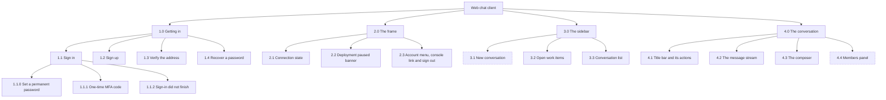

# SPEC: Chat Application

**Status:** Implemented

**Coverage:** `e2e/signin.spec.ts`, `e2e/signup.spec.ts`, `e2e/agent-intents.spec.ts`, `e2e/mentions.spec.ts`, `e2e/welcome.spec.ts`, `e2e/turn-state-without-lex.spec.ts` (a private message that also names the assistant is not answered in public)

**Verified by:** the addressing grammar and the one-responder rule, which are this document's load-bearing claims, are pinned on both sides of the client and backend seam: `backend/test/lib/the-flow-routes-every-at-token.test.ts` and `backend/test/lib/the-handler-stands-down-for-every-at-token.test.ts` (the flow claims exactly the turns the router stands down for), `backend/test/lib/a-dot-addresses-a-real-member-or-nobody.test.ts` and `backend/test/lib/a-mention-names-one-member-or-nobody.test.ts` (the backend re-resolves an address from the live roster), and `frontend/packages/chat/src/utils/mentionParser.test.ts` with `frontend/packages/chat/src/components/MessageInput.private-prefix.test.tsx` (the client lexes the same grammar and decorates only a resolved token). Per requirement, the test behind each row is named in the requirements table.

**Related:** [DESIGN-CHAT-APP.md](./DESIGN-CHAT-APP.md) - the mechanics, and the only place packages, providers, the message path and the reconnect model are described.

**Site section:** Interface layer.

---

## Overview

**This is the whole product as one person experiences it, and the one surface where a seam in the platform reads as a defect rather than as a design.** Everything the rest of the corpus specifies - classification enforcement, delegation, the turn queue, task state, drift, battle, evaluation - is felt here as whether an answer arrives, whether it arrives in the right room, and whether the person can tell the difference between working and stuck.

**What is unique here is the grammar of a conversation with several participants, some of whom are assistants.** Addressing somebody and hiding a message from everybody else are two different acts, so they are two different keystrokes: `@name` names a person or an assistant in front of the room and notifies them, and `.name ` is the only thing that makes a message readable by that member alone ([ADR-034](../../design/decisions/034-addressing-a-message-is-not-making-it-private.md)). The private form decorates itself into a chip as the token resolves, because the two ways to get this wrong cost different amounts: a message meant for one person that reaches the room cannot be taken back.

**Exactly one participant answers a turn.** `@all` always takes the flow bypass and the router stands down, so a broadcast produces one reply rather than one per assistant in the room, and both sides of that decision read the same function.

**The app is the end-user surface and carries no operator capability at all** - not as a hidden route, not as an unused import. The chat entry's import graph is asserted at deploy time never to reach admin code, so reading other people's conversations, moderating, redacting and administering are the separate console's job and cannot be reached from here by any client-side mistake.

**Three stores, one source per question** (tenet D7). Current conversation state - content, membership, the channel name, the read marker - is read from Amazon Chime SDK Messaging, never from a projection, because a projection's lag is indistinguishable at read time from the conversation having been quiet. What the client holds beyond that is session UI state.

> **Terminology.** This is the customer-facing chat interface, where the accepted label for a capability level is **tier** (basic, standard, premium). The platform, admin, config and security documents use **classification** for the same concept. Both name the access to data and models; "tier" in this document is the interface term, not drift.

## Business Problem

A person needs to ask an assistant for something and get a trustworthy answer, and every part of that has to hold together in one place: getting an account, starting a conversation at a level they are allowed, asking, receiving, bringing a file or a colleague in, and picking the same thread up on a phone an hour later. The alternative is to bolt a chat interface onto a raw model and build identity, live delivery, sharing and file handling underneath it, or to buy a single-purpose chatbot that has no multi-party, tier-governed collaboration at all. Without one coherent surface the person is exposed to the seams instead of the product: an asynchronous reply looks like a hang, a dropped socket looks like a broken app, a conversation opened on a laptop is missing on a phone, and a model the person is not cleared for is offered and then fails. Each of those erodes the trust that is the entire value of a conversational product, and none of them is a failure the person can diagnose or work around.

## Personas

Personas are defined in [PERSONAS.md](../../overview/PERSONAS.md) and are not redefined here. The End user is the primary persona of this surface and the only one whose daily work happens in it; the assistant participates as a system actor rather than as a user of the app.

### End user

**How this relates to them:** this is their only surface. They administer nothing, configure nothing and read no analytics, so everything they can know about the platform they learn from what this app shows them - including whether their message was received, whether it is queued behind an assistant that is already working, and whether a message they meant privately went out privately.

| What they need | Requirement |
|---|---|
| Get an account and get back into it without an operator | FR1, FR2, FR3, FR4 |
| A session that survives a long idle rather than silently ending | FR5, FR29 |
| Start work at a level they are allowed, and not be offered one they are not | FR7 |
| Return to any thread, and see where something new arrived | FR6, FR8 |
| Ask, and watch the answer arrive rather than wonder | FR14, FR23, FR21 |
| Name one person in front of the group, and separately say something to one person only | FR15, FR16, FR17 |
| Work over their own file, and be told before sending when the assistant cannot read it | FR18, FR19 |
| Find the thing they were asked and forgot, across every conversation | FR22 |
| Be greeted as somebody the platform already knows, and not re-interrogated | FR28 |
| Know the app is recovering rather than broken, and that a paused deployment is paused | FR29, FR30 |
| Read a long answer, and a table or a code block, without it becoming a wall | FR8, FR20 |
| Use it on a phone | FR9 |
| Choose the language messages to them are said in, and which emails they receive | FR43 |

### End user, as the conversation's owner

**How this relates to them:** the creator of a conversation is a channel moderator, so the same person holds a second set of actions over that one conversation. Every one of them is authorized where it is served rather than hidden in the client, so a member who is not a moderator is refused rather than merely not offered the button.

| What they need | Requirement |
|---|---|
| Bring somebody in, with or without an account, and take them out again | FR11, FR42, FR12, FR26 |
| Rename a thread, and have the name reach every other client | FR10 |
| End a finished conversation for everybody, not just hide it locally | FR12 |
| Turn a conversation into a head-to-head comparison and cleanly back | FR27 |
| Leave a conversation that is no longer theirs to follow | FR12 |

### The assistant, as a system actor

**How this relates to them:** the assistant is a participant rather than a user of this app. It is named, it holds its own identity, it can be addressed and can address one member back, and it can be waiting on the person. Everything the app does about it is a rendering of a decision taken elsewhere.

| What it needs from this surface | Requirement |
|---|---|
| To be addressable by name, in public or privately, alongside people | FR15, FR16 |
| To answer as itself, under its own name, with two assistants in one room distinguishable | FR8, FR14 |
| To open a question that outlives the person's attention, and have it closed by an answer | FR22 |
| To compete as a named side and have a preference recorded | FR27 |
| To be waiting on the person, visibly, without the composer being taken away | FR21 |

### Admin / operator

**How this relates to them:** they are not a user of this app. An operator who is also a chat user gets a link out to the separate console and nothing else, and that link is a URL rather than a capability.

| What they need | Requirement |
|---|---|
| Reach the console from the app they are already in | FR33 |
| Be sure the public bundle carries no operator code | FR34 |
| Know the deployed bundle is the code under test | FR35 |

## Standing, classification, and what each may do

Four roles meet in this surface. Two are held by a person, one is a deployment-wide group, and one is not a person at all.

| Role | What it is | Where it comes from | Assignable |
|---|---|---|---|
| **User** | the baseline participant: everyone signed in holds this | their classification, resolved from group membership | by an operator, in the console, at a classification |
| **Moderator** | a **per-conversation** role carrying Archive, Remove member and battle configuration | the live Amazon Chime SDK moderator list for that conversation, never inferred from who created it | **No** - see below |
| **Admin / operator** | a deployment-wide group that, in this surface, adds a link out and one line of battle detail. In an **admin** conversation it also carries moderator standing, granted by the reconcile that maintains the roster | the `admins` group; here it is a URL rather than a capability | by an operator, outside this app |
| **Assistant** | a participant rather than a user: named, addressable, holding its own identity, and labeled in the roster | provisioned by the platform from a capability profile | not a role a person can hold |

**Moderator is a real, enforced role, and in a user conversation no member can assign it.** The creator is made a channel moderator when the conversation is created, and nothing in this app grants it after that. The one later grant in a user conversation is an operator's: in the console, an operator who joins a conversation as a visible member is made a moderator, through the vended `manage-membership` capability. **An admin conversation is maintained rather than issued once** - its scheduled reconcile grants moderation to every current admin and revokes it from anyone demoted ([DESIGN-ADMIN-AGENT-NOTIFICATIONS.md](../interaction/governance/DESIGN-ADMIN-AGENT-NOTIFICATIONS.md)). Meanwhile a member may always leave, including the last moderator, and a moderator may remove another moderator. **So a member can lose the role and never pass it on, and a conversation can end up with none** - after which no member can rename it, archive it, remove a member from it or configure a battle in it, until an operator joins it from the console. The capability a member-facing grant would use is already vended: `chime:CreateChannelModerator` is in the `manage-membership` action list, and no path in this app calls it (FR38).

**Standing is per conversation rather than per person.** Someone is a moderator of the threads they started and a plain member of the ones they were added to, in the same session and the same sidebar, so the matrix below is read per conversation rather than per account.

**Classification is the orthogonal axis.** It decides which conversations exist for a person rather than which controls they get, and it is the only closed axis IAM evaluates (tenet P4).

**Standing adds exactly three controls, and everything else is identical.** A moderator gains Archive, Remove member, and Battle Mode on or off, plus the moderator label beside their name. Sending, attaching, renaming, sharing, rating a reply, picking a battle winner and reading the battle briefing are the same for every member. That is a deliberately small delta: this is a conversational surface, not an administrative one, and the operator console owns cross-conversation authority.

**The assistant holds a role in the conversation without being a user of the app.** It is addressable by name in public or privately, answers under its own name so two assistants in one room are distinguishable, can hold the floor while it works, and is labeled in the roster as neither moderator nor member. It is also the one participant no moderator may remove, refused where the request is served rather than only hidden in the client, because a conversation without its assistant is a room with no way to get an answer.

**Classification narrows what exists, not what is offered.** It decides which classifications the New-conversation modal offers and which conversations the sidebar lists. The modal offers the conversational, members-audience classifications the person's own classification grants, read from the deployment's declared set (`creatableClassifications`, `GET /classifications`, or before sign-in `VITE_CLASSIFICATIONS`), and the sidebar lists every conversation the person is a member of, as the server answers it, with no client filter. Neither assumes the sets nest: the shipped `basic`, `standard` and `premium` nest only because the sample is configured that way, and an outside classification such as `customer` is never offered from the picker, because no member classification grants it. Both are affordances: the creation path refuses a classification the caller does not clear for, so a stale build costs a confusing offer rather than access.

### The action matrix

Every action that writes. **Yes** means the person may take it; **No** means they may not. The accountability column is what stands between the click and the change.

| Action | Where | Moderator | Member | Refused where | Accountability at the point of action |
|---|---|---|---|---|---|
| Send a message | 4.3 | Yes | Yes | membership, at the send | the echo is local; the send is the record |
| Attach and send a file | 4.3 | Yes | Yes | the upload authorizer re-checks type and size | a staged file in a conversation whose assistant cannot read it says so before the send |
| Address one member privately | 4.3 | Yes | Yes | resolved against live membership | the chip names the recipient before the send commits |
| Rate an assistant reply | 4.2 | Yes | Yes | membership | a down vote may carry a reason |
| Pick a battle winner | 4.2 | Yes | Yes | server-side membership check on the channel | none beyond membership |
| Answer a work item | 3.2, 4.3 | Yes | Yes | the item is the person's own | answering closes the item |
| Rename the conversation | 4.1 | Yes | **No** | Amazon Chime SDK authorizes `UpdateChannel` for a moderator only | **the control is offered to every member**; a refusal is shown inline under the title (FR37) |
| Share with someone by email | 4.1 | Yes | Yes | the share path applies the classification check | the recipient is named; no confirmation |
| Archive for everyone | 4.1 | Yes | No | moderator-checked where it is served | an in-app confirmation names the consequence |
| Remove a member | 4.4 | Yes | No | moderator-checked where it is served | a browser confirmation; never offered on the assistant or on yourself |
| Turn Battle Mode on or off | 4.4 | Yes | No | the battle API applies the same gates | disabling confirms; enabling does not |
| Leave the conversation | - | **No control** | **No control** | the route only removes the caller's own membership, and applies no moderator check | **no control exists in this app** (FR12), and the route would let the last moderator leave (FR38) |
| Grant or revoke moderator on a member | - | **No control** | **No control** | nothing in this app grants it after the conversation is created; an operator who joins from the console as a visible member is made one | **no member can assign the role** (FR38) |
| Create a conversation | 3.1 | Yes | Yes | the creation path refuses a classification the caller does not clear for | a classification must be chosen |
| Sign out | 2.3 | Yes | Yes | ends the session everywhere | none |

**A refusal a person cannot see is the gap this matrix makes visible.** Every row above is authorized where it is served, which is what makes the client's affordances safe to be approximate. Rename is the one row where approximate becomes wrong: the control is present for someone who cannot use it, and the person learns that only by trying, from the refusal shown inline. Archive and Remove member are the pattern to follow, where standing decides whether the control is drawn at all.

## Functional Requirements and Acceptance Criteria

**Priority is a keep-or-cut decision set against what the field expects, not against how interesting the work is.** `Table stakes` means a deployment without it is behind. `Differentiator` is worth the cost because few platforms do it. `Gap - prioritize` marks a requirement whose absence puts this below comparable systems. `Above bar - optional` is more than the field asks and can wait. `Optional - attach instead` should be bought rather than built. `Enabler` is not user-visible and is what makes another row affordable.

| # | Requirement | Priority | Delivered | Validated by |
|---|---|---|---|---|
| FR1 | Sign in on the deployment's own screens, including the forced-new-password and MFA challenges | Table stakes | Yes | `signin` (e2e, behavior) for the password sign-in, `AuthProvider` (unit, behavior) for the refresh; the challenge paths are untested |
| FR2 | Self-service registration at a requested tier, with email verification and a resend | Table stakes | Yes | `signup` (e2e, behavior), which accepts either the verification screen or an authenticated header and enters no code and exercises no resend |
| FR3 | A locked-out person recovers their own password | Table stakes | Yes | none |
| FR4 | Sign out ends the session everywhere, not only in this tab | Table stakes | Yes | none |
| FR5 | A refused refresh ends the session and an unreachable one does not: connectivity never costs a person their session | Differentiator | Yes | `AuthProvider` (unit, behavior) |
| FR6 | The conversation list shows the classifications the person is cleared for, marks unread in real time, and keeps archived threads behind a toggle | Table stakes | Partly - the list is the server's membership answer, with no client filter by classification; nothing asserts the unread mark or the archived toggle | none |
| FR7 | A conversation is started only at a tier the person is allowed, and the offer is never empty | Table stakes | Partly - the offer is the declared classifications the person's own grants name (`NewConversationModal.offer.test.tsx`, including a custom set); a person whose token names no declared classification is offered nothing, and no e2e asserts the offer | none |
| FR8 | History reads: day dividers, a divider marking where the person left off, the assistant's own name per message, a collapse over a length threshold whoever wrote it, and a continuation part shown with the message it continues | Table stakes | Yes | `CollapsibleText` (unit, behavior), `senderLabel` (unit, behavior), `continuationOrder` (unit, behavior), `speaker-attribution` (e2e, behavior) |
| FR9 | On a narrow screen the list and the conversation are a master-detail pair with a Back affordance | Table stakes | Yes | none |
| FR10 | A moderator renames a conversation, the room's own assistant derives a title from the first message whichever assistant answers it, a conversation the platform opens for a purpose arrives already named from that purpose, and the new name reaches every client | Table stakes | Yes. The derived title replaces only the placeholder, so a moderator's name stands; naming at creation and by the room's primary is built and not yet deployed (SPEC-CONVERSATION-TYPES FR32) | `a-room-another-assistant-answered-is-named-by-its-primary` (unit, behavior), `a-room-is-named-from-what-opened-it` (unit, behavior); on a deployment, `a-conversation-is-named-and-assembled` (e2e) |
| FR11 | A conversation is shared with an existing user by email and opens for them from a link before it appears in their list | Table stakes | Yes | `mentions` (e2e, behavior) |
| FR12 | Archive for everyone, remove a member, and leave, each persisted where it is served rather than as a local change | Table stakes | Partly - the route and the provider action ship; the client offers no control, so a member cannot leave from this app | `archive-membership` (e2e, behavior) for archive only |
| FR13 | A conversation the person was just added to appears without a reload | Table stakes | Yes | none |
| FR14 | A message sends with an immediate echo and the reply arrives live, whether returned directly or as a placeholder that updates in place | Table stakes | Yes | `agent-intents` (e2e, behavior) |
| FR15 | `@name` names a member or an assistant in front of the conversation and notifies them, `@all` broadcasts, and exactly one participant answers the turn | Differentiator | Yes | `mentions` (e2e, behavior), `the-flow-routes-every-at-token` (unit, behavior), `the-handler-stands-down-for-every-at-token` (unit, behavior), `a-mention-names-one-member-or-nobody` (unit, behavior) |
| FR16 | `.name ` is the only form that makes a message private, it decorates itself as the token resolves, a dot that names nobody is ordinary text, and a dot combined with a mention is refused with a reason | Differentiator | Yes | `mentions` (e2e, behavior), `identical-private-messages` (e2e, behavior), `turn-state-without-lex` (e2e, behavior), `mentionParser` (unit, behavior), `MessageInput.private-prefix` (unit, behavior), `a-dot-addresses-a-real-member-or-nobody` (unit, behavior) |
| FR17 | A private address survives two members sharing one display name, and a name the bare token cannot carry | Differentiator | Yes | `mentions` (e2e, behavior) for the email-address name only; no test covers the delimited id form or two members sharing a name |
| FR18 | A file is staged with a preview and sent with a message, the type and size limits hold on the client and again where the upload is authorized, and an assistant deliverable downloads | Table stakes | Yes | `attachmentService` (unit, behavior), `AttachmentDisplay` (unit, behavior), `mentions` (e2e, behavior) |
| FR19 | A file can always be sent, because a colleague may receive it; when one is staged in a conversation whose assistant cannot read it, the composer says so before the send, and withholds the claim while the capability is unread | Differentiator | Yes | `MessageInput.attachment-capability` (unit, behavior) |
| FR20 | An assistant reply renders formatted, a person's message renders formatted only when they ask for it, and neither renders raw HTML | Table stakes | Yes | `CollapsibleText` (unit, behavior), `markdownPrefix` (unit, behavior), `MessageInput.slash-command` (unit, behavior) |
| FR21 | A message sent while the assistant is working is held, shown as waiting, and picked up, with one notice for a run of them and a way to stop the work in flight - and the composer is never disabled by the assistant's busy state | Differentiator | Yes | `turn-queue` (e2e, behavior), `private-stop` (e2e, behavior), `useTurnState` (unit, behavior), `useTurnState.dispatchFailed` (unit, behavior) |
| FR22 | The work items the person owns are listed across every conversation, answering one closes it, and a reference the person types is recognized | Differentiator | Yes | `open-work-items` (e2e, behavior), `task-answer` (e2e, behavior), `task-reference` (e2e, behavior), `OpenWorkItems` (unit, behavior), `MessageInput.task-answer` (unit, behavior), `taskReference` (unit, behavior) |
| FR23 | A longer-running task reads as work in progress rather than as a stall | Table stakes | Yes | `agent-intents` (e2e, behavior) for the task indicator, `tasks` (e2e, behavior), `task-state-machine` (e2e, behavior) |
| FR24 | A person rates an assistant reply from the reply itself | Table stakes | Yes | `feedback` (e2e, behavior) |
| FR25 | A link to one message opens its conversation and scrolls to it, and gives up rather than suppressing new messages forever | Above bar - optional | Yes | `focusMessage` (unit, behavior) |
| FR26 | The members panel shows who is in the conversation and their role, read from the live moderator list rather than inferred | Table stakes | Yes | none |
| FR27 | Where the tier is battle-capable and the deployment has battle on, the owner turns it on and off, and the conversation renders the briefing, the side-by-side scorecard, the running tally and a pick-the-winner control | Differentiator | Yes | `battle` (e2e, behavior), `battleTally` (unit, behavior), `BattleScorecard.remount` (unit, behavior), `ChannelMembersPanel.battle-briefing` (unit, behavior), `channelBattleService` (unit, behavior), `battleOutcomeService` (unit, behavior) |
| FR28 | A new conversation opens with this deployment's own orientation, and an intake adds its question to that opening rather than standing in place of it | Table stakes | Yes | `welcome` (e2e, behavior), `onboarding-intake` (e2e, behavior) |
| FR29 | A dropped connection shows as recovering and recovers, including after the tab was hidden long enough for the session to be stale | Table stakes | Partly - no automated multi-client or network-fault harness covers the reconnect | `MessagingProvider` (unit, behavior) |
| FR30 | A paused deployment says it is paused instead of timing out, and the banner is inert where sleep mode is not deployed | Table stakes | Yes | none |
| FR31 | A message arriving while the person is not looking at the app raises a notification that routes back to its conversation | Table stakes | Yes | none |
| FR31a | The person chooses which conversations notify them, per conversation, and that choice is theirs rather than a rule the client infers. A muted conversation still accrues unread state and never raises a desktop notification; a conversation they mark as following notifies them even while they are working in another one | Gap - prioritize | No | none |
| FR32 | Send, upload and addressing failures surface inline and dismissibly, and a render failure does not blank the app | Table stakes | Yes | none |
| FR33 | An admin sees a link to the separate console, and the link is a URL rather than a capability | Enabler | Yes | none |
| FR34 | The chat bundle reaches no admin code and carries no admin endpoint URL | Table stakes | Yes | `assert-no-admin-in-chat` (deploy-time assertion) |
| FR35 | The deployed bundle is identifiably the commit the tests run against | Enabler | Yes | `deployed-build` (e2e, behavior) |
| FR36 | Every string a person reads is translatable, and no decision the client takes depends on recognizing a phrase | Differentiator | Partly - one catalog language, the interface fixed to English, and some strings in `MessageInput.tsx` and `mentionParser.ts` are compiled English | `bilingual-conversations` (e2e, behavior) for a reply arriving in the person's language; none for the interface catalog |
| FR37 | The client offers an action only where the person's standing holds it, and an action refused where it is served says so to the person rather than to the browser console | Gap - prioritize | Partly - a refused rename is shown to the person inline; rename is still drawn for every member, so a plain member is offered a control they cannot use. Archive and Remove member already draw only for a moderator | none |
| FR38 | A conversation always has someone who can administer it: the moderator role is grantable and revocable on an existing member, and the last moderator cannot leave or be removed without the role passing to somebody | Gap - prioritize | No - in this app the role is granted only when the conversation is created, while leave applies no moderator check and a moderator may remove another, so a conversation can reach zero moderators. The only later grant is an operator joining from the console as a visible member. `chime:CreateChannelModerator` is already in the vended `manage-membership` set and no path in this app calls it | none |
| FR39 | A moderator sees the assistants the conversation's classification makes available, whether or not each is already in it, so bringing one in is a choice from a list rather than knowledge the person has to already hold. A plain member sees who is present and is not offered the roster of what could be | Gap - prioritize | No - depends on a classification declaring a set of assistants rather than one profile (SPEC-CAPABILITY-PROFILES FR13), and on an add-assistant path for the list to act on | none |
| FR40 | Sign in through the organization's identity provider: a SAML or OIDC provider on the deployment's pool through Cognito managed login, or a foreign OpenID Connect issuer, by authorization code with PKCE beside the unchanged password form, with the resulting ID token handed to the credential exchange exactly as the password flow's is, and a failed or forged callback refused with a localized reason and a way back | Table stakes | Yes in the client; a live redirect through managed login or a foreign issuer is **NOT VERIFIED** | `SignIn.flows` (unit, behavior: password, in-pool PKCE, foreign OIDC with its refresh, a forged state refused before any code is redeemed, a nonce mismatch, a failed callback in a second locale), `redirectSignIn` (unit, behavior), `viteIssuers.contract` (unit, behavior: the registry projection through Vite into the client parser) |
| FR41 | A visitor without an account continues as a guest from the sign-in screen, where the conversation type allows it | Differentiator | No - **NOT BUILT**: the sign-in screen renders no guest link (`frontend/packages/shared/src/components/LoginScreen.tsx`); a guest starts from the embeddable widget (`frontend/packages/widget`) | none |
| FR42 | A member invites somebody who has no account from the share dialog: by name, with an optional address the invitation is emailed to, and a mode (signing in, or the link alone as a guest where the conversation's type and the deployment allow it); with no address the dialog shows the link; the invitations issued there are listed with their status and a withdraw action, every one for a moderator | Differentiator | Yes - `InvitePanel.tsx` in the share dialog, on `POST /invitations`, `GET /invitations` and `POST /invitations/revoke` | `InvitePanel` (unit, behavior), `invitations` (e2e, behavior) |
| FR43 | Account settings, opened from the account menu in the header: the language messages addressed to the person are said in, and their email preferences where the deployment sends email | Table stakes | Yes - `AccountMenu.tsx`, `AccountSettingsModal.tsx`, `LanguagePreference.tsx`, `EmailPreferences.tsx` | `AccountMenu` (unit, behavior), `LanguagePreference` (unit, behavior), `EmailPreferences` (unit, behavior) |

**Reading the "Validated by" column.** Each entry is one specific test, named by its filename without its extension. Chat unit tests are Vitest specs under `frontend/packages/chat/src/`, with the shared ones under `frontend/packages/shared/src/`; backend unit tests live in `backend/test/`, with the shared-library ones under `backend/test/lib/`; end-to-end specs live in `tests/e2e/` and are listed against their phase in [e2e-coverage-matrix.md](../../reference/e2e-coverage-matrix.md). The status in brackets is what the test does, which matters more than that it is green:

- **behavior** - executes the code path and asserts on the result.
- **source text** - asserts that a convention still appears in the source. It catches the convention being dropped; it does not catch a wrong number.
- **deploy-time assertion** - not a test: a script wired into the chat deploy (`backend/scripts/deploy-frontend.mjs`) that fails it, and not into `npm run build`. `frontend/scripts/assert-no-admin-in-chat.mjs` walks the chat entry's real import graph, through the shared package's source, and fails when any resolved module sits under the admin package.
- **none** - no test exists.

**Acceptance criteria.** A new person registers at a requested tier, verifies the address, and signs in on the deployment's own screens, including the temporary-password and MFA paths, and recovers a forgotten password without an operator. Once in, they start a conversation only at a tier they are allowed; send a message and watch the reply arrive, direct or async, with a typing indicator; reopen a conversation with its history, day dividers and unread marks; name a member or the assistant in front of the room, and separately address one member privately with the chip visible before they commit; attach and send a file within the limits and download an assistant deliverable; share a conversation to somebody who opens it by link; see the members and their roles; as the owner add, remove, rename or archive, each persisted where it is served; and run a battle and pick a winner. Leaving is served by the same route and is not offered by this app (FR12). Throughout, the app degrades honestly: a dropped connection reads as recovering, a paused deployment as paused, a longer task as in progress, a queued message as waiting, and a failure inline. On a phone the list and the conversation are a master-detail pair with Back. The chat bundle reaches no admin code, and the deploy fails if it ever does.

**FR31 and FR31a are the same feature at two levels, and only one of them is built.** The delivered behavior carries two signals with two jobs: unread state flips per conversation whether or not the app is focused, and a desktop notification is raised only when the document is hidden or unfocused, for any conversation including the open one. That split exists because notifying per conversation while the person was plainly looking at the app produced two signals for one event, one of which interrupted the desktop. It is the right default and it is still a rule the client infers. A person working in one conversation has no way to mute a conversation that has become noisy, and no way to say that one particular conversation should reach them anyway. That choice belongs to them, and FR31a is where it goes.

**Known limits on the delivered rows.** FR7's client-side offer is an affordance and not the enforcement: the creation path refuses a classification the caller does not clear for, so being wrong here costs a confusing offer rather than access. FR12's leave is a route and a provider action with no control in front of them. FR16 and FR17 are covered on both sides of the client and backend seam and end to end, and the two grammars are separate copies kept in step by tests rather than by a shared module. FR21's stop control and queue notice are covered end to end; the stage wording a deployment configures wins over the translated token, and an unrecognized stage still renders.

## Non-Goals - Out of Scope

| Out of scope | Why | Where it is covered instead |
|---|---|---|
| **Reading, moderating or administering other people's conversations** | This is the public end-user surface, and an operator capability reachable from it is a security boundary crossed in the browser. The invariant is asserted on the import graph rather than argued: the chat entry cannot resolve admin code | [SPEC-ADMIN-CONSOLE.md](./SPEC-ADMIN-CONSOLE.md), [DESIGN-SEPARATE-ADMIN-APP.md](./DESIGN-SEPARATE-ADMIN-APP.md) |
| **User-side redaction or deletion of a message** | Redaction and deletion are moderation and administration actions, and the archive is an audit trail. The chat plane imports neither capability, which is the boundary rather than a gap | [SPEC-MODERATION.md](../interaction/governance/SPEC-MODERATION.md), [SPEC-ACCESS-AND-CONTROLS-AUDITING.md](../interaction/governance/SPEC-ACCESS-AND-CONTROLS-AUDITING.md) |
| **Editing a sent message** | Immutability is what makes the conversation readable as a record, and an edit in the surface would not reach the copy that matters | [SPEC-ACCESS-AND-CONTROLS-AUDITING.md](../interaction/governance/SPEC-ACCESS-AND-CONTROLS-AUDITING.md) |
| **Authoring, arming or aggregating a battle** | The app runs a duel and records a preference; deciding which duel exists is an operator decision with cross-conversation results behind it | [SPEC-BATTLE.md](../interaction/quality/SPEC-BATTLE.md), [DESIGN-BATTLE.md](../interaction/quality/DESIGN-BATTLE.md) |
| **Setting a person's tier or admin status** | The app reads and respects both and can set neither; a surface that could would be a second, weaker enforcement point | [SPEC-ADMIN-CONSOLE.md](./SPEC-ADMIN-CONSOLE.md), [SPEC-ADMIN-IDENTITY.md](../interaction/governance/SPEC-ADMIN-IDENTITY.md) |
| **A store of its own** | The app holds session UI state and nothing else. History, membership, the channel name and files live in the platform stores it reads through, and a local copy would be a fourth store to disagree with the other three (tenet D7) | [DESIGN-CHAT-APP.md](./DESIGN-CHAT-APP.md), Data model |
| **Token streaming** | Replies arrive as a placeholder that updates in place, which covers a multi-step answer that calls tools between tokens; streaming would present a partial answer that a later step contradicts | [DESIGN-CHAT-APP.md](./DESIGN-CHAT-APP.md), Placeholder, then update |
| **Voice, video and presence** | The app is text and attachments. Non-chat transports attach to the conversation as a connector's artifacts rather than as a second surface inside this one | [SPEC-CONVERSATION-TYPES.md](../interaction/conversation/SPEC-CONVERSATION-TYPES.md), [SPEC-CONNECTORS.md](../communication/SPEC-CONNECTORS.md) |
| **Read receipts and peer typing** | Unread state is tracked for the person's own sidebar; exposing another member's read or typing state adds cross-member presence tracking the product does not aim to provide | FR6 for the one direction that is built |
| **Amplify** | The auth screens are built on the Cognito SDK directly, so the deployment owns every screen a person sees and the challenge paths are the deployment's own | FR1, FR2, FR3 |
| **Reactions, message search, conversation search, threaded replies, forwarding, pinning** | Common messaging depth, none of it built. The conversation model is one linear thread with addressing rather than branches, and finding a past answer is a real gap rather than a decision | Open questions below |
| **A mid-conversation model switcher** | The tier chosen at creation is the control, and the router picks a model per intent within that classification. A live switcher would let a conversation leave the classification it was created under | FR7; a selector component exists in the tree, is imported by nothing, and reads mock data |
| **MFA enrollment, an authenticated change-password flow** | Credential self-service beyond recovery is an identity-provider concern in most deployments, and a second place to change a credential is a second place to get it wrong | Open questions below; the account settings this app does carry are FR43 |
| **A theme switcher and an in-app language picker** | The app ships one theme, the catalog holds one language, and the interface is fixed to English | FR36, and Open questions below |

## User Experience Description and Mocks

This vertical is the user experience, so the journeys below are the specification and the rest of the document supports them. They are ordered by persona, and each step names the requirement it exercises.

### Sitemap

One screen at a time before sign-in, and one frame with three regions after it. There is no separate page for anything inside a conversation: the members panel is a drawer, and sharing and archiving are modals over the conversation they act on. A conversation is addressable by link, and that link is the only URL this app reads.

**Numbering shows depth:** a top-level page is `N.0`, a page within it `N.M`, and a page within that `N.M.0` onward, so a citation says how deep it sits as well as which page it is.

Dashed nodes are a modal or a drawer over the frame rather than a place the person navigates to. Each subsection below states the purpose, the personas it serves, and what it offers; the standing that gates an action is in the matrix above.

#### 1.0 Getting in

The deployment's own screens rather than a hosted sign-in page, so the wording, the branding and the failure copy belong to the deployment (FR1, FR2). A person whose organization signs them in leaves for that organization's page and returns to this one (FR40).

**1.1 Sign in.** *Purpose:* get an existing person back to their conversations. *Personas:* End user, and the operator who continues to the console from here. *Offers:* email and password, a route to registration, and a route to password recovery. Two challenges are branches of this screen rather than screens of their own, because a person meets them mid-sign-in and a separate page would lose the attempt: **1.1.0** asks for a permanent password where the account was created with a temporary one, and **1.1.1** asks for a one-time code where MFA is enabled (FR1). Above the password form, the screen offers each redirect issuer the deployment declares as a secondary button carrying that issuer's name in the person's language; the admin console offers only the issuers whose people may hold an admin role (FR40). **1.1.2** replaces the form when a redirect sign-in returns without finishing: it says why in the person's language, never in the provider's own words, and offers the way back to 1.1. A "continue as guest" link is **NOT BUILT** (FR41).

**1.2 Sign up.** *Purpose:* self-service registration, so a person does not wait on an operator. *Personas:* End user. *Offers:* email, password with the requirements stated, and the requested classification. Approval at that classification is an operator's decision taken in the console, not here (FR2).

**1.3 Verify the address.** *Purpose:* prove the address before the account is usable. *Personas:* End user. *Offers:* the one-time code and a resend. A confirmation screen follows, then sign-in (FR2).

**1.4 Recover a password.** *Purpose:* a locked-out person recovers without an operator. *Personas:* End user. *Offers:* request a code, then set a new password. The request step advances whether or not the address is known, so the screen does not disclose who has an account (FR3).

#### 2.0 The frame

Present on every authenticated screen, and one part of it before sign-in.

**2.1 Connection state.** *Purpose:* tell the person the app is recovering rather than broken. *Personas:* End user. *Offers:* nothing to act on. It is absent while connected and shows a recovering state otherwise, which is the whole design: a permanent indicator teaches people to ignore it (FR29).

**2.2 Deployment paused banner.** *Purpose:* say that a paused deployment is paused rather than letting a request time out. *Personas:* End user. It renders above everything including the sign-in screen, because a person meets a paused deployment before they authenticate, and it is inert where sleep mode is not deployed (FR30).

**2.3 Account menu, console link and sign out.** *Purpose:* reach account settings, leave, and for an operator, cross to the other app. *Personas:* End user, and the admin / operator for the link alone. *Offers:* Account settings, with the language messages addressed to the person are said in and, where the deployment sends email, their email preferences (FR43); sign out, which ends the session everywhere rather than in this tab (FR4); and a link to the console for someone in the `admins` group. The link is a URL and carries no capability: the bundle reaches no operator code at all, and the deploy fails if it ever does (FR33, FR34).

#### 3.0 The sidebar

Where the person chooses what to work on, and the only place that spans conversations.

**3.1 New conversation.** *Purpose:* start work at a classification the person is allowed. *Personas:* End user. *Offers:* a card per classification the person is cleared for, with its description, who may join, the context and the tools it carries, and a details expander per card. A card names no model: the classification's model is a default that an intent may route past. The classification is the only choice, because it binds the model allow-list, the data-access profile and the tool set; the title is derived from the first message rather than asked for (FR7, FR10).

**3.2 Open work items.** *Purpose:* find the thing the person was asked and forgot, across every conversation. *Personas:* End user. *Offers:* a collapsed count that expands to the items the person owns, each naming what it needs and which conversation it belongs to, with a control that opens that conversation and arms the composer to answer that item. It is absent when the queue is empty rather than showing an empty shelf, and an item in another conversation stays visible but inert while a duel is waiting on this one (FR22).

**3.3 Conversation list.** *Purpose:* return to any thread and see where something new arrived. *Personas:* End user. *Offers:* the active threads with an unread mark, a classification chip and a relative date, and archived threads behind a toggle. On a narrow screen the list and the conversation are a master-detail pair with a Back affordance (FR6, FR8, FR9, FR13).

#### 4.0 The conversation

**4.1 Title bar and its actions.** *Purpose:* identify the thread and act on it as a whole. *Personas:* End user, and the owner for the moderator actions. *Offers:* the title with inline rename, the classification chip, Share by email, a members toggle carrying the count, and Archive for a moderator. Rename is offered to every member and is authorized for a moderator only, and a refusal is shown inline under the title (FR37); Share applies its classification check where it is served, and the same dialog invites somebody with no account (FR10, FR11, FR42).

**4.2 The message stream.** *Purpose:* read what was said, and rate what the assistant said. *Personas:* End user, with the assistant appearing as a named participant rather than a user. *Offers:* day dividers, a divider marking where the person left off, the author's own name per message so two assistants in one room are distinguishable, a collapse past a length threshold whoever wrote it, attachments, a task indicator, a waiting label for a held message, a thumbs rating with a reason on a down vote, and the battle briefing, scorecard, running tally and winner pick. The briefing is shown to every battling member and the controls that configure a battle are not (FR8, FR14, FR20, FR21, FR23, FR24, FR27).

**4.3 The composer.** *Purpose:* say something, to the room or to one participant. *Personas:* End user. *Offers:* the text field with a mention picker, a private-address grammar that decorates itself as the token resolves, file staging with a preview, and one chip at a time naming what the next message will do - waiting on a duel, private to one person, answering a work item, or held to a sticky target. It is never disabled by the assistant being busy, which is also how a person stops work in flight; it is read-only in an archived conversation (FR15, FR16, FR17, FR18, FR19, FR21).

**4.4 Members panel.** *Purpose:* see who is here and what standing they hold. *Personas:* End user, and the owner for the actions. *Offers:* the roster with each member labeled moderator, member or assistant, read from the live moderator list rather than inferred, with the person's own row marked; Remove member and Battle Mode on or off for a moderator. The experiment behind a battle is named only for an operator, because reading it needs a grant a member does not hold (FR26, FR27). This is also where a moderator sees the assistants the conversation's classification makes available and which of them are not in it yet, so bringing one in is a choice from a list (FR39, **ROADMAP**).

### The End user's first hour

1. **Ask for an account** (FR2). Registration takes an email, a password and a requested tier; verification is a one-time code with a resend. Approval at that tier is an operator step, so registration alone reaches nothing, and the screen says so rather than leaving the person at a sign-in that refuses them.
2. **Get in** (FR1). If the account was created with a temporary password, the sign-in screen asks for a permanent one before going further; if MFA is enabled, it asks for the code. Both are steps in the deployment's own screen rather than a redirect to somebody else's.
3. **Start a conversation** (FR7). The tier is the choice, and it binds the conversation to a model allow-list, a data-access profile and a tool set. Only allowed tiers are offered, so nothing that would fail later is clickable.
4. **Be greeted as somebody the platform knows** (FR28). The opening is this deployment's own orientation copy. Where an intake is configured and this person has not been onboarded, its first question follows that opening in the same message, so the conversation still says what it is for. A person who has been onboarded is answered directly and is never asked again.
5. **Ask something** (FR14). The message appears immediately; the reply arrives live. A slow answer arrives as a placeholder that fills in, so a multi-step answer never reads as a hang, and a typing indicator holds while the assistant composes.
6. **Watch a longer piece of work** (FR23, FR21). A task shows its label and an in-progress pulse. A message sent while the assistant is still working is held rather than lost, is marked as waiting, and draws one notice for a run of them; the composer stays usable, which is also how the person stops the work in flight.
7. **Bring a file** (FR18, FR19). Drag or pick, see it preview, send it with a caption. The attach control is always there, because a colleague in the conversation may be the reader. Where the assistant serving this conversation cannot read files, the composer says so beside the staged file before the send, rather than the upload silently succeeding and the answer coming from the caption; while the capability is still being read, it claims nothing.
8. **Read a long answer** (FR8, FR20). Tables, lists and code render; anything past the length threshold collapses behind a show-more, whoever wrote it; a continuation part stays with the message it continues even when a notice was posted between them.
9. **Come back later** (FR6, FR29, FR5). The list shows where something new arrived. A connection dropped in the meantime reads as recovering and recovers, including after the tab was hidden long enough for the session to be stale. A refresh that Cognito refused ends the session; one that never reached Cognito does not.
10. **Find what was asked of them** (FR22). The work-items queue spans every conversation, including a question asked in one the person is not looking at. Choosing an item opens its conversation and arms the composer to answer that item, which is what closes it.

### The End user in a room with other people

1. **Name somebody in front of the group** (FR15). `@name` notifies them and leaves the message readable by the conversation, which is the ordinary case in a room of more than two. An assistant named this way answers in public.
2. **Address everybody** (FR15). `@all` broadcasts, and exactly one participant answers it.
3. **Say something to one member only** (FR16). `.name ` sets the private address, and the typed characters become a chip stating in the deployment's own words what is about to happen. Privacy is never inferred from a near miss: a dot that names nobody is an ordinary sentence and goes to the room as written, so a line about a dotfile is sendable. A dot combined with a mention is refused inline, because the two say opposite things about who may read the message.
4. **Address a member the bare form cannot name** (FR17). The picker writes a delimited form carrying the member's id alongside the name, so a name with a space, a name that is an email address, and two members sharing a display name are all addressable, and the reader sees the name rather than the id.
5. **See who is here** (FR26). The members panel lists humans and assistants with their roles, read from the live moderator list rather than inferred from who created the conversation.

### The End user as the conversation's owner

1. **Share it** (FR11, FR42). By email, to somebody who already has an account; they open it from a link that works before the conversation appears in their list. Somebody with no account is invited instead, from the same dialog: by name, with an optional address the invitation is emailed to, and a mode (signing in, or the link alone as a guest for 15 minutes where the conversation's type and the deployment allow it). With no address, the dialog shows the link for the inviter to pass on. Below it, the invitations issued there, each with its status and a withdraw action; a moderator sees every one. The landing page and the redemption are [SPEC-EMBEDDABLE-WIDGET.md](./SPEC-EMBEDDABLE-WIDGET.md) and [SPEC-CREDENTIAL-EXCHANGE.md](../interaction/governance/SPEC-CREDENTIAL-EXCHANGE.md) §4c.
2. **Curate it** (FR12, FR26). Remove a member from the panel. Leaving, which removes only the caller's own membership, is served by the same route and is not offered by this app.
3. **Name it** (FR10). The room's own assistant derives a title from the first message, even when another assistant answers it, and the owner can rename it; either way the new name reaches every other client without a reload. A conversation the platform opens for a purpose (an event, an alarm, a visit) arrives already named.
4. **End it** (FR12). Archiving makes the conversation read-only and drops it from every member's active list, which is a shared end state rather than a per-device hide.
5. **Run a comparison** (FR27). Where the tier is battle-capable and the deployment has battle on, the owner turns Battle Mode on from the members panel. The second assistant joins as a visible member, the conversation shows the briefing, and a duel renders a side-by-side scorecard with response time and an estimated cost labeled as an estimate, a running tally, and a control to pick the winner.

### The Admin / operator

There is one step. Where a console URL is configured and the person is an admin, the header shows a link to it (FR33). Nothing else about this app changes for an operator, and the bundle they load is the same one every other person loads (FR34).

**Mocks.** None exist for this surface. The rendered record is the end-to-end suite, which drives the deployed app rather than a wireframe.

**OPEN:** whether this surface should carry rendered mocks in the way the evaluation views do. The argument for is that the composer's grammar - the chip, the picker, the queued styling, the answering affordance - is hard to review in prose and is where the expensive mistakes live. The argument against is that a mock drawn from the app's own stylesheets is a second thing to keep in step with the app.

## Open product questions

- **Discoverability of the private form.** `.name ` is a typed prefix with a picker behind it, and whether the composer should also offer it as a control is open. It carries more weight than the same question about a slash command: an undiscovered command means a feature goes unused, while an undiscovered private form means somebody reaches for `@` believing it is private.
- **Messaging depth.** Which of reactions, message search, conversation search, threaded replies, forwarding and pinning are worth adding, and in what order, is an open product call. Search is the one a person asks for by name. Message edit and user-side deletion stay excluded as accountability boundaries rather than as a backlog.
- **Account self-service depth.** Whether an authenticated change-password flow and MFA enrollment belong beside the account settings (FR43) or stay with the identity provider is unresolved, and the answer differs by deployment.
- **The language picker.** The catalog holds one language, the interface is fixed to English, and the strings FR36 names are compiled into components. Shipping a picker is a product decision, and moving those strings into the catalog is the build that has to precede it.
- **Attachment policy ownership.** The allowed-type list and the size cap are client constants matched by the upload authorizer. Which of them a deployer should tune, and where that configuration lives, is open.

## Related Documents

- [DESIGN-CHAT-APP.md](./DESIGN-CHAT-APP.md) - packages, providers, the message path, the reconnect model, and the mechanics of every flow above
- [PERSONAS.md](../../overview/PERSONAS.md) - the End user and the assistant actor
- [SPEC-CONVERSATION-TYPES.md](../interaction/conversation/SPEC-CONVERSATION-TYPES.md) - what a conversation's type decides about the experience this app renders
- [SPEC-USER-PROFILE-AND-ONBOARDING.md](../interaction/conversation/SPEC-USER-PROFILE-AND-ONBOARDING.md) - the once-per-user gate behind FR28
- [SPEC-TASK-STATE-TRANSITIONS.md](../interaction/conversation/SPEC-TASK-STATE-TRANSITIONS.md) - the states behind FR22 and FR23
- [SPEC-TURN-QUEUE.md](../interaction/conversation/SPEC-TURN-QUEUE.md) - the queue behind FR21
- [SPEC-WELCOME-AND-CONTEXT.md](../interaction/assistants/SPEC-WELCOME-AND-CONTEXT.md) - the orientation behind FR28
- [SPEC-BATTLE.md](../interaction/quality/SPEC-BATTLE.md) - the duel whose chat-side surfaces FR27 renders
- [SPEC-ADMIN-CONSOLE.md](./SPEC-ADMIN-CONSOLE.md) / [DESIGN-SEPARATE-ADMIN-APP.md](./DESIGN-SEPARATE-ADMIN-APP.md) - the operator app this one is the other half of
- [SPEC-ADMIN-IDENTITY.md](../interaction/governance/SPEC-ADMIN-IDENTITY.md) - the identity model the app authenticates against, where the chat identity is never elevated
- [ADR-034](../../design/decisions/034-addressing-a-message-is-not-making-it-private.md) - addressing and privacy as two acts
