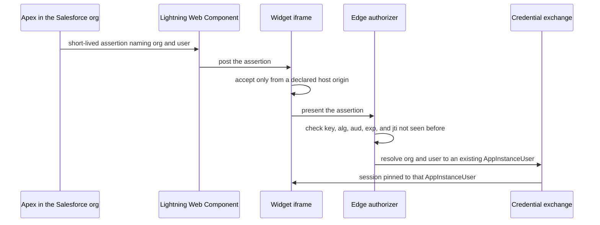

# SPEC: Embeddable widget - an assistant on someone else's page, with no account or with the host's sign-in

**Status:** Built, not deployed. The widget is `frontend/packages/widget` and its hosting is the `Widget` stack (`backend/lib/stacks/widget-stack.ts`, the `widget` capability). It signs people in through the guest issuer ([GUEST-ISSUER](../../guides/admin/GUEST-ISSUER.md)) and the `host-assertion` issuer ([SPEC-CREDENTIAL-EXCHANGE](../interaction/governance/SPEC-CREDENTIAL-EXCHANGE.md), "The host assertion"), and makes FR8's origin and parent-frame checks itself. Nothing has run against a deployed instance, so every live claim is **NOT VERIFIED**. The two shipped apps still cannot be framed: their distribution sends `X-Frame-Options: DENY` (`backend/lib/constructs/frontend-distribution.ts`), and only a distribution given a framed-document policy, the widget's, sends `frame-ancestors` instead.

**Coverage:** `e2e/guest-widget.spec.ts` - an anonymous visitor on the declared test host gets an answer from the guest assistant, and each guest-start refusal is shown as its own state. `e2e/invitations.spec.ts` - the landing page redeems nothing on open, hands a sign-in invitation to the chat app, and opens a link invitation's conversation until it is withdrawn. Written, **NOT RUN**.

**Related:** [STACKS.md](../../overview/STACKS.md) - the `Widget` stack and the `widget` capability. [SPEC-CREDENTIAL-EXCHANGE.md](../interaction/governance/SPEC-CREDENTIAL-EXCHANGE.md) - the exchange that vends the widget's session. [ADR-056](../../design/decisions/056-two-http-apis-and-no-aws-waf.md) - the guest-start route's abuse controls. [SPEC-CHAT-APP.md](./SPEC-CHAT-APP.md) - the first-party client the widget sits beside.

**Site section:** Interface layer.

---

## Overview

**The widget is an assistant conversation embedded in a page the deployment does not own.** It is the `Widget` stack in the Interface layer, added by declaring the `widget` capability, and it is part of the minimal deployment: an anonymous visitor on one declared host site talks to one assistant, with no accounts and no user pool.

**It signs a person in two ways, both through the one credential exchange:**

- **Guest start.** An anonymous visitor gets a guest session from the platform's own guest issuer. The guest is an ordinary AppInstanceUser with an expiration, in one conversation.
- **Host assertion.** Inside a host that already knows who the person is, such as Salesforce, the host signs a short-lived assertion naming the person, and the widget presents it. The person signs in once, to the host.

Either way, the session is pinned to one AppInstanceUser, and access is the IAM decision on the conversation's classification tag that every other client gets.

**It is hosted, not copied into the host page.** The widget is served from its own CloudFront origin and embedded as an iframe. Its `frame-ancestors` policy and `PersonApi`'s CORS origins are generated from the deployment's declared host sites, never `*`.

**It starts from a prototype, not a new build.** The client half is ported from a prototype kept outside this repository:

- It builds to a standalone bundle that bundles its framework, so a host that is not a React app can load it.
- It exposes one mount call that takes a container element and a configuration.
- It holds one shared messaging WebSocket session per AppInstanceUser, loads history once, and refreshes its credentials before they expire.
- Its strings and theme are host-provided, with English defaults.

What the prototype did not do is the identity half: it took credentials a host pre-vended from the host's own pool. The widget replaces that with guest start and host assertion, and drops the prototype's product-specific cards.

## As built

**Two outputs, one origin.** `frontend/packages/widget` builds the frame document (`index.html`, a React app) and the host loader (embed.js, no framework, built from `src/embed/embed.ts`) into one `dist/`, published to the `Widget` distribution by `backend/scripts/deploy-frontend.mjs --widget`, never by cdk. A host page includes `<widget origin>/embed.js` and calls `AEWidget.mount({ mode, lang, contact, theme, accent, radius, font, title })`.

**The loader** creates the frame with a title (the frame reports its localized one when ready), sizes it when the panel opens and closes, and in host mode relays the host's assertion: `postAssertion(assertion, conversationArn)` posts only to the widget's origin, and `onAssertionRequest` tells the host when the frame needs a fresh one. It reads a message only when `event.origin` is the widget's origin and `event.source` is its own frame.

**The frame** is a launcher and a panel (`src/components/WidgetApp.tsx`):

- **Guest mode.** The privacy notice, then the captcha and guest start, then the conversation. A visit already open on the origin (a reload, another tab) is joined. One tab per visit holds the refresh credential: the tabs elect a leader with a Web Lock and share every rotation on a `BroadcastChannel` (`src/session/refreshLeader.ts`, [GUEST-ISSUER](../../guides/admin/GUEST-ISSUER.md#the-widget)).
- **Host mode.** The frame accepts a posted assertion only when `event.origin` is exactly one of the registry's `host-assertion` `allowedOrigins` and `event.source` is its own parent (`src/session/hostAssertion.ts`). It holds the assertion in memory, sends it once to the exchange for the conversation the host names, and asks the host for a new one to renew. A host that names no conversation gets a settled state: starting one from inside the widget is **NOT BUILT**.
- **The conversation** loads history once and then follows the person's one shared Amazon Chime SDK messaging session (`src/messaging/`); a socket that does not start is retried after a growing delay, never polled.
- **The visit carries over with nothing to click.** A visitor is never asked whether to keep their visit. Under the conversation, when the deployment declares an upgrade path and names its chat app, a live guest session shows "Sign in" (path A), which opens the chat app's sign-in in a tab and hands the visit off to that tab alone (a single-use nonce in the page's URL fragment, and the secret over `postMessage` to the window the widget opened, so a forwarded link binds nothing), and the registration form (path B), a name and the address a sign-in link is emailed to (`POST /guest/register`). The widget never holds a claim token: it travels only in the email. The states are below.
- **Every refusal is a settled, localized state** (`src/components/Refusal.tsx`), never a raw error.

**Accessibility.** The launcher is a button with `aria-expanded` and `aria-controls`; the panel is a labelled dialog that takes focus into its composer; Escape closes it and focus returns to the launcher; the transcript is a polite ARIA live log with the connection state in its own status region.

**Strings and theme.** Every string is a key in `src/locales/<lang>.json` on the widget's own i18next instance, in the language the host asks for, then the browser's, then English. The frame ships the shared design tokens; a host overrides only `--accent-500`, the `--radius-*` scale, the font family and light or dark, each checked against its shape (`src/theme.ts`).

**Hosting.** The `Widget` stack's Content-Security-Policy sends `frame-ancestors` generated from every issuer's `allowedOrigins` (`'none'` when none is declared), no `X-Frame-Options`, scripts from its own origin and the captcha vendor only, images from its own origin, `data:` and `*.amazonaws.com` only, and fonts from its own origin or `data:`. The frame calls `PersonApi` from the widget's own origin, which `PersonApi` admits through the `widgetUrl` context (`backend/lib/config/app-origins.ts`). `npm run deploy` reads it from the `Widget` stack's `WidgetDistributionUrl` output and passes it, with one extra backend pass the first time that stack exists (`widgetUrlLookup` in `backend/scripts/deploy.mjs`); a deploy that does not go through it passes `--context widgetUrl=<url>`.

**The sample host page.** `examples/widget-host/` embeds the widget the way a host website does, from an origin of its own: the test-only `WidgetHost` stack (`backend/lib/stacks/widget-host-stack.ts`), a private bucket behind its own CloudFront distribution, stood up when the guest issuer lists `"widget-host"` in `allowedOrigins`, and named in `frame-ancestors` by a reference to that stack. Synth refuses it in production, on any other issuer and without the `widget` capability ([GUEST-ISSUER](../../guides/admin/GUEST-ISSUER.md#the-sample-host-page)).

**The hand-off is taken from the widget alone.** The chat app asks for path A's secret only at the widget's origin and takes the answer only from it (`VITE_WIDGET_ORIGIN`, the Widget stack's `WidgetDistributionUrl` output, `requestPendingBindSecret` in `@ae/shared`), so a page on another origin that opens the sign-in cannot hand the person its own visit; with no widget origin declared nothing is asked.

**The invitation landing page.** The same build serves `invite.html` (`src/invite/main.tsx`, `src/invite/landing.tsx`, `src/components/InvitationLanding.tsx`), the page an invitation's link opens (M-5). Every invitation lands in the chat app today, which mounts this page from `@ae/widget/invitation-landing` on its own origin (`invitationLandingFor`); the widget's copy is the alternative client. It reads the token from the URL fragment (`#t=<token>`), takes it out of the address bar, and asks `POST /invitations/peek` what its holder may know: the conversation's name, who invited them and as whom, and the mode. Opening the page redeems nothing. Joining is a click: a `sign-in` invitation sends its holder to the chat app's sign-in with the token in that page's fragment, where the first credential exchange redeems it; a `link` invitation solves the captcha and redeems once (`POST /invitations/redeem`), and the conversation opens on the page, on a session for that one conversation (`linkSession`) that is not renewed, under a standing banner, until it ends and the page says so. Every refusal (`expired`, `redeemed`, `redeemed_elsewhere`, `revoked`, `wrong_mode`, `ended`, and the redemption's `paused`, `rate_limited`, `captcha_failed`, `unavailable`) is a settled state naming the inviter. The `ChatApp` and `Widget` distributions each serve `invite.html` on its own behavior: `frame-ancestors 'none'`, `X-Frame-Options: DENY`, `Referrer-Policy: no-referrer` and `Cache-Control: no-store`. **NOT BUILT** on the landing page: requesting a new invitation from a refusal, and keeping a `link` visit by signing in.

**Person-facing states.** Every state a person can land in is settled, localized (the widget's `src/locales/<lang>.json`, the chat app's `@ae/shared` locale) and named for assistive technology, with what to do next; none is a raw error or an empty panel. One table per flow:

*Guest start* (`WidgetApp.tsx`, `Refusal.tsx`; the codes are `guest-session.ts`'s):

| State | What the visitor reads | What to do next |
|---|---|---|
| `captcha_failed` | The check did not pass | Try again (the notice, then the check) |
| `rate_limited` | Too many conversations started from the network, with the server's `retryAfterSeconds` | Try again after that many seconds |
| `paused` | The assistant is paused | The host's declared contact route, when the host passes one (`contact` on the loader, an `https:`, `mailto:` or `tel:` URL; any other scheme is dropped) |
| `unavailable` | The assistant is unavailable | Try again, and the host's contact route |
| `network`, `invalid_request` | No connection; the conversation could not start | Try again |
| `replayed`, `revoked` | This conversation was opened elsewhere | Start a new conversation |
| `expired`, `ended` | This conversation has ended | Start a new conversation |

*Invitation redemption* (`InvitationLanding.tsx`; the codes are `invitation-redemption.ts`'s): `expired`, `redeemed`, `redeemed_elsewhere` (a forwarded `link` already used), `revoked`, `wrong_mode`, `ended` and `unknown`, and the `link` redemption's `paused`, `rate_limited`, `captcha_failed` and `unavailable`, each naming the inviter and saying to ask them for a new invitation. A `sign-in` invitation refused at the chat app's first exchange is the chat app's notice (`ArrivalNotice.tsx`), and `wrong_account` (an account that already exists signed in) offers "Sign out and continue with a new account": the invitation is pending again for the next sign-in, and the account signed in now is never bound. **NOT BUILT:** requesting a new invitation from a refusal, which would notify the inviter (no route serves it).

*The `link` session banner*: "You are joined as a guest to this conversation only, for a short while", standing over the conversation until the session ends and the page shows `ended`. **NOT BUILT:** keeping a `link` visit by signing in. The bind takes a guest visit's refresh credential, and a `link` session has none.

*The visit carrying over, path A, signing in* (`CarryOver.tsx`, `session/upgrade.ts`, `@ae/shared` `pendingUpgrade.ts`). Nothing asks the visitor to keep anything, in the widget or on the chat app's sign-in screen:

| State | Where | What the person reads, and what to do next |
|---|---|---|
| Sign in | Widget, under a live guest session's conversation, when the deployment declares `bind` (`VITE_GUEST_UPGRADE_PATHS`) and names its chat app (`VITE_GUEST_SIGN_IN_URL`) | Signing in for the first time makes this conversation part of the account; the conversation stays where it is |
| Continue in the new tab | Widget | The chat app's sign-in opened in a new tab with the hand-off's nonce in its fragment (`#bindNonce=`), the secret answered to that tab alone; "Open the sign-in page" opens the tab again through the widget, for a blocked or closed one; back to the conversation. The conversation is not running while handed over, so nothing rotates the credential the bind consumes |
| Opened | Chat app | The first sign-in binds on its own (no confirmation is sent or asked for) and the continuation (`bound.conversationArn`) opens: the visit is part of the account and the conversation continues here, opening on the assistant's line about the visit |
| `CONTINUATION_UNAVAILABLE` | Chat app | The account is linked and signed in, its conversation not opened yet: "Try again" makes the same call, which the exchange recognizes as the bind that already happened |
| `SUBJECT_ALREADY_BOUND` | Chat app | The account already exists, so the visit was not linked: leave your details in the conversation and sign in from the emailed link (path B). The person is signed in as themselves |
| `GUEST_SESSION_NOT_LIVE`, `BIND_NOT_DECLARED`, `BIND_NOT_SUPPORTED` | Chat app | Why nothing carried over; the person is signed in as themselves |
| An outage (a 5xx, no answer) | Chat app | The sign-in's own retry makes the same call; the visit stays pending |

*The visit carrying over, path B, the registration and its emailed link*:

| State | Where | What the person reads, and what to do next |
|---|---|---|
| Leave your details | Widget, under a live guest session's conversation, when the deployment declares `claim` and names its chat app | A name and an email address (required), company, role and a note, registered with the guest token (`POST /guest/register`); the conversation stays where it is. A refusal (`invalid`, `claimed`, `refused`, `unavailable`, `unsent`, `network`) is said beside the form, which keeps what was typed |
| We emailed a sign-in link | Widget | The registration's link went to the address given (`status: "sent"`): signing in from it continues the conversation in the account |
| Once your details are reviewed | Widget | The deployment declares `guest.registration.approval: "admin"` (`status: "awaiting-approval"`): the link is emailed once an operator approves the registration |
| Opened | Chat app | Signing in from the link redeems its claim on its own (`#claim=`, `POST /upgrade/claim`) and the conversation opens, on the assistant's line about the visit |
| `CLAIM_UNKNOWN`, `CLAIM_INVALID`, `CLAIM_USED`, `CLAIM_EXPIRED`, `REGISTRATION_CLAIMED`, `NOT_CLEARED_FOR_TARGET`, `ISSUER_NOT_ADMITTED` | Chat app | Why, and where to go: use the most recent email, leave the details again for a new link, or sign in with the account used as a customer |
| `CLAIM_UNAVAILABLE`, an outage | Chat app | Nothing was used up: "Try again" makes the same call |

*The deployment's paused banner* (`DeploymentStatusBanner.tsx`, with `sleepMode`): the deployment is paused to save cost, an administrator can wake it, and it resumes shortly after activity returns; read from the locale (`deployment.paused`).

*Sales hand-off waiting* (V8): **NOT BUILT**. No hand-off exists, so there is no state in which a person is told that somebody will follow up.

*The audience* (the chat app): a conversation at a classification whose `audience` is `outside` carries a distinct header treatment, the label "Visible to the customer" and the same composer placeholder; an inside one says "Internal" (`ConversationClassification.tsx`, from `GET /classifications`). **NOT BUILT** in the widget, whose sessions are a visitor's own conversation or the one a host names, and which is not told that conversation's classification.

**NOT BUILT in the widget:** attachments, the @mention menu and the window's expand control from the prototype, regrouping `responseGroup` parts, and a second locale's strings.

## Business Problem

A business wants an assistant where its people already are: on its public site for visitors, and inside the CRM for its sales team. Both cases break a first-party chat app. A visitor will not create an account to ask one question, so a sign-up wall loses them, and an anonymous route with no limits is an open bill. A sales rep already signed in to Salesforce will not sign in a second time, and a second account per rep is a second directory to keep in step. The business needs one embeddable assistant that admits an anonymous visitor safely, admits a rep on the host's word without a second sign-in, and keeps each of them inside the conversations they are allowed to reach.

## Personas

Personas are defined in [PERSONAS.md](../../overview/PERSONAS.md) and are not redefined here.

### End user

**How this relates to them:** they are either a visitor with no account or a person working inside a host application. Their question is whether the assistant is there when they need it, without an extra sign-in.

| What they need | Requirement |
|---|---|
| Ask a question on a public page with no account | FR1, FR2 |
| Keep the conversation when they register or sign in | FR6 |
| Use the assistant inside Salesforce without signing in again | FR7, FR10 |
| Their conversation unreadable by any other visitor | FR3 |

### Admin / operator

**How this relates to them:** they declare where the widget may appear and who it admits, and they pay for every anonymous request. Their question is what an anonymous visitor can cost them and reach.

| What they need | Requirement |
|---|---|
| Declare host sites once, and have framing and CORS follow | FR4 |
| Anonymous starts that refuse under abuse and when a limit's store is unavailable | FR2 |
| A host's assertion that cannot be replayed, retargeted or stretched | FR8 |
| A host's claims that grant nothing the mapping does not declare | FR9 |

### Platform developer

**How this relates to them:** they build the widget and the issuers. Their question is how many sign-in paths there are, and the answer has to be one exchange.

| What they need | Requirement |
|---|---|
| Both sign-in kinds resolved through the one exchange to one AppInstanceUser | FR3, FR7 |
| The prototype's client reused, not rebuilt | FR5 |
| A Salesforce package that is configuration plus a small component | FR10 |

### AI developer

**How this relates to them:** they configure the assistant the widget talks to. Their question is what a guest may do that a signed-in person may not.

| What they need | Requirement |
|---|---|
| A guest classification with its own assistant and model allow-list | FR3 |
| Attachments, sharing and tasks off for guests unless the type turns them on | FR11 |

## Functional Requirements and Acceptance Criteria

**Priority is a keep-or-cut decision set against what the field expects.** `Table stakes` means a deployment without it is behind. `Differentiator` is worth the cost because few platforms do it. `Gap - prioritize` marks a table-stakes capability that is not delivered. `Above bar - optional` is more than the field asks and can wait. `Optional - attach instead` should be bought rather than built. `Enabler` is not user-visible and is what makes another row affordable.

| # | Requirement | Priority | Delivered | Validated by |
|---|---|---|---|---|
| FR1 | **Guest start.** An anonymous visitor gets a guest token signed by the platform's guest issuer with a KMS asymmetric key (ES256), lasting minutes, verified by the same edge authorizer as every other issuer. The refresh credential is a single-use `guest-refresh` token, consumed by a conditional write and rotated on every use, whose record the store keys by the token's hash without holding the usable token, never valid past the guest conversation's channel expiration | Table stakes | Yes - guest start and refresh (`backend/lambda/src/guest-session.ts`); the widget holds one refresh leader per visit | `backend/test/the-token-store-redeems-a-token-once.test.ts`, `frontend/packages/widget/src/session/refreshLeader.test.ts`; live `backend/scripts/deny-test-guest.mjs` (**NOT RUN**) |
| FR2 | The guest-start route enforces a captcha verified server-side, a per-IP limit, a per-person message limit and a kill switch, each failing closed when its store or verifier is unavailable, plus HTTP API route throttling. Production configuration carries no bypass token | Table stakes | Yes - on guest start, failing closed ([GUEST-ISSUER](../../guides/admin/GUEST-ISSUER.md#guest-start)); the widget shows each refusal as a state | `backend/test/the-guest-session-fails-closed.test.ts`, `frontend/packages/widget/src/components/GuestStart.test.tsx`; live `backend/scripts/deny-test-guest.mjs` (**NOT RUN**) |
| FR3 | A guest is an ordinary opaque AppInstanceUser id from the one minter, created on first message with an expiration, with an `Identities` row under the guest issuer from that first message. A pending invitee differs: it has no `Identities` row until redemption binds one (built for conversation invitations, [SPEC-CREDENTIAL-EXCHANGE](../interaction/governance/SPEC-CREDENTIAL-EXCHANGE.md) §4c). Its session is the one-channel restricted session at the guest classification, which has its own assistant and model allow-list | Table stakes | Yes - minted at guest start, after its controls ([GUEST-ISSUER](../../guides/admin/GUEST-ISSUER.md)) | `backend/test/the-guest-session-reaches-one-conversation.test.ts`; live `backend/scripts/deny-test-guest.mjs` (**NOT RUN**) |
| FR4 | The deployment declares its host sites. The widget's `frame-ancestors` and `PersonApi`'s CORS origins are generated from that list, and a page not on it cannot frame the widget or call the API from a browser | Table stakes | Yes - `frame-ancestors` from every issuer's `allowedOrigins` (`backend/lib/stacks/widget-stack.ts`), `PersonApi` CORS from the same list plus the frame's own origin | `backend/test/widget-stack-is-framed-only-by-the-declared-hosts.test.ts` |
| FR5 | The widget reuses the prototype's client: a self-contained bundle with one mount call, one shared messaging WebSocket session per AppInstanceUser, history loaded once, credentials refreshed before expiry, and host-provided strings and theme | Enabler | Yes - ported into `frontend/packages/widget`, as a framed document and a loader | `frontend/packages/widget/src/components/WidgetApp.a11y.test.tsx`, `frontend/packages/widget/src/embed/embed.test.ts` |
| FR6 | **Upgrade from inside the guest session.** The widget offers sign-in or registration from the live guest session, and the conversation type's declared path applies: either the guest AppInstanceUser becomes the account, with its expiration removed (**OPEN:** whether an AppInstanceUser's expiration can be removed at binding), or a single-use claim token seeds a new conversation for the account. Neither path finds or merges anything by email | Differentiator | Built; enabled only where a guest issuer is declared: the bind (`bindGuest` on `POST /exchange-credentials`, which answers with the visit's continuation, `bound.conversationArn`) and the claim (`POST /guest/register`, `POST /upgrade/claim`), in [GUEST-ISSUER](../../guides/admin/GUEST-ISSUER.md#becoming-a-person); the widget offers both under the live conversation with nothing to opt into: "Sign in" hands the visit to the chat app's sign-in, which binds on its own, and the registration form emails the sign-in link that carries the claim ([Person-facing states](#as-built)) | `binding-a-guest-ends-the-guest-credential`, `a-claim-opens-a-tagged-customer-conversation`, `the-visit-carries-over-with-nothing-to-click` (unit), `CarryOver` (widget, component); live `deny-test-upgrade.mjs`, **NOT RUN** |
| FR7 | **Host assertion.** A `host-assertion` issuer in the trusted-issuer registry accepts a short-lived JWT the host signs, naming the host's organization and user. The subject is organization id plus user id, never an email. The issuer is provisioned-only: an unknown subject is refused and no AppInstanceUser is created | Differentiator | Yes - the `host-assertion` kind, `provisioned-only` ([SPEC-CREDENTIAL-EXCHANGE](../interaction/governance/SPEC-CREDENTIAL-EXCHANGE.md)) | `backend/test/a-provisioned-subject-is-pending-until-its-first-sign-in.test.ts`; live `backend/scripts/deny-test-host-assertion.mjs` (**NOT RUN**) |
| FR8 | The authorizer checks every assertion: the registry pins the host's public key, the header `alg` equals the declared algorithm, `aud` equals the deployment's id, `exp` is at most minutes ahead, and `jti` has not been seen before (an `assertion-jti` replay record in the `Tokens` store, keyed by the host's `jti`; it records an id the host issued, not a token the platform issues). The widget accepts the posted assertion only when the message's `origin` is a declared host and its `source` is the widget's own parent frame | Table stakes | Yes - the server checks in the edge and the exchange; the origin and parent-frame checks in the widget (`frontend/packages/widget/src/session/hostAssertion.ts`) | `backend/test/lib/the-edge-verifies-a-host-assertion.test.ts`, `frontend/packages/widget/src/session/hostAssertion.test.ts`; live `backend/scripts/deny-test-host-assertion.mjs` (**NOT RUN**) |
| FR9 | A permission-set claim is an external claim. It maps through the issuer's declared claim-to-classification mapping and cannot exceed the issuer's classifications. A value the mapping does not declare reaches nothing | Table stakes | Yes - through the issuer's clearance source and the classifications it may grant | `backend/test/a-host-assertion-is-spent-before-the-exchange-vends.test.ts`; live `backend/scripts/deny-test-host-assertion.mjs` (**NOT RUN**) |
| FR10 | **The Salesforce package.** A Lightning Web Component for the record page and the Utility Bar wraps the widget's iframe. The widget origin is added in the org as a Trusted URL with `frame-src`, and the widget's `frame-ancestors` includes the org's `lightning.force.com` and `my.salesforce.com` hosts. Apex signs the assertion with the org's certificate and the component posts it into the iframe | Differentiator | No - **NOT BUILT**; the loader's `postAssertion` is what the component calls. **OPEN:** Apex signing and Lightning Web Security | none |
| FR11 | What a guest may do is narrower than a person: attachments, sharing and tasks are off for the guest conversation type unless the type turns them on | Table stakes | No | none |
| FR12 | A host that cannot sign assertions signs the person in through its own OIDC issuer instead, with authorization code and PKCE in a popup, because a host's sign-in page refuses to be framed. Salesforce does this through an External Client App | Above bar - optional | No | none |
| FR13 | The widget can sit inside a PagerDuty incident as an `incident_show_addon` iframe, with `frame-ancestors` for the account's subdomain. PagerDuty passes no identity into the frame, so sign-in is a popup against the deployment's staff issuer | Above bar - optional | No | none |

**Reading the "Validated by" column.** Unit and component tests run in CI; every live deny-test and the e2e spec are written and **NOT RUN** until the deployment they need exists. A row that is not built names the tests it owes.

**The host organization is trusted as a whole issuer.** Any Apex code in a Salesforce org, managed packages included, can sign an assertion for any user id in it. So the org is one issuer, and its reach is within the issuer's classifications the registry declares for it (FR9), whatever its assertions claim.

## Non-Goals - Out of Scope

| Out of scope | Why | Where it is covered instead |
|---|---|---|
| A host-owned copy of the widget code | One hosted widget keeps framing, CORS and updates under the deployment's control | FR4, FR5 |
| Credentials pre-vended by the host from the host's own pool | The host would mint sessions the platform cannot check. Every session comes from the one exchange | FR3, FR7 |
| A guest identity kept in browser storage with no expiry | That is a permanent bearer secret | FR1 |
| Matching a guest or a host user to an account by email | An address is a delivery route, never an identity | FR6, FR7 |
| AWS WAF in front of guest start | HTTP APIs take no AWS WAF association, and the controls run in the handler | [ADR-056](../../design/decisions/056-two-http-apis-and-no-aws-waf.md) |
| A Canvas signed request as the host credential | It carries an access token signed with a shared secret, not an identity token | FR7, FR12 |

## User Experience Description and Mocks

**A visitor on a public page.** A launcher sits in the corner of the host page. Opening it shows the assistant's greeting and a composer. The privacy notice shows first; accepting it runs the captcha and guest start, which creates the guest's AppInstanceUser and conversation before the first message. If they register, the widget offers it inside the same panel, and the conversation type decides whether this conversation becomes theirs or a new one opens seeded from it.

**A rep in Salesforce.** The widget appears on the record page or in the Utility Bar, already signed in as the rep. It opens the conversation the record links to, or offers to start one. A rep the deployment has not provisioned sees a localized message that they are not set up, rather than a new account.

**OPEN:**
- The Apex details: which of `Auth.JWT` and `Auth.JWS` signs with the org certificate, and how the certificate's public key reaches the registry. Rotation is assumed manual, since the org publishes no discovery document. Unverified.
- Whether Lightning Web Security allows the component to post into a third-party iframe. Unverified.
- The exact Salesforce subject format, and whether a My Domain org's issuer is its My Domain URL.
- The captcha vendor, and its behavior inside a third-party iframe.

## Related Documents

- [STACKS.md](../../overview/STACKS.md) - the `Widget` stack, the `widget` capability and the minimal deployment
- [ADR-055](../../design/decisions/055-stacks-are-capabilities-in-layers.md) - capabilities in layers
- [ADR-056](../../design/decisions/056-two-http-apis-and-no-aws-waf.md) - `PersonApi` and the in-handler abuse controls
- [SPEC-CREDENTIAL-EXCHANGE.md](../interaction/governance/SPEC-CREDENTIAL-EXCHANGE.md) - the one minter and the issuer kinds
- [IDENTITY-AND-ACCESS-MODEL.md](../interaction/governance/IDENTITY-AND-ACCESS-MODEL.md) - a person is their AppInstanceUser
- [SPEC-ABUSE-CONTROLS.md](../interaction/governance/SPEC-ABUSE-CONTROLS.md) - the limits, and failing closed
- [SPEC-USER-PROFILE-AND-ONBOARDING.md](../interaction/conversation/SPEC-USER-PROFILE-AND-ONBOARDING.md) - the guest and its upgrade
- [SPEC-CONVERSATION-TYPES.md](../interaction/conversation/SPEC-CONVERSATION-TYPES.md) - what a guest conversation type allows
- [IDENTITY-PROVIDER-GUIDE.md](../../guides/user/IDENTITY-PROVIDER-GUIDE.md) - declaring an issuer
- [SPEC-CHAT-APP.md](./SPEC-CHAT-APP.md) - the first-party chat client
- [PERSONAS.md](../../overview/PERSONAS.md) - the canonical definitions of the personas above
