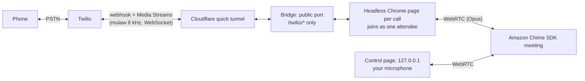

# Phone bridge proof of concept

A phone leg into an Amazon Chime SDK WebRTC meeting through Twilio, with no Amazon Chime SDK PSTN Audio. It exists to measure what SPEC-TELEPHONY FR10 and SPEC-ASSISTANT-MEETINGS FR13a leave open: how a server process joins a meeting as an attendee, and what latency a caller hears.

**This is a proof of concept, not the feature.** It runs on one computer, keeps its state in memory, starts its own meeting rather than a conversation's, and its control page is English only. Nothing here is deployed by CDK or read by the backend.

## How it works



- **Dial-in:** calling the Twilio number joins the meeting that is running. With no meeting, the caller hears that and the call ends.
- **Dial-out:** the control page calls a number from the Twilio number, and the callee joins the meeting on answer.
- **Each call** is a headless Chrome page that joins as its own attendee (`phone-in-1234-...` or `phone-out-...`). The caller's audio becomes that attendee's microphone, and the meeting's mixed audio, which leaves out the caller's own voice, is sent back to the phone.
- **Join time is hidden where it can be:** the attendee starts joining the moment a call arrives or is placed, during the greeting or the ringing.
- **Late audio is dropped, not queued:** more than 200 ms of caller audio waiting is cut back to 60 ms, and the control page shows how much was dropped.

## Security

- Every Twilio webhook is checked against Twilio's signature, and a media stream must present the per-call token the signed webhook handed out.
- Only the public port is tunneled. The control page, its API and the audio sockets listen on `127.0.0.1` on a separate port, and the API requires an `X-Poc` header and a loopback `Host`, so another site open in the browser cannot place calls through it.
- **Anyone who calls the number while a meeting runs joins it.** That is the agreed shortcut for this proof of concept (no PIN).
- Phone numbers are masked in logs and on the page, including a number a Twilio error message names. The Twilio secret's values are never logged.

## Run it

Needs Node 22 or later, Google Chrome, `cloudflared` (`winget install Cloudflare.cloudflared`), an AWS profile allowed to call `chime:CreateMeeting`, `CreateAttendee`, `DeleteAttendee` and `DeleteMeeting` and to read the Twilio secret, and a number on the Twilio account.

```
cd poc/phone-bridge
npm install
copy config.example.json config.json    # then set twilioSecretId and twilioNumber
npm start
```

Open `http://127.0.0.1:8787/`, choose **Start meeting**, and allow the microphone. Call the number shown, or enter a number and choose **Call**.

**The Twilio number's voice webhook and status callback are repointed at the tunnel while the bridge runs.** The status callback reports an inbound caller who hangs up before the call's audio stream opens, and a call that opens no stream within 20 seconds is ended, so no phone attendee is left in the meeting. Its previous settings are saved to `.state/original-webhook.json` first and restored on Ctrl+C. After a crash, `npm run restore` puts them back.

`npm test` runs the mu-law codec tests.

## What to measure

The control page shows, per call, when the attendee joined and when Twilio's stream started, measured from when the call arrived or was placed. Mouth-to-ear latency needs a person at each end: tap the phone's microphone and count the delay heard in the meeting, then the reverse.
